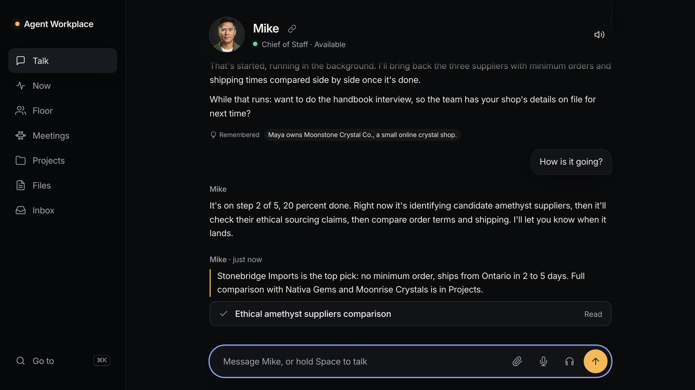
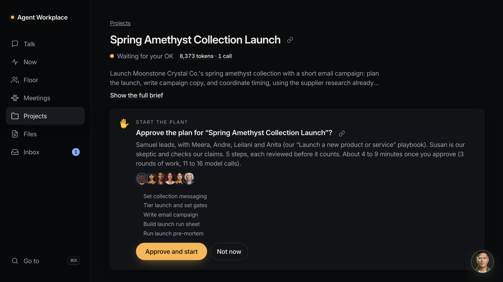
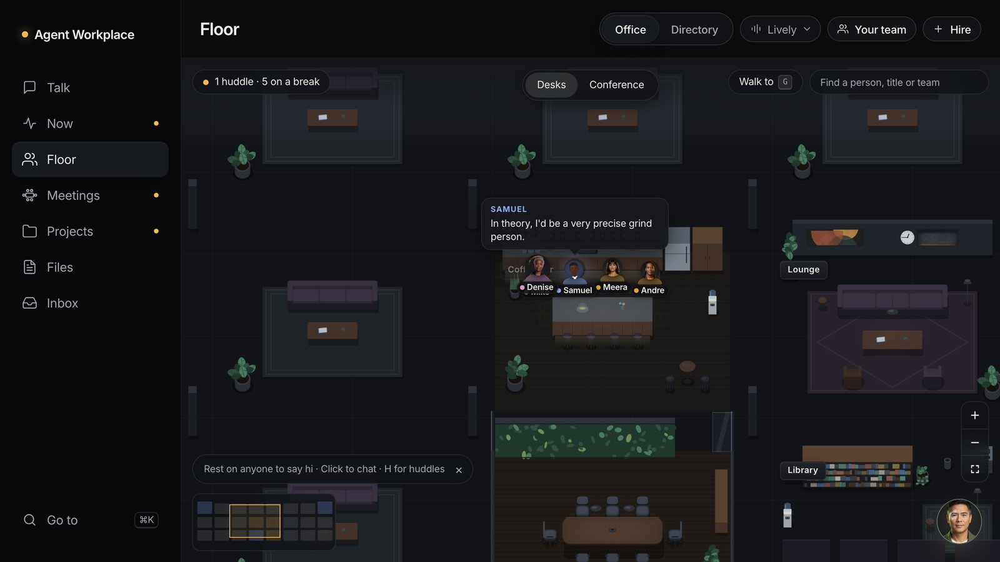
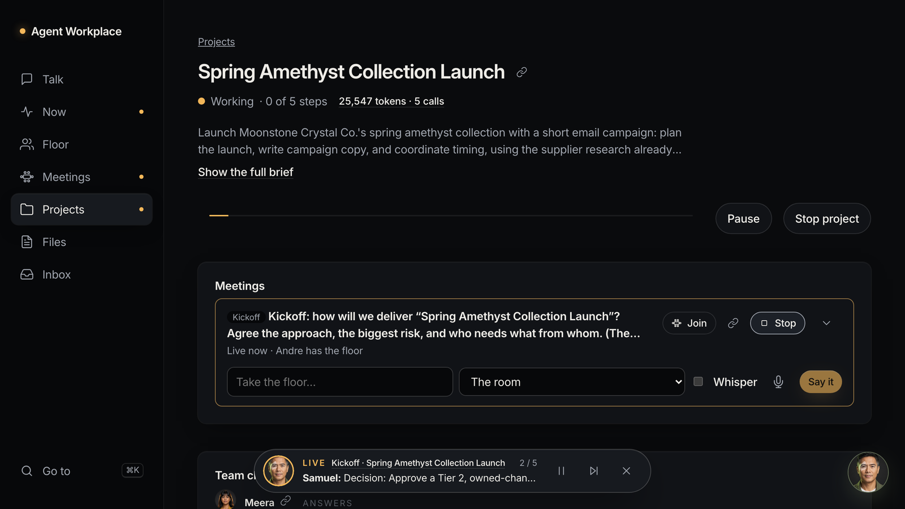
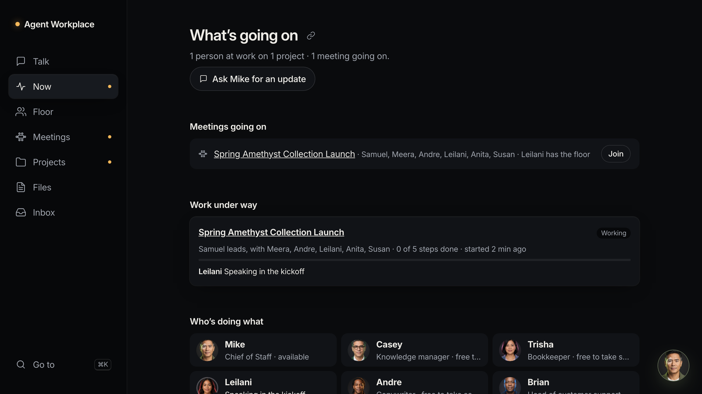

# Agent Workplace

**Hire an AI team. Watch it work.**

Agent Workplace is an AI office for small businesses. You talk to one Chief of Staff. Your Chief of Staff runs a team
of AI coworkers who meet, plan and deliver real work: research, documents, spreadsheets, images, short videos and
emails. Nothing leaves the office until you approve it.

<p align="center">
  
</p>

## What it does

| | |
|---|---|
|  | **Staff a project in one sentence.** Say "put together a team to launch our spring collection". Your Chief of Staff picks the coworkers, drafts a plan and waits for your approval. The team then works step by step and reviews each other's work. |
|  | **Watch the office at work.** Coworkers sit at desks, walk to huddles and talk about real work. Click anyone to talk with them in place. |
|  | **Put the team in a room.** Call a meeting in a sentence. Each coworker speaks in their own voice, your Chief of Staff moderates, and the work they agree on starts when the meeting ends. |
|  | **See everything on Now.** Every job and project in progress, its step and who is on it. Change direction or stop work at any time. |

More:
- **Voice:** talk and listen in each coworker's own voice. Hold Space or the mic to speak. Interrupt at any time.
- **Background work:** hand off research and keep talking. Ask "how is it going?" for a status read from the live job.
- **Files:** images, short videos, and documents that download as Word, PowerPoint or Excel. Edit images and documents in place.
- **Approvals:** emails wait for your yes, go out once, and get a receipt. One control stops every job and project.
- **Your office:** sign in with Google, invite your team, and keep memory, files and projects apart from every other
  office.
- **Honest AI:** every coworker is labeled as AI and says so when asked.

## Run it

You need Node 22 or later and pnpm 10.

```bash
pnpm install
```

```bash
cp apps/worker/.dev.vars.example apps/worker/.dev.vars
```

Add at least one chat key to `apps/worker/.dev.vars`: `ANTHROPIC_API_KEY`, `OPENAI_API_KEY`, `XAI_API_KEY` or
`GEMINI_API_KEY`. An OpenAI or xAI key also turns on voices and images.

```bash
pnpm dev
```

Open http://localhost:5173 and press **Enter the office**.

- No keys: `pnpm dev --mock` runs with placeholder answers.
- Local models only: `pnpm dev --local` uses Ollama.
- Keys stay on the server. They never reach the browser or the logs.

Checks: `pnpm typecheck`, `pnpm test` (Vitest) and `pnpm e2e` (Playwright).

## Make it yours

The product name lives in one place: `BRAND` in `packages/protocol/src/brand.ts`. Change `name`, `tagline` and
`description` there, and the app, the home page, the page titles and the agents' own words follow.

## Deploy

Agent Workplace runs on Cloudflare: one Worker with Durable Objects, D1 and R2, serving the web app as static assets.
`docs/DEPLOY.md` has the steps and `scripts/deploy-preflight.mjs` checks a build before each deploy.

## How it is built

| Path | What it is |
|---|---|
| `apps/web` | The web app: Preact and signals, built with Vite. |
| `apps/worker` | The Cloudflare Worker: routes, Durable Objects (the office, projects), agents and tools. |
| `packages/agent-loop` | The tool-calling loop every agent turn runs on. |
| `packages/models` | One interface over Anthropic, OpenAI, xAI, Gemini, OpenAI-compatible servers and Ollama. |
| `packages/protocol` | Types, routes and frames shared by the web app and the worker. |
| `packages/office`, `packages/avatar`, `packages/audio` | The office floor, the faces and lip sync, and voice playback. |
| `catalog/` | The coworkers, Chiefs of Staff, skills and team recipes. |

Read more in `docs/`: `ARCHITECTURE.md`, `PRODUCT.md`, `EXPERIENCE.md`, and the feature notes in `docs/dev/`.
