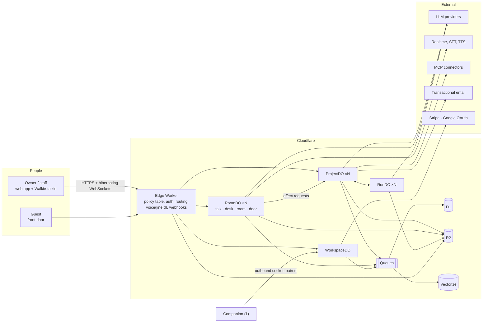
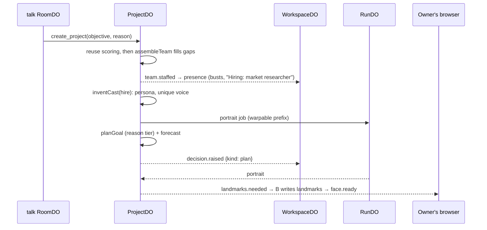
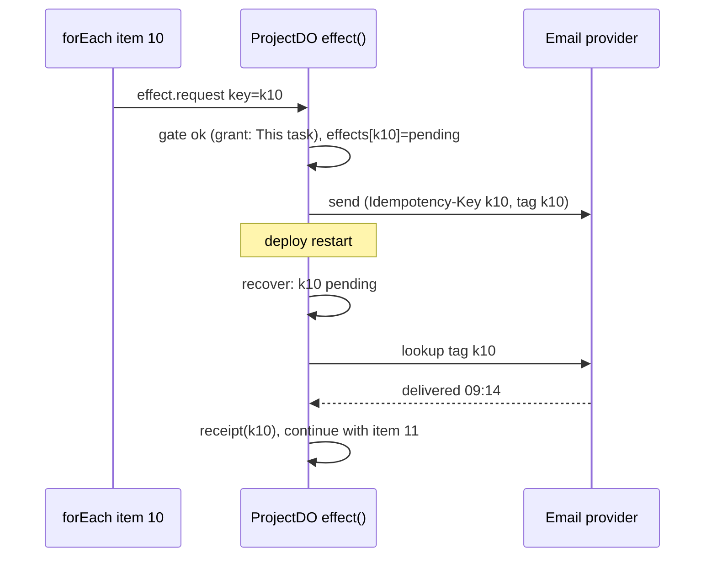

# Headcount: Architecture

> **Status.** Technical architecture, v1.0, 28 September 2026. It makes `docs/PRODUCT.md` (v1.0, binding) buildable. Where the two disagree, PRODUCT.md wins; places where I think PRODUCT.md has a real problem are listed in §19, not silently changed.
>
> **Vocabulary** follows PRODUCT.md §4 exactly. Retired terms (§4.4) appear only as provenance, such as a file name.
>
> **Tags.** **[BB]** biz-bot · **[OC]** oncloudnine · **[PG]** personagram-ai · **[NEW]** white space none of them covers. Paths are relative to `reference/`. *Tn* is tension *n* in `docs/research/capability-matrix.md` §5; *S1–S5* are the Phase 0 spikes (PRODUCT §11.1). Phases: **P0**, **M** (MVP), **1** (v1), **2** (v2).

---

## 0. The system on one page

Headcount is **four Durable Object classes around one append-only ledger**, with a thin edge Worker in front and a framework-free face-and-audio engine in the browser.

- **`WorkspaceDO`**: the tenant. Members, vault, billing, quotas, front-door tokens, workspace triggers, the kill switch, presence fan-out and the workspace ledger stream.
- **`ProjectDO`** (one per project, including Everyday): the plan engine, and the **only code that ever executes an external effect**.
- **`RoomDO`**: live conversation. The Chief of Staff's talk thread, 1:1 desks, project rooms and front-door sessions; the floor arbiter and every provider socket.
- **`RunDO`**: one long job (render, video, document, app build, long agent run, Companion step), checkpointed, at most two attempts.

Coworkers are **rows plus loop configurations**: a hire costs one D1 row and one presence event. Everything the owner sees (faces, Inbox, Brief, replay, cost, "why") is a **projection** of ledger streams, so a face cannot look busy when nothing is running, and a replay moves the faces exactly as they moved.

### 0.1 Tension resolution index

| # | Tension | Decision | § |
|---|---|---|---|
| T1 | UI stack | TypeScript + Vite; Preact + Signals shell; avatar and audio engines framework-free | 16 |
| T2 | Where agents run | Workers + four DO classes; Companion optional and paired; never the tab | 2 |
| T3 | System of record | D1, R2, DO SQLite, Vectorize; IndexedDB is cache; BB protocol-2 for Companion sync | 2.4, 16.4 |
| T4 | Provider layers | One `models` package: OC registry shape, BB adapters, four dialects, rates, Mock | 4, 12 |
| T5 | Voice stack | Server-mediated `RoomDO`; AudioWorklet uplink; WebRTC only for OpenAI Live (v1) with server sideband | 8 |
| T6 | One brain or two | Voice seam: realtime or cascade front, one server brain | 5, 8 |
| T7 | Meeting speech | Each coworker's own text turn, then per-line TTS with timestamps | 7, 8 |
| T8 | Voiced or on demand | Text-native rooms; voiced only for an audio observer; `voice(lineId)` idempotent | 7.6 |
| T9 | Meeting model | Real per-coworker turns, Chief of Staff moderates; director mode only for Brief and Review scripts | 7.5 |
| T10 | Avatar renderer | PG strip-warp at Hero and Tile tiers, shared scheduler, Token stills; `sample(now)` the only coupling | 9 |
| T11 | Lip-sync timing | PG fusion driver in OC `captureTap` order; timestamped TTS revived | 9.3 |
| T12 | Orchestration layers | Route table → plan DAG → ledger jobs and `RunDO`; Activity rail and Inbox as views | 5, 6 |
| T13 | Memory | D1 graph + Vectorize + hybrid recall + Markdown Handbook + reflection as a decision | 11 |
| T14 | Identity | PG OAuth + PKCE, workspaces and roles, stable ids, OC policy table | 14 |
| T15 | Tool governance | Offer → grant → policy → effect → audit; exactly-once effects; taint on MCP, search, delegates | 6.6, 13, 14 |
| T16 | Build and test | Vite, vitest, PG Wrangler harness, BB Mock and `verify:live`, OC preflight and fake media, PG guards | 17 |
| T17 | MCP client | OC core + BB version negotiation + OAuth 2.1/PKCE + vault; stdio and relay in the Companion | 13 |
| T18 | Time and triggers | Owner timezone on the workspace; one pure `triggers` package on DO alarms | 6.8 |

---

## 1. Principles and system context

### 1.1 Principles

1. **The ledger is the product.** Every route, call, hand-off, spoken line, verdict, raised hand, reservation and receipt is an event; UI state is a projection; "Why did we…?" is a query. BB derived its team graph from the log (`biz-bot/public/js/graph.js`); Headcount makes that the storage model.
2. **One writer per stream, one writer for effects.** Each stream has one DO assigning its `seq`. External effects execute only in `ProjectDO.effect()`; rooms, desks, RunDOs and the Companion *request* them. [NEW]
3. **Objects scale with work, not staff.** A coworker is a row plus a loop configuration [OC `runAgentLoop` seams, `oncloudnine/server/lib/agentRuntime.ts:1183`].
4. **The server owns brains, keys and sockets.** No key, system prompt or provider socket reaches the browser [PG `personagram-ai/src/worker/providers.ts:386-415`].
5. **Text-native work, voice on demand** (T8).
6. **The frequency rule.** Nothing faster than a sentence is persisted: deltas, audio frames, levels, visemes and presence frames are ephemeral.
7. **Engines are pure packages; hosts inject the world.** Plan engine, triggers, FloorProjector, recall and the route table take injected `fetch`, storage, clock and ids, replacing BB's global patching inside the DO (`biz-bot/worker/src/runtime/project-runtime.js:29,54`).
8. **Honesty by mechanism.** No presence frame without `cause.seq`; no "sent" without a receipt id; no completion without linked evidence; no unknown cost shown as zero; no control shown that cannot work [OC product rules].
9. **Mock-first.** Every provider, modality and connector has a deterministic Mock [BB `biz-bot/worker/src/providers/mock.js`].
10. **Stable ids, never names** (BB's name keys and `repairReferences`, `biz-bot/public/js/store.js:249-268`, are the anti-pattern).

### 1.2 System context



---

## 2. Runtime topology

### 2.1 The edge Worker

One Worker serves the app and the API [BB `biz-bot/wrangler.jsonc`]. It holds no state:

- **Router and perimeter**: Hono with the **OC policy table** as middleware. Each route declares `{method, auth: session|capability|guest|public, role, rateClass, bodyCap}`; an unlisted route is POST-only, session-gated and spend-classed [OC `oncloudnine/server/lib/security.ts:51,648`]. This replaces PG's 1,226-line regex router.
- **Auth**: Google OAuth + PKCE, hashed 30-day sessions, origin checks, bounded bodies, error redaction [PG `personagram-ai/src/worker/security.ts:48-108,159-278`].
- **Stateless services**: `voice(lineId)` (§7.6), signed R2 URLs, OAuth callbacks, Stripe and connector webhooks, front-door entry.
- **Routing**: JS RPC to DO stubs; WebSocket upgrades forwarded to the owning DO with the member id and role in a signed header.

### 2.2 The four Durable Object classes

| Class | Key | Owns | Why a DO | From |
|---|---|---|---|---|
| `WorkspaceDO` | `ws:<id>` | Members, roles, timezone, **vault**, billing, quotas, front-door raw tokens, workspace triggers (Brief, Review, reflection), interruption budget, kill switch, `project_status` for the routing brief, spend **allowances**, presence merge and fan-out, the `ws:` stream, Companion pairing | Serialises money, quota and secret mutations; the only place raw tokens and decrypted keys live; one hibernating socket per client | [PG] `CreatorDO`, `personagram-ai/src/worker/creator.ts` |
| `ProjectDO` | `p:<id>`; Everyday is `p:everyday:<ws>` | Plan engine, runs, steps, leased jobs, decisions, **effects and receipts**, reservations, outbox, drafts, project triggers and context, the `p:` stream | Single writer for plan and effects; a scheduler that survives laptop sleep and deploys through alarms | [BB] `worker/src/runtime/project-runtime.js`, `public/js/runtime/ledger.js`, rebuilt per project |
| `RoomDO` | `rm:<id>` | One live conversation of kind `talk` (owner ↔ Chief of Staff), `desk` (owner ↔ one coworker), `project` (a project's Room and meetings) or `door` (a guest session): participants, observers, floor arbiter, generations, rolling summary, provider sockets, the room stream | Server-mediated voice needs one object holding the client socket and every provider socket (T5); floor control needs one serialiser | [PG] `ConversationDO`, `personagram-ai/src/worker/conversation.ts` |
| `RunDO` | `run:<jobId>` | One long job: input ref, fence, attempts, deadline, checkpoint, progress | Minutes of streaming must not block a ProjectDO's input gate (PG builds hit Worker CPU limits) | [PG] `BuilderDO`, `personagram-ai/src/worker/builder.ts` |

**One class, four room kinds.** Only `project` rooms are Rooms in owner vocabulary. `talk`, `desk` and `door` reuse the class because they need the same machinery: client socket, provider sockets, barge-in, generations and a stream. The Chief of Staff's text *and* voice turns run in its talk room, which serialises them and keeps the brain beside the voice front.

**No `AgentDO`.** A coworker's turn runs inside whichever object hosts the conversation. An `AgentDO` would add a hop per turn, multiply objects by headcount and create a second writer for the same conversation. Per-coworker facts (voice, face, track record, autonomy, memory scope) are D1 rows.

### 2.3 Ledger streams

| Stream | Writer | Contents |
|---|---|---|
| `ws:<ws>` | WorkspaceDO | `route`, asks outside projects, Briefs, triggers fired, standing grants, autonomy changes, promotions and demotions, kill switch, door and member changes, `system` changes |
| `ws:<ws>/talk:<member>` | RoomDO talk | Owner and Chief of Staff `message`, `speech.line` |
| `ws:<ws>/desk:<member>:<coworker>` | RoomDO desk | 1:1 turns, each tagged with the project it concerns |
| `p:<project>` | ProjectDO | `plan`, `plan.diff`, `step`, `job`, `verdict`, `decision`, `effect`, `receipt`, `reservation`, `deliverable`, `context`, `team`, `handoff`, `ask` |
| `p:<project>/room:<room>` | RoomDO project | `message`, `whisper`, `speech.line`, `floor`, meeting phases, minutes |
| `ws:<ws>/door:<door>:<session>` | RoomDO door | Guest turns (only with consent), escalations |

`seq` is gap-free, assigned inside the writer's storage transaction; every stream rolls up to D1 through an outbox (§2.5).

### 2.4 Storage tiers (T3)

| Tier | Holds |
|---|---|
| **DO SQLite** | Hot state: last 50,000 events or 30 days per stream, jobs, leases, effects, reservations, drafts, floor state, 24 h idempotency records, vault ciphertext [BB `worker/src/runtime/storage.js`] |
| **D1** | Records and the full `ledger_events` roll-up, for cross-project queries: Inbox, "Why did we…?", billing, audit [PG schema, `personagram-ai/migrations/*.sql`] |
| **R2** | Artifacts, audio and alignment, faces and LOD tiles, captures, Handbook Markdown, cold ledger archives, app builds, audit exports. Events carry `{r2Key, bytes, mime, sha256}` pointers, never blobs |
| **Vectorize** | One index per embedding model and dimension, namespaced per workspace [OC `VectorIndex.ts:50-126` dimension safety] |
| **Queues** | `rollup`, `extract`, `embed`, `notify`, `meter`, `gc` |
| **Browser** | IndexedDB and Cache Storage as caches only |

The MVP uses one D1 database with `ws_id` on every row; `workspaces.d1_shard` exists from day one so a workspace can move shards when a database passes 5 GB or write p95 exceeds 50 ms.

### 2.5 Queues, alarms and cron

| Mechanism | Use |
|---|---|
| **Outbox → `rollup`** | Writers insert an outbox row in the same transaction as each event; alarms drain batches of 500; the consumer does `INSERT OR IGNORE` on `(stream, seq)` [BB ledger outbox] |
| **`extract`, `embed`** | Memory extraction and embeddings (§11.4) |
| **`notify`** | Push, email and SMS, only after the judge and interruption budget allow (§6.8) |
| **`meter`** | Priced usage → `usage_events` → Stripe meter |
| **`gc`** | Retention (captures 24 h, guest transcripts 90 d, replays by tier), with R2 lifecycle rules as backstop |
| **DO alarms** | ProjectDO 30 s tick while work is in flight; triggers; the 07:10 Brief; room expiry; RunDO job loop. A `timers` table multiplexes due times onto the one alarm [PG `BuilderDO`, BB `worker/src/runtime/triggers.js`] |
| **Cron** | Nightly model discovery, weekly rate diff, hourly light canaries, 03:00 UTC retention sweep. Workspace schedules never use cron (T18) |

### 2.6 The Companion (v1)

BB's bridge (`biz-bot/bridge/src/*`) as an optional desktop helper, with three changes:

1. **Paired through the workspace.** A QR code from Settings is exchanged for a device credential held by the WorkspaceDO; the Companion then keeps an **outbound** socket to it. No inbound port, and no raw token in a URL (BB used `#/pair?url&token`).
2. **Jobs, not RPC.** A Companion-pinned step is a `RunDO` job with executor `companion:<device>`. If the device goes offline the lease lapses and the step raises a decision; **work never moves silently from local to cloud** [BB `agent.js:19` `resolveModel`].
3. **Honest capabilities.** It reports local models, CLIs, exec, fs, browser and stdio MCP with plain-language limits [BB `runtime/runtime.js`]; the UI hides what is absent.

It keeps BB's sandbox chain (Docker `--network none --cap-drop ALL --read-only` → seatbelt profile denying `~/.ssh`, `~/.aws`, keychains → confined shell; `bridge/src/exec.js`, `sandbox/*`), realpath-confined files, the Playwright browser with password-field pause, CLI adapters and the MCP relay (§12.4).

### 2.7 Scaling N rooms × N coworkers

Load model (Business): 10 members, 60 coworkers, 15 running projects, 3 live meetings, 2 audio observers, 1 owner on voice.

| Path | Mechanism | Bound |
|---|---|---|
| Model calls | Concurrency 3 per project [BB `executePlan`]; allowances cap spend | ≤45 streams, spread over 15 ProjectDOs |
| Meetings | The floor serialises speakers; one look-ahead turn when paced | ≤2 streams per room |
| Observers | WebSocket Hibernation with tags per member; idle sockets cost nothing | Tens per room |
| Provider sockets | Outbound sockets block hibernation, so they open only while the owner's mic is live and close 10 s after [PRODUCT S2] | ≤1 per member |
| Presence | Each ProjectDO and RoomDO reduces its stream to **claims** and pushes them to `WorkspaceDO.presence(batch)`, coalesced to ≤4/s per object; the WorkspaceDO merges per coworker and broadcasts | Sub-10 ms per batch |
| Placement | Objects are created with the workspace's `locationHint`, set at sign-up from the owner's region | Regional voice round trips |

**Contingency** (PRODUCT §13): if WorkspaceDO socket-send p95 exceeds 200 ms for an hour, fan-out moves to a dedicated presence object holding only client sockets and the merge table, behind a flag from day one (§19, Q7).

---

## 3. Unified event protocol

One vocabulary flows from provider adapters through the loop and the objects to the browser and the ledger. It starts from BB's normalised provider events (`biz-bot/worker/src/index.js:97,204,214`) and OC's turn frames (`oncloudnine/server/api/chat.ts`), adds PG's session events (`personagram-ai/src/worker/conversation.ts`), and namespaces all of it. [BB + OC + PG → NEW]

### 3.1 Envelope

```json
{ "v": 1, "stream": "p:prj_nw01/room:rm_nw01", "seq": 1842, "id": "evt_01J9ZK4Q2M",
  "hlc": "2026-09-28T16:02:11.120Z#0003", "ws": "ws_brightline", "project": "prj_nw01",
  "room": "rm_nw01", "actor": "cw_walt", "run": "run_7c", "step": "s3", "type": "message",
  "data": { "text": "Brand love doesn't move their Q2 number. Show me sell-through.", "phase": "round 1/2 · opening" },
  "cause": { "stream": "p:prj_nw01/room:rm_nw01", "seq": 1839 } }
```

- `actor` is a coworker id (`cw_…`), the Chief of Staff (`cw_chief_…`), `owner:<user>`, `guest:<session>` or `system`.
- `cause` names the event that produced this one; presence, audit and "Why did we…?" follow these chains.
- Payloads over 8 KB move to R2 as `data.blob`.
- **Ephemeral frames** share the envelope but have no `seq`; they carry `after` (the last persisted `seq`) and, for audio, `gen`.

### 3.2 Frame vocabulary

| Type | Stored | Key fields | Notes |
|---|---|---|---|
| `text`, `reasoning` | no | `delta` / `summary` | Durable form is `message`; raw reasoning never shown |
| `tool` | start and end | `callId, name, status, summary, durationMs` | `summary` from the route table copy [OC] |
| `citation`, `image` | yes | `url, title, retrievedAt` / `blob` | Citations count as evidence |
| `usage` | yes | `provider, model, tokens, audioS, usd, costStatus` | Unknown cost is `unavailable`, never 0 [BB `ledger.js:55`] |
| `done`, `error` | yes | `finish`, `code, message` | A turn that only started a job is a valid `done` [OC] |
| `message`, `whisper` | yes | `text, visibility, contextItems[]` / `to, policy` | One per completed sentence-turn |
| `ask`, `handoff` | yes | `from, to, task, depth` / `note, round` | [BB `ask_bot`, `message_bot`] |
| `route`, `route.model` | yes | `route, reason, executor` / `chosen, skipped[]` | Every Chief of Staff turn emits `route` |
| `plan`, `plan.diff`, `step`, `job` | yes | `dag` / `patch, staleApprovals[]` / `status` / `attempt, fence` | |
| `verdict` | yes | `{verdict, findings[], evidenceChecked[]}` | §6.2 |
| `decision` | yes | `raised\|resolved, kind, payload, allowedGrants[], via` | Approvals are decisions of kind `approval` |
| `effect`, `receipt`, `reservation`, `deliverable`, `context` | yes | `key, intent` / `result, undo` / `scope, usd` / `lineage` / `ContextItem` | |
| `speech.start`, `speech.end`, `speech.cancel` | no | `lineId, actor, gen` | Drive speaking state, the mixer and barge-in |
| `speech.line` | yes, once | `lineId, text, audioKey, alignmentKey, durationMs, voice, truncatedAtMs?` | [PG group lines] |
| `speech.align` | no | `chars[], startsMs[], endsMs[]` | Live alignment; stored copy is `alignmentKey` |
| `speech.viseme` | no | `ids[], timesMs[]` | Reserved for providers with native visemes; otherwise derived in the browser (T11) |
| `floor` | grants only | `claim\|grant\|yield, priority, gen, next` | §7.4 |
| `presence` | no | `actor, state, label, cause, dwellMs` | Recomputable (§3.5) |

### 3.3 Subscriptions and replay

A tab holds at most three hibernating sockets (WorkspaceDO always; the ProjectDO and RoomDO it is viewing) and subscribes with cursors: `{"op":"sub","streams":{"p:prj_nw01":1830}}`. The writer replays from DO SQLite inside the hot window; otherwise it answers `cold` and the client pages `GET /api/streams/{stream}?since=N` from D1 [BB `/runner/events?since=`]. Large streams offer a **snapshot at seq N** (plan, team, open decisions). A gap in `seq` triggers a ranged fetch before later events apply. SSE is the fallback where WebSockets are blocked.

### 3.4 Ordering and idempotency

Within a stream, `seq` gives total order. Across streams, a hybrid logical clock (`hlc`) that advances on local time and on every observed `cause` orders merged views (Activity rail, replay, audit).

| Operation | Idempotency key |
|---|---|
| Client command | `opId` (client ULID); the DO stores `opId → result` for 24 h |
| Job enqueue | `jobId = hash(runId, stepId, phase, itemKey)` [BB `ledger.enqueue`] |
| External effect | `effectKey`, e.g. `hash(projectId, recipient, templateHash)` (§6.6) |
| Voiced line | `lineId` |
| Roll-up, webhooks | `(stream, seq)`; provider event id [PG `stripe_events`] |

### 3.5 Presence: the FloorProjector

`FloorProjector` is a pure package: `reduce(state, event)` and `frames(state, now)`. The same code runs in every ProjectDO and RoomDO (producing **claims**), in the WorkspaceDO (merging claims per coworker), in the replay player and in CI. [NEW, from BB `graph.js` `onActivity`]

```json
{ "type": "presence", "actor": "cw_pax", "state": "working", "label": "Reading 14 outdoor-retail reports",
  "cause": { "stream": "p:prj_nw01", "seq": 1204 }, "dwellMs": 600 }
```

- **Merge**: a coworker busy in several projects shows its highest-priority claim: speaking > raised hand > blocked > listening > handing off > thinking > working > idle.
- **Dwell**: a state holds for its minimum (thinking 600 ms, handing off 1.2 s, delivered 2 s) before it can change.
- **Freshness**: a frame is emitted only from a cause ≤2 s old. Sustained states are backed by a live **lease**: "working" holds while the step's job lease is alive; if it lapses, `job.lease_expired` moves the face to blocked or idle (§19, Q2).
- **Night Shift**: a job that finishes while no member socket is open marks the desk lamp lit until a member next opens the Floor.

---

## 4. Agent runtime

### 4.1 One loop, four dialects

`packages/agent-loop` merges OC `runAgentLoop` (`oncloudnine/server/lib/agentRuntime.ts:643-1183`) with BB `runBotTurn` (`biz-bot/public/js/agent.js:93`). [OC + BB]

- **Neutral transcript** `user | assistant{toolCalls} | tool{outcomes}` over four dialects: Anthropic `tool_use`, Responses `function_call` (OpenAI, xAI), compatible `tool_calls`, and Gemini `functionCall` [NEW]. Unparseable arguments return to the model as `argsError` [OC].
- **Parallel tool calls**; **no third identical failure** [BB]; **step ceiling** 8 (hard 24) then one tool-free wrap-up turn [OC].
- **Completion enforcement**: done only when `finish = stop` and output is non-empty [BB `providers/responses.js:47,82`]. Errors carry `partial` output; drafts checkpoint at most once a second [BB `turn-record.js`].
- **Hooks**: `beforeModel` reserves budget and a concurrency slot, `afterModel` settles priced usage [BB `headless-engine.js:122-142`]; `interceptTool` routes a tool to a job, an effect request or a room action [OC].
- **One `AbortSignal`** carries cancel, deadline [OC `setProviderDeadline`, `server/lib/http.ts:75`] and budget, so a cap or **Everyone stop** reaches the provider fetch.
- **Output envelope**: results over 20,000 characters are cut for the model; over 200,000 they become valid JSON `{truncated, originalCharacters, preview}` [BB `tool-output.js`].

### 4.2 A coworker at runtime

```json
{ "actor": "cw_lena", "role": "co_owner", "phase": "work", "persona": "cw_lena@v7", "tier": "reason",
  "tools": ["read_artifact", "web_search", "doc.render", "request_user_input", "propose_change"],
  "memoryScopes": ["workspace", "client:northwind", "project:prj_nw01", "agent:cw_lena"],
  "budget": { "perTurnUsd": 0.25 }, "host": "ProjectDO" }
```

The **offered** tools are the intersection of the persona's tools, the project's connectors, the host's capability and the member's role, and are **re-checked at dispatch**; PG proves this with stubs that emit forbidden calls (`conversation.ts:414-421`, `tests/integration.test.ts:1087`). [PG]

### 4.3 Prompt layering

Most stable first, so providers cache the prefix (Anthropic `cache_control` after layer 3, OpenAI prefix caching, Gemini context caching).

| # | Layer | Source | Budget |
|---|---|---|---|
| 0 | Platform rules: data-not-instructions, no action claims without a receipt id, evidence contract, disclosure, uncertainty marker | [PG `domain.ts:168-187`, BB `EXTERNAL_RULE`, `UNCERTAINTY_RULE`] | fixed |
| 1 | House style and standing rules from `company.md` (override everything below) | [BB `agent.js:43`] | 1,500 tokens |
| 2 | Persona: 9 PG identity fields incl. `handoff`; instructions as lines | [PG `domain.ts:5-15`] | profile 6k chars |
| 3 | Role and phase directive (work, review, sceptic, framing, debate…) | [BB `discussionDirective`] | 800 tokens |
| 4 | Project brief: objective, criteria with proof kinds, autonomy, headroom, ≤20 decisions, ≤25 artifacts | [BB `projects.js:24`] | 3,000 tokens |
| 5 | Context cards in scope, each with `scope, source, asOf` | [OC `ContextCard`] | files 20k chars |
| 6 | Memory recall: ≤4 items, ≤1,200 chars, labelled by retriever | [OC `MemoryRecall.ts`] | facts 7k, summaries 3k |
| 7 | Perspective projection: ≤6k tokens plus a rolling summary | [BB `transcriptToMessages`, PG] | recent 6k |

Layers 4–7 are framed as *reference data, not instructions* [PG]. The chips used in layers 5–6 ride on the turn's `message.contextItems`.

### 4.4 Guardrails

- **Taint.** MCP output, web search, fetched pages, delegate summaries, captures and guest input are wrapped `<external source>` after OTP and token-link stripping [BB `grants.js:86`, extended to the sources BB missed]. A tainted turn executes no effect or `system` change without approval.
- **Honesty filter.** A post-turn checker finds completed-action claims ("sent", "booked", "paid", "published"). Without an inline receipt reference it forces one corrective retry, then replaces the sentence with "Not done yet: …" and logs `honesty.blocked`. Unsourced numbers get the **unverified** badge. [PG prompt rule → NEW mechanism]
- **Secret refusal** before any approval or storage [BB `looksLikeSecret`]; **`SingleFlight`** on ambient calls [OC `CaptureSupport.ts:123-153`].

### 4.5 Structured output

Native schemas where supported (OpenAI `json_schema`, Anthropic output format or forced tool, Gemini `responseSchema`), with **enum-constrained ids** so the model can only pick real coworkers, tools and models [BB `assemble.js:51`, `plan.js:85`]. A lenient reader takes the richest JSON candidate [OC `lenientJson.ts:122`, PG `parseObject`], a validator checks it, one strict retry follows. **Verdicts are JSON**, never first-line `APPROVED`: `{verdict: approve|changes|block, findings:[{severity, criterionId, text}], evidenceChecked:[{criterionId, proofRef, ok}]}`.

### 4.6 Where loops run

| Host | Loops | Tools |
|---|---|---|
| RoomDO talk | Chief of Staff, text and voice | Lead tools (§5.3), read tools; effects via Everyday |
| RoomDO desk | 1:1 coworker turns | Persona tools; effects requested from the relevant ProjectDO; scope only via `propose_change` |
| RoomDO project | Meeting and @mention turns, moderator | Read tools, `ask`, `raise_hand`, `propose_change`; no effects |
| RoomDO door | Guest conversation | Door knowledge and one tool: *request a callback* |
| ProjectDO | Step work, review, finisher, QA, staffing, planning | Persona tools; effects in-process |
| RunDO | Long agent runs, builds, renders | Declared by the job; effects by RPC |
| Companion (1) | CLI coworkers, local models | Through the MCP relay |

---

## 5. Lead orchestrator: the Chief of Staff

### 5.1 Rebuilt every turn

The Chief of Staff is a persona row of kind `chief` (name, face, voice, model policy) that cannot be deleted. Its prompt and tools are rebuilt every turn by one function, `buildLeadTurn(workspace, member, channel)`, for text, voice and meetings alike [BB `bizbot.js:9,27`]. "One brain" is this function plus one memory, run wherever the conversation is.

The **routing brief** is one RPC to the WorkspaceDO's `project_status` table, which every ProjectDO updates when its plan, decisions, team or budget change. It lists:

- the roster **including project members**, with role, skills, current step and availability (fixing `bizbot.js:29`; a test with members in three projects fails if any is missing);
- each project's `projectSummary` status and verb-first next action [BB `projects.js:42`, `home-graph.js:80`];
- open decisions, budget headroom, and context cards dropped on the Chief of Staff since its last turn.

### 5.2 Seven routes as data

Each lead tool maps to a row of the **route table**, generalised from OC's routing and summary tables (`orchestrator.ts:77,118`). CI fails if a lead tool has no row, a row has no copy, or a row has no executor (the OC bug at `orchestrator.ts:496-497`). [OC + NEW]

| Route | Lead tool | costClass | approval | executor | runningText / finishedText |
|---|---|---|---|---|---|
| `answer` | none or read tools | low | no | inline, talk room | — |
| `ask` | `ask_coworker` | low | no | inline consult, depth ≤2 [BB `ask_bot`] | "Asking Marcus about Harbor's retention" / "Marcus answered" |
| `delegate` | `delegate` | med | per autonomy | Everyday single-step run | "Handing the renewal summary to Juno" / "Juno delivered it" |
| `project` | `create_project` | high | plan approval | new ProjectDO: Staff it → plan → decision | "Staffing Northwind pitch" / "Northwind is staffed; the plan needs you" |
| `steer` | `post_to_project`, `steer_project` | low | if scope, criteria, budget or deadline change | target ProjectDO | "Pausing Harbor renewal" / "Paused" |
| `meeting` | `convene_meeting` | med | no | project RoomDO | "Convening a pricing meeting" / "Minutes attached" |
| `escalate` | `escalate`, `brief_me` | low | no | WorkspaceDO urgency ladder | "Flagging this for you" |

Every lead tool has a required `reason` (≤140 characters); the talk room appends `route {route, reason, executor, targets[]}` to the `ws:` stream.

**Voice seam rule.** If the path needs the reasoning tier or more than two tool calls, the Chief of Staff answers in one sentence ("I started it"), and the work runs as an Everyday step on the reason tier; the result is delivered once to the thread that asked [OC deliver-to-origin].

### 5.3 Lead tools

| Tool | Behaviour | Ph |
|---|---|---|
| `create_project{objective, deadline?, clientTag?, criteria?, budgetHint?}` | Project row and ProjectDO; starts Staff it (§5.4) | M |
| `post_to_project{projectId, text, to?}` | Chief of Staff message in the Room, optional exact-handle mention | M |
| `steer_project{projectId, action: pause\|resume\|rescope\|reassign\|raise_budget}` | Pause and resume apply at once; the rest become a **plan diff** decision | M |
| `convene_meeting{projectId, agenda, participants[], rounds}` | Meeting in the project RoomDO, Chief of Staff moderating | M |
| `escalate{ref, urgency, why}` · `brief_me{scope}` | Urgency ladder (§6.8) · on-demand Brief (§7.9) | M |
| `delegate{coworker?, task}` · `ask_coworker{coworker, question}` | Everyday run · synchronous consult | M |
| `system.*` | Bounded self-extension (§13.5) | M |
| `search_history{query}` | "Why did we…?" (§11.7) | 1 |

Before `project` or `delegate`, the Chief of Staff asks the owner **at most two** questions, only for inputs that the Handbook and connectors cannot supply; a team recipe's `inputs_from_owner[]` (`catalog/schema/team-recipe.schema.json`) seeds them. No model is called on empty input [PG `studio.ts:412`].

### 5.4 Staff it

Target: pod visible at p50 < 45 s, p95 < 90 s. The pod appears as soon as the team is chosen; faces paint afterwards.



1. **Reuse scoring** [NEW, weights from `catalog/formation.json`]: primary skill +5, secondary +2, industry +2, track record +2, missing tool or connector −10; ties to fewer open steps and an unused voice.
2. **Gap filling** [BB `assemble.js:122,164`]: 2–6 members, distinct disciplines, exactly one **sceptic** (never the coordinator, `excludeFamilies` set to the lead's model family), providers spread, strongest model on the hardest trade-off.
3. **Hiring** [PG `groups.ts:350-445` `inventCast`, `assignVoice`]: persona from the nearest `catalog/personas` entry or invented; a workspace-unique voice (§8.7); a portrait RunDO job; a procedural bust meanwhile.
4. **Plan and forecast** (§6.1, §6.4) run in parallel with casting.
5. Active coworkers are capped per tier (6, 20, 60); a hire past the cap becomes a raised hand.

### 5.5 Steering and the single-agent contract

- The owner can open any desk. A coworker **cannot** write the plan, criteria, budget or deadline: the ProjectDO accepts those only as a plan diff from `propose_change`, which becomes a decision. That write guard *is* the contract. [NEW]
- Every desk session ends in a distillation (§11.6); the next routing brief carries one line per session ("You talked to Lena (2 min). Three budget tiers, change accepted, brand guide shared.").
- A diff that touches approved steps marks their approvals stale and pauses them until resolved [BB plan `stale`].

---

## 6. Orchestration engine

### 6.1 The plan engine

`packages/plan-engine` is BB's `executePlan` (`biz-bot/public/js/plan.js:371`) as a pure package with injected `runTurn`, storage, clock and ids, hosted in the ProjectDO. **BB's 16 execution and 7 checkpoint tests are ported first and become the spec** (`public/test/project-execution.test.mjs`, `plan-checkpoints.test.mjs`). [BB]

- **Plan**: a DAG of 2–8 steps (24 with manual edits), each owned by a **cluster** of 1–3 owners and 0–2 reviewers from another discipline; `normalizePlan` validates members, breaks cycles and picks a finisher [`plan.js:126`]. Keys are coworker ids.
- **Scheduler**: concurrency 3; dependants of a failed step are skipped [`plan.js:512-529`].
- **Per step**: the lead is `owners[attempts % owners.length]` (a failed attempt rotates owner); work → parallel review → one revision → a `needs_review` decision if findings remain [`plan.js:430`].
- **Final assembly**: a finisher assembles done outputs and is told what is unfinished; a QA reviewer gives a verdict with one revision [`pickQaReviewer`, `extractDeliverable`].
- **Repair**: `repairPlan` reopens false completions and their dependants [`plan.js:229`].
- **Activities**: BB's 14 typed activities (`activities.js:2`), with deterministic ones using execution receipts as their idempotency guard [`activity-runner.js:7`]; new ones: `render`, `image`, `video`, `app`, governed actions such as `email.send`, and `cli` (Companion).

### 6.2 Evidence contract [NEW]

Each acceptance criterion names its proof kind: `citation`, `artifact`, `receipt`, `metric` with `asOf` (v1) or `owner_answer`. The ProjectDO marks a step `done` only when:

1. `finish = stop` and the output is non-empty [BB];
2. no `blocking` finding is open in the latest verdict;
3. every criterion links to a proof reference that resolves (a citation event, a deliverable version, a receipt id, a metric event, a resolved decision);
4. the reviewers' `evidenceChecked[]` covers each linked proof.

A step failing (3) returns to its owner ("Criterion 2 has no proof") without spending a review. Deliverable **lineage** (coworker, step, context items, reviewer, evidence) is written at completion.

### 6.3 Plan shapes

| Shape | Semantics | Ph |
|---|---|---|
| DAG | As above | M |
| `forEach{items, as, maxParallel}` | One job per item with its own `itemKey` and effect keys; fan-in waits for all or a quorum | M |
| `when{condition}` | Branch on a prior step's structured output; the untaken branch is skipped with a reason | 1 |
| Step deadline | A decision one hour before a projected miss | 1 |
| Dry run | The plan on Mock provider and fake connectors, free, to show shape, forecast and expected decisions | 1 |
| `human` | A decision to the owner; human staff as assignees in v2 | M |

### 6.4 Forecasts and reservations [NEW, on BB ledger budgets]

- **Forecast**: each step is estimated from `{activity, tier, skill, expected tool rounds}` against historical step costs (pack defaults until data exists), producing `{usdLow, usdHigh, etaLow, etaHigh, hoursLow, hoursHigh}`; human-equivalent hours use the owner's calibrated rates. Target ±35% (M), ±25% (1).
- **Approval reserves `usdHigh`**; reservations nest run → step → day → workspace month [BB `ledger.reserve`, `ledger.js:51-63`].
- **Allowances**: a ProjectDO draws spend from the WorkspaceDO in chunks ($2 or 10% of the run reservation) and reserves each call locally, returning the rest when the run ends, so the monthly cap costs one RPC per chunk rather than per call.
- **Per call**: `beforeModel` reserves `rates × (input + max output)`; `afterModel` settles. A model without rates is not selectable under a dollar budget, and unknown cost with a dollar cap refuses the call [BB `ledger.js:55`; BB failed here only because no rates existed, which §12.1 fixes].
- **At the cap**: `stop` or `raise` ("Northwind is at $22 of $22; one more revision needs about $4. Raise by $6?").

### 6.5 Durable execution

BB's ledger semantics (`biz-bot/public/js/runtime/ledger.js`) on DO SQLite, one ProjectDO per project, with an alarm keep-alive. [BB, fixed]

| Mechanism | Rule |
|---|---|
| Enqueue | Idempotent on `jobId` |
| Claim | Rejects a live lease and unmet dependencies; increments `attempts` and `fence`; 90 s lease |
| Heartbeat | Every 30 s; `heartbeat`, `finish`, `retry` assert `(owner, fence)`, so stale writers get `LedgerConflict` |
| Retry | Backoff 1 s × 2^(n−1), max 5 min; in-DO jobs dead-letter after 3 attempts; **RunDO-backed jobs have 2 attempts in total** (§19, Q5) |
| Recover | On each tick and at construction: expired leases re-queue; dead letters raise a decision with the readable failure |
| Alarm | Re-armed every 30 s while any job is queued or leased: heartbeat, recover, drain outbox, check the kill switch. BB's cloud DO had no keep-alive and one instance per deployment (`worker/src/index.js:105`) |
| Drafts | Streamed output checkpointed ≤1/s; on resume supplied as `<incomplete_output>` with "check receipts; do not repeat an action" [BB `recoveryContext`] |

A deploy kills in-flight fetches; the new instance fences jobs leased by the previous `instanceId` and resumes from drafts. **S1** restarts the Worker three times during a `forEach` send to a fake email sink: zero duplicate receipts, resume ≤60 s.

**RunDO** [PG `builder.ts`]: `start(job, fence)` stores the job and arms an alarm; the work runs under its ceiling (image 5 min, document 3, app 10, video 20, agent 10); progress goes to the ProjectDO as ephemeral frames; the result lands in R2 and returns via `ProjectDO.jobResult(jobId, fence, result)`, where a stale fence is ignored. Builds and portraits are **sketch ‖ full**: a fast first version shows immediately and is swapped when the full one lands [PG `experiences.ts:389-538`].

### 6.6 Exactly-once external effects [BB ledger, wired NEW]

```
effect.request {key, tool, intent, actionClass, coworker, tainted}
  → gate: offer → autonomy/grant → policy → reserve
  → effect(key, intent)   status pending  (durable before any I/O)
  → provider call with Idempotency-Key = key and a correlation tag
  → receipt(key, result)  status done     (action, target, payloadHash, grant, at, response, undo)
```

- **Keys are stable per intended action** (for the month-end chase, `hash(projectId, recipient, templateHash)`), so a re-run skips receipted items.
- **Reconcile, never blindly replay.** On recovery each `pending` effect is checked against the provider's record by key or tag (each adapter declares `reconcile: by_key | by_tag | none`). Found → receipt. Provably absent → retry with the same key. Unknown → `unknown` plus a decision ("I can't confirm the email to Kirsten went out. Send again?").
- **Held**: under Everyone stop or a revoked grant, pending effects wait for an on-screen resume.
- Only receipts prove "sent" (§4.4, §6.2).



### 6.7 Decisions and the Inbox [BB `InputRequired`, structured]

Plan approval, `request_user_input`, review escalation, budget raises, grant requests, plan diffs, reflection diffs, promotions and escalations are one record [BB `tools.js:35`]:

```json
{ "id": "dec_41", "kind": "approval", "project": "prj_harbor", "run": "run_3", "step": "s6", "from": "cw_marcus",
  "question": "Send the Harbor deck with a pricing option to their CMO and CFO?",
  "payload": { "tool": "email.send", "recipients": 2, "attachments": ["dlv_12@v3"], "pricingTerms": true },
  "allowedGrants": ["once", "task"], "urgency": "today", "expectedMinutes": 2, "voiceEligible": false }
```

Raising one throws `InputRequired`: the step waits, siblings continue, and resolution resumes it; a step may have several pending. Decisions carry `runId`, so an old answer never authorises a new run. `allowedGrants` lists only kinds the capability permits (fixing BB's card mismatch). The Inbox groups *Needs you · Updates · Resolved* with verb-first copy [BB `project-view.js:40`]; the desk shows the raised-hand glyph; the Brief reads voice-eligible ones aloud (§8.8).

### 6.8 Triggers, the judge and the interruption budget

- **One pure `packages/triggers`** on DO alarms: workspace triggers (Brief, Review, reflection) in the WorkspaceDO, project triggers in their ProjectDO, all in the **owner's timezone** (T18; BB ran UTC in the cloud, `worker/src/runtime/triggers.js`).
- **Kinds**: schedule and edge-triggered page watch (M) [BB]; inbound email, webhook, form, payment and CRM stage change via signed endpoints (1).
- **Firing** runs a saved plan or skill; creating the trigger with an approved plan is the approval [BB]; effects still pass the gate.
- **The ladder**: a fast-tier judge returns `{matters, urgency: digest|inbox|push|live, reason}` [BB triggers gate]. Each step up digest → Inbox → push → live needs "matters now" *and* room in the daily **interruption budget** (0, 6 or 30) held by the WorkspaceDO [BB `budgets.js` `allowPing`]. Quiet hours yield only to the owner's *always wake me* class. A pull into a live room opens with a **handoff card** (§7.9).

### 6.9 Everyone stop

1. The WorkspaceDO sets `kill`, appends it to the `ws:` stream and calls `stop()` on every object in its **live-object registry**.
2. ProjectDOs abort calls through their signals, bump every fence, hold pending effects and cancel RunDOs.
3. RoomDOs bump every generation, close provider sockets and send `speech.cancel`.
4. Every claim and heartbeat also checks the flag, so a missed RPC still stops within 30 s.
5. Resuming needs an on-screen confirmation.

### 6.10 The Activity rail

OC's Pending tray over ledger jobs [OC `TaskRegistry.ts`, `PendingTray.tsx`]: terminal is final; records ≤2 KB with no artifact bytes (`oncloudnine/test/unit/task-store.test.js:792`); failures are sentences; stop and retry carry an `opId`; results are delivered once to the thread that asked.

---

## 7. Intra-agent communication

### 7.1 Rooms and participants

Participants are typed: `coworker`, `chief` (moderator), `owner`/`staff`, `observer` (text or audio socket) and `guest` (door rooms). **Coworkers are not sockets**; their turns run inside the RoomDO when the floor grants them. `join` upgrades an observer to a speaker and opens the member's STT socket. [PG `ConversationDO` → NEW multi-party]

### 7.2 Perspective projection

`projectPerspective(roomLog, coworkerId)` is BB `transcriptToMessages` (`biz-bot/public/js/swarm.js:32`): own entries as `assistant`, others as `[Message from Walt (sceptic)]`, hand-offs tagged, drafts labelled incomplete, same-role turns merged. Additions: a **6k-token cap** with a **rolling summary** refreshed every 20 messages on the fast tier [PG `conversationSoFar`]; **guest-safe context only**, never private agent memory [PG `groups.ts` `advance`]; whispers only for their target. It is deterministic, so replay reproduces what each coworker saw.

### 7.3 Primitives

| Primitive | Semantics | Bound | From |
|---|---|---|---|
| `ask` | Synchronous; the asker waits for the target's answer from its own context | depth ≤2 | [BB `tools.js:323`, `swarm.js:382`] |
| `message` | Asynchronous hand-off; targets run next round | ≤6 rounds | [BB `swarm.js:273,422`] |
| `mention` | `@handle`, exact match only (`@Ann` no longer matches `@Anna`) | — | [BB `parseMentions`, fixed] |
| `meeting` | §7.5 | 1–4 debate rounds | [BB `/discuss`] |
| `whisper`, `broadcast` | Owner → one coworker, private; Chief of Staff or owner → the room | — | [NEW] |

Each is a room event, so the Floor draws hand-off edges and replay shows them.

### 7.4 The floor arbiter

Priority: **owner 0** > **moderator 1** > **raised hand 2** > **speaking order 3** [PG director `next` + NEW].

- Each speaker has a **generation**; a higher-priority claim bumps it, cancels provider work and emits `speech.cancel{gen}`, and clients drop older audio [PG `conversation.ts:602-623`].
- Hold-to-talk cuts immediately; **Raise hand** waits for the current sentence boundary.
- Turns end with `next: continue | user | end`; each coworker gets 90 s per round, cut at a sentence boundary.

### 7.5 Meeting protocol (T9)

Real per-coworker turns under the Chief of Staff: **framing** (<200 words, the hinge constraint) → **openings** (each discipline's angle and feared failure) → **debate** rounds 1–4 (one disagreement with evidence each) → **synthesis** (recommendation in ≤3 sentences, owners, open disagreements, what the owner must decide) [BB `discussionPlan`, `discussionDirective`, `swarm.js:92,111`]. Paced turns use the fast tier. Meeting turns get read tools, `ask`, `raise_hand` and `propose_change`; no side-effecting tool is offered, so the RoomDO appends only `message`, `whisper` and `speech.line`.

### 7.6 Voice on demand (T8)

- **Listen in**: pressing **L** attaches an audio observer. The first one triggers a **catch-up**: the moderator writes a ≤20 s summary from the rolling summary and last 12 turns, then the **live tail** starts.
- **Client pipeline** [PG `src/web/groups.ts` `Engine`]: *writer* (room events) ‖ *voicer* (`voice(lineId)` up to three lines ahead) ‖ *player* (in order through the mixer, lip-syncing the speaker). **The RoomDO never streams TTS frames.**
- **`voice(lineId)`** is an idempotent Worker endpoint: on an R2 miss it confirms with the RoomDO that the caller is a current audio observer (or is playing a Brief or replay), runs TTS with timestamps in the speaker's voice, stores audio and alignment, and appends `speech.line` once. Cached lines replay free. **No line is voiced without an observer**, and a daily voiced-seconds cap applies.
- **Pacing**: while voiced, the RoomDO generates the next turn only while the voicer is ≤3 lines ahead of the player. When voicing lags live by >20 s or 8 lines, the moderator inserts a **skip line** ("They've moved on. Juno accepted sell-through; now it's budget tiers.").
- **Leaving**: when the last audio observer detaches, voicing stops within one line and the meeting returns to machine speed. MVP: one audible room per member.

### 7.7 Whispers

`whisper{to, text, policy: quietly|attribute}` is stored with `visibility: {owner, target}`. Only the target's projection includes it (`[Private note from the owner: use it, do not quote it]` or an attributable note). Socket fan-out filters by visibility, so staff and guests never receive it; replay shows it only to the owner behind a lock. Voice whispers (v1) reuse the event with STT text.

### 7.8 Minutes → tasks

Synthesis produces `{decisions[], actionItems:[{owner, task, due?, criterion?}], openQuestions[]}`. MVP: **Make tasks** files a `propose_change` plan diff; v1 files it automatically as a decision. Minutes are indexed for "Why did we…?".

### 7.9 The Brief, the Weekly Review and the handoff card

- **Brief**: at 07:10 owner time, `brief.build` runs as an Everyday job. It queries D1 for events since the last Brief, ranks by *needs the owner* → deadline → dollars, and writes a **director-mode script from real state**, each line `{speaker, text, cites[]}` [PG director JSON, BB `goalBoard`]. A validator cuts any line whose cites don't resolve. Leads speak their own lines; cap 5 minutes; a quiet day is one line. It plays in the member's talk room (so barge-in reaches the realtime front), voiced at first play with look-ahead (§19, Q4). Listen-through and "shorter"/"skip" are recorded.
- **Weekly Review**: a real meeting in the Everyday Room, one chapter per project, ≤90 s per lead, ending in the **Time-back report** (accepted deliverables, decisions, spend, calibrated hours); replayed with chapters at 1–2×.
- **Handoff card**: when the ladder pulls the owner into a live room, the coworker's first turn is `{who, what, whyNow, recommendation, options[]}`, spoken in 15 s and shown.

---

## 8. Voice pipeline

### 8.1 Two live paths

| Path | Who | Front | Brain | Target (p50) |
|---|---|---|---|---|
| **Voice seam** | Chief of Staff (talk, Brief barge-in, escalations) | Realtime model held server-side | Server loop, fast tier; background for reasoning | Ack ≤1.5 s, answer ≤3 s |
| **Cascade** | Any coworker at a desk; front doors; Chief of Staff fallback | Streaming STT + `TurnAssembler` | Coworker's own fast-tier loop | First audio ≤2.5 s |

Meetings use neither live path: text turns are voiced per line on demand (T7).

### 8.2 The voice seam (T6)

The front handles turn-taking, acknowledgement, fillers and barge-in; the brain supplies all substance and tools [PG voice front / brain back].

- **xAI (MVP).** The talk RoomDO holds streaming STT (`endpointing=450`, `smart_turn=0.7`) while the mic is live [PG `conversation.ts:549-601`]. When `TurnAssembler` closes an utterance, the DO opens a per-turn realtime socket (`grok-voice-think-fast-2.0`, `turn_detection:null`) told to *acknowledge in under eight words* (PG measured ~1.2 s to first audio), and starts the brain turn in parallel. Brain text flows through `SentenceChunker` (first clause released at ≥60 characters) into **xAI streaming TTS with timestamps** in the same voice, the path PG built but never reached (`conversation.ts:652-667`), revived in Phase 0. The Chief of Staff's voice comes from the five that exist in both realtime and TTS (`eve, ara, rex, sal, leo`), so front and brain sound like one person.
- **Small talk**: if the brain answers with no tools inside 1.2 s, the ack is skipped.
- **v1 fronts** after their canaries: OpenAI `gpt-live-1` with `delegation:{type:"client"}`, brain chunks via `session.commentary.append` on the server sideband, browser data channel allowlist empty [PG `providers.ts:386-435`]; Gemini Live on the same interface.
- **Fallback**: the cascade path, with six **pre-voiced acknowledgement clips** per voice (voiced at hire, cached in R2) that the client plays if no brain audio arrives within 700 ms.
- **Metering**: a voice minute is realtime session time + brain tokens + TTS seconds.

### 8.3 The cascade path

`STT → TurnAssembler → fast-tier loop → SentenceChunker → TTS with timestamps → playback → fusion driver` [PG `turns.ts`, `chunker.ts`]. `TurnAssembler` groups fragments on the **provider timeline** (1,500 ms gap, 1,200 ms arrival fallback, 300 ms pending tolerance) and reopens a dispatched turn if the speaker continues, cancelling the stale answer [PG `src/shared/turns.ts:61-63`]. The coworker's loop runs in the desk RoomDO with its own persona, tools and memory.

### 8.4 Transports

- **Client ↔ RoomDO WebSocket**: JSON control plus binary audio. Uplink is PCM16 mono 24 kHz from an **AudioWorklet** that resamples off the main thread, batched at 100 ms [PG `audio-worklet.js`, replacing BB's and OC's `ScriptProcessorNode`]. Downlink frames are tagged `{lineId, gen, seq}` with `speech.align` alongside.
- **Budgets per socket**: 24,000-byte frames, a 48 B/ms token bucket with 96 KB burst, 1,500 messages, alarm expiry [PG `conversation.ts:255-340`].
- **Provider sockets** live only in the RoomDO, only while the mic is live.
- **WebRTC** only for OpenAI Live (v1), SDP via the server, control on the sideband [PG `webrtc.ts`]. Browser-direct ephemeral tokens (BB, OC) are not used: listen-in, recording, scoped tools, budgets and audit need the server in the path (T5).
- **Reconnect**: three retries at 500 × 2^n ms to the same RoomDO; typed text is never lost.

### 8.5 Barge-in by generations (≤300 ms)

| t (ms) | Event |
|---|---|
| 0 | Owner starts speaking (hold-to-talk skips VAD and starts at ~120) |
| ~120 | Client VAD: RMS > 0.055 for ~120 ms while output plays [PG `transports.ts:215-229`] |
| ~125 | Client ducks the voices bus 18 dB over 30 ms; sends `floor.claim{priority:0}` |
| ~180 | RoomDO bumps the generation, sends `response.cancel` / `text.clear`, emits `speech.cancel{gen}` |
| ~200 | Client discards older-generation buffers; the line records `truncatedAtMs` |

BB's barge-in only reset a playhead (`biz-bot/public/js/voice.js:98,160-172`); Headcount stops the sources and cancels upstream.

### 8.6 The client audio engine

`packages/audio` owns the single `AudioContext`, created in a user gesture [PG `armAudio`]:

```
voice sources → per-actor Gain → Analyser tap (→ that face's driver) → voices bus → ducker → master → out
mic → AudioWorklet (PCM16 24 kHz, RMS) → VAD → ducker control + uplink
```

Taps follow OC's `captureTap` order: `captureStream()` first, the context tap only when `running`, text timing last (`oncloudnine/shared/Modules/SpeechOutput.ts:432`). Solo, mute and a picture-in-picture speaker arrive in v1. Media Session controls serve the Brief and Walkie-talkie, with `releaseAudio`/`clearMediaSession` on every stop [PG `audio-cleanup.js`].

### 8.7 Voices and replay storage

- Catalogs load live per provider and endpoint, validated [PG `providers.ts:318-347`] and drift-tested [OC]. Voice identity is `{provider, voiceId, speed 0.85–1.15, styleInstruction?}`; a `voices_in_use` index gives each hire an unused voice, and when catalogs run out uniqueness is kept **within every project and meeting**, with speed and style separating workspace clashes (§19, Q3). Each coworker has an auditioned fallback voice per provider. **No voice cloning**, enforced by a guard test [PG `tests/architecture-guard.test.ts`]. English-first in the MVP; four more languages in v1.
- Every spoken line, including the realtime acknowledgements captured from the provider downlink, is a `speech.line` with audio and alignment in R2; interrupted lines keep `truncatedAtMs`, so replay stops audio and mouth together. Lines are stored as WAV and transcoded to Opus by a nightly RunDO job.
- A member's own voice is stored only with their recording consent; otherwise captions only. Guest audio is never stored.

### 8.8 Voice approvals

A decision is **voice-eligible** only if it offers Once or This task, is under the **voice cap** (default $250, 25 recipients, no pricing terms), and involves no standing grant, money or identity change. The Chief of Staff reads it back ("Sending Juno's follow-up to Kirsten at Nordic Oat, once."), waits for an explicit yes, and resolves it `via: voice` with the transcript span as evidence. Otherwise: "That needs your screen", and the item goes to the top of the Inbox.

---

## 9. Avatar pipeline

PG's stack (geometry → driver → renderer) is the only complete still-portrait-to-speaking-face pipeline in the references. Headcount keeps its layers and its one coupling, `sample(now)`, and adds what an office needs: many faces, a landmark job, level of detail and a shared scheduler. [PG + NEW] (T10, T11)

### 9.1 Portraits, warpable by construction

Faces are `RunDO` image jobs on `grok-imagine-image-2.0` (3:4) or `gpt-image-2` with PG's **warpable prefix** (single adult, front-facing, unobstructed face, relaxed closed lips) and **identity-preserving edit** prefix (`personagram-ai/src/worker/content.ts:45-138`). Each face record is `{renderer: portrait|procedural, assetId, landmarks}`; the job also writes a 256 px Tile and a 64 px Token image, so walls of desks never decode 1024 px sources. Generated faces only; owner likeness (v1) uses PG's likeness consent.

### 9.2 The landmark job

Landmarks are detected **once per portrait**; no viewer re-detects.

- **MVP, client job**: a portrait without landmarks emits `landmarks.needed{assetId}`; the first connected member's browser runs MediaPipe FaceLandmarker (pinned `@mediapipe/tasks-vision@0.10.35`, GPU, retryable singleton; `face-landmarks.js:71`) and PATCHes the result, validated by PG `landmarks.ts` (0–1 coordinates, 3–30-point contours, four lip contours plus jaw, ≤100 KB). The first valid write wins.
- **Quality gate**: a face without lip contours is repainted once, as PG's seed refuses such faces (`scripts/seed-demo.mjs`); a second failure keeps the procedural bust.
- **v1, server job**: a RunDO runs the same module in Cloudflare Browser Rendering, so a hire at 02:00 has a face by morning.

### 9.3 Renderer and driver

`FaceLipSync` (`personagram-ai/src/web/avatar/face-lipsync.js`) is kept: a Canvas2D strip warp (2 px strips, shear tapering to the corners), a vector cavity with teeth and tongue, blinks, brow lifts on energy onsets and head sway, from a source drawn once offscreen [PG]. Changes [NEW]: `maxSide`, `tier` and `paused` exposed on `<avatar-view>`; **head yaw** as a parameter so faces can turn toward a speaker (no eye movement or arms: renderer honesty); no per-instance rAF loop.

The **fusion driver** (`viseme-driver.js:80`) keeps its priorities, **alignment > timed deltas > deltas > spectrum > energy**, with AGC, voiced hysteresis (0.06/0.035), iOS dead-analyser drop and a queue that advances only while voiced. Every TTS line in Headcount (meetings, desks, Brief, the Chief of Staff's brain) has alignment; realtime acknowledgements use deltas; spectrum and energy remain the safety net and cover non-English voices.

**Phase 0 fixes (S5):** keep the driver on the first audio chunk instead of `newDriver()` discarding pushed text (`transports.ts:285-296` vs `:347-351`); stop early drain by using `setTimeline` from alignment or pacing text over voiced segments (`audio-features.js` `segmentSpeech`, `warpTimelineToSegments`, dormant in PG); claim exact lip sync only after an **alignment canary** checks mouth-open peaks land within 60 ms of vowel onsets.

### 9.4 Level of detail and the shared scheduler

| Tier | Size | Animated | Count | Used for |
|---|---|---|---|---|
| **Hero** | 1024 px | Full warp, 60 fps | 1 | Room speaker, desk stage |
| **Tile** | 256 px | Warp, 30 fps | ≤3 | Floor desks speaking, listening or thinking |
| **Token** | still | Speaking ring and state glyph only | rest | Everyone else |

- **One scheduler** owns the only rAF loop: sample every active driver, render the Hero, round-robin Tiles within a 6 ms budget; on overrun the lowest-priority Tile drops to Token for 2 s. The FloorProjector's state picks who is Hero or Tile.
- `IntersectionObserver` pauses off-screen faces; `visibilitychange` pauses all.
- **OffscreenCanvas**: where supported, renderers run in a `FaceWorker`; the main thread samples drivers (analysers live there) and posts seven floats per face per frame (`openY, stretchX, jawDrop, cornerPull, round, yaw, blink`).
- **S3** must show 1 Hero + 3 Tiles + 12 Tokens on one `AudioContext` at 60 fps on an M-class laptop and 30 fps on an iPhone 13.

### 9.5 Face states

| State | Face | Floor |
|---|---|---|
| speaking | Lip sync; Hero or Tile | Speaking ring |
| raised hand | Idle face, **hand glyph beside** it | Glyph, Inbox count |
| blocked | Desaturated, reason label | — |
| listening | Yaw toward the speaker, slow nod at their sentence ends | — |
| handing off | Yaw toward the receiver | Hand-off edge (1.2 s dwell) |
| thinking / working | Head tilted down, "thinking…" / step label | Door plate shows the step |
| idle | Blink and sway at 15 fps, or still | — |
| Night Shift | Unchanged | Desk lamp lit |

Reduced motion removes sway, blinks and brows but **keeps lip sync** [OC `FaceAnimation.ts:15-21`, PG]; still-portrait mode and Text Floor are always available.

### 9.6 Fallbacks and the path to WebGL

A **procedural bust** (accent colour and appearance notes, after OC's layered bust idea, `oncloudnine/persona/Components/Persona.tsx`) holds a desk while its portrait paints. The renderer interface is `{mount, setTier, render(params, state, now), destroy}` and `sample(now)` is the only driver coupling, so the v2 renderer can be a WebGL mesh warp over the same landmark triangulation (enables gaze), then Live2D or Rive rigs with an `expression_palette`. Gaze and expressions ship only with that renderer.

---

## 10. Multimodal services

Each modality has a route (inline or job), a cost class and one output: a **context card** or an **artifact**. All sit behind the registry (§12), so "which provider" is policy. [OC services + PG voice + BB adapters]

| Modality | Route | MVP providers | Output |
|---|---|---|---|
| Web search | inline tool | Anthropic `web_search_20260209`, OpenAI and xAI `web_search`, xAI `x_search`, Gemini grounding; OC normaliser (`websearch.ts`) | citations = evidence |
| STT batch | inline | OpenAI `gpt-transcribe` with rolling prompt, xAI `/stt`, browser fallback | composer text, never auto-sent [OC] |
| STT streaming | RoomDO socket | xAI WS `/stt` | utterances [PG] |
| Realtime front | RoomDO socket | xAI `grok-voice-think-fast-2.0` | voice (§8.2) |
| TTS | `voice(lineId)` or stream | xAI REST and WS with timestamps, OpenAI `gpt-4o-mini-tts`, browser fallback | `speech.line`; expressive tags kept for TTS, stripped for captions [PG `speakable`] |
| Vision | inline | Anthropic, OpenAI, xAI, Gemini | card; honest gate when a model cannot see [OC `orchestrator.ts:289`] |
| Camera, screen | client capture → vision | as vision | card, enriched in place (§10.1) |
| Image generation, edit | RunDO (5 min) | OpenAI `gpt-image-2`, xAI `grok-imagine-image-2.0` | artifact |
| Video generation | RunDO (20 min), flagged | xAI `grok-imagine-video-1.5`, 5 s polling [OC `providers/video.ts`] | artifact |
| Video understanding | inline | ≤12 key frames extracted in the browser → vision; Gemini native in v1 | card |
| Embeddings | `embed` queue | OpenAI `text-embedding-3-small`, Workers AI `bge-base-en-v1.5` (keyless), Gemini, Ollama, Mock | vectors |
| Documents in | client, server fallback | OC `FileProcessor.ts` (DOCX, XLSX, PDF, CSV/TSV, JSON); PG `unpdf`, `mammoth` | card |
| Documents out | RunDO (3 min) | Pure-JS DOCX, XLSX and PPTX writers from a structured model and the pack's house template | artifact |
| Replay export | client | Transcript + stitched WAV [PG `toWav`]; MP4 in v2 | file |

### 10.1 Capture → context cards

A frame appears at once as a card and is enriched in place when its description lands ("Photo · 6 bags torn") [OC `ContextBus` upsert]. Frames are **differenced** on a 32×32 luminance thumbnail and near-duplicates dropped before any model call; `SingleFlight` keeps one description in flight per source [OC + NEW]. A truthful privacy dot shows while capturing; consent is per coworker; every frame's destination (provider, model, coworker) is audited. In a meeting only the **addressed** coworker gets the raw frame; others get the description. Raw frames live 24 h unless pinned. Captures reach memory extraction only when pinned or used in a turn, avoiding OC's noisy per-frame extraction.

---

## 11. Memory and context

### 11.1 Context items and scope

`ContextItem = {id, kind: file|capture|memory|connector|artifact|kpi, scope: workspace|client|project|room|agent, scopeId, provenance, visibility, asOf, tokens, costEstimate}`, upserted, consumed, retired and archived [OC `ContextCard` + NEW]. **The drop target is the scope**: on Lena's desk → `agent: cw_lena`; on the room wall → `room`; on the Chief of Staff → routed to **one** step. Connector facts always carry `asOf`.

### 11.2 The Handbook graph in D1

OC's identity model moves server-side [OC `MemoryStore.ts:139-160,480-520`]: **entities** keyed `lower(name)|type` (customer, product, person, KPI, client, concept) with deduplicated observations, provenance and `asOf`; **relations** keyed over entity keys, so renames never break edges and renaming onto an existing key merges; **chunks** of ≤1,200 characters on sentence bounds. Deletes are **tombstones with Undo** (OC deleted hard), recorded in `memory_changes`.

### 11.3 Hybrid recall

| Stage | Mechanism |
|---|---|
| Keyword | D1 FTS5 `bm25()` (k1 1.2, b 0.75, matching OC `FtsIndex.ts`), prefix expansion for tokens ≥3 characters |
| Vector | Vectorize in the workspace namespace, filtered by allowed scopes and client tag; cosine floor 0.25; 12 candidates |
| Fusion | Weighted RRF, k 60 [OC `VectorIndex.ts`] |
| Fit | ≤4 items, ≤1,200 characters, best item always kept |
| Timeout | 3 s on the query embedding, then keyword only |

Each item is a **"memory used" chip** labelled `keyword`, `vector` or both [OC `MemoryRecall.ts:32-186`]. Each embedding model has its own index, so dimensions never mix; a RunDO re-embeds on a model change.

### 11.4 Extraction

The `extract` consumer follows OC `GraphExtractor` (`:102-263`): chunks are written and embedded **before** any model call so recall survives extraction failures; inputs under 12 characters are dropped; a 200-character fingerprint dedupes the last 50; passes serialise per scope; extraction is capped at 4,000 input characters and 900 output tokens; a 503 pauses extraction while chunking continues.

### 11.5 The Markdown Handbook

`company.md`, `client-<id>.md`, `project-<id>.md` and `agent-<id>.md` are projections of the graph in R2, one fact per line with an id comment (`- Agency day rate is $1,400 <!-- f:9c1 -->`) [BB `memory-files.js`]. Owner edits parse back by id; new lines become facts; removed lines become tombstones. Each projection carries the graph version it reflects, and edits against an older version merge line by line [BB `memory-sync.js`]. Standing rules in `company.md` feed prompt layer 1.

### 11.6 Training by talking and distillation

During a conversation coworkers call `update_instructions{add[], remove[]}` (instructions as lines, ≤12,000 characters) and `save_memory`, shown as "Learned: …" chips [PG `conversation.ts:428-470`]; these are audited tier-0 changes to their own record. After every 1:1 and meeting, `distill` writes `{summary, facts[], instructions[]}` [PG `doppelganger.ts:675-724`]: facts to the agent scope, the summary to the next routing brief, and anything that would change a standing rule or `company.md` as a Handbook decision. A closed tab triggers wrap-up after 120 s unless it reconnects [PG].

### 11.7 Search, "Why did we…?" and reflection

- **"Find where we decided X"** (M): recall over a project's messages, minutes, verdicts, decisions and deliverables.
- **"Why did we…?"** (1): `search_history` over the D1 roll-up of verdicts, decisions and minutes plus embeddings of `speech.line` text. Hits carry `(stream, seq)` and `lineId`, so the Chief of Staff can offer the 40 seconds; replay recomputes presence through the FloorProjector, and the faces move exactly as they did.
- **Reflection** (1): a weekly job files compactions and gaps as an **Inbox diff**, never a silent rewrite [BB `bridge/src/runner/reflect.js`].

### 11.8 Isolation and budgets

A project's client tag is a mandatory filter on every recall in that project; cross-client recall needs an owner grant and is logged. `memoryScopes[]` (§4.2) is the only way a loop reads memory. Rooms and front doors never see private memory. Per-turn budgets: profile 6k, files 20k, facts 7k (newest win), summaries 3k, recent 6k characters; ≤20 decisions and ≤25 artifacts per project bundle [PG `doppelganger.ts:451-664`, BB `projects.js:24`].

---

## 12. Provider fabric

### 12.1 The registry

`packages/models` implements the **OC registry shape** with **BB adapters** (T4) [OC `registry.ts:119-217`, BB `worker/src/providers/*`]:

```json
{ "id": "anthropic/claude-sonnet-5", "family": "claude",
  "capabilities": ["chat","streaming","vision","tools","search"], "latencyClass": "fast",
  "contextWindow": 1000000, "structuredOutput": "native",
  "rates": { "input": 3.0e-6, "output": 1.5e-5, "cached": 3.0e-7 }, "ratesAsOf": "2026-09-21" }
```

Capability flags (chat, streaming, vision, tools, search, embeddings, transcription, speech, image, video, realtime), latency class and family per model; preference orders per capability enforced by `requireProvider`/`assertProviderSupports`, with errors that name the missing key [OC `:330,355`]; one file of ids with `*_BASE_URL` overrides and xAI chat on `/responses`; **rates** per token plus audio, image, video and realtime units, diffed weekly. Rate values above are illustrative; real ones come from the pricing diff.

### 12.2 Adapters

| Adapter | Dialect and notes | Ph | From |
|---|---|---|---|
| Anthropic | Messages `tool_use`, adaptive thinking, server tools | M | [BB `anthropic.js`, OC] |
| OpenAI | Responses `function_call` + completion enforcement; audio, image, embeddings; Live and Realtime (1) | M | [BB `responses.js`, OC, PG] |
| xAI | Responses chat; WS realtime, STT, TTS; images with edits; video | M | [BB `xai.js`, OC, PG] |
| Gemini | Native `functionCall`; OpenAI-compatible surface only after a parity canary | M (chat, vision, embeddings); 1 (rest) | [NEW] |
| OpenAI-compatible | `tool_calls` by base URL; per-model capability detection | M | [BB `openai-compat.js`, OC] |
| Azure OpenAI · Bedrock · Vertex | Deployment mapping · Converse · Vertex endpoints | 1 · 2 | [NEW] |
| Workers AI | `env.AI.run`, keyless embeddings | M | [BB `cloudflare.js`] |
| Local (Ollama, LM Studio, llama.cpp, vLLM) | NDJSON or `/v1`, dynamic catalog | M by URL; 1 via Companion | [BB `ollama.js`, OC] |
| Claude Code · Codex | Companion: stream-JSON, tail-resume, `StructuredOutput`, MCP relay | 1 | [BB `bridge/src/cli/*`] |
| Mock | Keyless, schema-aware, deterministic; silent TTS with synthetic alignment | M | [BB `mock.js`] |

Adapters emit the §3 vocabulary, cancel upstream in `finally` [OC `sse.ts`], retry 429/5xx twice with jitter and capped `Retry-After`, and never retry an aborted caller [OC `http.ts:75`]. Provider-side MCP never runs with `require_approval:'never'` [BB defect fixed].

### 12.3 Routing policy and fallbacks

Selection checks, in order (PRODUCT §8.3): capability → the policy's preference order for the tier → a key is present → **local never moves to cloud** → `excludeFamilies` → budget headroom → latency class → price. It logs `route.model {chosen, reason, skipped[]}`. On 429, 5xx, timeout or a failed canary the next candidate passing the same checks is used; failover never crosses local → cloud or violates `excludeFamilies`. Planners get the strongest reasoner; room routing, paced turns and 1:1 voice use the fast tier.

### 12.4 Companion adapters and the MCP relay (v1)

CLI coworkers use BB's adapter framework (discovery, fingerprint, idle kill, environment scrub, tail-resume; `bridge/src/cli/adapter.js`, `session.js`). A per-run **MCP relay** exposes `ask`, artifact reads and effect requests to the CLI with a run token and ≤8 pending calls; **system tools are never relayed** [BB `relay.js`, `mcp-server.js`, `mcp-shim.js`]. CLI permission modes are pinned to the step's grant.

### 12.5 Metering and canaries

Every `usage` event is priced, settled against its reservation and sent through `meter` into `usage_events` (PG's never-written table). A weekly job compares metered cost with provider invoices; Stripe self-serve opens after four consecutive weeks within ±5%. BYOK spend is shown as "on your key". `verify:live` runs on every deploy and hourly in a light form for each provider and modality: chat, tool round trip, JSON schema, vision, search, image, **TTS → STT round trip**, **TTS timing and alignment**, embeddings, realtime handshake [BB `scripts/verify-live.mjs`]. A failure demotes the provider and the next Brief says so; nightly discovery diffs catalogs against the ids file.

---

## 13. Tools, MCP and connectors

### 13.1 The tool registry

```json
{ "name": "hubspot.update_deal", "source": "mcp:hubspot", "actionClass": "internal_write",
  "effect": true, "reconcile": "by_key", "taintOutput": true, "route": "inline",
  "runningText": "Updating the Harbor deal in HubSpot", "finishedText": "Updated the Harbor deal", "offeredTo": ["cw_marcus"] }
```

`actionClass` (research, internal_write, external_send, publish, spend, identity, self_modification) maps to the autonomy dial (PRODUCT §9.2). `effect: true` tools execute only through `ProjectDO.effect()`. MCP tools default to `effect: true` until the catalog marks them read-only.

### 13.2 The MCP client

OC's client core (`oncloudnine/server/mcp/{client,manager,schema,net}.ts`) with BB's version negotiation, `2025-11-25` → `2025-06-18` → `2025-03-26` (`biz-bot/worker/src/mcp.js`): Streamable HTTP and legacy SSE; SSRF checks on the announced endpoint and **every redirect hop**; `server.tool` namespacing with bijective wire names; schemas normalised (depth ≤8, ≤64 properties); results capped at 60,000 characters and **taint-wrapped**; sessions cached per ProjectDO for 5 minutes. Resources and prompts in v1; stdio only through the Companion.

### 13.3 OAuth 2.1 and the vault [NEW]

Connector sign-in is OAuth 2.1 with PKCE: protected-resource and authorisation-server metadata discovery, dynamic client registration where offered, hashed state with 10-minute expiry. Tokens live **only** in the WorkspaceDO vault, encrypted with a per-workspace data key that is wrapped by a Worker-secret key; the vault is write-only to every API (BB kept tokens in localStorage). A ProjectDO gets a token by `vault.use(connectorId, purpose)`, holds it in memory ≤5 minutes and never persists or logs it. Refreshes run inside the WorkspaceDO, so projects cannot race them.

### 13.4 Connectors and per-persona grants

The catalog starts from BB's 11 (`biz-bot/public/connectors/catalog.json`) plus Shopify, Meta Ads and Google Workspace in v1; the **MVP ships HubSpot read access** and transactional email. **Every connector starts read-only**; a write scope is requested as a raised hand at first need and triggers incremental consent. A connector's tools are offered only to coworkers in its `offeredTo`. v1 adds scheduled graph sync with `provenance {connector, recordId}` and KPI items.

### 13.5 Bounded self-extension

BB's `system` tool (`biz-bot/public/js/system-tools.js`) becomes the Chief of Staff's admin power with its guard pipeline intact [BB]: **tier 0** inert drafts (coworker, team, app, Playbook drafts; now also face and voice edits through a strict schema), free; **tier 1** anything that runs or reaches out (skills, connectors, automations, coworker tools or models), asks first; **tier 2** principal, grants, secrets, money and identity, unreachable by construction. Budgets 3 per turn, 12 per hour, 40 per day; tainted turns ask even for tier 0; secret-shaped input refused; every change a `system_changes` row with before and after and Undo.

### 13.6 Governed actions

| Action | Ph | Reconcile | Undo |
|---|---|---|---|
| `email.send` on the workspace's verified domain, disclosure line by default | M | key or tag | "No undo: email cannot be recalled" |
| Calendar, CRM writes, publish | 1 | key or tag | Inverse where supported |
| Pay and refund | 2 | key | Refund path |

All run through §6.6. A standing grant for send, publish or pay must name six bounds (tool, recipient class, amount cap, asset library, count per period, window ≤30 days), validated by schema.

### 13.7 Sandboxed apps (v1)

Apps are served from a separate user-content origin with `sandbox allow-scripts` (no `allow-same-origin`), CSP `connect-src 'none'`, `frame-ancestors` limited to the app origin, and CORP same-origin [PG `EXPERIENCE_CSP`]. Data access goes only through a `window.headcount` SDK (derived from BB's `window.bizbot`, `app-host.js`) over `postMessage`, with per-app permissions and every action through the gate; apps outside a project see no artifacts. Builds run in a RunDO (sketch ‖ full, expansion pass, PG `builderPrompt` contract), and an injected `REPORTER` feeds runtime errors into at most two repair rounds [PG `experiences.ts:546`].

---

## 14. Security, tenancy and governance

### 14.1 Identity and the perimeter (T14)

- **Sign-in**: Google OAuth with state + PKCE; hashed 30-day sessions [PG `security.ts:159-278`]; SSO for Business in v1.
- **Workspaces are tenants.** Every request carries a workspace id and membership is checked before routing. Roles: **owner**, **staff** (v1, sees only projects they are added to) and **guest** (front doors only). Whispers, vault, billing, grants and autonomy are owner-only.
- **Perimeter**: the policy table, protected by default (§2.1); rate classes `spend | read | session` counted in D1 with **refunds** on downstream rejection [PG `security.ts:131-153`, OC classes], where the spend class also checks the dollar allowance; exact-origin checks, bounded bodies (JSON 512 KB, vision 8 MB, uploads 26 MB), redacted errors, CSP and Permissions-Policy [PG `security.ts:48-108`].
- **SSRF**: OC `checkOutboundUrl` on every fetch and redirect hop [OC `mcp/net.ts:147`]. Workers cannot pre-resolve DNS, so rebinding is mitigated by refusing redirects to private hosts; the Companion browser resolves and checks DNS itself [BB `browser.js`].

### 14.2 The gate

```
offer   → offered for this persona, role, host and door; re-checked at dispatch        [PG]
grant   → autonomy position for (coworker, actionClass, project) → matching grant       [BB grants.js]
policy  → endpoint policy, rate class, allowance                                         [OC]
effect  → effect(key) → provider → receipt(key); reconcile on crash                     [BB ledger, wired]
audit   → model call, tool call, egress per frame and provider, decision, grant, receipt [NEW]
```

**Autonomy compiles to grants** [NEW → BB]: **Ask** raises a decision before the work; **Propose** runs the work and holds the effect behind a decision; **Act & report** runs the effect under an implicit grant bounded by the class ceiling and surfaces the receipt in the Brief; **Act quietly** runs and logs. Grants are **Once**, **This task**, **This project**, **24 hours**, **Standing (bounded)** (BB kinds `once|task|session|hours|standing`, renamed), scoped by tool glob, recipient class, origin or `server/tool` [BB `scopeMatches`, `suggestScope`]. Identity and self-modification never accept standing or task grants [BB `NO_STANDING`].

**Track record.** The `rollup` consumer updates per-coworker, per-class counters over 30- and 90-day windows from decisions and receipts (proposed, as-is, edited with edit distance, declined, reversed, complained). A weekly job files a **promotion proposal** when a class passes the pack threshold (default ≥20 proposals, ≥90% as-is, no reversal in 30 days), naming its six bounds and needing a tap. A reversal or complaint **demotes the class one step at once** and queues a Brief line.

### 14.3 Taint, secrets and audit

- **Taint**: MCP results, search, fetched pages, delegate summaries, captures, connector records, guest messages and inbound email are wrapped `<external source>` [BB `wrapExternal`]; a tainted turn cannot execute an effect or `system` change without approval, and the card says why.
- **Secrets**: the per-workspace encrypted vault (§13.3), write-only; guard tests scan the web bundle for key patterns [PG `architecture-guard.test.ts`]; preflight scans published assets for configured secrets [OC `tools/deploy.ts`]; secret-shaped input is refused [BB]; a log-hygiene test drives failing upstreams and asserts no key, prompt or image data is logged [OC `server-api.test.js:571`].
- **Audit**: one append-only `audit` table with daily R2 exports, written by the `rollup` consumer from ledger events so it cannot disagree with the ledger: model calls with cost, tool calls, **egress per frame and provider**, decisions, grants, effects, receipts and `system` changes. Business tier can export it.

### 14.4 Consent and retention

| Data | Rule |
|---|---|
| A member's voice | Stored only with that member's versioned recording consent; otherwise captions |
| Guest transcripts / audio | Only with versioned consent, 90 days / never |
| Raw capture frames | 24 hours unless pinned; descriptions kept |
| Replays | 30 days (Solo), 1 year (Team), custom (Business) |
| Erase | Ends live sessions first, then deletes rows and objects [PG `conversation.ts:341-369`] |

### 14.5 Front doors (v1)

A door is a purpose-scoped brief (purpose, audience, greeting, approved knowledge, one coworker, one tool: *request a callback*) behind a **hashed bearer link**; the raw token lives only in the WorkspaceDO [PG `creator.ts:127-306`]. A visit creates a `door` RoomDO with a **path-scoped capability cookie** [PG `index.ts:106-178`]; tools are re-checked at dispatch; minutes are capped per link and per day. PG's prompt-only `handoff` becomes a tool that files an Inbox decision with the consented transcript excerpt and a proposed follow-up. Revoking ends live sessions. The **AI coworker** badge is permanent; agency tiers remove only Headcount branding.

---

## 15. Data model

### 15.1 D1 tables

| Area | Table: key fields |
|---|---|
| **Identity and billing** | `users`: id, google_sub · `auth_sessions`, `oauth_states`: token_hash, expires_at · `workspaces`: id, name, tz, tier, d1_shard, location_hint, voice_cap, proactivity, quiet_hours · `members`: ws, user_id, role, recording_consent_version · `subscriptions`, `stripe_events` [PG] · `usage_events`: ws, stream, seq, provider, model, units, usd, cost_status, byok · `rate_limits` [PG] · `model_catalog`, `model_rates`: model_id, input, output, cached, audio_s, image, video_s, realtime_min, effective_from |
| **Staff** | `coworkers`: id, ws, kind chief\|coworker, handle, name, role, skills, persona (9 fields), instructions_lines, tools, connectors, model_policy, voice, face{renderer, asset_id}, memory_scopes, budget, status draft\|active\|retired, catalog_persona_id, version · `coworker_versions` (export to `AGENT.md`, rollback) · `face_assets`: r2_key, tile_key, token_key, landmarks, source, approved · `voices_in_use`: ws, voice_key UNIQUE, coworker_id · `autonomy`: coworker\|*, action_class, project\|*, position, ceiling, reason · `track_record` |
| **Work** | `projects`: id, ws, objective, scope, criteria[{id, text, proof}], client_tag, budget_usd, cap_behaviour, status, room_id, is_everyday, forecast · `project_members`: role, reason reuse\|hire · `runs`, `steps`: owners, reviewers, depends_on, status, attempts, evidence, hours_est · `deliverables`: kind, version, r2_key, lineage, accepted_at · `decisions`: kind, status, payload, allowed_grants, urgency, via, resolution · `grants`: subject, tool_glob, scope, kind, bounds, expires_at, decision_id · `effects`: key PK, status pending\|done\|held\|unknown · `receipts`: effect_key, target, payload_hash, grant_id, provider_response, undo · `triggers` · `rooms`, `meetings`: chapters, minutes · `speech_lines`: line_id PK, stream, seq, actor, text, audio_key, alignment_key, duration_ms, truncated_at_ms · `briefs` · `ledger_events`: PK(stream, seq), hlc, type, actor, cause, data |
| **Context and tools** | `context_items`: kind, scope, scope_id, client_tag, provenance, as_of, status · `entities`, `relations`, `chunks`, `chunks_fts` (FTS5) · `memory_changes` · `handbook_docs`: path, graph_version · `connectors`: catalog_id, auth, scopes_granted, offered_to · `system_changes` [BB] · `apps` · `doors`: token_hash UNIQUE, brief, minutes_cap · `guest_sessions`, `guest_turns` [PG] · `audit`, `consents` |
| **Catalog** | `catalog_personas`, `catalog_skills`, `catalog_recipes`, `catalog_leads` imported read-only from `catalog/`; `packs`; `playbooks` gated by golden evaluations [BB `catalog-store.js`] |

### 15.2 Durable Object state

| Object | DO SQLite tables |
|---|---|
| `WorkspaceDO` | `events` + `outbox` (`ws:`), `vault`, `door_tokens`, `quotas`, `allowances`, `project_status`, `presence_claims`, `live_objects`, `interruption_budget`, `kill`, `timers`, `companions`, `ops` |
| `ProjectDO` | `events` + `outbox` (`p:`), `plan`, `jobs(job_id, status, attempts, fence, lease_owner, lease_expires, executor)`, `effects`, `reservations`, `decisions_open`, `drafts`, `context`, `timers`, `ops` |
| `RoomDO` | `events` + `outbox`, `participants`, `floor(queue, current, generations)`, `summary`, `pacing`, `ops`; sockets as hibernation attachments tagged `member:<id>`, `audio`, `text` |
| `RunDO` | `job(job_id, project_id, fence, kind, input_ref, attempts, deadline)`, `checkpoint`, `progress` |

### 15.3 R2 layout

```
ws/<ws>/projects/<project>/{inbox,artifacts,apps,notes}/…     [BB ensureProjectWorkspace]
ws/<ws>/deliverables/<id>/v<n>.<ext>
ws/<ws>/audio/<lineId>.{wav|opus}   ws/<ws>/align/<lineId>.json
ws/<ws>/faces/<asset>.webp  …/<asset>.tile.webp  …/<asset>.token.webp
ws/<ws>/capture/<item>.jpg                                      24 h unless pinned
ws/<ws>/handbook/{company,client-<id>,project-<id>,agent-<id>}.md
ws/<ws>/apps/<app>/{index,preview}.html
ws/<ws>/ledger/<stream>/<yyyy>/<mm>/<dd>.ndjson.gz             cold archive
ws/<ws>/doors/<door>/transcripts/<session>.json                 consented only
ws/<ws>/exports/audit/<yyyy-mm-dd>.ndjson.gz
```

The bucket is private; reads go through owner- or capability-checked routes or 5-minute signed URLs.

---

## 16. Frontend architecture

### 16.1 Stack (T1)

- **TypeScript**, **Vite** for the app, esbuild for packages, **vitest**.
- **Preact + `@preact/signals`** for the shell: keyed reconciliation for desks, Inbox cards and steps; a React-compatible API; signals that update streaming text, captions and presence without re-rendering parents. SolidJS is an acceptable swap.
- **Framework-free engines**, driven by the shell but not rendered by it: `@headcount/avatar` (landmarks, driver, renderer, scheduler, `FaceWorker`, `<avatar-view maxSide tier paused>`) [PG]; `@headcount/audio` (context, mixer, taps, worklet, VAD, writer ‖ voicer ‖ player) [PG + OC]; `@headcount/voice-client` (`TransportManager`: one mic, many streams, generations; OC GA and beta event aliases).
- **Not ported**: OC's JSX runtime and concatenating bundler, BB's string-template `paint()`, PG's `innerHTML` pages.

### 16.2 State and sync

One client store (`@headcount/sync`) keeps normalised entities and per-stream cursors from the three sockets (§3.3), applies events in `seq` order and exposes signals per entity. Commands are optimistic with an `opId`, confirmed or rolled back with the server's sentence. The browser reuses server packages: the FloorProjector for replay and dwell, `projectSummary` and `goalBoard` for door plates and Inbox copy [BB]. Surfaces: Talk (plus a Chief of Staff bubble everywhere), Floor with Directory, Room, Desk stage, Inbox, Projects, Activity rail, Replay, Handbook, Settings, each a lazy chunk; the avatar and audio engines load on the first Floor or Room visit. Keyboard: **L**, **W**, hold **Space**, **H**, arrows between desks, a command palette. The Directory exposes every Floor action as a row.

### 16.3 The Walkie-talkie

A PWA route with hold-to-talk, audio-only patch-in, Media Session controls and Brief playback; the service worker caches the shell, the last Brief's lines and the Inbox. Push and a background mic come with the native shell in v1, because iOS limits background capture in the browser.

### 16.4 Offline cache and Companion sync

IndexedDB caches recent events, the Inbox, Handbook projections and replay metadata; Cache Storage holds recent lines and face tiles; both rebuild from the server on any doubt (T3). Companion ↔ cloud sync uses BB protocol-2: newer `updatedAt`, then higher `rev`; tombstones with 30-day TTL; **a resolved decision beats a pending one**; connector headers never sync [BB `biz-bot/public/js/sync.js`].

Accessibility and product rules (44 px targets, no horizontal scroll at 375 px, 200% text, light and dark, captions always on, colour never the only signal, no model chrome, hidden-not-disabled controls, errors naming the missing key) are enforced by Playwright tests [OC `app/Styles/*`, PG `tests/e2e/accessibility.spec.ts`].

---

## 17. Observability, testing and delivery

### 17.1 Observability

Every turn is a trace, `turn → route → route.model → model call → tool → effect → receipt`, with ids carried through DO RPC and `cause`; spans go to Workers Logs with no prompt text or keys. Workers Analytics Engine holds the PRODUCT §12 metrics: acknowledgement and answer latency, 1:1 first audio, first voiced line, barge-in, pod-visible time, forecast error, cost per route, turn and tool. **Zero-counters** page immediately: duplicate effects, effects without a grant, claims without a receipt, presence without a cause, silently zero costs.

### 17.2 Tests

| Layer | What | From |
|---|---|---|
| Engine specs | BB's 16 + 7 plan tests; ledger tests (duplicate claims, stale fences, reservations that cannot overspend, unpriced calls not free) | [BB `project-execution.test.mjs`, `bridge/test/ledger.test.mjs`] |
| Pure packages | Route-table completeness; FloorProjector bus replay (no non-idle frame without a fresh cause); recall constants; `TurnAssembler`; `SentenceChunker`; landmarks; driver; renderer on a fake canvas | [OC, PG `turns.test.ts`, `renderer.test.ts`] |
| Keyless e2e | Mock provider: delegate → Staff it → plan → run → deliverable → send | [BB `mock.js`] |
| Wrangler harness | Real runtime with DOs, D1, R2; HTTP/WS stubs for OpenAI, Anthropic, xAI, Gemini, Stripe and a fake email provider; **adversarial tool calls** | [PG `tests/integration.test.ts`, extended] |
| Fake cloud, fixtures | In-memory SQL, R2, DO ctx; zero-dependency PDF, DOCX, XLSX, PNG, WAV | [BB `fake-cloud.mjs`, OC `make-fixtures.mjs`] |
| Fake media e2e | Playwright with oscillator mic and camera fixtures on Chrome, WebKit, iPhone 13 | [OC `capture.spec.js`, PG] |
| Architecture guards | No keys or provider hosts in web code; no voice cloning; no model names in UI strings; only `ProjectDO.effect()` imports effect executors; RoomDO never streams TTS to clients | [PG `architecture-guard.test.ts`, NEW] |
| Chaos and load | Deploy restart mid-send (S1); kill switch ≤30 s; 429 storms; N rooms × N coworkers (S2); faces fps (S3) | [NEW] |
| Live canaries | `verify:live` per provider and modality, incl. alignment | [BB `verify-live.mjs`] |

### 17.3 CI/CD and preflight

Typecheck → unit → Wrangler integration → Playwright on Mock → build → **preflight** → staging deploy → `verify:live` on staging → gradual production rollout with Workers versions (10% → 100% while canaries and error budgets hold). Preflight [OC `tools/deploy.ts`] adds to OC's leaked-config scan: D1 migrations applied in staging first, DO migration tags for any class change, route and copy tables complete, rates for every selectable model. A build fingerprint at `/__build` stops e2e running against a stale server [OC dev-server guard]; version skew soft-reloads the client [BB `app.js:242-248`]. Per-workspace feature flags live in the WorkspaceDO.

---

## 18. Reuse plan and build sequence

### 18.1 Module reuse

Effort for one experienced engineer: **S** ≤1 week, **M** 1–3 weeks, **L** >3 weeks.

| # | Headcount module | Reference sources | Action | Effort | Risk |
|---|---|---|---|---|---|
| 1 | `models` adapters, events | [BB] `worker/src/util.js`, `providers/{responses,openai,xai,anthropic,cloudflare,mock}.js`, `bridge/src/providers/{ollama,openai-compat}.js` | Adapt to TS; add Gemini, rates, discovery | M | Med |
| 2 | `models` registry | [OC] `server/providers/{registry,dispatch}.ts`, `server/lib/{http,sse,lenientJson}.ts` | Adopt; add policy, families, rates | S–M | Low |
| 3 | `agent-loop` | [OC] `server/lib/agentRuntime.ts:643-1183`; [BB] `agent.js:93`, `tool-output.js` | Adapt: four dialects, hooks, signals | M | Med |
| 4 | `lead` | [BB] `bizbot.js`, `project-create.js`, `controllers/projects.js:315,459-476`; [OC] `orchestrator.ts:77,118,599` | Adapt; fix `bizbot.js:29`, `orchestrator.ts:496` | M | Med |
| 5 | `plan-engine` | [BB] `plan.js`, `activities.js`, `activity-runner.js`, `turn-record.js`, `projects.js`, `runs.js` | Adopt; JSON verdicts, evidence, `forEach` | M | Low–Med |
| 6 | `ProjectDO` host, ledger | [BB] `runtime/ledger.js`, `headless-engine.js`, `worker/src/runtime/{project-runtime,storage,triggers}.js` | Rewrite host: per project, alarms, injected I/O, effects wired | L | High |
| 7 | `governance` | [BB] `tools.js:35,55`, `grants.js`, `budgets.js`, `project-view.js:40` | Adapt; structured payloads | M | Med |
| 8 | `RunDO` | [PG] `builder.ts`, `experiences.ts:389-538` | Adopt; generalise | S–M | Low |
| 9 | Activity rail | [OC] `taskStore.ts`, `TaskRegistry.ts`, `PendingTray.tsx` | Adapt onto ledger jobs | M | Low |
| 10 | `RoomDO` | [PG] `conversation.ts`, `src/shared/{turns,chunker,captions}.ts` | Adapt: multi-party, observers, floor, four kinds, timestamped TTS, any-provider brain | L | High |
| 11 | `rooms` | [BB] `swarm.js:32,74,92,111,273,382,422` | Adapt; exact handles; 6k cap | M | Med |
| 12 | `@headcount/avatar` | [PG] `src/web/avatar/{face-landmarks,viseme-driver,audio-features,face-lipsync}.js`, `avatar-view.ts`, `src/shared/landmarks.ts` | Adopt; scheduler, LOD, `FaceWorker`, yaw, bug fixes | M (L with WebGL) | Med |
| 13 | `@headcount/audio`, `voice-client` | [PG] `src/web/voice/{transports,webrtc}.ts`, `audio-worklet.js`, `audio-cleanup.js`, `web/groups.ts` `Engine`; [OC] `SpeechOutput.ts:432`, `VoiceChat.ts:794`, `VoiceMode.ts` | Adapt: one context, mixer, many streams | L | High |
| 14 | Personas, Staff it | [PG] `domain.ts:5-15`, `doppelganger.ts`, `groups.ts:350-445`, `content.ts:45-138,205-369`; [BB] `agent.js:43`, `assemble.js`; `catalog/` | Adapt: unified schema, reuse scoring | M | Med |
| 15 | `context`, capture | [OC] `ContextBus.ts`, `input/Modules/{FileProcessor,FolderContext,CaptureContextPublisher,CaptureSupport,CameraInputManager}.ts` | Adopt pure cores; scope, differencing | M | Low |
| 16 | `memory` | [OC] `shared/Modules/Memory/*`, `extractMemory.ts`; [BB] `memory-files.js`, `memory-sync.js`, `reflect.js`; [PG] `distill` | Adapt to D1 + Vectorize | L | Med |
| 17 | `mcp`, OAuth, vault | [OC] `server/mcp/*`; [BB] `worker/src/mcp.js`, `connectors/catalog.json` | Adapt; OAuth and vault new | M | Med |
| 18 | `system` tool | [BB] `system-tools.js` | Adopt | S | Low |
| 19 | Security kit | [PG] `security.ts`; [OC] `security.ts`, `mcp/net.ts`, `Markdown.tsx` | Adopt; add workspaces, roles | M | Low |
| 20 | Apps (1) | [BB] `app-host.js`, `apps.js`; [PG] `experiences.ts`, `canvas.ts` | Adapt | M | Low |
| 21 | Billing, doors | [PG] `billing.ts`, `creator.ts:127-486`, `web/{share,qr}.ts`, `meta.ts` | Adopt; add metering | S–M | Low |
| 22 | Packs, onboarding | [BB] `templates.js`, `templates/business-ops.json`, `mode.js`; [PG] `studio.ts`; `catalog/` | Adapt | M | Low |
| 23 | Floor, Directory | [BB] `graph.js` (`extractExchanges`, `replaySteps`), `home-graph.js` | Rewrite renderer, keep log model | L | Med |
| 24 | Rendering | [BB] `rich-content.js`, `file-preview.js`; [OC] `Markdown.tsx`, `Document.tsx:29-96` | Adopt; `action:` buttons | S | Low |
| 25 | Media services | [OC] `server/api/{generateImage,generateVideo,describeImage,search,transcribe,speech,embeddings}.ts`, `providers/{images,video,websearch}.ts` | Adapt behind registry; RunDO jobs | M | Low–Med |
| 26 | Test and ship | [PG] `integration.test.ts`, `architecture-guard.test.ts`; [BB] `mock.js`, `fake-cloud.mjs`, `verify-live.mjs`; [OC] `deploy.ts`, `make-fixtures.mjs`, `capture.spec.js` | Adopt; add stubs, canaries | M | Low |
| 27 | Companion (1) | [BB] `bridge/src/{index,auth,config,tls,pair,exec,fs,browser,relay,mcp-server,mcp-shim,mcp-client}.js`, `cli/*`, `sandbox/*` | Adopt; pair via workspace; RunDO jobs | L | Med–High |
| 28 | Protocol-2 sync (1) | [BB] `sync.js` | Adapt | S–M | Low |

**Not ported** (lessons only): OC's JSX runtime and bundler; BB's global patching, single DO, name keys, text verdicts, substring mentions, localStorage secrets and trusted share payloads; PG's `MODELS` constant, regex router, string-template pages, xAI-only brain and single-director work meetings; OC's split voice brain and per-isolate pub/sub.

### 18.2 Build sequence (PRODUCT §11)

**Phase 0, 4 weeks.** One spike per engineer, plus the pre-port fixes (BB fake barge-in, missing rates, single DO, `bizbot.js:29`, name keys, failing refine test; OC split brain and `orchestrator.ts:496`; PG unreachable timestamped TTS, dropped first deltas, early drain, xAI-bound brain). The MVP builds foundations only until all five pass.

| Spike | Build | Pass |
|---|---|---|
| S1 | Items 5–6 minimal: ledger, alarms, `forEach`, `effect()`, fake email sink | Zero duplicate receipts over three restarts; resume ≤60 s; kill ≤30 s |
| S2 | Item 10 minimal: 4 Mock coworkers, owner, 2 observers, floor, `voice(lineId)` | First line ≤2.5 s; barge-in ≤300 ms; nothing voiced unobserved; sockets closed when idle |
| S3 | Item 12: scheduler, LOD, `FaceWorker` | 1 + 3 + 12 faces at 60 fps laptop, 30 fps iPhone 13 |
| S4 | xAI ack + brain + TTS; cascade with ack clips | Ack ≤1.5 s; answer ≤3 s; cascade ≤2.5 s |
| S5 | Timestamped TTS, driver fixes, landmark write-back | Alignment canary passes |

**MVP, ≈16 weeks, 5 engineers (≈70 engineer-weeks).**

| Weeks | Engine | Voice and rooms | Faces and client | Brain and context | Platform |
|---|---|---|---|---|---|
| 1–4 | Plan engine on BB specs; ProjectDO; decisions | RoomDO kinds, talk room, floor | Preact shell, sync store, Directory | `models` (6 providers + Mock), loop, rates | Auth, WorkspaceDO, policy table, vault, CI, harness |
| 5–8 | Evidence, forecasts, allowances, Activity rail | Voice seam + cascade; desks | Floor with LOD, audio engine | Lead: brief, routes, tools, Staff it | Inbox, Everyone stop, metering |
| 9–12 | Exactly-once `email.send`; triggers; judge | Meetings, listen-in, voice on demand, text whispers, replay | Room and Desk stages, captions, keyboard | Context items, graph, recall, Handbook, distillation | HubSpot via MCP + OAuth; documents; flagged video |
| 13–16 | Chaos and load hardening | Brief and Weekly Review | Walkie-talkie, accessibility suite | Agency pack, onboarding, canaries | Stripe after calibration; preflight; design partners |

Exit: PRODUCT §5.1–5.5, the §5.7 send and the §5.9 Review pass on real providers, and every §12 MVP gate is green (§17.1).

**v1, ≈5 months.** Front doors and client portals; Practice and E-commerce packs; ten connectors; calendar, CRM and publish effects; bounded standing grants and promotions; business triggers; `when` and Playbooks; OpenAI Live and Realtime, Gemini Live, Azure; the Companion; native shell; semantic zoom, mixer, voice whispers, automatic minutes, meeting screen share; workspace "Why did we…?", metric evidence, reflection; staff seats; server landmark job; four voice languages.

**v2.** Money movement; human assignees; run comparison and cross-project dependencies; Bedrock and Vertex; the WebGL renderer with gaze and expressions; earcons, Rewind, MP4 export; marketplace and white-label API.

---

## 19. Open questions for the owner

Places where PRODUCT.md is ambiguous or, I think, has a real problem. Each has a working answer above; none is a silent divergence.

1. **Route `ask` is undefined.** §5.2 reads it as a synchronous consult of coworkers (BB `ask_bot`) and treats the ≤2 clarifying questions to the owner as a pre-step of `project` and `delegate`. Confirm.
2. **"Cause ≤2 s old" for long states.** Literally, a ten-minute step would need an event every two seconds, which the frequency rule forbids. §3.5 emits frames only from causes ≤2 s old and holds sustained states on a live job lease that decays on expiry. Confirm this is what the bus-replay test means.
3. **Voice uniqueness vs 60 coworkers.** "Unique in the workspace" with no cloning exceeds today's distinct catalog voices (≈26 xAI + ≈13 OpenAI TTS). §8.7 guarantees uniqueness within every project and meeting and separates wider clashes by speed and style. Relax the rule, or accept near-duplicates.
4. **Brief voicing vs "never voice without a listener".** §7.9 voices the Brief at first play with look-ahead and pre-voices only when the owner opts into offline. Confirm.
5. **Two retry rules.** Ledger jobs dead-letter after 3 attempts, RunDO jobs after 2; §6.5 caps RunDO-backed jobs at 2 in total so nothing runs 6 times. Confirm.
6. **The catalog's vocabulary.** `catalog/` uses tiers `deep | balanced | fast` and speeds 0.90–1.10; PRODUCT uses `reason | fast | voice` and 0.85–1.15. The import maps `deep → reason`, `balanced → reason` with a lower per-turn cap, `fast → fast`, and treats the twelve catalog leads as Chief of Staff presets the owner names. Confirm.
7. **A fifth object.** PRODUCT fixes four DO classes but names a presence split as a mitigation; §2.7 keeps it behind a flag with a measured trigger. Confirm without revisiting PRODUCT §4.3.
8. **D1 sharding** by workspace hash or per Business workspace is needed before public launch.
9. **Staff timezones.** With staff seats (v1), should each member's Brief follow their own timezone while automations follow the owner's?
