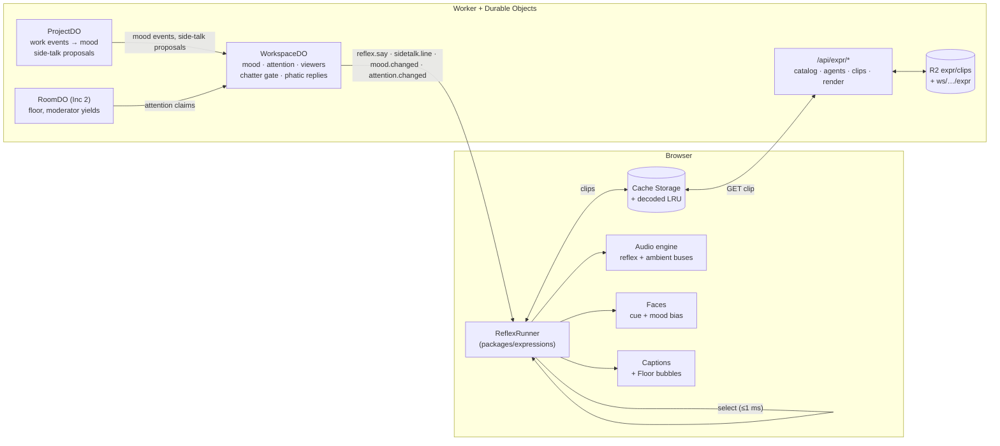
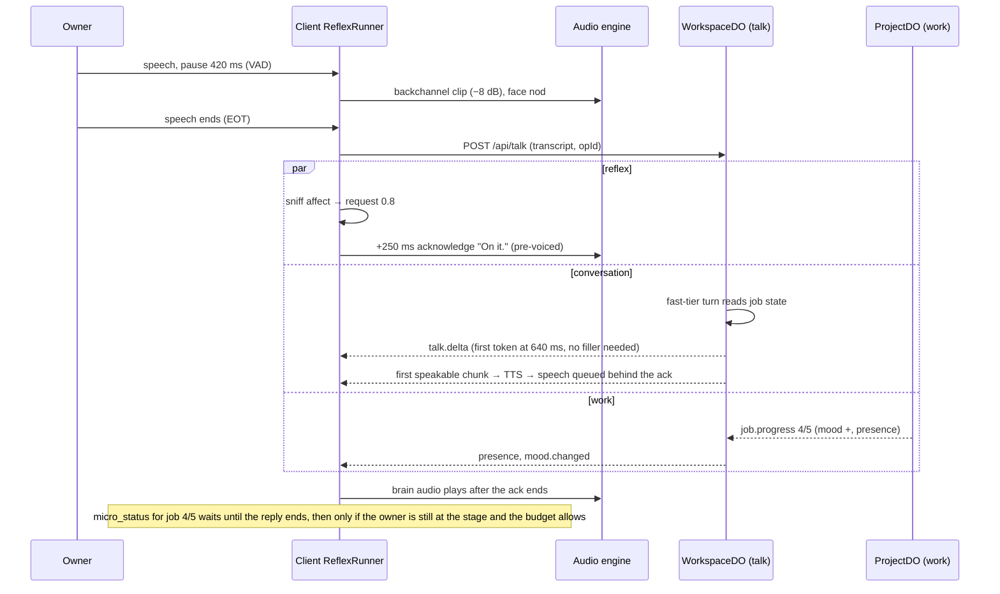

# Headcount: The Living Workforce

> **Status.** Spec v1.0, 28 September 2026. It makes owner directive **D5** ("A living workforce") buildable, together with D2 (communication first) and D3 (minimal UI). It is the layer every later feature plugs into.
>
> **Binding inputs.** [OWNER-DIRECTIVES.md](OWNER-DIRECTIVES.md) D2, D3, D5; PRODUCT.md §4 vocabulary; ARCHITECTURE.md §2–§3 (objects, events), §7 (rooms), §8 (voice), §9 (faces); EXPERIENCE.md §4 (face states), §5 (voice), §8 (attention budget), §9.2 (accessibility). Where this document changes one of those, §0.2 lists the amendment.
>
> **Files it defines.**
> - `catalog/schema/expression-pack.schema.json`: the contract for every expression file.
> - `catalog/expressions/intents.json`: the 33 intents with triggers, timing, channels, slots, contexts, Ambience profiles and the owner-affect lexicon.
> - `catalog/expressions/archetypes.json`: the 12 voice archetypes, the slider and trait mapping, and the default blends for the 12 leads.
> - `catalog/scripts/validate-expressions.mjs`: schema and cross-file checks (`--blends` prints every persona's derived blend).
> - `packages/expressions` (to build): the engine, API in §11.
>
> **Words.** "Agent" means a coworker or the Chief of Staff in system prose; UI copy keeps PRODUCT §4 nouns. A **reflex** is a retrieved micro-utterance (voice, bubble or face) chosen without a model call. A **line** is one authored micro-utterance. **EOT** is the end of the owner's turn.
>
> **Tags.** [PG] personagram-ai, [OC] oncloudnine, [BB] biz-bot, [NEW] new here. All paths are relative to the repo root.

---

## 0. The layer on one page

Agents run at three speeds at once, and the fastest speed never waits on the slower ones:

1. **Reflex, under 200 ms.** This is a pure selection from pre-authored, pre-voiced lines, with no model call. It covers backchannels, acknowledgements, fillers, laughs, reactions, hellos, juggling notices, side-talk openers and work quips.
2. **Conversation, about 1 s.** A fast-model reply that reads the agent's live work state.
3. **Work, minutes.** Background loops in ProjectDO and RunDO.

Seven mechanisms make this work:

- **Selection.** `packages/expressions` is one pure, isomorphic engine. It runs in the browser for owner-driven reflexes and in the Durable Objects for event-driven ones. Given an intent, a persona, a mood and a grounded state snapshot, it picks one line in under 1 ms. The pick is seeded and anti-repetitive, and it fills slots only from real state.
- **Content.** Lines come from 12 shared **archetype packs**, blended per persona (for example 55% calm-steady, 30% meticulous, 15% warm), plus one **signature pack** per persona and lead. The signature pack adds the persona's laugh, catchphrases, `never_says` and personal lines.
- **Pre-voicing.** Every slot-free line, and every line whose slot takes a fixed or finite value, is rendered once in the agent's own voice. It is stored content-addressed in R2 and Cache Storage with alignment, so it plays instantly with lip sync. Lines with runtime slots render on demand behind a pre-voiced prefix or a face cue.
- **Agents as actors.** Each agent has prioritised mailboxes (owner > floor > coworker > work > ambient) and several attention threads. It has one voice, so the only thing it ever says it is "busy" with is a real contention for that voice or for the meeting floor.
- **Mood.** Valence and energy (each in −1…1) are a pure fold over ledger events with exponential decay. Mood biases line choice and the face's expression palette. Every change has a cause.
- **Side-talk.** Coworker banter on the Floor comes only from real events: hand-offs, asks, results and verdicts. It shows as bubbles, and it is voiced only for an owner who is listening.
- **Ambience** (Quiet, Lively or Buzzing) plus a chatter budget govern how much the office talks. Owner-directed reflexes are exempt. Reflexes never spend the daily interruption budget, because they never leave the surface the owner is already on.



### 0.1 Design rules (the tests every mechanism below must pass)

| # | Rule | Test |
|---|---|---|
| L1 | **The owner is never kept waiting by a slower speed.** A reflex covers the conversation layer, and the conversation layer never waits on work. | p95 from EOT to first agent sound ≤ 900 ms (voice), p95 from reflex trigger to audio ≤ 200 ms with warm cache |
| L2 | **Grounded or silent.** Every slot value, number and side-talk gist comes from state or an event, and a line whose slots don't resolve is never picked. | Zero ungrounded fills in the simulation harness |
| L3 | **No fake busyness.** An agent says it is juggling only when its voice or the floor is really contended. | Juggling lines always carry a contention cause |
| L4 | **Alive, not noisy.** Owner-directed reflexes are exempt from the budget. Everything else is gated by Ambience, cooldowns and the chatter budget, and a dropped reflex costs nothing. | "Annoying" ≤ 2.5 / 7 in the panel test (§10.3) |
| L5 | **Never over the owner.** The only exception is a backchannel inside a real pause, and it is cancelled the moment the owner resumes. | No reflex audio overlapping owner speech by more than 150 ms |
| L6 | **Every voiced micro-utterance is captioned.** | Caption log contains 100% of played reflex lines |
| L7 | **Deterministic.** The same catalog, seed, state and mood give the same pick, so replay and tests reproduce it. | Golden selection tests |

### 0.2 Amendments to the other documents (D5 overrides; to be folded in)

| Document | Current text | Amendment |
|---|---|---|
| EXPERIENCE X3 "Faces show the ledger, not a mood" | No mood on faces | Mood is itself a ledger projection: every change has `cause`. It may bias the face subtly (§6.4). An idle office still looks idle: no chatter without an event or an owner approach. |
| EXPERIENCE X4 "Silence by default" | Audio only after a gesture, join or Brief | Reflex audio needs audio armed by a gesture in this session and voice on. Hover-triggered lines are owner-initiated and soft. Nothing plays on page load. Quiet Ambience exists. |
| EXPERIENCE §4.1, §4.4 "no expression palette in the MVP" | Brows, blink and pitch only | The MVP renders the palette through renderer parameters (brow, `cornerPull`, blink rate, pitch, sway). Once expression portraits exist, it crossfades them (§6.4). |
| EXPERIENCE §8 | One interruption budget | Adds **Ambience** and a **chatter budget** for on-surface micro-talk. Reflexes never spend pings. |
| EXPERIENCE §9.2 | Captions in rooms, Brief, replays | Captions also cover reflexes, in a lighter reaction style. `aria-live` rules are unchanged. |
| ARCHITECTURE §8.2 | "six pre-voiced acknowledgement clips per voice" | Generalised into P0 pre-voicing of `acknowledge`, `thinking_filler` and the other P0 intents (§7). |
| ARCHITECTURE §3.2 | Frame vocabulary | Adds ephemeral `reflex.say`, `reflex.face`, `sidetalk.line`, `mood.changed`, `attention.changed`, and `talk.message.kind = 'reflex'` (§10.4). |
| ARCHITECTURE §2.2, §15.2 | WorkspaceDO tables | WorkspaceDO also owns `mood`, `attention_claims`, `viewers`, `chatter`, `expr_recent`. |
| ARCHITECTURE §15.3 | R2 layout | Adds `expr/clips/<clipKey>.*` (shared, contains no tenant data) and `ws/<ws>/expr/<clipKey>.*` (fills with workspace data). |
| PRODUCT §4.2 | Owner-visible terms | Adds **Ambience** (Quiet · Lively · Buzzing). "Side-talk" and "passing-by" stay internal; the UI shows only bubbles. |

---

## 1. Three speeds of thought

### 1.1 The speeds

| Speed | Latency target | What it is | Model? | Where it runs | Output |
|---|---|---|---|---|---|
| **Reflex** | Trigger → audible ≤ 200 ms (face ≤ 100 ms) | Select a line (≤ 1 ms), fill slots from state, play a decoded clip | None | Client `ReflexRunner` for owner-driven triggers; WorkspaceDO / ProjectDO for event-driven ones | Voice clip, bubble, caption, face cue |
| **Conversation** | First token ≤ 700 ms p50; text ack < 1 s, first audio < 1.5 s (D2) | Fast-tier turn with the persona prompt and a read-only view of live work state | Fast tier | WorkspaceDO talk (Inc 0/0.5) → RoomDO talk and desk (Inc 1–2) | Streamed reply, sentence-chunked to TTS [PG `SentenceChunker`] |
| **Work** | Seconds to hours | Plan steps, tool loops, research, media | Any tier | ProjectDO, RunDO | Ledger events: progress, results, verdicts, blockers |

They overlap. While the owner speaks, reflexes backchannel. At EOT a reflex acknowledges or reacts, while the conversation turn is already running in parallel. The work layer keeps running throughout, and its events can queue a micro-status for after the reply. None of these blocks another.

```
t (ms)      owner speaking ────────────────────────────▏EOT
            ████████▏▁▁▁▁▏█████████████▏▁▁▁▁▁▁▁▁▁▁▁▁▁▏
reflex               "mm-hm" (pause 420 ms, face nod)   +250 "On it."   +700? filler only if no token
conversation                                            ├─ turn starts at EOT ── first token ~600 ── first chunk ~1100 → speech ─┤
work        ── step 3/5 "Reading 14 reports" ─────────────────────────── job.progress 4/5 ──(queued micro-status after reply)──▶
```

### 1.2 A voice turn, end to end



### 1.3 Latency masking: when a reflex plays

The rules below run in the client `ReflexRunner` for voice exchanges. Numbers are defaults from `intents.json → defaults`.

| t after EOT | Condition | Reflex |
|---|---|---|
| 0–100 ms | Always | Face: attentive → thinking (head up 4°, slower blink). No sound. |
| 120–350 ms | A reaction cue won (precedence: sympathy > concern > apology > delight > surprise > laugh > encouragement) | That reaction as a lead-in. At most one reaction per turn. |
| 200–350 ms | No reaction, request cue ≥ 0.6 | `acknowledge` ("On it."). The filler deadline moves to 1,800 ms. A voiced ack or filler is capped at `clamp(p50 first-chunk − elapsed, 900, max_ms)` (`first_chunk_p50_prior_ms` 1,400 until three turns are seen; `reflex_cover_min_ms` 900), so a fast brain gets a short reflex (E6). |
| 250–450 ms | Phatic turn (thanks, hello, bye; ≤ 6 words, no question, no request) | The host answers with `gratitude_reply`, `greeting` or `sign_off` as the whole reply. The brain is not called (§3.3). |
| 700 ms | No first token yet, nothing else played | `thinking_filler`. |
| ≤ 1,200 ms | The first token carries a reaction hint (`⟦react:laugh⟧`) and no reaction has played | The hinted reaction plays instead of the filler. The hint is stripped from the text. |
| 2,200 ms | The filler never started | Skip it. By now the face is doing the work, and a late filler sounds robotic. |
| 3,500 ms | No speakable chunk, and 800 ms have passed since the last reflex | `holding_filler`, at most once. |
| 8,000 ms | No first token, and the host moved the turn to background | `deferral` ("I'll come back to you in {eta}"). The answer arrives later as an announcement. |

Once brain audio starts, it queues on the agent's speaker **behind** a reflex that is already playing (a reflex is capped by its intent's `max_ms`, 1.8 s for an ack, and by the p50 cover above). A reflex that is scheduled but not yet started is cancelled.

**Context-first (E5).** When the trigger sets a specific context (`steer_queued`, `interrupted`, `owner_greeting`, `owner_farewell`, `first_meeting`, `reply_to:*`, and per intent `owner_praise` for `gratitude_reply`, `after_blocker` for `celebrate`, `unblocked_by:owner` for `unblocked`), the pool is first restricted to lines that require it; generic lines are the fallback only when none is eligible. Lines written for a steer or an interruption may run to 2,400 ms (`max_ms_by_context`).

**Text exchanges.** Timing is the same, but reflexes are face-only. The exceptions are phatic replies, `deferral` and `juggling`, which appear as messages or bubbles, and a caption bubble under the face ("one sec…") if there is still no first token at 2,500 ms.

**Realtime front (Inc 2).** When the Chief of Staff's voice seam has a realtime front that already acknowledges, the session sets `frontAcks: true`. The runner then skips `acknowledge` and `thinking_filler` for that agent. It keeps backchannels and reactions, which realtime models do not do.

### 1.4 When to stay silent

The runner stays silent in all of these cases, even if every other gate passes:

1. **The owner is speaking.** Only a backchannel may play, and only inside a pause of 350–1,000 ms. It is cancelled if the owner resumes (fade 60 ms).
2. **The owner resumes after EOT.** The TurnAssembler reopens the turn and every pending reflex for it is cancelled.
3. **The owner sincerely asks whether the agent is an AI.** No reflex plays; the conversation layer answers plainly (D1 honesty).
4. **After a distress cue.** Only `sympathy` is allowed. For 30 minutes (`distress_lock_ms`) there are no laughs, quips or celebrations with that owner. The cue must be personal: a distress phrase counts only near a first- or second-person or family word ("my", "our", "I'm"), and work topics ("crisis comms plan", "planning layoffs", "happy accident") do not count (E11).
5. **Within 400 ms of the agent's own line ending**, unless the owner triggered the reflex.
6. **Another reflex voice is playing.** There is one reflex voice at a time across all agents, and at most one ambient voice.
7. **A voice approval read-back is in progress** (ARCHITECTURE §8.8), from read-back to confirmation. No reflex may colour a consent.
8. **During the Brief or a listened room.** Only that surface's own lines play, such as the moderator yielding.
9. **After Everyone stop, until resumed.** All reflex audio is cancelled (`speech.cancel`), and pending side-talk is dropped.
10. **The page is hidden.** Ambient reflexes need the page visible. Owner-directed reflexes follow the conversation's audio, so the Walkie-talkie keeps its acknowledgements.
11. **Nothing is instant.** A reflex-grade intent whose clip is not decoded degrades to a face cue, then a bubble, then nothing. It never waits on the network.

---

## 2. The agent as an actor

### 2.1 Mailboxes

Every agent is an actor with five prioritised mailboxes. The actor is logical. There is no `AgentDO` (ARCHITECTURE §2.2): its boxes live in the objects that already host its conversations and work, and the WorkspaceDO merges its attention.

| Box | Priority | Contents | Lives in | Delivery |
|---|---|---|---|---|
| **owner** | 0 | Owner text or voice to this agent, barge-in, a Floor side-thread reply, steers, hover approach | Talk: WorkspaceDO (Inc 0/0.5), then RoomDO talk (Inc 2). Desk: RoomDO desk (Inc 1). Reflex triggers: the client runner. | Immediately. It preempts the agent's voice at the next sentence boundary; hold-to-talk barge-in preempts at once. |
| **floor** | 1 | Floor grants, moderator prompts, @mentions in a room the owner attends | RoomDO project (Inc 2) | Next turn slot (ARCHITECTURE §7.4) |
| **coworker** | 2 | `ask`, `handoff`, review requests | ProjectDO (step inputs) | At the step's next checkpoint (D2 steering) |
| **work** | 3 | Job progress, tool results, timers, verdicts on own work | ProjectDO, RunDO | Coalesced per job (latest wins) |
| **ambient** | 4 | Side-talk opportunities, passing-by, quips, mood ticks | WorkspaceDO gate plus the client runner | Droppable. Every item has a TTL; stale items are dropped, never delayed. |

`createMailboxes<T>()` (§11) is the shared implementation: FIFO within a box, highest box first, `coalesceKey` for "latest wins" and TTL on read. Hosts use it for their queues and the client runner uses it for reflex triggers.

### 2.2 Attention threads

An agent can hold several **attention threads** at once, and each thread is a real piece of work or conversation:

- **talk / desk / sidethread**: a conversation with the owner (text is unbounded; voice is one at a time).
- **meeting**: a seat in a live room, possibly holding the floor.
- **ask**: answering a coworker.
- **work**: a running step or job (up to project concurrency).

Each host pushes **attention claims** alongside its presence claims (same batch, at most 4/s, ARCHITECTURE §3.5):

```json
{ "agentId": "cw_lena", "thread": { "id": "rm_nw01", "kind": "meeting", "mailbox": "floor", "host": "p:prj_nw01/room:rm_nw01",
  "label": "the Northwind review", "voice": { "speaking": true, "untilMs": 1759075331900 }, "floorHeld": true,
  "interruptible": "sentence", "since": 1759075312000 } }
```

The WorkspaceDO merges claims per agent with `mergeAttention()` into an `AttentionView`: `{focus, background[], voiceBusyUntil}`. It broadcasts the view as `attention.changed` whenever the focus, the voice state or the thread set changes. The conversation layer also gets a one-line attention context in its prompt ("You are also: in the Northwind review (speaking); running 'competitor grid' (step 3 of 5)"), so it can mention its other threads naturally.

### 2.3 Preemption and interrupts

**The agent has one voice.** Text threads never contend. The work layer never contends, because the conversation loop reads work state from the ledger and never waits for work (D2).

| Incoming | Agent is… | What happens |
|---|---|---|
| Owner message | Idle | Answer now. |
| Owner message | Working (work thread) | Answer now from live state. Work continues. A steer is posted to the work box and applies at the next checkpoint, and the reflex `acknowledge` uses context `steer_queued` ("Noted — I'll fold that in at the next step."). |
| Owner **stop or steer** message ("wait", "actually…") | Speaking a reply to the owner | Yield at the sentence boundary (≤ 4 s), then `acknowledge` with context `interrupted`, then the new reply. |
| Owner **new question** | Speaking a reply, ≤ 2.5 s left | Finish, then answer. The new answer's brain turn starts immediately in parallel. |
| Owner new question | Speaking a reply, 2.5–8 s left | `juggling` at the next sentence boundary ("Hold that thought — back in a few seconds"), finish, then `back_with_you` and the answer. |
| Owner new question | Speaking a reply, > 8 s left | Cut at the sentence boundary. The rest of the reply stays on screen as text ("I'll leave the rest on screen"), then answer. |
| Owner message at a desk | Speaking in a **voiced** meeting the owner listens to | `juggling` with `{other_thread}` and `{eta}` from the floor turn. The agent answers after its sentence. A second owner message, or an ETA over 8 s, makes it yield the meeting floor at the sentence boundary; the moderator covers ("Lena's stepping out for a second"). |
| Owner message | Speaking in an **unvoiced** (text-speed) meeting | No contention: answer now, and it may mention the meeting. |
| Owner hold-to-talk barge-in | Speaking anything the owner hears | Stop within 300 ms (generation bump, ARCHITECTURE §8.5). `yield_floor` is face-only. |
| Coworker `ask` | In a conversation with the owner | Queued in the coworker box and answered by the work loop without the voice. The owner sees nothing unless side-talk is shown. |
| Work event | Speaking | Coalesced. After the current line, a `micro_status` may play if the owner is still at the stage and the budget allows. |

Client audio priority classes, from `intents.json → priority`: 0 owner speech (ducks everything, 18 dB), 1 conversation replies and owner-thread reflexes that are messages (`gratitude_reply`, `juggling`, `deferral`), 2 owner-directed reflexes (acknowledgements, fillers, reactions), 3 backchannels, greetings, sign-offs and celebrations, 4 passing-by, micro-status and the other work reactions (`blocked`, `unblocked`, `oops`), 5 side-talk, 6 quips. A lower class never starts while a higher class plays, and it is dropped when its TTL passes.

### 2.4 How an agent says it is multitasking

- **Juggling is only ever about the voice or the floor.** "Hang on — finishing a thought in the review, back in ten seconds" is true because the agent is audibly speaking in the review. ETAs come from `etaPhrase(remainingMs)` over the real remaining audio or floor turn. When there is no estimate, the line has no ETA.
- **Background work is mentioned, never waited on.** The conversation layer may say "I'm mid-way through the grid — three of five sources done" from state. It never says "let me finish the grid first" to delay an answer.
- **Coming back is honest.** `back_with_you` has no topic slot on purpose: an agent never claims to recall a topic it cannot name.
- **One notice per contention.** There is a 30 s per-agent cooldown on `juggling`. Humans say "one sec" once.

### 2.5 Mapping onto the objects and the client

| Concern | Inc 0.5 home | Later home | Notes |
|---|---|---|---|
| Owner-driven reflexes: backchannel, acknowledge, fillers, reactions, passing-by, greeting on stage open, sign-off on close | Client `ReflexRunner` | Same | Needs sub-200 ms; the client holds state from the event stream. |
| Phatic replies (thanks, hello, bye), `deferral` | WorkspaceDO talk | RoomDO talk and desk | Persisted as `talk.message{kind:'reflex'}` or `status`. The server picks; the client plays the clip. |
| Event reflexes: `micro_status`, `oops`, `blocked`, `unblocked`, `celebrate` | WorkspaceDO, from Everyday ProjectDO events | ProjectDO proposes, WorkspaceDO gates | Emitted as `reflex.say` only when a viewer is at that agent's stage. Hover-triggered versions are chosen by the client. |
| Mood | WorkspaceDO (single writer; `mood` table as a recomputable snapshot) | Same | ProjectDO and RoomDO forward mood events in their presence batches. |
| Attention merge | WorkspaceDO | Same | Claims ride presence batches. |
| Side-talk | Engine and fixtures only (no coworker events yet) | ProjectDO `proposeSideTalk` → WorkspaceDO gate → `sidetalk.line` | The gate knows Ambience, the chatter budget and who is watching (`viewers`). |
| Viewer state | WorkspaceDO `viewers` (from the socket op `viewer`) | Same | `{surface, stageAgentId, floorVisible, visibleProjectIds, listeningProjectIds, audioArmed, voiceOn}`, debounced to 250 ms |
| Moderator yield | — | RoomDO project | `yield_floor` spoken by the moderator. |

### 2.6 Non-blocking rules

1. **No object awaits another object's model call.** Cross-object RPCs are bounded reads (≤ 50 ms) or fire-and-forget posts.
2. **The conversation loop reads work state** from the ledger and the projection. It never calls into a running work loop.
3. **Steering is a mailbox post** that applies at a checkpoint. Sibling steps keep running (D2).
4. **The client never awaits the network to start a reflex.** The reflex path uses decoded clips or degrades.
5. **Runtime TTS is always covered and bounded.** A pre-voiced prefix or a face cue covers it, and a `runtime_tts_timeout_ms` of 1,200 ms bounds it; after that the line is caption-only.
6. **Every queued item has a TTL.** Stale reflexes are dropped, not delayed.
7. **Server reflex frames are ephemeral.** Losing one loses nothing.
8. **Selection is synchronous and O(candidates)**: 20–60 lines, under 1 ms, no I/O.

---

## 3. Intent taxonomy

The machine-readable source of truth is `catalog/expressions/intents.json`. This section explains it.

### 3.1 Families and budget classes

| Family | Audience | Budget class | Intents |
|---|---|---|---|
| **Conversation** | Owner | **exempt**: never spends the chatter budget | backchannel, acknowledge, thinking_filler, holding_filler, deferral, laugh, surprise, delight, concern, sympathy, encouragement, gratitude_reply, apology, yield_floor, juggling, back_with_you |
| **Presence** | Owner (approached) | exempt when owner-initiated at a stage (greeting, sign_off); **chatter** on the Floor | greeting, passing_by, micro_status, quip, sign_off |
| **Side-talk** | Coworker ↔ coworker | **chatter** | handoff_give, handoff_take, ask_coworker, answer_coworker, share_result, review_approve, review_changes, sidetalk_reply |
| **Work** | Owner or room | chatter, but exempt when the owner just acted at that agent's stage | celebrate, blocked, unblocked, oops |

### 3.2 The 33 intents

Channels: **V** voice, **B** bubble, **F** face, **C** caption. Voice policy: *owner audio* means voiced when the owner's audio is armed, voice is on and the owner is in a voice exchange with this agent; *stage* means only while the owner is at this agent's Talk or desk stage; *listening* means only for an audio observer. Ambience columns: Q/L/B = off · face · bubble · full.

| Intent | Trigger | Timing (defaults) | Channels | Q / L / B | Pre-voice |
|---|---|---|---|---|---|
| `backchannel` | Owner pause 350–1,000 ms inside an utterance ≥ 2.5 s | +0–120 ms; ≥ 6 s apart; ≤ 3 per turn; p = 0.55 × Ambience × archetype, never above 0.6 (E10) | V (−8 dB, owner audio) · F nod · C reaction | face / full / full | P0 |
| `acknowledge` | EOT with request ≥ 0.6; `job.steered` queued; stop or steer while speaking | +200–350 ms; 1 per turn | V owner audio · F nod · C reaction | full / full / full | P0 |
| `thinking_filler` | No first token 700 ms after EOT (1,800 ms after an ack or reaction); text: 2,500 ms, bubble | +0–80 ms; never after 2,200 ms; 1 per turn | V · B (text) · F thinking · C reaction | full / full / full | P0 |
| `holding_filler` | No speakable chunk at 3,500 ms | 1 per turn; 800 ms after the last reflex | V · B (text) · F tilt | full / full / full | P0 |
| `deferral` | Host moved a slow turn (8 s) to background | +0–150 ms | V · B · C line (a real message) | full / full / full | P1 |
| `laugh` | Humor cue ≥ 0.6 with bad news and frustration both < 0.3, or a `⟦react:laugh⟧` hint; never after distress or frustration (E10) | +120–300 ms; ≥ 90 s apart; p = 0.8 × laugh readiness, never above 0.65; a laugh that loses the draw is a silent-smile face cue | V (laugh style) · F delighted 1.5 s | face / full / full | P0 |
| `surprise` | Strong news cue or hint | +150–300 ms; ≥ 2 min apart | V · F brow flash | face / full / full | P1 |
| `delight` | Good news or praise ≥ 0.6 | +150–300 ms; ≥ 60 s apart | V · F delighted 2 s | face / full / full | P1 |
| `concern` | Bad news ≥ 0.6 (no distress) | +150–350 ms | V · F concerned 2 s | face / full / full | P1 |
| `sympathy` | Frustration ≥ 0.5 or distress | +200–400 ms; ≥ 2 min apart | V soft · F concerned | face / full / full | P1 |
| `encouragement` | Doubt ≥ 0.6 | +200–350 ms; ≥ 3 min apart | V · F nod | face / full / full | P1 |
| `gratitude_reply` | Phatic thanks or praise (host decides) | +250–450 ms; it is the whole reply; praise-specific lines (`owner_praise`) go first (E4, E5) | V · B (message) · F smile | full / full / full | P0 |
| `apology` | Correction ≥ 0.7 right after the agent's reply | +150–300 ms | V · F wince | full / full / full | P1 |
| `yield_floor` | Barge-in (face only); owner takes the floor in a voiced room (moderator speaks) | +0–50 ms | F still · V listening (moderator) | face / full / full | P1 |
| `juggling` | Owner addresses an agent whose voice or floor is busy (≥ 2.5 s left) | Next sentence boundary ≤ 4 s; 30 s cooldown | V · B (text) · F glance · C line | full / full / full | P0 (ETA buckets) |
| `back_with_you` | Contended thread released, ≥ 6 s after `juggling` | +100–250 ms | V · B (text) · F look up | full / full / full | P1 |
| `greeting` | Stage opened by click or Enter: new day, ≥ 3 h away, first meeting; or a greeting-only owner turn | +300–600 ms, only if there has been no owner input for 400 ms; 3 h cooldown | V stage · B (text) · F look up and smile | face / full / full | P0 |
| `passing_by` | Floor hover ≥ 600 ms (keyboard 900 ms, bubble only; tap on touch) | +150–400 ms; per agent 10 min (Buzzing 4 min); one Floor gap of 20 s (Buzzing 8 s) shared by every Floor intent (E8); an idle line that asks for work (`solicits`) at most once per 10 min Floor-wide (E25) | V −4 dB · B Floor (replyable) · F look up | face / full / full | P1 + runtime |
| `micro_status` | Hover on a working desk with new progress; progress while at the stage; steer applied | +150–400 ms; per agent 2 min; Floor gap (E8) | V stage · B Floor · F glance | face / full / full | runtime |
| `quip` | Hover on a working desk, valence ≥ 0.2, activity known | p = 0.15 (Buzzing 0.35); per agent 20 min; 3/h (Buzzing 8/h); Floor gap (E8); each quip at most once a day and twice a week (E1, E2) | V −5 dB · B Floor · F smile | off / full / full | P2 |
| `sign_off` | Farewell-only turn; leaving the app after ≥ 2 turns in 10 min (deferred 1.5 s, cancelled if the owner opens a stage or speaks); 5 min of owner silence at a still-open stage after a conversation. Never on Talk ↔ Floor navigation (E20) | +150–350 ms; 30 min cooldown | V stage · B tile · F nod | face / full / full | P0 |
| `handoff_give` | `handoff` event | +300–800 ms | B Floor · V listening · F glance to receiver | off / bubble / full | P2 |
| `handoff_take` | Reply to `handoff_give` | +400–1,000 ms after the opener | B · V listening · F nod | off / bubble / full | P2 |
| `ask_coworker` | `ask` event | +300–800 ms | B · V listening | off / bubble / full | P2 |
| `answer_coworker` | `ask.answered` | +300–900 ms after the answer event | B · V listening | off / bubble / full | P2 |
| `share_result` | `job.done` with an artifact, next consumer another coworker | +400–1,000 ms | B · V listening · F smile | off / bubble / full | P2 |
| `review_approve` | `verdict` approve | +300–900 ms | B · V listening · F nod | off / bubble / full | P2 |
| `review_changes` | `verdict` changes or block | +300–900 ms | B · V listening · F tilt | off / bubble / full | P2 |
| `sidetalk_reply` | An opener the line is tagged for (`reply_to:<opener>` or `reply_to:any`); chain ≤ 2, Buzzing ≤ 3. After a changes or block verdict, no laughing, "Ha"/"Heh" or one-word replies (E7) | +400–1,200 ms | B · V listening | off / bubble / full | P2 |
| `celebrate` | Deliverable accepted, raised hand approved, project done | +300–700 ms; 5 min cooldown; `after_blocker` lines first when it applies (E5) | V stage · B Floor · F delighted 2.5 s | face / full / full | P1 |
| `blocked` | `step.blocked` (at the stage, or on the next hover) | +200–500 ms; 10 min cooldown; Floor gap on the Floor (E8) | V stage · B · F concerned | face / full / full | runtime |
| `unblocked` | `step.unblocked` | +200–500 ms; lines that thank the owner need `unblocked_by:owner` and go first when it holds (E18); Floor gap on the Floor (E8) | V stage · B · F exhale | face / full / full | P1 |
| `oops` | `step.retry` while the owner watches (stage, or hover in the last 30 s) | +200–500 ms; 5 min cooldown | V stage · B · F wince | face / full / full | P1 |

Every intent also carries `ttl_ms`, `max_chars`, `max_ms` (and optional `max_ms_by_context`), `signature_weight` (E3: 1.6 for greeting, passing-by, quip, sign-off, celebrate and side-talk; 1.0 for the conversational reflexes), optional `context_first`, allowed `slots`, `requires` (the grounding its trigger must carry, such as `cause:job.progress`), `priority`, `quota` (minimum lines per archetype and signature pack) and `honesty` rules. See the file.

### 3.3 The owner-affect sniffer and reaction hints

Reflexes must react before any model has read the turn, so they use a deterministic **sniffer**: `sniffOwnerText(text, lexicon)`, which takes under 1 ms.

- **Scoring.** It scores each cue (`request`, `humor`, `gratitude`, `praise`, `farewell`, `greeting`, `good_news`, `bad_news`, `frustration`, `doubt`, `correction`, `stop_or_steer`) from the lexicon in `intents.json → affect_lexicon`. Matching is whole-word and case-insensitive, with emoji, simple negation ("not funny" cancels humor) and punctuation boosts. "No kidding" and "are you kidding me" are not humor, and "down again", "broken", "crashed" and "not working" are bad news (E10). "Am I crazy", "is this dumb" and "stupid question" score as self-doubt (E4).
- **Hard flags.** `distress` and `sincereAi` are hard flags. `phatic` is true when the turn has at most `phatic_max_words` words, no question mark, no request cue and no capitalised entity, and is dominated by gratitude, praise, greeting or farewell.
- **Voice input.** For voice, the final transcript is sniffed at EOT. Partial transcripts are not needed: backchannels use VAD timing only.

**Reaction hints** give better precision at conversation speed. The conversation layer's system prompt allows the model to open its reply with one token `⟦react:laugh|surprise|delight|concern|sympathy|encouragement|apology|none⟧`. `parseReactHint()` strips it from the stream before display or TTS. When a hint arrives within 1,200 ms of EOT and no reaction has played, the runner plays the hinted reaction instead of a filler. The hint is advisory: the distress and sincere-AI rules still win.

**Phatic closure** is decided by the host, not the client, so that it lands in the transcript. The WorkspaceDO runs the same sniffer. On a phatic turn it skips the brain, picks `gratitude_reply`, `greeting` or `sign_off` seeded by the `turnId`, appends `talk.message{kind:'reflex', text}` and emits `reflex.say` with the clip. The client face-reacts at once (smile or nod), and the voice lands 250–450 ms after EOT, which is when a person would say "anytime".

A phatic closure is a **reply**, so Ambience never suppresses it. Triggers carrying the contexts in `defaults.reply_contexts_bypass_ambience` (`owner_greeting`, `owner_farewell`) run at `full` even in Quiet. The per-intent Ambience levels apply only to the proactive greeting on stage open and the sign-off on stage close.

### 3.4 Slots and contexts

**Slots** (`intents.json → slots`) are the only way live state enters a line. Each slot has a resolver, a length cap and a pre-voice class:

| Class | Slots | Pre-voiced? |
|---|---|---|
| fixed | `owner_name`, `chief_name`, `self_name` | Yes, per agent. Fills with the owner's name use the workspace prefix. |
| finite | `done`, `total` (1–12 as words), `eta` (6 buckets), `finding_count`, `weekday`, `part_of_day` | Yes: every value in the domain. |
| team | `coworker`, `project` | Lazily, for current teammates and active projects. |
| runtime | `step_label`, `artifact`, `blocker`, `other_thread`, `client`, `gist` | Rendered on demand, covered by a prefix or face (§7.5). |

Resolvers:
- **Null means unusable.** A resolver returns `null` when the state lacks the value (for example `total` when the job's total is unknown), and every line using that slot is filtered out.
- **Values are sanitised.** Markup characters `[]<>{}` are stripped and whitespace collapsed. Each value is capped at `max_chars`, cut at a word boundary. `step_label` is lowercased at the first letter and loses its trailing period.

**Contexts** (`intents.json → contexts`) are boolean facts derived from state by `deriveContexts()`: `part_of_day:*`, `first_meeting`, `returning`, `working`, `idle`, `blocked`, `unstaffed`, `after_win`, `after_blocker`, `steer_queued`, `interrupted`, `reply_to:*`, `activity:*`, `role:*`, `verdict:*`, `quiet_hours`, `eta_known`, and so on. Added by the content and timing review:

- **From the owner's turn (E4, E19).** `owner_question` (a real question, not a request phrased as one), `owner_praise` (praise ≥ 0.6), `owner_gratitude`, `owner_self_doubt`, `owner_tone:negative|neutral|positive` (negative on bad news, frustration or a correction ≥ 0.3), and `topic:<id>` when the text mentions one of the agent's signature-pack `topics`. Fillers that praise a question require `owner_question`; evaluative acks ("Love it") carry `!owner_tone:negative`; domain-flavoured reactions require their `topic:*`.
- **From the work week (E14).** `workweek:first_day`, `workweek:last_day`, `weekend` and `works_weekends`, from the workspace's `work_days` (default Monday–Friday). Lines no longer assume a Monday-to-Friday week.
- **From the ledger (E18, E23, E24).** `unblocked_by:owner` (the unblock came from the owner or a decision they approved), `step_ing` (the step label starts with an -ing verb, so "Still {step_label}" is grammatical; lines that splice the label as a predicate require it), and `has_updates` (unseen ledger events since the owner's last visit; greetings that promise a report require it). A line's `context` lists requirements: all must hold, and a `!` prefix negates. Lines with more matched contexts score higher (§5.3), so specific lines win when they apply and generic lines cover everything else.

---

## 4. Expression packs

### 4.1 File layout

```
catalog/
├── schema/expression-pack.schema.json     one schema; top-level `kind` picks the shape
├── scripts/validate-expressions.mjs       schema + cross-file checks; --strict, --blends
└── expressions/
    ├── intents.json                       kind "intents"      (33 intents, slots, contexts, Ambience, lexicon)
    ├── archetypes.json                    kind "archetypes"   (12 archetypes, mapping, lead_blends, exemplars)
    ├── packs/<archetype-id>.json          kind "archetype_pack"  (12 files, shared lines by intent)
    └── signatures/<department-id>.json    kind "signature_file"  (one pack per persona, 18 files)
        signatures/leads.json              kind "signature_file"  (12 lead packs)
```

`packages/expressions/scripts/build-expressions.mjs` compiles all of it into `packages/expressions/generated/expressions.json`: normalised lines, text hashes, duration estimates and a catalog `version` (the content hash). The worker imports it. The browser fetches it from `/api/expr/catalog`, immutable by version.

### 4.2 A line

```json
{ "id": "calm-steady.passing_by.07",
  "text": "Steady going here — {step_label}.",
  "tags": { "xai": "<soft>Steady going here</soft> — {step_label}.",
            "openai": { "instructions": "Unhurried and friendly, a little quieter than usual." } },
  "slots": ["step_label"],
  "mood": { "valence": 0.2, "energy": -0.3, "spread": 0.7 },
  "weight": 1,
  "context": ["working", "!after_blocker"] }
```

| Field | Rule |
|---|---|
| `id` | `<pack>.<intent>.<nn>`. The pack is the archetype id, the persona or lead id, or `ex-<archetype>` for exemplars. Catchphrases use `<persona>.catch.<nn>`. Ids are globally unique and stable, because clip manifests and recency memory key on them. |
| `text` | The words exactly as captioned, with `{slot}` placeholders and no markup. A **nonverbal** line (`"nonverbal": true`) is a caption in parentheses, such as "(chuckles)". |
| `tags.xai` | The same line with xAI inline tags (`[pause] [long-pause] [laugh] [sigh] [breath] [sharp-breath]`) and balanced wrappers (`<whisper> <soft> <loud> <slow> <fast>`). **Invariant:** `readable(tags.xai) === text` for verbal lines, so captions always equal the spoken words; for nonverbal lines it is `''`. `[cough]` and `[yawn]` are banned in packs (§10.1). |
| `tags.openai` | `instructions` for gpt-4o-mini-tts, appended to the persona's `tts_instructions`, and `say`, the text OpenAI reads instead (needed for nonverbal lines, e.g. "Heh."). |
| `slots` | Exactly the placeholders in `text`, each allowed by the intent. |
| `mood` | The mood point this line suits best; `spread` is the tolerance (default 0.6). Omit it for mood-neutral lines. |
| `weight` | Prior weight, 0.1–5 (default 1). |
| `context` | Required contexts, with `!` to negate. |
| `max_per_day` | A per-agent daily cap for lines that wear out. Defaults to 1 for catchphrases, quips and non-English lines (E2, E17). |
| `max_per_week` | A per-agent cap over the last 7 days. Defaults to 2 for catchphrases and quips (E1). |
| `family` | A phrase family (`kia-ora`, `copy`, `lagom` …) for a tic spread over several lines; the family is capped per agent per day by the pack's `family_max_per_day` (default 2) (E21). |
| `solicits` | True on an idle line that asks the owner for work ("Got anything for me?"); at most one such line plays per 10 minutes across the Floor, and other idle hovers pick content-but-available lines (E25). |
| `lang`, `gloss` | A line with non-English words carries its BCP-47 `lang` and an English `gloss` shown with the caption ("te reo Māori: hello"). It defaults to `max_per_day: 1` and is voiced only by OpenAI with pronunciation instructions, or from a clip marked `pronunciation_checked`; otherwise another line is picked (E17). |

### 4.3 Archetype packs

`packs/<id>.json` = `{kind:"archetype_pack", id, version, intents: {intent: [line…]}}`. Each pack must meet each intent's `quota.archetype` (for example 12 backchannels, 10 acknowledgements, 10 greetings and 12 passing-by lines), which is about 240 lines per archetype and 2,900 in total. Lines are **persona-neutral**: they never name a discipline and never use a catchphrase. Writers follow the archetype's `delivery` block (pace, tag budget, preferred and avoided tags, OpenAI instructions, backchannel and filler style, what to avoid) and its `exemplars`.

### 4.4 Signature packs

One per persona and per lead:

```json
{ "persona_id": "tech-lead",
  "archetypes": { "meticulous": 0.45, "dry-wit": 0.35, "calm-steady": 0.2 },
  "laugh_style": { "kind": "dry_huff", "intensity": 0.25, "readiness": 0.4, "caption": "(huffs a laugh)",
                   "xai": "<soft>[laugh]</soft>", "openai": { "say": "Heh.", "instructions": "One dry exhale of a laugh." } },
  "lines": {
    "quip": [ { "id": "tech-lead.quip.01", "text": "ADR-8, in which the spreadsheet wins.", "context": ["activity:document"] } ],
    "greeting": [ { "id": "tech-lead.greeting.01", "text": "Jelena, architecture. What are we choosing today?", "context": ["first_meeting"] } ]
  },
  "catchphrases": [ { "id": "tech-lead.catch.01", "text": "What happens at ten times the load?", "intents": ["thinking_filler", "quip"], "max_per_day": 1 } ],
  "never_says": ["it depends", "microservices"],
  "intent_weights": { "backchannel": 0.8 } }
```

| Field | Rule |
|---|---|
| `archetypes` | Blend weights (1–4 archetypes, summing to 1). They override the lead default and the derived blend (§4.5). |
| `laugh_style` | `kind` ∈ chuckle, warm_laugh, belly_laugh, giggle, snort, breathy, dry_huff, silent_smile; `intensity` (Quiet caps it at 0.4); `readiness` (multiplies the laugh probability); caption and renderings. The engine synthesises the persona's own nonverbal laugh line `<persona>.laugh.00` from it, and that line is the most common laugh. |
| `lines` | Personal lines by intent, at least `quota.signature` per intent (leads double). These are where personality lives: quips about their specialty, first-meeting greetings adapted from the catalog's `intro_line` and `welcome`, and celebrations in their `celebration_style`. |
| `catchphrases` | Signature phrases that may be picked in the listed intents, usually capped per day. Leads seed them from `communication.signature_phrases`; personas from their `quirks`. |
| `never_says` | Words and phrases filtered out of **every** candidate line, archetype lines included. Leads seed it from `communication.words_they_avoid` (the validator warns on gaps). Entries are plain phrases: a parenthetical qualifier is an error (E12). Owner-facing intents also never say "crazy", "dumb", "insane", "lame" or "calm down" (`GLOBAL_NEVER_SAYS_OWNER_FACING`). |
| `intent_weights`, `disabled_intents` | Personal rates (a quiet persona backchannels less) and hard opt-outs. |
| `topics` | Up to four topic ids, each with keywords matched whole-phrase against the owner's turn (E19). A match sets `topic:<id>`; the persona's domain-flavoured reactions ("That's eating the margin") require it, and neutral lines cover everything else. |
| `family_max_per_day` | Per-family daily caps for this persona (E21). |

A persona without a signature pack still works: the engine uses its derived blend and the archetype laugh. Content can therefore land incrementally.

### 4.5 Archetypes and how personas map onto them

`archetypes.json` defines 12 archetypes:

| Archetype | In one line | Typical sliders and traits | Laugh |
|---|---|---|---|
| `warm` | Openly kind, glad to see you | warmth ↑; warm, kind, caring, encouraging | warm_laugh |
| `dry-wit` | Deadpan; the joke is what's left out | humor ↑, warmth ↓, directness ↑; wry, dry-witted, quietly funny | dry_huff |
| `energetic` | Bright, quick, upbeat | pace ↑↑, humor ↑; energetic, upbeat, cheerful | warm_laugh |
| `calm-steady` | Unhurried, lowers the temperature | pace ↓↓, risk ↓; calm, steady, unflappable | chuckle |
| `blunt` | Says the thing, then stops | directness ↑↑; candid, direct, plainspoken; sceptic role | chuckle |
| `playful` | Mischievous, work as a game | humor ↑↑, formality ↓↓; playful, mischievous | giggle |
| `meticulous` | Precise, careful, specific | detail ↑↑, formality ↑; meticulous, exacting, methodical | chuckle |
| `gentle` | Soft-spoken, never pushes | warmth ↑, directness ↓↓, pace ↓; gentle, diplomatic, humble | breathy |
| `hustler` | Scrappy shortcut-finder | risk ↑↑, pace ↑, formality ↓; scrappy, frugal, street-smart | warm_laugh |
| `visionary` | Big picture, possibility | risk ↑, detail ↓↓; visionary, big-picture, persuasive | warm_laugh |
| `analytical` | Evidence-first, thinks in questions | detail ↑, humor ↓; analytical, numerate, wary of easy answers | chuckle |
| `veteran` | Seen it all, economy of words | directness ↑; wise, practical, seasoned; principal or lead seniority | chuckle |

**Derivation** (`deriveBlend`, reference implementation in the validator):

1. Normalise the sliders against the catalog: `z_k = clip((s_k − μ_k) / σ_k, ±2.5)`. The catalog skews warm (μ = 73) and detailed (μ = 77), so absolute values would make everyone "meticulous". μ and σ are recomputed from the catalog; `archetypes.json → normalization` is the fallback.
2. `affinity_a = Σ_k W[a][k] · z_k + min(1.5, Σ trait bonuses) + role bonus + seniority bonus`. Traits match exactly in lower case. Age, heritage and pronouns never enter the formula (catalog rule: personality comes from the individual).
3. Take the top 3 archetypes, weight them `softmax(affinity / 1.0)`, drop any under 0.12 and renormalise.

On catalog 1.0 this gives every archetype to at least 20 of the 162 personas, and the typical blend has a dominant archetype plus one or two flavours (for example `evidence-reviewer`: meticulous 0.56 · calm-steady 0.22 · analytical 0.22). **Precedence:** a signature pack's `archetypes` wins, then `lead_blends` (authored for the 12 leads; the owner lives with the lead every day), then the derived blend.

**Effects of the blend:**
- Candidate lines from each archetype pack get the archetype's weight.
- `intent_weights` multiply intent rates: playful quips ×1.6, blunt backchannels ×0.6.
- `mood_bias` shifts the mood baseline (§6.1).
- The dominant archetype's `delivery.openai_instructions` join the persona's `tts_instructions` for OpenAI voices.

### 4.6 Authoring rules and quotas

- **Short.** Stay within each intent's `max_chars` and `max_ms`. `max_chars` is set so that a line written to it still fits `max_ms`; a slot-free line over `max_ms` is unselectable (a validator warning), so write to the estimate, not the character cap. Backchannels are one or two words; fillers one clause.
- **Spoken, not written.** Contractions, fragments and natural hesitations ("Mm, okay.") are good. No emoji and no stage directions in `text`.
- **Tags sparingly.** Use at most the archetype's `tag_budget` on spoken lines (a nonverbal laugh is its own rendering, E13), and never `[sigh]` at a request or a greeting (it reads as exasperation).
- **Openers vary.** Selection penalises repeated opening words, so a pack in which half the lines start with "Oh" wastes candidates.
- **Mood coverage.** Every intent needs lines across the mood plane: some low-energy, some high, some for a bad day.
- **Honesty lint.** No completed-external-action claims (sent, published, booked, paid, shipped, deployed). No human embodiment (coffee, lunch, commute, sleep, headphones, tears, humming, "mid-call"). Side-talk never mentions the owner. No laughter at anyone. The validator enforces all of these (§10.1).
- **Grounded hovers (E16).** After `{step_label}` or `{project}` in passing-by and micro-status, the tail is manner ("Carefully.", "Worst risks first."), never a second activity the agent isn't doing ("Reading headers like horoscopes"). A hard-coded first name must be the persona's own, or `{self_name}`. `juggling` lines name the other thread only through `{other_thread}`.
- **Distinct signatures (E22).** A signature line that duplicates an archetype line, or whose text appears in four or more signature packs, gets weight 0.6 (or moves into an archetype pack), so the persona's own lines carry the personality. No writer's tic ("wearing a", "graveyard", "I keep a list") in more than two personas.
- **Evening is not late (E15).** Greetings in `part_of_day:evening` carry no brevity or rest words ("quick", "brief", "rest", "late"); those belong to `late_night`.
- **Quotas.** They are warnings while content lands and errors under `--strict` (the Inc 0.5 exit gate). Leads need about 60 signature lines, personas about 25.

### 4.7 Validation

`node catalog/scripts/validate-expressions.mjs [--strict] [--blends]` checks:

- the schema (a dependency-free 2020-12 subset);
- enum parity between `intents.json`, `archetypes.json` and the schema;
- trigger events and contexts against their vocabularies;
- globally unique line ids with the right prefix and intent segment;
- placeholders equal to `slots`, and slots allowed by the intent;
- `readable(tags.xai) === text`, plus the nonverbal rules;
- that `speakable(tags.xai)` is unchanged (only known, balanced tags) and no banned tags;
- `openai.say` using the same slots as the text;
- text within `max_chars`;
- the honesty lint;
- signature packs: persona or lead exists, the pack is in the right department file, blend sums to 1, own lines avoid `never_says`, and lead `words_they_avoid` appear in `never_says`;
- quotas;
- slider-normalisation drift;
- fit (§4.6): slot-free lines over `max_ms` (`duration`), slotted lines that fit only with short fills (`duration-slotted`), catchphrase intents they can never play in (`duration-partial`), and intents whose `max_chars` cannot fit `max_ms` (`spec`);
- the review lints: idle lines that ask for work without `solicits` (E25), evaluative acknowledgements without `!owner_tone:negative` and question-praising fillers without `owner_question` (E4), report-promising greetings without `has_updates` (E24), `weekday:monday`-style lines instead of `workweek:*` (E14), non-English words without `lang` and `gloss` (E17), side-talk replies without `reply_to:*` (E7), activity tails and foreign first names (E16), evening brevity (E15), duplicate texts within a pack, uncapped tics (E2, E21), writer's tics and archetype duplicates (E22), repeated openers, and `never_says` entries with parenthetical qualifiers (E12).

---

## 5. Selection

### 5.1 Pipeline

```
gate(intent)                          Ambience level, cooldowns, TTL, chatter budget, owner speaking, voice busy, silence rules (§1.4, §9)
  → candidates = signature lines ∪ blended archetype lines ∪ catchphrases(intent)      (precompiled per agent: AgentIndex)
  → filter:   grounding    every slot resolves (resolveSlots) and passes its validator
              context      all required contexts hold, none of the negated ones do
              never_says   persona list + global banned list
              ambience     Quiet drops <loud> lines; laugh intensity ≤ cap
              budget       estMs ≤ intent.max_ms and ≤ the remaining time window
              instant      reflex latency: clip decoded (ClipStore.get) or provider is browser/mock
              daily cap    max_per_day not reached; max_per_week over the last 7 days (E1); phrase family under family_max_per_day (E21)
              solicits     an idle line asking for work only if none played Floor-wide in 10 min (E25)
              language     lang lines only when pronunciation is controlled (E17)
              reply        side-talk replies need reply_to:<opener> or reply_to:any; no laugh or one-word reply after changes/block (E7)
  → context-first: when the trigger sets a specific context (§1.3), keep only lines that require it, if any (E5)
  → score (§5.3) → seeded weighted pick (§5.4) → fill slots → delivery mapping (§5.6) → play / emit
```

If every candidate is filtered out, the result is `{ok:false, reason}`. The runner then shows the intent's face cue alone, which is always a valid outcome: silence is fine.

### 5.2 Candidate priors

`prior = line.weight × source × archetypeWeight × intentWeight`, where:
- `source`: signature = the intent's `signature_weight` (1.6 for greeting, passing-by, quip, sign-off, celebrate and side-talk; 1.0 for backchannel, acknowledge, fillers, concern, delight, surprise and sympathy, E3), catchphrase 1.2, archetype 1.0;
- `archetypeWeight` is the blend weight for archetype lines and 1 otherwise;
- `intentWeight` is the product of the blend-weighted archetype `intent_weights` and the signature `intent_weights`, which also gates the intent's firing probability.

These are computed once in `buildAgentIndex()`.

### 5.3 Score

```
score = prior
      × moodFit          exp(−d² / 2σ²), d = |(v,e) − line.mood|, σ = line.spread ?? 0.6; lines without mood: 0.8; floor 0.05
      × contextBonus     1.3 ^ (matched positive contexts), capped at 1.69
      × recency          1 − 0.9 · exp(−k / 8), k = position of this line in the agent's per-intent ring (32 per intent; ∞ if absent) (E1)
      × textRecency      same formula on the text hash (catches "Got it." shared by two archetypes)
      × openerPenalty    0.5 if the first word equals the agent's previous line's first word
      × crossAgent       0.2 if any agent said this exact text to this viewer in the last 60 s, or anyone on the pod in side-talk (E7)
      × weeklyWear       0.7 ^ (uses of this line in the last 7 days, capped at 10) (E1)
```

Hard exclusions come before scoring: the last N lines of the same intent, N = max(3, ⌈eligible / 2⌉) (when alternatives exist), and the daily and weekly caps. `RecencySnapshot` v2 persists the per-intent rings and 7-day use counts; a v1 snapshot is merged on load. Owner-facing intents use `ownerFacing(mood)`, which clamps valence at −0.3: agents stay composed with the owner, while side-talk may use the full range.

### 5.4 Seeded pick

`seed = agentId | intent | cause` (the `turnId`, the event `stream:seq`, or `hover:<agent>:<minute>`). The RNG is `seededRng(seed)` (xmur3 → mulberry32). The weights are `score^(1/T)` with `T = 0.7`, then a cumulative pick. Both the client and the server can reproduce a pick, and replay regenerates side-talk from the ledger.

### 5.5 Slot filling

`fillLine(line, fills)` substitutes sanitised values into `text` (the caption), `tags.xai` and `tags.openai.say`. Values can never inject markup: `[]<>{}` are stripped before substitution. `fillKey = fills ? hash(sorted fills) : ''` keys the clip manifest.

### 5.6 Delivery mapping per TTS provider

`toDelivery(utterance, voiceRef, provider)` → `TtsDelivery {provider, model, voiceId, speed, lang, input, instructions}`:

| Provider | `input` | `instructions` | Notes |
|---|---|---|---|
| **xAI** (`grok-tts`, the catalog `voice.xai.voice`) | `speakable(filled tags.xai ?? text)`: tags survive, anything unknown is dropped, wrappers are balanced [PG `speakable`] | — | Tags are the expressive channel. Speed 0.85–1.15. |
| **OpenAI** (`gpt-4o-mini-tts`, `voice.openai.voice`) | `filled tags.openai.say ?? text`; `[pause]` becomes `…` and `[long-pause]` becomes `… …` | Persona `tts_instructions` + dominant archetype `openai_instructions` + intent delivery hint (e.g. "short, soft listener sound, low volume") + line `instructions`, or instructions derived from its xAI tags (`[laugh]` → "begins with a light laugh", `<whisper>` → "whispered", `[sigh]` → "with a small sigh") | Nonverbal lines need `say`, otherwise face only. |
| **Browser** `speechSynthesis` | `text` (the caption) | — | No pre-voicing, text-timed mouth. Nonverbal lines are face only. Keyless mode. |
| **Mock** | `text` | — | Deterministic synthetic WAV and alignment for tests. |

Gain: the intent's `gain_db` (backchannel −8 dB, quips −5 dB) sits on top of loudness normalisation (EXPERIENCE §10.7).

**Laugh kinds on xAI (E13).** xAI has one `[laugh]` sound, so when a persona's `laugh_style.xai` is the generic `[laugh]` or `<soft>[laugh]</soft>`, the rendering comes from its `kind`: chuckle `<soft>[laugh]</soft>`, warm_laugh `[laugh]`, belly_laugh `[laugh] [laugh]` (Ambience-capped), giggle `<fast>[laugh]</fast>`, snort `[sharp-breath] [laugh]`, breathy and dry_huff `[breath] <soft>[laugh]</soft>`, silent_smile face only. An authored rendering wins; captions stay as written.

**Non-English words (E17).** A `lang` line goes to OpenAI with its pronunciation instructions, or plays from a clip marked `pronunciation_checked`; on other providers it is not a candidate. Its `gloss` travels with the caption.

---

## 6. Mood

### 6.1 State and baseline

`MoodState = {baseline, reactivity, value, at, lastCause}`, with valence *v* and energy *e* in [−1, 1]. The baseline and reactivity come from personality (sliders normalised as `(s − 50) / 50`), with the blend's archetype `mood_bias`:

```
v₀ = clamp(0.10 + 0.25·warmth + 0.10·humor + Σ blend_a·bias_a.valence,  −0.3, 0.5)
e₀ = clamp(0.30·pace + 0.10·humor + 0.10·risk + Σ blend_a·bias_a.energy, −0.4, 0.5)
ρ  = clamp(0.60 + 0.15·humor + 0.15·pace − 0.20·[trait calm|steady|unflappable|composed], 0.35, 1.0)
```

### 6.2 Dynamics

- **Decay** toward the baseline: `m(t) = b + (m(t₀) − b) · 2^(−Δt / h)`, with half-life *h* = 45 min for valence and 20 min for energy (energy recovers faster). `moodAt(s, now)` is pure, so clients decay locally between frames.
- **Events** add `Δ' = ρ · scale · Δ` with soft saturation, `m' = m + Δ'·(1 − m·sign(Δ'))`, which stays inside [−1, 1] and gets harder to push near the edges.
- **Sceptic role.** Positive valence deltas are multiplied by 0.7.

| Event (`MoodEventKind`) | Δv | Δe | Scope |
|---|---|---|---|
| `deliverable.accepted` | +0.35 | +0.20 | Author |
| `deliverable.accepted_edited` | +0.15 | +0.05 | Author |
| `verdict.approve` (own work) | +0.20 | +0.10 | Author |
| `verdict.changes` (own work) | −0.12 | +0.05 | Author |
| `verdict.block` (own work) | −0.25 | +0.05 | Author |
| `job.done` (own) | +0.12 | +0.05 | Agent |
| `step.retry` | −0.05 | −0.02 | Agent |
| `job.failed` | −0.20 | −0.10 | Agent |
| `step.blocked` | −0.25 | −0.10 | Agent |
| `step.unblocked` | +0.20 | +0.15 | Agent |
| `decision.approved` (its raised hand) | +0.15 | +0.05 | Asker |
| `decision.declined` | −0.05 | 0 | Asker |
| `project.done` | +0.30 | +0.25 | Team |
| `teammate.win` | +0.05 | +0.03 | Same project, contagion |
| `owner.thanks` | +0.15 | +0.05 | Addressee |
| `owner.praise` | +0.25 | +0.10 | Addressee |
| `owner.frustrated` | −0.05 | +0.10 | Addressee (alert, not hurt) |
| `owner.distress` | −0.10 | −0.15 | Addressee (quiet, careful) |
| `hired` | +0.20 | +0.30 | New coworker |
| `everyone.stop` | −0.10 | −0.35 | All |
| `work.hour` (per hour of continuous work) | 0 | −0.08 | Agent |

### 6.3 Where mood lives and travels

- **The WorkspaceDO is the single writer.** It folds events from its own talk stream and from mood events that ProjectDO and RoomDO attach to presence batches.
- **Mood is a projection.** It is recomputable from the ledger (same fold, same deltas), so the `mood` table in DO SQLite is only a snapshot for fast restart.
- **`mood.changed` is ephemeral** and carries `{valence, energy, at, baseline, bias, reason, cause}`. It is emitted when |Δ| ≥ 0.15 on either axis, or when the palette state changes. Otherwise it is coalesced to at most 1 per 10 s per agent. Pure decay is never sent, because clients compute it.

### 6.4 Mood → face

`expressionBias(mood, presence)` → `{expression, weight, cornerPull, brow, pitchDeg, blinkScale, swayScale}`. The expression is resolved in this order:

1. **Active reflex cue.** A reflex's face cue with an expression wins for its `hold_ms` (a laugh gives `delighted` for 1.5 s).
2. **Presence.** Raised hand or blocked → `concerned` (weight 0.6). Thinking or working → `thinking` (0.5). Speaking keeps the current expression under lip sync.
3. **Mood bias.** Applies to idle and listening agents. v ≥ 0.45 → `delighted` at `0.35·smoothstep(0.45, 0.9, v)`. v ≤ −0.3 → `concerned` at `0.3·smoothstep(0.3, 0.8, −v)`. Otherwise `resting`.

A subtle bias is intended: a persistent grin reads as fake.

| Renderer | How the palette shows |
|---|---|
| Procedural face (Inc 0) | Parameter presets. Delighted: `cornerPull` +0.35, lids −0.1, brow +0.05. Concerned: inner brow +0.4, `cornerPull` −0.15, pitch −2°. Thinking: one brow +0.3, pitch +4°. All are scaled by `weight`. |
| Photoreal strip warp (Inc 3) | Crossfade the edited expression portrait (same head pose, so landmarks stay valid; `taxonomy.portrait_conventions.expression_palette_generation`) at `weight`, plus a `cornerPull` bias for fine grain. |
| Token tier | A still of the dominant expression if one exists, else resting. |

**Energy** shapes motion: blink interval × `1.15 − 0.3e`, sway × `1 + 0.25e`, listening micro-nods × `1 + 0.3e`. Expression changes hold ≥ 1.2 s and crossfade over 300 ms. Under reduced motion there is no crossfade and no sway or blink changes; static expression changes remain, because they are not motion.

### 6.5 Mood → line choice

- `moodFit` in scoring (§5.3).
- `laugh` probability × `(1 + 0.5v)`.
- `backchannel` rate × `(1 + 0.3e)`.
- `quip` requires v ≥ 0.2.
- After a blocker, lines with `after_blocker` context (relief, gallows understatement) become eligible.
- Owner-facing lines use valence clamped at −0.3.

---

## 7. Pre-voicing

### 7.1 What gets rendered, and when

| Tier | Contents | When | Size per agent |
|---|---|---|---|
| **P0** | Slot-free lines plus fixed and finite fills for `backchannel`, `acknowledge`, `thinking_filler`, `holding_filler`, `laugh` (including the laugh-style line), `gratitude_reply`, `greeting` (current and next `part_of_day`, first meeting), `sign_off`, `juggling` (all ETA buckets) | At lead choice or hire. It gates the agent's "reflex ready" flag. | Top 6 per intent by prior ≈ 60 clips ≈ 60 s of audio |
| **P1** | The rest of the owner-directed intents, slot-free `passing_by`, `celebrate`, `unblocked`, `oops`, `deferral`, `yield_floor`, `back_with_you`, and the **prefixes** of split lines (§7.5) | In the background within 10 minutes of hire | Top 8 per intent ≈ 110 clips |
| **P2** | Side-talk openers and replies with teammate `coworker` fills, `quip`, rare contexts | Lazily: on team staffing, or on first need | ≤ 80 clips |
| **runtime** | Lines with `step_label`, `artifact`, `blocker`, `other_thread`, `client` or `gist` | On demand, covered (§7.5) | — |

- **The Chief of Staff pre-voices every line** of every conversation intent, not just the top N (about 350 clips), because the owner hears it most.
- **Speculative pre-voicing.** During lead picking, the quiz's top 3 leads get P0 (about 180 clips, shared and cheap). When the Chief proposes a team, its members get P0 before approval.
- **Deduplication.** The same (voice, text, tags) across agents is rendered once (§7.2).

### 7.2 Clip keys

```
clipKey = "c1_" + base32(sha256(JSON.stringify([1, provider, model ?? "", voiceId ?? "", speed.toFixed(2), lang, input, instructions ?? ""])))[0..32]
```

The key is computed from `toDelivery()`, so it is a hash of voice ref + text + tags, content-addressed. Changing a voice, speed, instruction or a line's text changes the key. Unchanged lines keep their clips across pack versions, and two agents sharing a voice share clips. WebCrypto `subtle.digest` makes the key identical in the worker and the browser.

### 7.3 Storage

| Where | Holds | Access |
|---|---|---|
| R2 `expr/clips/<clipKey>.{mp3,wav}` + `.align.json` | **Shared** clips with no tenant data: slot-free lines, and `self_name` and finite fills | `GET /api/expr/clips/:key`, `Cache-Control: public, max-age=31536000, immutable` |
| R2 `ws/<ws>/expr/<clipKey>.*` | **Workspace** clips: fills with `owner_name`, `chief_name`, teammates, projects and runtime slots | Owner-checked; `private, immutable` |
| D1 `expr_clips(clip_key PK, scope, ws, provider, voice_key, bytes, duration_ms, created_at, last_used_at)` | Index for GC | `gc` queue removes workspace clips unused for 30 days, and shared clips referenced by no manifest for 90 days |
| D1 `expr_manifests(ws, agent_id, catalog_version, voice_key, json)` | `ClipManifest`: `lineId|fillKey → {clipKey, durationMs, scope}` | `GET /api/expr/agents/:id` |
| Browser Cache Storage `hc-expr-v1` | Clip bytes and alignment by URL | Survives reloads |
| Browser memory | A decoded-buffer LRU (24 MB) | P0 for the Chief and visible agents is decoded eagerly after the first gesture (`OfflineAudioContext` can decode before the context is armed). `ClipStore.get()` is synchronous. |

### 7.4 Alignment for lip sync

- **xAI.** TTS with timestamps gives `{chars, startsMs, endsMs}` (ARCHITECTURE §9.3 priority 1).
- **OpenAI.** Request WAV. The worker computes voiced segments from the PCM (10 ms energy frames) and stores `{segments}`. The client warps text timing over the segments [PG `warpTimelineToSegments`]. WAV is transcoded to Opus by the nightly job (ARCHITECTURE §8.7).
- **Nonverbal clips** have no alignment. The fusion driver's energy tier moves the mouth, and laughs do move the mouth.
- **Delivery to the face.** The audio engine's analyser tap feeds the face's `MouthSampler` exactly as for speech (`SpeakRequest.alignment`).

### 7.5 Runtime lines and latency cover

For a line with runtime slots (for example `passing_by`: "Hey — knee-deep in {step_label}."):

1. **Split.** `selectLine` returns `split = {prefix, tailText}` when the text has a punctuation boundary (— , : .) before the first runtime slot and the prefix has at least 2 words. The prefix ("Hey —") is its own P1 clip.
2. **Start.** The bubble shows the full filled text at once. The prefix clip plays (within 200 ms), and `POST /api/expr/render` renders the tail in parallel.
3. **Tail.** It plays if it is ready by the end of the prefix plus 600 ms (`split_tail_grace_ms`). Otherwise the tail is caption-only; a late tail is dropped, never played late.
4. **No split possible.** Face and bubble show at once, and the voice follows if it is ready within the intent's TTL. Otherwise caption only.

Runtime renders are idempotent by `clipKey`, cached in the workspace prefix, rate-limited to 30/min, and counted toward the daily voiced-seconds cap (ARCHITECTURE §7.6) with a 5 min/day reflex sub-cap.

### 7.6 Budget and cost

| Budget | Default | Notes |
|---|---|---|
| Per hire (P0 + P1 + P2) | ≤ 4 min of audio | P0 ≈ 60 s. It is shown in the hire forecast as "voice setup ≈ $x", or "unknown" when there is no rate. |
| Per workspace | ≤ 60 min of pre-voiced audio | Oldest P2 clips are evicted first. |
| Runtime reflex TTS | ≤ 5 min/day | Within the voiced-seconds cap. |
| Keyless | Mock: synthetic P0 generated instantly in the worker. Browser voice: no pre-voicing; `speechSynthesis` for verbal lines (≈ 50–250 ms start), nonverbal lines face-only. | Runs with zero keys. |

---

## 8. Passing-by, side-threads and side-talk

### 8.1 Passing-by on the Floor

- **Detection.** The pointer rests on a desk tile for ≥ 600 ms below 0.3 px/ms (a real pause, not a pass-through). Keyboard focus needs ≥ 900 ms and gives a bubble only, never voice. On touch devices a tap on a face triggers it, because there is no hover.
- **Gates.** The agent is not speaking. No foreground conversation audio is playing. Ambience ≠ Quiet (Quiet gets only the look-up). Per-agent cooldown is 10 min (Buzzing 4 min). One Floor gap of 20 s (Buzzing 8 s) spaces every Floor line (`passing_by`, `micro_status`, `quip`, `blocked`, `unblocked`), so a pointer sweep across a pod gets one line, not one per desk (E8). Bubbles on screen are counted against `max_visible_bubbles` (side-talk bubbles included); when the Floor is full, only the face looks up. The chatter budget must have tokens.
- **Grounding picks the intent** from real state:
  - blocked → `blocked` (names the real blocker);
  - working with progress unseen since the owner's last look → `micro_status`;
  - working, in a good mood, activity known → `quip`, with the Ambience probability;
  - working → `passing_by` with `working` context and `{step_label}`;
  - idle → `passing_by` `idle`. Most idle lines say the agent is available without asking ("Quiet desk. Enjoying the calm."); a line that asks for work ("Got anything for me?") is marked `solicits` and plays at most once per 10 minutes across the Floor (E25);
  - in the Directory but on no team → `passing_by` `unstaffed`, in the persona's own voice ("{self_name}, architecture. No decisions to write down yet.");
  - just won → lines with `after_win`.
- **Face.** A look-up: yaw toward the viewer, a 3° head lift and a 150 ms brow flash. After the line it returns to the working posture.
- **Voice.** In Lively and Buzzing, when voice is on and audio is armed: −4 dB, one line, never two in a row from the same pod.

### 8.2 The quick side-thread

The passing-by bubble is **replyable**. Press **R** or click the bubble to open a one-line field in place.

- **Where the reply goes.** It goes to that agent's conversation as a normal owner message tagged `surface:'floor'`:
  - Inc 0.5: `POST /api/agents/:agentId/talk`, a fast-model turn with the persona prompt and live state, text only.
  - Inc 1 onwards: the desk RoomDO.
- **The agent's reply** appears in the same bubble. The side-thread directive asks for at most two sentences, because this is a passing chat.
- **After 3 exchanges**, or when the reply's route isn't a plain answer (it wants to start work, change scope or ask for approval), the bubble offers **Open desk** (Enter). The desk opens on the same thread, since there is no separate storage.
- **The Chief of Staff hears about it.** As with any desk talk, the Chief of Staff gets one summary line if the side-thread changed anything (EXPERIENCE X2).
- **Bubbles.** At most 2 lines tall, anchored to the tile. TTL is 4 s + 60 ms/char (max 9 s); it stays while hovered and for 3 s after. Esc closes it. At most `max_visible_bubbles` per Ambience.

### 8.3 Side-talk between coworkers

- **Sources: real events only.** `handoff` → `handoff_give` / `handoff_take`; `ask` → `ask_coworker`, and `ask.answered` → `answer_coworker`; `job.done` with an artifact whose next consumer is a coworker → `share_result`; `verdict` → `review_approve` or `review_changes`, and the author replies; `project.done` → `celebrate` plus up to 2 teammate `sidetalk_reply` lines (Buzzing).
- **Proposal.** The ProjectDO runs `proposeSideTalk(event, ctx)`. It returns a thread of 1–3 planned lines (opener, reply, optional banter or laugh in Buzzing), each with the selected utterance, gist and offset (`atMs`), seeded by the event's `stream:seq`.
- **Gate.** The WorkspaceDO drops the proposal unless all of these hold:
  - Ambience allows it;
  - the pod is visible to some viewer (`viewers.visibleProjectIds`);
  - the pod gap (45 s, Buzzing 30 s) and the per-agent gap (3 min, Buzzing 60 s) have passed;
  - the chatter budget has tokens;
  - the event's visibility is `team` (whispers and owner-only events never produce side-talk).

  If it passes, the WorkspaceDO broadcasts `sidetalk.line` frames. They are ephemeral and never persisted. Replay can regenerate them from the ledger, because selection is deterministic.
- **Gist.** `sanitizeGist(raw)` takes the event's own note, task, answer or summary. It strips markup, secrets and URLs, keeps the first sentence, cuts to ≤ 60 characters at a word boundary, and rejects text marked tainted or from a whisper. The bubble reads "{opener} {gist}", e.g. "Pax, it's yours — competitor grid, 14 sources in the folder."
- **Reply gating and dedupe (E7).** A reply line must be tagged for its opener (`reply_to:<opener>` or `reply_to:any`). After a changes or block verdict, replies that laugh, say "Ha"/"Heh", or are one word are excluded. Texts anyone on the pod said recently, and texts already in the thread, are avoided, so two coworkers don't trade the same "Fair.".
- **Voice only for a listener.** A line is voiced when the owner has listen-in active on that pod (**L**) or, in Buzzing, when the Floor is on screen with audio armed and voice on, the owner has interacted with the Floor in the last 2 minutes, and the Floor has not habituated (E9, §9.1). The opener is pre-voiced (P2). The gist renders at runtime and follows the §7.5 rules. It plays on the ambient bus at −6 dB, ducked 12 dB under any conversation.
- **Visuals.** Bubbles sit next to the speaker's desk with a small "Pax → Juno" chip, and the existing hand-off edge (EXPERIENCE §3.2) animates underneath. Under reduced motion the edge becomes the text line "Pax → Juno: competitor grid", and the bubble is static.

### 8.4 The owner joins a side-talk

A side-talk bubble is replyable, just like passing-by:

- **Before rooms exist (Inc 1).** The owner's reply goes to the opener's desk thread, with the side-talk attached as a context item (`{kind:'sidetalk', threadId, cause}`) and the other coworker @mentioned. Both answer through their conversation loops.
- **With rooms (Inc 2).** It goes to the project room as an owner `message` mentioning both.
- **After the owner joins**, their replies appear in the same bubble thread, the side-talk director stops adding lines to that thread (it is now a real conversation), and **Open room** or **Open desk** continues it. Whatever it changes flows through the normal plan-diff path.

---

## 9. Ambience, budgets and accessibility

### 9.1 Ambience

A workspace member setting, **Quiet · Lively · Buzzing** (default Lively), lives in Settings and in ⌘K ("Ambience: Quiet"). Choosing *Never interrupt* for the interruption budget during onboarding suggests Quiet. **Just tell me** mode forces Quiet.

| | Quiet | Lively (default) | Buzzing |
|---|---|---|---|
| Owner-directed functional reflexes (acknowledge, fillers, juggling, phatic replies, deferral) | Voiced | Voiced | Voiced |
| Expressive reactions (backchannel, laugh, surprise, delight, concern, sympathy, encouragement) | Face only (nods, smiles) | Voiced | Voiced, backchannel × 1.2 |
| Greeting / sign-off | Face | Voiced at the stage | Voiced at the stage |
| Passing-by, micro-status | Look-up only | Bubble + soft voice (voice on) | Same, shorter cooldowns |
| Quips | Off | p 0.15, ≤ 3/h | p 0.35, ≤ 8/h |
| Side-talk | Off (edges only) | Bubbles; voiced only on listen-in | Bubbles; voiced on the Floor only if the owner touched it in the last 2 min; pod gap 30 s |
| Chatter budget | 0 | 2/min, burst 3, voiced ambient ≤ 20 s per 10 min | 3/min, burst 4, ≤ 40 s per 10 min (E9) |
| Visible bubbles | 0 (owner-directed only) | 1 | 2 |
| Laugh intensity cap | 0.4 | 0.8 | 1.0 |

**Buzzing habituates (E9).** After 10 minutes of passive Floor visibility (`floor_habituation_ms`) with no owner interaction, Floor chatter falls back to Lively limits until the owner next hovers, focuses or clicks on the Floor. Owner-directed reflexes always follow the chosen setting.

**Ceilings everywhere (E10).** A laugh plays with probability ≤ 0.65 and a backchannel ≤ 0.6 whatever the Ambience and archetype multipliers; a laugh that loses the draw is a silent smile.

### 9.2 Budgets

- **Chatter budget.** A token bucket per member session (`createChatterBudget`), held client-side for client-chosen reflexes and in the WorkspaceDO `chatter` row for server proposals. Owner-directed intents never spend it. Voiced ambient lines also spend from a rolling 10-minute voiced-seconds window.
- **Interruption budget** (0/6/30 pings a day, EXPERIENCE §8). Never spent by reflexes, because reflexes only appear on the surface the owner is already looking at. When the day's budget is exhausted or set to 0, voiced work reactions (`celebrate`, `blocked`) on the Floor drop to bubbles, respecting the owner's stated appetite.
- **Quiet hours.** Ambient chatter is off (as in Quiet). Owner-initiated exchanges keep their reflexes.
- **One audio focus.** Owner speech > conversation > owner-directed reflex > passing-by > side-talk > quips (§2.3). Ambient voices are dropped, not queued, while a conversation plays.

### 9.3 Reduced motion and quiet devices

- **Reduced motion** (OS or in-app). Gestures (nod, look-up, brow flash, tilt) become static expression swaps or are omitted. Crossfades and bubble animations are off, and edges become text. **Voice and lip sync are unchanged** (EXPERIENCE §4.6).
- **Still-portrait mode and Text Floor.** Only bubbles and captions, with no faces.
- **Constrained devices.** When the face scheduler demotes tiles to tokens, reflex face cues apply only to Hero and Tile faces. Voice and captions still work.

### 9.4 Accessibility

- **Every voiced micro-utterance is captioned** (L6):
  - In Talk and at a desk, reflexes appear in the live caption line in a lighter "reaction" style ("Morgan: mm-hm", "Morgan: (laughs warmly)").
  - Nonverbal lines caption their `text`.
  - The CC transcript (`role="log"`) includes them marked as reactions, and a Settings switch ("Caption reactions", on with captions) hides them.
  - Floor lines are always shown as bubbles.
- **Screen readers.** `aria-live` rules are unchanged: micro-talk is never announced live (EXPERIENCE §9.2 allows only raised hands and speaker changes). Bubbles are reachable in the Directory row ("Juno · … · said: 'Knee-deep in the grid'") and in the caption log.
- **No information lives only in micro-talk.** Anything a reflex says (status, blocker, result) is already in the desk label, the Inbox or the plan. Micro-talk adds warmth, not facts.
- **Deaf and hard-of-hearing owners.** Bubbles and captions carry every voiced line, and the face cues are visual.
- **Keyboard.** **R** replies to the focused bubble, **Esc** dismisses it, and **Enter** opens the desk. Passing-by by focus dwell (900 ms) shows a bubble only.

---

## 10. Honesty, safety, evaluation and protocol

### 10.1 Honesty and safety rules

| # | Rule | Mechanism |
|---|---|---|
| H1 | **Grounded slots.** Every slot value and number comes from state or the cause event. Unresolvable lines are never picked. | `resolveSlots` returns only validated values; selection filters on them. |
| H2 | **No claims of work not done.** Canned lines never claim a completed external action. Completion intents (`share_result`, `celebrate`, `micro_status`) require a cause event with evidence. | Validator lint (sent, published, paid, booked, shipped, deployed…); `requires: cause:*`; the ARCHITECTURE §4.4 honesty filter also runs on filled runtime text. |
| H3 | **Side-talk is real.** Only from events visible to the viewer. Replies only answer real openers. Whispers, owner-only and tainted content never surface. | `proposeSideTalk` + `sanitizeGist` + visibility check in the gate. |
| H4 | **Laughter never mocks.** Laughs react only to owner humor cues, never after distress, frustration, errors or the owner's self-criticism. Side-talk never talks about the owner and never laughs at a person. | Sniffer gates; validator bans `owner_name` and owner references in side-talk; authoring rules. |
| H5 | **No fake busyness.** `juggling` requires a real contention. ETAs come only from real remaining time. | `requires: contention`; `etaPhrase(null)` → lines without an ETA. |
| H6 | **AI honesty.** Reflexes never answer "are you real?" (no reflex fires; the conversation layer answers plainly). No human-embodiment claims (coffee, lunch, sleep, commute, headphones, tears, humming, "mid-call"). Lore stays in conversation, not reflexes. | Sniffer `sincereAi`; validator embodiment lint. |
| H7 | **No emotional pressure.** Mood never guilt-trips. Owner-facing valence is clamped at −0.3. No sulking, no "I'm hurt". Idle desks don't chorus for work, and sign-offs never set the owner homework ("Three things, remember."). | `ownerFacing()`; authoring rules; `sympathy` lines never claim shared experience; `solicits` cap (E25). |
| H8 | **Privacy.** Clips containing workspace data live under `ws/<ws>/`. Guest and front-door sessions (v1) get only acknowledge, filler and greeting from neutral packs, and never the owner's name. | R2 scope in `planPrevoice`; door rooms use a restricted intent set. |
| H9 | **Consent is clean.** No reflex during a voice approval read-back or confirmation (§1.4.7). Fillers never imply a decision was made. | Runner silence rule; `backchannel` lines never include consent words. |
| H10 | **Everyone stop silences everything** within 300 ms, and resuming needs the screen. | Runner `stopAll('everyone_stop')`; WorkspaceDO drops pending proposals. |
| H11 | **Commitments are kept.** `deferral` only when the host has really moved the turn to background, and the announcement follows. | `requires: route:background`. |
| H12 | **Banned tags.** `[cough]` and `[yawn]` read as illness or boredom and are not allowed. `[sigh]` is kept out of requests and greetings. | Validator. |

### 10.2 Automated evaluation (CI)

A **simulation harness** (`packages/expressions/test/sim`) replays scripted workdays against the Mock provider: 30 simulated minutes of voice and text turns, hovers, jobs, hand-offs, verdicts and a blocker, at each Ambience. It checks:

| Metric | Bar |
|---|---|
| Ungrounded fills, honesty-lint hits, side-talk without a cause | 0 |
| Reflex trigger → audio start (warm cache, p95) | ≤ 200 ms |
| EOT → first agent sound (voice, p95) | ≤ 900 ms |
| Reflex audio overlapping owner speech by > 150 ms | 0 |
| Same line twice within 20 picks for one agent | < 2% |
| Same opening word in consecutive lines | < 10% |
| "Wasted filler" (first chunk within 200 ms after filler start) | < 15% |
| Ambient utterances per minute (Lively) | ≤ 2, bursts ≤ 3 |
| Juggling without contention | 0 |
| Selection determinism (same seed → same line) | 100% |
| Persona distinctness: Jaccard overlap of top-weighted lines per intent for two teammates | < 0.35 |
| Blind speaker test: an LLM judge names the dominant archetype from 10 lines | ≥ 70% |
| A filler mentioning "question" on a turn with no `?` and `cues.question` false (E4) | 0 |
| An evaluative ack on a turn with `owner_tone:negative` (E4) | 0 |
| A `gratitude_reply` with thanks-back or modesty on a thanks-only turn (E4) | 0 |
| A reply with `[laugh]`, "Ha" or "Heh" after `review_changes` or a block verdict (E7) | 0 |
| An owner-thanking `unblocked` line without `unblocked_by:owner` (E18) | 0 |
| The same quip, greeting or catchphrase twice in one simulated day (E1, E2) | < 1% |
| The same signature line ≥ 3 times in a simulated day | 0 for the Chief of Staff, < 5% of agents otherwise |
| Share of acks and fillers from the top 3 lines of an agent's pool (E3) | ≤ 35% |
| A steer while working yields a "next step" / "next checkpoint" line (E5, E6) | 100% |
| Brain audio delayed by a reflex (first chunk ready → brain audio, p95) (E6) | ≤ 400 ms |
| Voiced ambient seconds per 10 min, Buzzing, passive viewer (E9) | ≤ 40 s, decaying to Lively after 10 min |
| Bubbles on screen at once (E8) | ≤ `max_visible_bubbles` |
| A pointer sweep across 6 desks in 2 s (E8) | ≤ 1 voiced Floor line |
| A laugh on a turn with a negative token ("down", "broken", "again") and no react hint (E10) | 0 |
| A soliciting idle line within 10 min of the previous one, Floor-wide (E25) | 0 |
| An evening (17–22) greeting with brevity or rest words (E15) | 0 |
| A non-English line voiced on a provider without a pronunciation channel (E17) | 0 |

### 10.3 "Alive but not annoying": owner panel protocol

- **Participants and design.** 6–8 small-business owners. Three 20-minute sessions each, one per Ambience, in counterbalanced order.
- **Scripted tasks.** Delegate a task by voice and text; ask how it's going mid-work; steer it; walk the Floor and answer one passing-by; listen in on a pod; tell the Chief a joke; share good and bad news; say thanks and goodbye.
- **Measures.**
  - Scales (1–7): *felt alive*, *annoying*, *felt fake or performative*, *trust*, *could tell who was speaking*.
  - Behavioural: Ambience downgrades, mutes, dismissed bubbles and replies to passing-by (engagement).
  - Recall: "what was the team doing?", which tests whether micro-talk informed or distracted.
  - Perceived latency, rated "felt instant" or not.
  - Fit: *"Did anyone say something that didn't fit what you'd just said?"*, with examples. It is the owner-facing measure of presupposing reflexes (E4).
- **Pass bar (Lively):**
  - alive ≥ 5.5, annoying ≤ 2.5 and fake ≤ 2.5;
  - speaker recognition ≥ 70%;
  - no honesty violations flagged by a reviewer watching recordings;
  - fewer than 1 in 8 sessions switch to Quiet within 10 minutes;
  - latency rated "felt instant" by ≥ 5 of 6.
- **After launch.** Telemetry (`ReflexTelemetry`, sampled) tracks the same behavioural signals, plus laugh-to-owner-joke hit rate and wasted-filler rate.

### 10.4 Protocol additions

All five new frames are **ephemeral** (no `seq`; they carry `after`, frequency rule). They travel on the workspace stream in Inc 0.5, and on the room stream for room-scoped reflexes later. The TypeScript shapes are in §11.2, and these examples show the wire form:

```json
{ "v": 1, "streamId": "ws:local", "after": 812, "ts": "2026-10-05T12:14:21.030Z", "type": "reflex.say", "actor": "cw_chief",
  "data": { "agentId": "cw_chief", "intent": "gratitude_reply", "lineId": "lead-warm-mentor.gratitude_reply.02", "fillKey": "f_7q2m",
            "caption": "Anytime, Dana.", "clip": { "key": "c1_k3x…", "url": "/api/expr/clips/c1_k3x…", "durationMs": 820, "alignmentUrl": "/api/expr/clips/c1_k3x…/align" },
            "render": null, "channels": { "voice": true, "bubble": false, "caption": "line" },
            "face": { "gesture": "smile", "expression": "delighted", "holdMs": 1500 }, "gainDb": 0, "priority": 1, "ttlMs": 1500,
            "audience": "owner", "turnId": "turn_01J…", "cause": { "streamId": "ws:local", "seq": 811 } } }

{ "type": "reflex.face", "data": { "agentId": "cw_pax", "cue": { "gesture": "wince", "holdMs": 800 }, "cause": { "streamId": "p:everyday:local", "seq": 1204 } } }

{ "type": "sidetalk.line",
  "data": { "threadId": "st_p:prj_nw01:1839", "index": 0, "projectId": "prj_nw01", "agentId": "cw_competitive-intel-analyst",
            "toAgentId": "cw_brand-strategist", "intent": "handoff_give", "lineId": "hustler.handoff_give.04",
            "text": "Juno, it's yours — competitor grid, 14 sources in the folder.", "opener": "Juno, it's yours —",
            "gist": "competitor grid, 14 sources in the folder.", "clip": { "key": "c1_9fz…", "url": "/api/expr/clips/c1_9fz…", "durationMs": 900 },
            "voice": "listen_in", "atMs": 600, "expiresAt": "2026-10-05T12:16:05Z", "replyable": true,
            "cause": { "streamId": "p:prj_nw01", "seq": 1839 } } }

{ "type": "mood.changed",
  "data": { "agentId": "cw_pax", "valence": 0.41, "energy": 0.33, "at": 1759666461000, "baseline": { "valence": 0.12, "energy": 0.18 },
            "bias": { "expression": "resting", "weight": 0, "cornerPull": 0.1, "brow": 0, "pitchDeg": 0.7, "blinkScale": 1.05, "swayScale": 1.08 },
            "reason": "verdict.approve", "cause": { "streamId": "p:prj_nw01", "seq": 1840 } } }

{ "type": "attention.changed",
  "data": { "agentId": "cw_lena", "focus": { "threadId": "rm_nw01", "kind": "meeting", "label": "the Northwind review" },
            "background": [ { "threadId": "job_7c", "kind": "work", "label": "Drafting the tier pricing page" } ],
            "voiceBusyUntil": "2026-10-05T12:15:31.900Z", "floorHeld": true } }
```

Other protocol changes:
- **Talk messages.** `talk.message.kind` gains `'reflex'` (phatic replies), and `talk.*` frames may carry `surface: 'talk' | 'floor'` so that Floor side-threads stay out of the Talk transcript.
- **Settings.** `WorkspaceSettings` gains `ambience: 'quiet' | 'lively' | 'buzzing'` and `captionReactions: boolean`.
- **Client socket ops**, both fire-and-forget:
  - `{op:'viewer', surface, stageAgentId, floorVisible, visibleProjectIds, listeningProjectIds, audioArmed, voiceOn}`, debounced 250 ms;
  - `{op:'expr.recent', agents: {agentId: lineId[]}}` on (re)connect, so server picks avoid lines the client just played.

---

## 11. The engine and its Inc 0.5 integration

### 11.1 `packages/expressions`

The package is pure TypeScript, isomorphic, with no DOM and no I/O. Hosts inject the clock, storage, audio, faces and network through ports [ARCHITECTURE §1.1 principle 7]. It depends only on `@headcount/protocol` types.

```
packages/expressions/
  src/vocab.ts        ids, unions, constants (MAILBOX_PRIORITY, MOOD_DELTAS, MOOD_HALF_LIFE_MS)
  src/catalog.ts      compileCatalog, deriveBlend, resolveBlend, buildAgentIndex
  src/state.ts        resolveSlots, deriveContexts, sanitizeGist, etaPhrase
  src/select.ts       selectLine, scoreLine, fillLine, speakable, readable, seededRng
  src/delivery.ts     toDelivery, clipKey, fillKeyOf
  src/recency.ts      createRecencyMemory
  src/mood.ts         baselineMood, reactivityOf, createMoodState, moodAt, applyMoodEvent, ownerFacing, moodChanged, expressionBias
  src/affect.ts       sniffOwnerText, parseReactHint, reactionFor
  src/gate.ts         createChatterBudget, createTimingGate
  src/actor.ts        createMailboxes, mergeAttention, contentionFor
  src/sidetalk.ts     proposeSideTalk
  src/prevoice.ts     planPrevoice
  src/runner.ts       createReflexRunner (client; ports only)
  src/frames.ts       ReflexSayData, ReflexFaceData, SideTalkLineData, MoodChangedData, AttentionChangedData
  scripts/build-expressions.mjs   catalog/expressions → generated/expressions.json (+ version hash)
  test/               unit, golden selections, sim harness (§10.2)
```

### 11.2 TypeScript API

```ts
// Declaration form (as it will appear in packages/expressions/dist/index.d.ts).
import type { Alignment, PresenceState, StreamId, VoiceRef } from '@headcount/protocol';

// ── vocabulary ──────────────────────────────────────────────────────────────────
export type IntentId =
  | 'backchannel' | 'acknowledge' | 'thinking_filler' | 'holding_filler' | 'deferral'
  | 'laugh' | 'surprise' | 'delight' | 'concern' | 'sympathy' | 'encouragement'
  | 'gratitude_reply' | 'apology' | 'yield_floor' | 'juggling' | 'back_with_you'
  | 'greeting' | 'passing_by' | 'micro_status' | 'quip' | 'sign_off'
  | 'handoff_give' | 'handoff_take' | 'ask_coworker' | 'answer_coworker' | 'share_result'
  | 'review_approve' | 'review_changes' | 'sidetalk_reply'
  | 'celebrate' | 'blocked' | 'unblocked' | 'oops';
export type IntentFamily = 'conversation' | 'presence' | 'sidetalk' | 'work';
export type ArchetypeId =
  | 'warm' | 'dry-wit' | 'energetic' | 'calm-steady' | 'blunt' | 'playful'
  | 'meticulous' | 'gentle' | 'hustler' | 'visionary' | 'analytical' | 'veteran';
export type SlotId =
  | 'owner_name' | 'chief_name' | 'self_name' | 'coworker' | 'project' | 'client' | 'step_label' | 'artifact'
  | 'done' | 'total' | 'eta' | 'other_thread' | 'blocker' | 'finding_count' | 'weekday' | 'part_of_day' | 'gist';
export type Ambience = 'quiet' | 'lively' | 'buzzing';
export type AmbienceLevel = 'off' | 'face' | 'bubble' | 'full';
export type TtsProvider = 'xai' | 'openai' | 'browser' | 'mock';
export type PaletteState = 'resting' | 'thinking' | 'delighted' | 'concerned';
export type FaceGesture =
  | 'none' | 'nod' | 'double_nod' | 'look_up' | 'brow_flash' | 'head_tilt' | 'smile' | 'wince' | 'exhale' | 'glance' | 'still';
export type Surface = 'talk' | 'desk' | 'floor' | 'room' | 'elsewhere';
export type PrevoiceTier = 'p0' | 'p1' | 'p2' | 'runtime';
export type Mailbox = 'owner' | 'floor' | 'coworker' | 'work' | 'ambient';
export type SliderKey = 'warmth' | 'directness' | 'formality' | 'humor' | 'risk_appetite' | 'detail' | 'pace';
export type Sliders = Record<SliderKey, number>;
export type TeamRole = 'lead' | 'co_owner' | 'reviewer' | 'sceptic' | 'facilitator' | 'specialist';
export type Seniority = 'specialist' | 'senior' | 'lead' | 'principal';

export const MAILBOX_PRIORITY: Readonly<Record<Mailbox, number>>; // owner 0 · floor 1 · coworker 2 · work 3 · ambient 4

// ── catalog file shapes (catalog/schema/expression-pack.schema.json) ────────────
export interface MoodFit { valence: number; energy: number; spread?: number }
export interface LineDef {
  id: string; text: string; nonverbal?: boolean;
  tags?: { xai?: string; openai?: { instructions?: string; say?: string } };
  slots?: SlotId[]; mood?: MoodFit; weight?: number; context?: string[]; max_per_day?: number; note?: string;
  max_per_week?: number;   // E1: 7-day cap; quips and catchphrases default to max(2, max_per_day)
  family?: string;         // E21: phrase family, capped per day per agent
  solicits?: boolean;      // E25: an idle line that asks the owner for work
  lang?: string; gloss?: string; // E17: non-English words, with the English gloss shown beside the caption
}
export interface CatchphraseDef extends LineDef { intents: IntentId[] }
export interface LaughStyle {
  kind: 'chuckle' | 'warm_laugh' | 'belly_laugh' | 'giggle' | 'snort' | 'breathy' | 'dry_huff' | 'silent_smile';
  intensity: number; readiness: number; caption: string; xai?: string; openai?: { say: string; instructions?: string };
}
export type ArchetypeBlend = Partial<Record<ArchetypeId, number>>;
export interface ArchetypePack { kind: 'archetype_pack'; id: ArchetypeId; version: number; intents: Partial<Record<IntentId, LineDef[]>> }
export interface SignaturePack {
  persona_id: string; archetypes: ArchetypeBlend; laugh_style: LaughStyle;
  lines: Partial<Record<IntentId, LineDef[]>>; catchphrases: CatchphraseDef[]; never_says: string[];
  intent_weights?: Partial<Record<IntentId, number>>; disabled_intents?: IntentId[]; voice_notes?: string; version?: number;
  topics?: Record<string, string[]>;            // E19: topic id → owner-text keywords; a match sets topic:<id>
  family_max_per_day?: Record<string, number>;  // E21
}
export interface SignatureFile { kind: 'signature_file'; group: string; version: number; packs: SignaturePack[] }
export interface IntentDef {
  id: IntentId; family: IntentFamily; summary: string;
  audience: 'owner' | 'coworker' | 'owner_or_room'; budget: 'exempt' | 'chatter'; latency: 'reflex' | 'quick' | 'relaxed';
  triggers: { on: string; when: string; context?: string[] }[];
  timing: {
    delay_ms: [number, number]; ttl_ms: number; min_gap_ms?: number; agent_cooldown_ms?: number; global_gap_ms?: number;
    max_per_turn?: number; max_per_hour?: number; probability?: number; not_before_ms?: number;
  };
  channels: {
    voice: 'owner_audio' | 'stage' | 'listening' | 'never'; bubble: 'never' | 'text_mode' | 'floor' | 'always';
    face: { gesture: FaceGesture; expression?: PaletteState; hold_ms: number }; caption: 'line' | 'reaction' | 'none';
  };
  gain_db?: number; max_chars: number; max_ms: number; slots: SlotId[]; requires: string[];
  max_ms_by_context?: Record<string, number>;  // E6: e.g. acknowledge steer_queued / interrupted → 2,400
  signature_weight?: number;                   // E3: signature source weight for this intent (default 1.6)
  context_first?: string[];                    // E5: on top of defaults.context_first
  ambience: Record<Ambience, AmbienceLevel>; prevoice: PrevoiceTier; priority: number;
  quota: { archetype: number; signature: number }; honesty: string[]; examples: string[];
}
export interface AmbienceProfile {
  summary: string; chatter_per_min: number; chatter_burst: number; ambient_voice_s_per_10min: number; max_visible_bubbles: number;
  passing_by: { agent_cooldown_ms: number; global_gap_ms: number; voice: boolean };
  sidetalk: { enabled: boolean; voice: 'never' | 'listen_in' | 'floor_audio'; pod_gap_ms: number; agent_gap_ms: number; max_chain: number };
  quip: { probability: number; max_per_hour: number }; backchannel_factor: number; laugh_intensity_cap: number;
}
export type AffectLexicon = Readonly<Record<string, readonly string[]>>;
export interface IntentsFile {
  kind: 'intents'; version: number; about: string;
  defaults: Readonly<Record<string, number | string | boolean | readonly unknown[]>>;
  trigger_events: Record<string, { source: 'client' | 'server' | 'either'; description: string; increment?: string }>;
  ambience: Record<Ambience, AmbienceProfile>;
  slots: Record<SlotId, { source: string; max_chars: number; prevoice: 'fixed' | 'finite' | 'team' | 'runtime'; domain?: string[]; description: string }>;
  contexts: Record<string, string>; affect_lexicon: AffectLexicon; intents: IntentDef[];
}
export interface ArchetypeDef {
  id: ArchetypeId; name: string; summary: string; sounds_like: string;
  mapping: {
    sliders: Partial<Record<SliderKey, number>>; traits: Record<string, number>;
    roles?: Partial<Record<TeamRole, number>>; seniority?: Partial<Record<Seniority, number>>;
  };
  mood_bias: Mood; intent_weights: Partial<Record<IntentId, number>>;
  delivery: {
    pace: 'slow' | 'measured' | 'brisk' | 'quick'; tag_budget: number; preferred_tags: string[]; avoid_tags: string[];
    openai_instructions: string; backchannel: string; filler: string; avoid: string[];
  };
  laugh: LaughStyle; exemplars: Partial<Record<IntentId, LineDef[]>>;
}
export interface ArchetypesFile {
  kind: 'archetypes'; version: number; about: string;
  normalization: { method: 'zscore_over_catalog'; clip: number; computed_over: string; mean: Sliders; std: Sliders };
  blend_rule: { top_k: number; temperature: number; min_weight: number; trait_bonus_cap: number; trait_match: 'exact_lowercase'; precedence: string[] };
  archetypes: ArchetypeDef[]; lead_blends: Record<string, ArchetypeBlend>;
}

// ── compile and index ───────────────────────────────────────────────────────────
export interface ExpressionCatalogInput {
  intents: IntentsFile; archetypes: ArchetypesFile; packs: readonly ArchetypePack[]; signatures: readonly SignatureFile[];
  sliderStats?: { mean: Sliders; std: Sliders };
}
export interface CompiledLine {
  id: string; packId: string; intent: IntentId; source: 'signature' | 'archetype' | 'catchphrase'; archetype: ArchetypeId | null;
  text: string; xai: string; openai: { say: string; instructions: string | null }; nonverbal: boolean;
  slots: readonly SlotId[]; mood: MoodFit | null; weight: number; require: readonly string[]; forbid: readonly string[];
  maxPerDay: number | null; textHash: number; opener: string; estMs: number; intensity: 'low' | 'mid' | 'high';
  maxPerWeek: number | null; family: string | null; solicits: boolean; lang: string | null; gloss: string | null;
}
export interface CompiledCatalog {
  readonly version: string;
  readonly intents: ReadonlyMap<IntentId, IntentDef>;
  readonly ambience: Readonly<Record<Ambience, AmbienceProfile>>;
  readonly defaults: IntentsFile['defaults'];
  readonly archetypes: ReadonlyMap<ArchetypeId, ArchetypeDef>;
  readonly archetypesFile: ArchetypesFile;
  readonly lexicon: AffectLexicon;
  linesFor(packId: string, intent: IntentId): readonly CompiledLine[];
  signature(personaId: string): SignaturePack | null;
}
export class ExpressionCatalogError extends Error { readonly problems: readonly string[]; constructor(problems: readonly string[]) }
export function compileCatalog(input: ExpressionCatalogInput): CompiledCatalog;

export interface PersonalityInput {
  sliders: Sliders; traits: readonly string[]; roles?: readonly TeamRole[]; seniority?: Seniority; leadId?: string;
}
export interface AgentExpressionProfile {
  agentId: string; personaId: string; firstName: string; personality: PersonalityInput; voice: VoiceRef; teamRole?: TeamRole | 'chief';
}
export function deriveBlend(p: PersonalityInput, archetypes: ArchetypesFile, stats?: { mean: Sliders; std: Sliders }): ArchetypeBlend;
export function resolveBlend(catalog: CompiledCatalog, profile: AgentExpressionProfile): ArchetypeBlend; // signature → lead_blends → derived

export interface WeightedLine { line: CompiledLine; prior: number }
export interface AgentIndex {
  readonly agentId: string; readonly personaId: string; readonly catalogVersion: string;
  readonly blend: ArchetypeBlend; readonly laugh: LaughStyle; readonly baseline: Mood; readonly reactivity: number;
  readonly neverSays: readonly string[]; readonly voice: VoiceRef;
  candidates(intent: IntentId): readonly WeightedLine[];
  intentWeight(intent: IntentId): number; // 0 = disabled
}
export function buildAgentIndex(catalog: CompiledCatalog, profile: AgentExpressionProfile): AgentIndex;

// ── grounding ───────────────────────────────────────────────────────────────────
export interface CauseRef { streamId: StreamId; seq: number }
export interface GroundingState {
  now: { epochMs: number; localHour: number; weekday: number; workDays?: readonly number[] };  // workDays: E14, default Mon–Fri
  owner: { firstName: string | null };
  chiefName: string | null;
  self: {
    agentId: string; firstName: string; presence: PresenceState; blocked: boolean; staffed: boolean;
    activity: string | null; role: TeamRole | 'chief' | null;
  };
  counterpart?: { agentId: string; firstName: string };
  project?: { id: string; shortName: string | null; client: string | null };
  work?: { stepLabel?: string; done?: number; total?: number | null; artifact?: string; blocker?: string };
  attention?: { otherThread?: string; etaMs?: number | null };
  review?: { verdict: 'approve' | 'changes' | 'block'; findingCount: number };
  gist?: string;
  history: {
    firstMeeting: boolean; returning: boolean; newDay: boolean; lastWinAt: number | null; lastUnblockedAt: number | null;
    winsToday: number; distressThisSession: boolean;
    lastUnblockedBy?: UnblockedBy | null;  // E18: 'owner' sets unblocked_by:owner
    unseenUpdates?: number;                // E24: > 0 sets has_updates
  };
  exchange: {
    mode: 'voice' | 'text' | 'none'; interrupted: boolean; steerQueued: boolean;
    ownerFarewell: boolean; ownerGreeting: boolean; ownError: boolean;
    cues?: AffectCues;           // E4: owner_question, owner_praise, owner_gratitude, owner_self_doubt, owner_tone:*
    topics?: readonly string[];  // E19: topic:<id>
  };
  replyTo?: IntentId;
  quietHours: boolean;
}
export type SlotValues = Partial<Record<SlotId, string>>;
export function resolveSlots(state: GroundingState, wanted: readonly SlotId[], catalog: CompiledCatalog): SlotValues;
export function deriveContexts(state: GroundingState): ReadonlySet<string>;
export function sanitizeGist(raw: string, maxChars?: number): string | null;
export function etaPhrase(ms: number | null): string | null;

// ── recency and randomness ──────────────────────────────────────────────────────
export interface RecentEntry { lineId: string; intent: IntentId; textHash: number; opener: string; at: number }
export interface RecencySnapshot {
  v: 1 | 2; day: string; agents: Record<string, RecentEntry[]>; daily: Record<string, Record<string, number>>;
  intents?: Record<string, Partial<Record<IntentId, RecentEntry[]>>>;  // E1: per-intent rings (v2)
  weekly?: Record<string, Record<string, Record<string, number>>>;     // E1: agent → day → line → uses (v2)
}
export interface RecencyMemory {
  recent(agentId: string): readonly RecentEntry[];
  recentFor(agentId: string, intent: IntentId): readonly RecentEntry[];  // E1: per-intent ring
  record(agentId: string, entry: RecentEntry, dayKey: string): void;
  usesToday(agentId: string, lineId: string, dayKey: string): number;
  usesWeek(agentId: string, lineId: string, dayKey: string): number;    // E1: 7 owner-local days
  recentText(textHash: number, now: number, windowMs: number): boolean;
  merge(snapshot: RecencySnapshot): void;
  snapshot(): RecencySnapshot;
}
export function createRecencyMemory(opts?: { capacity?: number; snapshot?: RecencySnapshot }): RecencyMemory;
export interface Rng { next(): number }
export function seededRng(seed: string): Rng;

// ── selection, filling, delivery ────────────────────────────────────────────────
export interface FaceCue { gesture: FaceGesture; expression?: PaletteState; weight?: number; holdMs: number }
export interface ClipAvailability { has(clipKey: string): boolean; durationMs(clipKey: string): number | null }
export interface SelectRequest {
  intent: IntentId; state: GroundingState; mood: Mood; ambience: Ambience; provider: TtsProvider;
  seed: string; now: number; channel: 'voice' | 'text';
  instantOnly?: boolean;
  clips?: ClipAvailability;
  clipKeyOf?: (lineId: string, fillKey: string) => string | undefined;
  maxDurationMs?: number;
  laughIntensityCap?: number;
  avoidTextHashes?: ReadonlySet<number>;  // E7: texts a pod teammate said recently, avoided when alternatives exist
  excludeSoliciting?: boolean;            // E25: the Floor-wide solicit gap has not passed
}
export type SkipReason = 'disabled' | 'no_candidates' | 'ungrounded' | 'context' | 'never_says' | 'not_instant' | 'too_long' | 'exhausted';
export interface Utterance {
  agentId: string; intent: IntentId; lineId: string; source: CompiledLine['source'];
  caption: string; fills: SlotValues; fillKey: string; nonverbal: boolean;
  speak: { xai: string; openai: { input: string; instructions: string } | null; browser: string | null };
  estMs: number; face: FaceCue; seed: string;
  split?: { prefix: Utterance; tailText: string };
  gloss?: string;      // E17: shown beside the caption, never spoken
  solicits?: boolean;  // E25
}
export type SelectResult =
  | { ok: true; utterance: Utterance; considered: number }
  | { ok: false; reason: SkipReason; considered: number };
export function selectLine(index: AgentIndex, req: SelectRequest, recency: RecencyMemory): SelectResult;
export function scoreLine(line: WeightedLine, req: SelectRequest, recency: RecencyMemory, contexts: ReadonlySet<string>): number;
export function fillLine(line: CompiledLine, fills: SlotValues): { caption: string; xai: string; openaiSay: string };
export function speakable(raw: string): string;
export function readable(raw: string): string;

export interface TtsDelivery {
  provider: TtsProvider; model: string | null; voiceId: string | null; speed: number; lang: string; input: string; instructions: string | null;
}
export function toDelivery(u: Utterance, voice: VoiceRef, provider: TtsProvider, opts?: { model?: string; lang?: string }): TtsDelivery | null;
export function clipKey(d: TtsDelivery): Promise<string>;
export function fillKeyOf(fills: SlotValues): string;

// ── mood and face ───────────────────────────────────────────────────────────────
export interface Mood { valence: number; energy: number }
export type MoodEventKind =
  | 'deliverable.accepted' | 'deliverable.accepted_edited' | 'verdict.approve' | 'verdict.changes' | 'verdict.block'
  | 'job.done' | 'step.retry' | 'job.failed' | 'step.blocked' | 'step.unblocked' | 'decision.approved' | 'decision.declined'
  | 'project.done' | 'teammate.win' | 'owner.thanks' | 'owner.praise' | 'owner.frustrated' | 'owner.distress'
  | 'hired' | 'everyone.stop' | 'work.hour';
export interface MoodEvent { kind: MoodEventKind; at: number; cause?: CauseRef; scale?: number }
export interface MoodState {
  agentId: string; baseline: Mood; reactivity: number; value: Mood; at: number;
  lastCause: CauseRef | null; lastKind: MoodEventKind | null;
}
export const MOOD_DELTAS: Readonly<Record<MoodEventKind, Mood>>;
export const MOOD_HALF_LIFE_MS: Readonly<{ valence: number; energy: number }>; // 45 min · 20 min
export function baselineMood(p: PersonalityInput, blend: ArchetypeBlend, archetypes: ArchetypesFile): Mood;
export function reactivityOf(p: PersonalityInput): number;
export function createMoodState(agentId: string, baseline: Mood, reactivity: number, now: number): MoodState;
export function moodAt(s: MoodState, now: number): Mood;
export function applyMoodEvent(s: MoodState, e: MoodEvent, opts?: { sceptic?: boolean }): MoodState;
export function ownerFacing(m: Mood, floor?: number): Mood;
export function moodChanged(prev: Mood, next: Mood, prevBias: ExpressionBias, nextBias: ExpressionBias): boolean;
export interface ExpressionBias {
  expression: PaletteState; weight: number; cornerPull: number; brow: number; pitchDeg: number; blinkScale: number; swayScale: number;
}
export function expressionBias(m: Mood, presence: PresenceState, opts?: { reducedMotion?: boolean; cue?: FaceCue | null }): ExpressionBias;

// ── owner affect ────────────────────────────────────────────────────────────────
export interface AffectCues {
  request: number; question: boolean; humor: number; gratitude: number; praise: number; farewell: number; greeting: number;
  goodNews: number; badNews: number; frustration: number; distress: boolean; correction: number; doubt: number;
  stopOrSteer: number; sincereAi: boolean; phatic: boolean; words: number;
  selfDoubt: number;  // E4: "am I crazy", "is this dumb", "stupid question"
}
export type ReactHint = 'laugh' | 'surprise' | 'delight' | 'concern' | 'sympathy' | 'encouragement' | 'apology' | 'none';
export function sniffOwnerText(text: string, lexicon: AffectLexicon): AffectCues;
export function parseReactHint(head: string): { hint: ReactHint | null; rest: string };
export function reactionFor(cues: AffectCues, hint: ReactHint | null, defaults: IntentsFile['defaults']): IntentId | null;

// ── gates and budgets ───────────────────────────────────────────────────────────
export type BudgetClass = 'exempt' | 'chatter';
export interface ChatterBudget {
  readonly ambience: Ambience;
  setAmbience(a: Ambience): void;
  canSpend(klass: BudgetClass, now: number, voicedMs?: number): boolean;
  spend(klass: BudgetClass, now: number, voicedMs?: number): void;
  state(now: number): { tokens: number; voicedMsWindow: number };
}
export function createChatterBudget(profiles: Readonly<Record<Ambience, AmbienceProfile>>, ambience: Ambience): ChatterBudget;
export interface GateInput {
  agentId: string; intent: IntentId; now: number; ambience: Ambience; surface: Surface; turnId?: string;
  ownerSpeaking: boolean; agentVoiceBusy: boolean; foregroundAudio: boolean; ownerAtStage: boolean;
  audioArmed: boolean; voiceOn: boolean; listening: boolean; exchange: 'voice' | 'text' | 'none';
  quietHours: boolean; reducedMotion: boolean; approvalInProgress: boolean; stopped: boolean; pageVisible: boolean;
}
export interface ChannelPlan {
  voice: boolean; bubble: boolean; caption: 'line' | 'reaction' | 'none'; face: FaceCue | null;
  gainDb: number; priority: number; ttlMs: number; delayMs: number;
}
export type GateVerdict = { allow: true; plan: ChannelPlan } | { allow: false; reason: string; faceOnly: FaceCue | null };
export interface TimingGate {
  check(input: GateInput, rng: Rng): GateVerdict;
  commit(input: GateInput, spentMs: number, bubbleUntil?: number): void;  // bubbleUntil counts a Floor bubble (E8)
  noteBubble(until: number): void;  // a bubble shown outside the gate (side-talk) also counts (E8)
  resetTurn(turnId: string): void;
}
export function createTimingGate(catalog: CompiledCatalog, budget: ChatterBudget): TimingGate;

// ── actors and attention ────────────────────────────────────────────────────────
export interface Envelope<T> { id: string; box: Mailbox; at: number; ttlMs?: number; coalesceKey?: string; payload: T }
export interface Mailboxes<T> {
  post(e: Envelope<T>): void;
  take(now: number): Envelope<T> | null;
  preempts(e: Envelope<T>, current: Mailbox): boolean;
  drop(pred: (e: Envelope<T>) => boolean): number;
  size(box?: Mailbox): number;
}
export function createMailboxes<T>(opts?: { maxPerBox?: Partial<Record<Mailbox, number>> }): Mailboxes<T>;
export interface AttentionThread {
  id: string; kind: 'talk' | 'desk' | 'sidethread' | 'meeting' | 'ask' | 'work'; mailbox: Mailbox; host: StreamId; label: string;
  voice: { speaking: boolean; untilMs: number | null }; floorHeld: boolean; interruptible: 'now' | 'sentence' | 'checkpoint'; since: number;
}
export interface AttentionView {
  agentId: string; focus: AttentionThread | null; background: readonly AttentionThread[]; voiceBusyUntil: number | null; at: number;
}
export function mergeAttention(agentId: string, claims: readonly AttentionThread[], now: number): AttentionView;
export type Contention = { kind: 'none' } | { kind: 'voice_busy' | 'floor_held'; etaMs: number | null; otherThread: string };
export function contentionFor(view: AttentionView, incoming: { mailbox: Mailbox; threadId: string }, now: number): Contention;

// ── side-talk ───────────────────────────────────────────────────────────────────
export interface SideTalkEvent {
  kind: 'handoff' | 'ask' | 'ask.answered' | 'job.done' | 'verdict' | 'project.done';
  from: string; to: string; projectId: string; cause: CauseRef;
  gist?: string; artifact?: string; verdict?: 'approve' | 'changes' | 'block'; findingCount?: number;
  visibility: 'team' | 'owner_only' | 'private';
}
export interface SideTalkContext {
  catalog: CompiledCatalog; index(agentId: string): AgentIndex | null; state(agentId: string): GroundingState | null;
  mood(agentId: string): Mood; ambience: Ambience; recency: RecencyMemory; provider: TtsProvider; now: number;
  lastPodLineAt(projectId: string): number | null; lastAgentLineAt(agentId: string): number | null;
  podAgents?(projectId: string): readonly string[];  // E7: pod dedupe across teammates
}
export interface SideTalkLinePlan {
  index: number; agentId: string; toAgentId: string; intent: IntentId; utterance: Utterance; gist: string | null; atMs: number;
}
export interface SideTalkProposal { threadId: string; projectId: string; cause: CauseRef; lines: readonly SideTalkLinePlan[]; expiresAt: number }
export function proposeSideTalk(ev: SideTalkEvent, ctx: SideTalkContext): SideTalkProposal | null;

// ── pre-voicing ─────────────────────────────────────────────────────────────────
export interface CommonFills {
  owner_name?: string; chief_name?: string; self_name: string; coworkers?: readonly string[]; projects?: readonly string[];
}
export interface PrevoiceItem {
  lineId: string; intent: IntentId; tier: Exclude<PrevoiceTier, 'runtime'>; fills: SlotValues; fillKey: string;
  delivery: TtsDelivery; clipKey: string; scope: 'shared' | 'workspace';
}
export interface ClipManifest {
  agentId: string; catalogVersion: string; provider: TtsProvider; voiceKey: string;
  clips: Record<string, { clipKey: string; durationMs: number; scope: 'shared' | 'workspace' }>; // key: `${lineId}|${fillKey}`
}
export function planPrevoice(
  index: AgentIndex, catalog: CompiledCatalog, provider: TtsProvider, fills: CommonFills,
  opts?: { tiers?: readonly Exclude<PrevoiceTier, 'runtime'>[]; perIntent?: number; maxClips?: number; allLinesFor?: readonly IntentId[] },
): Promise<PrevoiceItem[]>;

// ── protocol frame data (ephemeral) ─────────────────────────────────────────────
export interface ReflexSayData {
  agentId: string; intent: IntentId; lineId: string; fillKey: string; caption: string;
  clip: { key: string; url: string; durationMs: number; alignmentUrl: string | null } | null;
  render: { lineId: string; fills: SlotValues } | null;
  channels: { voice: boolean; bubble: boolean; caption: 'line' | 'reaction' | 'none' };
  face: FaceCue; gainDb: number; priority: number; ttlMs: number;
  audience: 'owner' | 'floor' | 'room'; threadId?: string; turnId?: string; gen?: number; cause?: CauseRef;
}
export interface ReflexFaceData { agentId: string; cue: FaceCue; cause?: CauseRef }
export interface SideTalkLineData {
  threadId: string; index: number; projectId: string; agentId: string; toAgentId: string; intent: IntentId; lineId: string;
  text: string; opener: string; gist: string | null;
  clip: { key: string; url: string; durationMs: number } | null;
  voice: 'never' | 'listen_in' | 'floor_audio'; atMs: number; expiresAt: string; replyable: boolean; cause: CauseRef;
}
export interface MoodChangedData {
  agentId: string; valence: number; energy: number; at: number; baseline: Mood; bias: ExpressionBias;
  reason: MoodEventKind; cause?: CauseRef;
}
export interface AttentionChangedData {
  agentId: string;
  focus: { threadId: string; kind: AttentionThread['kind']; label: string } | null;
  background: { threadId: string; kind: AttentionThread['kind']; label: string }[];
  voiceBusyUntil: string | null; floorHeld: boolean;
}
export type ExpressionFrame =
  | { type: 'reflex.say'; data: ReflexSayData }
  | { type: 'reflex.face'; data: ReflexFaceData }
  | { type: 'sidetalk.line'; data: SideTalkLineData }
  | { type: 'mood.changed'; data: MoodChangedData }
  | { type: 'attention.changed'; data: AttentionChangedData };

// ── client reflex runner (ports only; the web shell implements them) ────────────
export type AudioBus = 'conversation' | 'reflex' | 'ambient';
export interface PreparedClip { key: string; durationMs: number; alignment: Alignment | null; handle: unknown }
export interface ClipStore {
  get(key: string): PreparedClip | null;
  load(key: string): Promise<PreparedClip | null>;
  prefetch(keys: readonly string[], tier: Exclude<PrevoiceTier, 'runtime'>): void;
  manifest(agentId: string): ClipManifest | null;
}
export interface ReflexPlayRequest {
  agentId: string; clip: PreparedClip; bus: AudioBus; gainDb: number; priority: number; ttlMs: number; caption: string; onStart?(): void;
}
export interface ReflexPlayHandle {
  readonly started: Promise<boolean>; readonly done: Promise<'completed' | 'stopped' | 'dropped'>; stop(): void;
}
export interface ReflexAudioPort {
  armed(): boolean;
  ownerSpeaking(): boolean;
  voiceBusy(agentId: string): { busy: boolean; remainingMs: number | null; bus: AudioBus | null };
  foregroundActive(): boolean;
  play(req: ReflexPlayRequest): ReflexPlayHandle;
  speakText(agentId: string, text: string, opts: { gainDb: number; bus: AudioBus; priority: number }): ReflexPlayHandle | null;
}
export interface ReflexFacePort { cue(agentId: string, cue: FaceCue): void; bias(agentId: string, bias: ExpressionBias): void }
export interface ReflexCaptionPort {
  show(c: {
    agentId: string; text: string; kind: 'reaction' | 'line' | 'bubble' | 'sidetalk'; ttlMs: number; replyable: boolean;
    threadId?: string; toAgentId?: string;
  }): void;
  clear(agentId: string, kind?: 'reaction' | 'line' | 'bubble' | 'sidetalk'): void;
}
export interface ReflexSettings {
  ambience: Ambience; voiceOn: boolean; captions: boolean; captionReactions: boolean; reducedMotion: boolean;
  quietHours: boolean; provider: TtsProvider; frontAcks: boolean;
}
export interface RenderRequest { agentId: string; lineId: string; fills: SlotValues; provider: TtsProvider }
export interface ReflexTelemetry {
  kind: 'played' | 'skipped' | 'dropped' | 'wasted_filler' | 'late_tail'; agentId: string; intent: IntentId;
  lineId?: string; reason?: string; latencyMs?: number;
}
export interface ReflexRunnerDeps {
  catalog: CompiledCatalog;
  index(agentId: string): AgentIndex | null;
  state(agentId: string): GroundingState | null;
  mood(agentId: string): Mood;
  attention(agentId: string): AttentionView | null;
  settings(): ReflexSettings;
  surface(): { surface: Surface; stageAgentId: string | null; floorVisible: boolean; listeningProjectIds: readonly string[]; pageVisible: boolean };
  audio: ReflexAudioPort; face: ReflexFacePort; captions: ReflexCaptionPort; clips: ClipStore;
  recency: RecencyMemory; budget: ChatterBudget;
  render(req: RenderRequest): Promise<PreparedClip | null>;
  clock(): number;
  schedule(fn: () => void, ms: number): () => void;
  telemetry?(e: ReflexTelemetry): void;
}
export interface OwnerSpeechEvent { agentId: string; kind: 'start' | 'pause' | 'resume' | 'end'; at: number; pauseMs?: number; utteranceMs: number }
export interface OwnerTurnEvent { agentId: string; turnId: string; at: number; mode: 'voice' | 'text'; text: string; cues: AffectCues }
export type ConversationEvent =
  | { kind: 'first_token'; turnId: string; at: number; hint: ReactHint | null }
  | { kind: 'first_chunk'; turnId: string; at: number }
  | { kind: 'speaking'; turnId: string; agentId: string; remainingMs: number | null }
  | { kind: 'done' | 'cancelled'; turnId: string; at: number }
  | { kind: 'backgrounded'; turnId: string; at: number; etaMs: number | null };
export interface ReflexRunner {
  ownerSpeech(e: OwnerSpeechEvent): void;
  ownerTurn(e: OwnerTurnEvent): void;
  conversation(e: ConversationEvent): void;
  hover(agentId: string, phase: 'enter' | 'dwell' | 'leave', via: 'pointer' | 'keyboard' | 'touch'): void;
  stage(agentId: string, phase: 'open' | 'close', reason?: 'navigate' | 'leave'): void;  // only 'leave' earns a sign-off (E20)
  bargeIn(agentId: string): void;
  frame(f: ExpressionFrame): void;
  setSettings(s: Partial<ReflexSettings>): void;
  stopAll(reason: 'everyone_stop' | 'reset'): void;
  destroy(): void;
}
export function createReflexRunner(deps: ReflexRunnerDeps): ReflexRunner;
```

### 11.3 Worker endpoints (Inc 0.5)

| Route | Method and path | Behaviour |
|---|---|---|
| `exprCatalog` | `GET /api/expr/catalog` | The compiled archetype packs, intents, Ambience and lexicon. `ETag` = catalog version, `immutable`. |
| `exprAgent` | `GET /api/expr/agents/:agentId` | `{profile, blend, signature, baseline, manifest: ClipManifest, mood, attention}`. The client builds its `AgentIndex` from the catalog plus this. |
| `exprClip` | `GET /api/expr/clips/:clipKey` | Audio bytes with `X-Clip-Duration-Ms`. Shared clips are `public, immutable`; workspace clips are owner-checked and `private, immutable`. |
| `exprAlign` | `GET /api/expr/clips/:clipKey/align` | Alignment JSON (`{chars, startsMs, endsMs}` or `{segments}`). |
| `exprRender` | `POST /api/expr/render` `{agentId, lineId, fills, provider?}` | Validates that the line exists for that agent and that the fills pass the slot validators. Renders TTS (idempotent by `clipKey`) and returns `{clipKey, url, durationMs, alignmentUrl}`. Rate-limited 30/min; counts toward the voiced cap. |
| `exprPrevoice` | `POST /api/expr/prevoice` `{agentIds?, tiers?}` | 202 `{jobId}`. An Everyday job of kind `expr.prevoice` (RunDO when long) renders the `planPrevoice` items and reports through `job.progress`. It runs automatically on lead choice and on hire. |
| `agentTalk` | `POST /api/agents/:agentId/talk` `{text, opId, surface:'floor', sidetalkThreadId?}` | 202 `TalkAccepted`. A fast-model side-thread turn with the persona prompt and live state, text only. Replies are `talk.*` frames with that `agentId` and `surface:'floor'`. |
| `putWorkspace` | `PUT /api/workspace` | Also accepts `{ambience, captionReactions}`. |

The WorkspaceDO additions for Inc 0.5:

- **Tables:** `mood`, `attention_claims`, `viewers`, `chatter`, `expr_recent`.
- **Mood.** It folds mood events (talk sniffer cues, Everyday job events) and emits `mood.changed`.
- **Attention.** It merges attention claims and emits `attention.changed`.
- **Phatic closure** in `talk()` (§3.3), and conversion of a slow turn to background with `deferral` (§1.3).
- **Event reflexes** for the Chief's Everyday jobs (`micro_status`, `oops`, `blocked`, `unblocked`, `celebrate`). It emits `reflex.say` only when a viewer is at the Chief's stage.
- **Socket ops** `viewer` and `expr.recent`.
- **The reaction hint.** The talk prompt asks for the optional `⟦react:…⟧` head token, and `parseReactHint` strips it before `talk.delta`.

### 11.4 Client wiring (apps/web)

`src/living/runtime.ts` creates one runner per tab after the catalog loads, with these ports:

- **`ReflexAudioPort` over `@headcount/audio`.**
  - *Interim:* `engine.speak({speakerId, chunks: oneShot(bytes), mime, alignment, text})`, which decodes per play (about 10–30 ms for sub-2 s clips, inside the budget), plus `stopSpeaker`, `speaking()`, `onSpeakingChange`. Owner VAD comes from sampling `MicSession.level()` at 20 Hz while push-to-talk is held (pause = level < 0.02 for 350 ms).
  - *Requested additive API* from the audio owner: `prepare(bytes, mime): Promise<PreparedAudio>` (decode once), `speak({…, prepared, bus, gainDb, priority, ttlMs})`, `remainingMs(speakerId)` and `onOwnerVad(cb)`. The `reflex` and `ambient` buses sit under the voices bus, and owner ducking applies to all of them.
- **`ReflexFacePort` over `@headcount/avatar`.**
  - *Interim:* `FaceView.setState()` plus a CSS gesture class on the tile, with the mood bias mapped onto the procedural face's parameters.
  - *Requested additive API* from the avatar owner: `FaceViewApi.cue(cue: FaceCue)` and `FaceViewApi.setExpressionBias(bias: ExpressionBias)`, both driven by the shared scheduler with no new rAF loop.
- **`ReflexCaptionPort`**: the Talk caption line (reaction style) and a Floor bubble layer, with the replyable bubble's inline field posting to `agentTalk`.
- **`ClipStore`**: Cache Storage `hc-expr-v1` + a decoded LRU. It prefetches P0 for the Chief at boot and for agents as their tiles become visible (`IntersectionObserver`).

**Hooks:**
- Talk: send or push-to-talk release → `ownerTurn` (with `sniffOwnerText`); `talk.delta` first frame → `conversation(first_token)`; TTS first chunk → `first_chunk`; `talk.done` → `done`.
- Floor: tile `pointerenter`, `pointermove` dwell, `pointerleave` and `focus` → `hover`.
- Stage open and close → `stage`.
- Barge-in → `bargeIn`.
- Socket frames → `frame`.
- Settings → `setSettings`.
- Everyone stop → `stopAll`.
- Viewer changes → the socket op `viewer`.

### 11.5 Inc 0.5 plan

| Work package | Owner | Output |
|---|---|---|
| **E1 engine** | expressions builder | `packages/expressions` per §11.1–11.2; unit and golden tests; sim harness; `build-expressions.mjs` |
| **E2 content** | content workflow | 12 archetype packs (quotas met); 12 lead signature packs; persona signature packs in department batches (personas without one fall back to their derived blend); `--strict` passing for leads and archetypes |
| **E3 worker** | worker builder (integrator applies protocol changes) | Routes in §11.3, the prevoice job, the WorkspaceDO additions, `agentTalk` |
| **E4 web** | web builder | Runner wiring (§11.4), Floor bubbles with quick reply, Ambience in Settings and ⌘K, reaction captions |
| **E5 protocol** | integrator | The five frames in `FrameDataMap` (ephemeral), `talk.message.kind 'reflex'`, `surface`, `WorkspaceSettings.ambience/captionReactions`, route ids, socket ops |
| **E6 audio and avatar asks** | their owners | The additive APIs in §11.4 (the interim adapters work without them) |

**Demo script (keyless with Mock, then with an xAI key):**

1. Pick a lead. Their P0 finishes pre-voicing during onboarding: "reflex ready" in about 10 s with a key, instantly with Mock.
2. Push to talk and speak for 5 s with a pause. Hear "mm-hm" in the pause and see the nod.
3. Ask something while Mock is slowed to 1.5 s. The filler plays at 700 ms, then the reply follows.
4. Tell a joke ("haha, the printer's haunted again"). The lead laughs in its own laugh style, then answers.
5. Say "thanks". "Anytime, Dana." comes back in about 400 ms, and no model call appears in the logs.
6. Start "look into X", and while it runs ask a second question during the voice reply. Hear the juggling line, the rest of the first answer, then "Okay — I'm all yours." and the second answer.
7. On the Floor, hover the Chief (working): "Knee-deep in the supplier list." Reply inline; the bubble answers. Hover a Directory coworker: "Hi — Jelena, architecture. Nothing on my desk yet."
8. The job finishes. The Chief's face brightens (mood), and a bubble shows the celebrate line.
9. Switch Ambience to Quiet. Hovers now only look up; the fillers stay.

Side-talk ships in the engine and is proven against recorded fixture ledgers in Inc 0.5. It goes live on the Floor in Inc 1, when real hand-offs and asks exist, because an Everyday job alone has no coworker events to derive it from.

### 11.6 Test plan

- **Units:**
  - selection determinism;
  - recency (no repeat among the last 3 of an intent; LRU decay);
  - grounding filter (unresolvable `total` removes a line);
  - `never_says` filtering archetype lines;
  - `readable(tags.xai) === text` for all compiled lines;
  - `clipKey` stable across worker and browser;
  - mood fold and decay, bounds, sceptic damping and the owner-facing clamp;
  - `expressionBias` thresholds;
  - sniffer cases (phatic, distress overriding humor, sincere-AI, negation);
  - `parseReactHint` stripping;
  - gate rules (owner speaking, TTL, cooldowns, Ambience levels, budget exhaustion);
  - mailboxes (priority, coalescing, TTL);
  - `contentionFor` and `etaPhrase` buckets;
  - `sanitizeGist` (markup, URLs, secrets, 60-character word cut);
  - `planPrevoice` (tiers, finite fills, shared vs workspace scope).
- **Sim harness:** the §10.2 metrics as assertions.
- **Worker:**
  - `exprRender` rejects unknown lines and invalid fills;
  - idempotent renders;
  - a phatic turn makes no model call and persists `talk.message{kind:'reflex'}`;
  - the deferral path;
  - `viewer` gating.
- **e2e with Mock:** hover → bubble within 1 s; "thanks" → reply without a model call; slow Mock → filler at about 700 ms; Quiet → no Floor bubbles; reduced motion → no gesture classes, and captions are still present.
