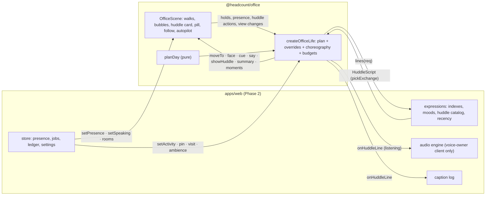

# Office life: the office runs itself (design and build plan)

> **Status.** v1.1, 29 September 2026. The design for the autonomous layer of the Office, on top of `packages/office`
> as built ([OFFICE-PLAN §9](OFFICE-PLAN.md)), with every fix of the UX, game-feel and comedy review
> ([`screens/office-life/REVIEW.md`](screens/office-life/REVIEW.md)) applied: §9 maps each finding to its change and its
> evidence. Where the review changed a number or a rule, the sections below carry the new one. Owner request (verbatim): *"the new office layout mode should be fully
> autonomous - the agents move around automatically and even talk near the water cooler. It adds more liveliness to
> the whole thing. We want this to feel familiar and meaningful, not arduous and unusable - please ensure the user
> experience is delightful!"*
>
> **Binding inputs.** OWNER-DIRECTIVES **D3** ("The office runs itself", "Faces are the status UI", minimal, dark,
> reduced motion replaces walking with fades) and **D5** ("Water-cooler small talk", "Honest and never annoying",
> Ambience); D2 (presence is never "busy, try later"); OFFICE-PLAN §1.6 (motion), §2 (people and states), §3.4
> (amenities), §3.8 (budget), §4 (interactions), §5.3 (API), §6 (Phase 2); LIVING-WORKFORCE §3 (intents), §4 (packs),
> §5 (selection), §8 (passing-by and side-talk), §9 (Ambience and budgets), §10 (honesty).
>
> **What this document defines.** The routine model and runtime (`packages/office/src/life/**`), the huddle content
> format (`kind: "huddle_pack"`, `catalog/expressions/huddles/**`), the huddle selection engine
> (`packages/expressions/src/huddle.ts`), the camera behaviours (autopilot, follow, "What's happening"), budgets,
> tests and the Phase 2 host wiring. Where it changes an earlier document, §0.2 lists the amendment.
>
> **Schematic.** A day on the floor for eight real catalog personas, generated from the §2 rules by a throwaway
> prototype (not the engine): [`screens/office-life/routine-sketch.svg`](screens/office-life/routine-sketch.svg).

---

## 0. Office life on one page

Open the Floor at 10:40 on a Tuesday and the office is already going about its morning. Most people sit at their desks.
Kate and Pax stand at the water cooler, as they do most mornings, and a bubble over Kate says *"I'd grab an espresso if
I had hands."* Two people stroll the boulevard toward the coffee bar, one nods at a colleague passing the other way.
Juno's monitor glows in her accent: she is really working, so she stays put. Nothing asks for attention. Rest the
pointer on the water cooler and a small card shows what they are saying; press **Listen** and you hear it in their own
voices; press **Join** and they turn, Kate says *"Oh, hi Dana!"*, and you are in a quick group chat. Click anyone,
anywhere, and you are talking to them at once. Press **F** and the camera follows them back to their desk. At 23:00 the
floor is quieter: a couple of people at the north glass looking at the city, the Night Shift lamps where real work runs.

| Decision | Choice | Why (short) |
|---|---|---|
| Time model | The owner's real local time. Minute-scale rhythms (desk blocks 10–30 min, breaks 1.5–4.5 min) around a few stable **daily anchors** per person ("Kate: water cooler ≈ 10:40") | Familiar enough to learn, lively enough to glance at (§2.5) |
| Plan | One **deterministic day plan** for the floor from `seed + day + people + personality + Ambience`; real state masks it (**overrides**) | The same floor on every device; testable on a fake clock; free when off-screen (§2.5, §2.9) |
| Truth | Away from the desk means **available**. Real work, raised hands, rooms, calls and the owner's attention always win | D3 "Real work always overrides", D2 presence (§2.9) |
| Walking | A **stroll** (≈ 42 u/s, trapezoid speed profile, rounded corners, keep-right lanes, facing hysteresis) | No sliding, no stampedes (§2.6) |
| Caps | Walkers ≤ 4 / 8 / 12, active huddles ≤ 3 / 6 / 8 (the night floor ≤ 1 / 1 / 2) (Quiet / Lively / Buzzing); ≤ 3 ambient bubbles on screen | Social, never chaotic (§2.5, §3.3) |
| Social floor | The café's cooler and counter hold a group most of the working day; most breaks are with someone (a second person at a spot makes it a conversation); groups of three and four at the café and the lounge sofa | The ask: "they even talk near the water cooler" (§2.5) |
| Small talk | **Pre-authored exchanges** of 2–4 turns, cast by personality, shown only when someone is looking, one bubble per huddle, **in a rhythm**: several exchanges 20–40 s apart while watched; a framed quiet huddle talks within a second | Personality without noise; zero model cost (§3, §5) |
| Honesty | Small talk never claims facts, work or a body; anything about real work comes only from grounded slots | D5 (§5.5) |
| Voice | Only for a huddle the owner **listens in** to, only on the **voice-owner client**, within the ambient voice budget | D3, D5 (§3.6) |
| Owner | Hover to read, **Listen**, **Join** (greeted by name), click anyone to talk, **F** to follow | One gesture each (§3.5, §4.2) |
| Camera | Opens at **L1 on the liveliest neighbourhood** (or the owner's last camera); **Autopilot** (optional, off by default, offered once), **Follow**, a quiet **What's happening** pill | Life is visible the moment the office opens; never hijacked (§4) |
| Motion safety | Reduced motion: fades instead of walks, no autopilot; a **Pause** control | WCAG 2.2.2, EXPERIENCE §4.6 (§4.5) |
| Budget | Zero rAF unless a *visible* walker or the camera moves; nothing runs while the office is off-screen; plans and replans in idle slices; walkers at plan zoom on their own layer at ≤ 30 Hz | OFFICE-PLAN §3.8 (§7.1) |

### 0.1 Rules (every mechanism below must pass these)

| # | Rule | Test |
|---|---|---|
| O1 | **Movement tells the truth.** A person away from their desk is available. Nobody working, thinking, speaking, raising a hand, in a room or on a real call follows the ambient plan. Life never lights a monitor or a lamp. | Sim: 0 ambient segments during real claims; 0 `setPresence` calls from life |
| O2 | **The owner comes first.** Nobody walks away from the owner's attention: hovered, focused, dragged, in a bubble or chat with the owner, or in a joined huddle. | Director test: 0 walk starts for held people |
| O3 | **Never chaotic.** Walkers, huddles, bubbles and spot capacities stay within the caps at every instant. | Sim at 1 s resolution over a Buzzing day |
| O4 | **Grounded or silent.** No small-talk line claims a fact, a result, work in progress or a human body; lines about real work fill only from real, team-visible events. | Content lint + 1,000-pick fuzz: 0 violations |
| O5 | **Legible.** One bubble per huddle, ≤ 3 ambient bubbles on screen, reading-time TTLs, no bubble over anyone's face or name plate (groupmate or bystander), the HUD or the open card; laughs are caption chips, not bubbles. | Director and scene tests + screens |
| O6 | **Familiar.** A person's anchors fall within ± 5 min and at the same spot on ≥ 4 of 5 work days; crews stay together while the team is stable. | Sim over 5 days |
| O7 | **Effortless.** Nothing requires interaction; life sends no notifications, badges or counters that ask for action. Every person and huddle is one gesture away. | Review checklist, e2e |
| O8 | **Cheap.** No per-frame work for off-screen walkers, no timers while the office is off-screen, 60 fps pan with life at Buzzing. | Perf probe (§7.1) |
| O9 | **Deterministic.** The same seed, day, people and Ambience give the same plan, byte for byte. | Golden hash test |
| O10 | **Accessible.** Reduced motion replaces walks with fades; a Pause control stops ambient motion; every small-talk line is captioned; the Directory stays the full alternative. | a11y checks, reduced-motion e2e |

### 0.2 Amendments to other documents

| Document | Current text | Amendment |
|---|---|---|
| OFFICE-PLAN §1.6 | "There are no idle loops, steam, swaying plants or fake typing." | Still true for props and monitors. People now take walks, but every walk has a cause: the availability plan (§2.5) or a real event (§2.9). No mugs or props in hands, no typing animation. Ambient walks use the stroll (§2.6); owner-initiated room walks keep 260 u/s. |
| OFFICE-PLAN §1.5, §3.4 | Phone booths "free in Inc 0.7 (later: a coworker on a call)" | Booths hold **real calls only** (§2.4). Ambient life never uses booths or conference rooms. |
| OFFICE-PLAN §4.3 | Keyboard map | Adds **H** (next huddle), **F** now also follows (§4.2, §4.6). **L** stays the host's key; the host maps it to listen-in on the hovered huddle. |
| LIVING-WORKFORCE §0.2 (EXPERIENCE X3) | "An idle office still looks idle: no chatter without an event or an owner approach." | Monitors and lamps still glow only for real work. Idle people now visibly take breaks, which is the honest picture of idle time, and huddles may show **small talk** (D5 "Water-cooler small talk"), limited to non-factual topics unless grounded, and only while someone is looking. |
| LIVING-WORKFORCE §9.1 | `max_visible_bubbles` Quiet 0 / Lively 1 / Buzzing 2 covers passing-by and side-talk | **A1.** Adds a `smalltalk` column (§2.5 table): huddle bubbles Lively 2, Buzzing 3, Quiet 0, under a hard ceiling of 3 ambient bubbles on screen of any kind. Passing-by and side-talk keep their own caps and pre-empt small talk. The small-talk budget is separate from the chatter budget. |
| LIVING-WORKFORCE §4.6, §10.1 H6 | Embodiment words are banned in micro-talk | **A2.** Huddle lines in the `self_aware` topic may use embodiment words only as counterfactuals ("if I had hands", "no taste buds"). The huddle lint enforces it (§5.5). Everything else keeps H6. |
| This document v1.0, §2.5 | Active huddles ≤ 2 / 3 / 4; Lively 1 exchange per huddle, 6 lines a minute (burst 4); Buzzing 2, 10 (6) | **A3 (the review).** Active huddles ≤ 3 / 6 / 8 (night ≤ 1 / 1 / 2); exchanges per huddle Lively 3, Buzzing 4, 20–40 s apart while watched; small-talk lines Lively 10 a minute (burst 6), Buzzing 14 (8). Visible huddle bubbles stay 0 / 2 / 3 under the hard ceiling of 3. Laughs are caption chips outside the bubble and line budgets. |
| LIVING-WORKFORCE §4.6 (passing by) | Passing-by lines are about the agent's current work | **A4.** Someone on a break, in a huddle or walking is available: their hover line is about availability ("On a little break. What do you need?", `strings.life.availability`), never a work status. |

---

## 1. Experience goals and delight principles

### 1.1 The feeling: an office aquarium

The Office should feel like a well-run studio seen through glass: calm, alive, readable at a glance and never in need
of looking after. The owner should be able to leave it open on a second screen and feel the team is *there*, and to
drop in on anyone in one gesture.

| Principle | What it means on screen | Mechanisms | Bar |
|---|---|---|---|
| **Familiar** | People have habits you learn. Kate is at the water cooler mid-morning; the design crew gathers at the coffee bar; Eddie walks the floor in the afternoon; night owls stand at the north glass. | Stable per-person anchors from the persona id (§2.2), crews (§2.2), favourite spots, a stable seat | O6; owner panel: "who usually hangs out at the water cooler?" answered after 3 sessions |
| **Meaningful** | Movement says something true. An empty desk means "available, stepped away"; a glowing monitor means real work; a person walking back briskly means work just started; a welcome huddle means a real hire; a win huddle follows a real accepted deliverable. Huddles reveal personalities: the blunt one says the thing, the gentle one softens it. | Overrides (§2.9), grounded topics (§5), casting by archetype (§6.2) | O1, O4; panel "felt fake" ≤ 2.5 / 7 |
| **Effortless** | Zero required interaction. Glance and understand. No counters, prompts or chores. | Life runs on its own; the What's happening pill is informational; nothing notifies | O7 |
| **Never chaotic** | A few movers at a time, unhurried, one voice per group, bubbles you can read. | Caps and density curve (§2.5), stroll physics (§2.6), bubble rules (§3.3) | O3, O5; panel "annoying" ≤ 2.5 / 7 |
| **Instantly actionable** | Talk to anyone wherever they are, join a huddle, follow someone, in one gesture. The person you point at never walks off. | Owner hold (O2), click-to-talk on walkers and huddlers, Join, F (§3.5, §4.2) | e2e: click a walker → reply field focused in < 100 ms |

### 1.2 Small moments of delight

Each costs little and each is true to the rules above.

- **The first ten seconds.** The Office opens at L1 on the liveliest neighbourhood (usually the café), and a huddle
  already there talks at once (no settle beat). If nobody is walking in view, the director pulls the nearest planned
  departure within the next two minutes forward to now (§2.10), so the floor visibly breathes at once.
- **Someone walks up.** A pair at the cooler often becomes three: a colleague on a break walks up and joins; a second
  person arriving at someone's solo break makes it a conversation instead of two strangers standing apart.
- **Habits you can see.** A crew's card says "Their usual 10:40 at the water cooler", and so does What's happening.
- **The glyph murmurs.** Zoomed out, a huddle's glyph pulses in the speaker's accent while a line runs; the pill's
  tooltip shows the nearest huddle's latest line.
- **A nod in the aisle.** Two people passing within 8 u in opposite directions at L1+ both get a `nod` cue. No words.
- **Arrival.** Whoever is already at the spot looks up and smiles at the newcomer before the chat starts.
- **A laugh ripple.** A laugh beat plays the speaker's own laugh style (from their signature pack) and the others smile.
- **Night glass.** After 20:00 people drift to the north windows more often and face the city; their bodies turn away
  from the camera at L0.
- **A welcome huddle.** A real `hired` event gives the newcomer a welcome huddle with teammates within the hour.
- **After a win.** A real accepted deliverable makes the team's next huddle prefer a grounded `wins` exchange.
- **Joining.** The group turns toward you and one of them greets you by name.
- **The Chief walks the floor.** Every afternoon the Chief of Staff strolls through a few neighbourhoods and back
  (and stops at the coffee bar mid-morning), unless you are talking to them.
- **The owner's regulars.** Autopilot favours huddles with people you talked to recently (§4.1).

### 1.3 Anti-patterns to avoid

| Anti-pattern | What it feels like | Guard |
|---|---|---|
| **Arduous navigation** | "Where did Kate go?", hunting across 88 m of floor | Find (`/`), Home and arrow focus fly to where the person *is*; a ghost plate on the empty desk at L2 ("Kate · coffee bar"); location in the seat's accessible name; Follow (§4.2) |
| **Walking out from under the cursor** | The person you are about to click leaves | Owner hold (O2): hovered, focused, dragged, in a bubble or chat → no walk starts; a walk in progress eases to a stop within 0.5 s |
| **Noisy bubbles** | Walls of text, overlapping speech, chatter everywhere | Visible-only talk, one bubble per huddle, ≤ 3 on screen, an 80 u talk token between nearby huddles, reading-time TTLs, owner-directed bubbles hush nearby huddles (§3.3) |
| **Repetitive loops** | The same joke twice; someone pacing desk ↔ cooler every minute | Floor-wide daily caps and 14-day participant memory for exchanges (§6.2); desk dwell floors; ≤ 3 visits to the same spot per 2 h outside anchors |
| **Clockwork** | Everyone leaves at :00; the same thing every day | Anchors jittered ± 5 min per day, one anchor day in five skipped, departures jittered ± 20 s and staggered |
| **Uncanny sliding** | Badges skating at constant speed, snapping round corners, moonwalking, overlapping | Trapezoid speed profile, rounded corners, keep-right lanes, facing matches direction with hysteresis, arrival turn, a 0.6 px gait bob at L1+ (§2.6) |
| **Stampedes** | Half the floor moving at once | Walker caps, density curve, departures shifted rather than piled up (§2.5) |
| **Fake busyness** | People "on calls" in booths, ambient meetings, fake typing | Booths and rooms are real-only; monitors light only for real work; no props in hands (O1) |
| **Talking behind the owner's back** | Gossip, jokes at the owner | Ambient small talk never mentions the owner; laughter never at a person (§5.5) |
| **Guilt and pressure** | Idle people looking bored or asking for work | No soliciting or boredom lines in small talk; idle reads as pleasant availability |
| **Camera hijack** | The view drifts while you read | Autopilot is opt-in, stops on any input, never runs while you interact (§4.1) |
| **Performance jank** | Pan stutters once life runs | Visible-only animation, a separate walker layer, idle-time planning, off-screen suspension (§7.1) |

---

## 2. Routine model

### 2.1 Inputs

`packages/office` stays dependency-free. The host passes personality as plain data (Phase 2 builds it from the catalog
and `@headcount/expressions`' `resolveBlend`, §7.3):

```ts
interface OfficeLifePerson {
  id: string;                                   // the OfficePerson id ('cw_<personaId>', the Chief's id)
  sliders?: Partial<Record<'warmth' | 'directness' | 'formality' | 'humor' | 'risk_appetite' | 'detail' | 'pace', number>>; // 0–100
  traits?: readonly string[];                   // catalog personality.traits
  blend?: Readonly<Partial<Record<ArchetypeName, number>>>; // resolveBlend(): e.g. {meticulous: .56, 'calm-steady': .22, analytical: .22}
  pairsWellWith?: readonly string[];            // person ids (the host maps persona ids to agent ids)
  tensionWith?: readonly string[];              // productive_tension_with, as person ids
  teamRoles?: readonly string[];
}
```

Department (`groupId`), seniority and the Chief (`leadId`) come from the scene's `OfficePerson`s. Missing data falls
back to neutral values (slider 50, blend `{calm-steady: 1}`), so life works with the demo's slim catalog too.

### 2.2 Personality becomes habits

Sliders are normalised against the catalog, as the expressions engine does:
`z_k = clip((s_k − μ_k) / σ_k, ±2.5)` with catalog 1.0 statistics as defaults (warmth 72.0 / 12.8, humor 58.7 / 13.3,
pace 55.7 / 16.1, detail 78.3 / 12.6, directness 68.4 / 10.1; overridable with `sliderStats`). `σ(x) = 1 / (1 + e^−x)`.

| Knob | Formula | Drives |
|---|---|---|
| **Sociability** `s` | `σ(0.9 z_warmth + 0.6 z_humor − 0.3 z_detail + 0.5·[warm, playful, gregarious, outgoing, chatty, energetic] − 0.5·[reserved, quiet, introverted, private, soft-spoken, understated])`, clamped 0.1–0.9 | Social share of breaks `0.35 + 0.45 s` (× 0.6 at Quiet, × 0.4 at night); initiating huddles; drop-by visits `0.05 s`; a drop-by as an ad-hoc choice only when `s ≥ 0.6`; group size |
| **Restlessness** `r` | `σ(1.0 z_pace + 0.3 z_risk_appetite − 0.4·[calm, steady, unflappable, composed])` | Break frequency (desk dwell × `1.25 − 0.5 r`), break length (× `0.8 + 0.4 (1 − r)`), stroll speed (× `0.85 + 0.3 r`) |
| **Humour** `h` | `σ(1.1 z_humor)` | Casting for playful and dry roles, laugh beats |
| **Curiosity** `c` | `σ(0.7 z_detail + 0.4·[research, data or analysis department])` | Library and window preference |
| **Blend** | From the host (expressions `resolveBlend`) | Spot preferences (below) and casting (§6.2) |

**Spot preference.** `w(p, spot) = Σ_a blend_a · PREF[a][kind] × proximity × timeOfDay[kind] × free capacity`, with
`proximity = exp(−walkLength / 400 u)` (the coffee bar and water cooler use 600 u: they draw from everywhere), nooks only
in the person's own neighbourhood, windows only within ± 1 column.

| Archetype | Coffee bar | Water cooler | Lounge | Library | Window | Nook | Drop-by |
|---|---|---|---|---|---|---|---|
| warm | 1.2 | 1.4 | 1.2 | 0.6 | 0.8 | 1.0 | 1.5 |
| dry-wit | 1.0 | 1.5 | 0.8 | 1.0 | 1.0 | 0.8 | 0.8 |
| energetic | 1.6 | 1.2 | 0.8 | 0.4 | 0.6 | 0.8 | 1.3 |
| calm-steady | 0.8 | 0.8 | 1.4 | 1.0 | 1.5 | 1.2 | 0.6 |
| blunt | 1.3 | 1.0 | 0.6 | 0.8 | 0.8 | 0.8 | 1.0 |
| playful | 1.2 | 1.5 | 1.4 | 0.5 | 0.8 | 1.0 | 1.2 |
| meticulous | 0.8 | 0.8 | 0.6 | 1.6 | 0.8 | 1.2 | 0.6 |
| gentle | 0.8 | 1.0 | 1.3 | 1.2 | 1.4 | 1.2 | 0.8 |
| hustler | 1.6 | 1.2 | 0.6 | 0.4 | 0.6 | 0.8 | 1.4 |
| visionary | 1.0 | 1.0 | 1.2 | 0.8 | 1.8 | 0.8 | 1.0 |
| analytical | 0.8 | 0.9 | 0.6 | 1.7 | 0.8 | 1.0 | 0.6 |
| veteran | 1.5 | 1.0 | 1.0 | 1.0 | 1.2 | 0.8 | 0.8 |

**Anchors: the habits you learn.** Every person gets 1–4 daily anchors, seeded by the **persona id only**, so a
persona's habits are the same in every workspace and on every device. Anchor time = window start + a seeded offset;
each day adds ± 5 min of jitter (`seed | personId | dayKey`), and one anchor day in five is skipped.

| Anchor | Window (owner-local) | Chance | Spot | Dwell |
|---|---|---|---|---|
| `morning` | 09:30–11:15 | `0.55 + 0.3 s` | Signature spot among coffee bar and water cooler; window or library when `s < 0.35` | 3–6 min |
| `midday` | 12:00–14:00 | 0.5 | Lounge or nook | 3–5 min |
| `afternoon` | 15:00–17:00 | `0.2 + 0.5 r` | Water cooler or window | 2–4 min |
| `evening` | 18:30–21:00 | 0.3 | Window (dusk, city lights) | 3–5 min |
| `night` | 22:00–01:00 | `0.25 c` | Window | 3–6 min |

The **signature spot** is the person's top-weighted spot (seeded tie-break); it is where their anchors happen, so
"Kate is at the water cooler mid-morning" holds week after week.

**Crews: the people you see together.** Crews of 2–4 form once per people set (seeded by sorted ids, greedy by
descending sociability) within a district, maximising
`affinity(a, b) = 1.0·pairs_well_with (either way) + 0.6·same department + 0.4·productive_tension + 0.3·same district
+ 0.2·same signature spot + 0.1·seniority mentorship (principal or lead with a specialist)`.
About half the floor is in a crew. A crew's morning anchors merge into a **crew huddle** at the crew's spot and time
(the most sociable member's), on four work days in five. Crews change only when their members' groups change.

**The Chief of Staff** has a steadier template: in the office ≥ 88 % of the day (desk dwell 30–60 min), a `morning`
coffee-bar anchor, and a `floor walk` anchor in the afternoon (a loop through 3–4 neighbourhoods and back, 3–5 min, with
two 15 s pauses). The Chief never joins ambient huddles longer than 3 min and is pinned to the office while the owner is
in Talk with them (§2.9).

### 2.3 Places (spots)

`planSpots(plan)` derives spots from the plan's cells and props (pure; not part of `OfficePlan.hash`, so the plan tests
and hashes do not change). Each spot has **slots** (a point, a facing toward the spot's centre, a posture), an
**approach** point on a corridor or cell gap line (attached to the walk graph like a seat's exit), and time-of-day
multipliers.

| Spot kind | Where (from `plan/props.ts`) | Slots | Huddles? | Night × | Notes |
|---|---|---|---|---|---|
| `coffee_bar` | Café cell: counter front (stand 4, 15 u apart), island stools (sit 2 of the 4 stools, ≥ 16 u apart so name plates never run together), high table (sit 2): three spots | 8 | Yes (2–4; 4 at the counter) | 0.6 | The social centre; its own spots so two small groups can share it |
| `water_cooler` | Café cooler (stand 4), library cooler (stand 2) | 6 | Yes (2–4 at the café) | 0.8 | The canonical small-talk spot; one solo break at a time (a second person makes it a conversation) |
| `lounge` | Lounge sofa (sit 3 + a standing place at its end) and armchairs (sit 2); reception benches; neighbourhood commons nooks (2 armchairs each) | 6 + 2 per bench + 2 per nook | Yes (2–4; 4 at the sofa) | 1.2 | Nooks are local: a department's own corner |
| `library` | Reading chair (sit 1), shelf browsing points (stand 2) | 3 | Rarely (2, hushed) | 1.2 | Also the **work place** for real research (§2.9) |
| `window` | Two stand points per north-row column in the window clearance, ± 1 column from the person | 2 per column | Yes (2) | 2.2 (dusk 1.5) | Night favourite |
| `hallway` | Boulevard stand points beside the columns | 3 each | Yes (2–3, short) | 0.5 | Brief stop-and-chat |
| `desk_dropby` | The end of a teammate's desk on the aisle side, a desk pitch (16 u) out, on a side with no seated neighbour and never on the neighbourhood's floor sign | 1 visitor + the seated host | Yes (visitor ↔ host) | 0.7 | Only to an idle host (§2.4); titled "At Jasleen's desk · Nayra visiting" |
| `phone_booth` | The four library booths | 1 each | No | — | **Real calls only**; no huddle exchange may list it (validator error) |

Conference rooms are never ambient: people are in a room only when the owner seats them (OFFICE-PLAN §4.5) or, in
Inc 2, when a real RoomDO meeting holds them.

### 2.4 Activity states

| State | Source | Where | Dwell (Lively, daytime) | Badge and status line (L2) | Light |
|---|---|---|---|---|---|
| `desk` | Ambient | Own desk | 10–30 min × `(1.25 − 0.5 r)` / density | Idle as today (no status line; Night Shift if badged) | Monitor off |
| `break` | Ambient | Coffee bar, water cooler, lounge, nook, library, window | 1.5–4.5 min × `(0.8 + 0.4 (1 − r))` | The place: "Coffee bar", "By the window" | — |
| `huddle` | Ambient | A spot with ≥ 2 people | 1.5–4 min (anchors 3–6 min) | "Water cooler · with Pax" | — |
| `visit` | Ambient (Inc 1: also real, §2.9) | Beside an idle teammate's desk | 45–120 s | "At Juno's desk" | — |
| `walking` | Transition | Aisles and corridors | 2.5–16 s | Unchanged; a real state shows at once | — |
| `focus` | **Real** (`working`) | The work place: the desk, or the library for research | While real | The real label ("Reading 14 reports") | Monitor in accent (library: the reading lamp in accent) |
| `call` | **Real** (a live voice call) | A free phone booth, else where they are | While real | "On a call with you" | Booth lamp |
| `meeting` | **Real** (a room seat) | Room seat | While real | "In the Skyline room" (existing) | — |
| `held` | **Owner** attention | Where they are, facing the viewer | While the owner attends + grace | As today | — |

Visits go only to a teammate whose plan says `desk` and whose presence is idle at departure. If the host starts real
work before the visitor arrives, both nod and the visitor turns back after 3 s.

### 2.5 The day plan

**Algorithm** (`planDay`, pure and deterministic; a generator that yields every few units of work, so `planTask` runs it
in idle slices of ≤ 8 ms and the office never blocks a frame; the whole Lively day costs ~150 ms of CPU in Node):

1. **Knobs, preferences and crews** per people set (cached by a people hash).
2. **Density** per 15-minute bucket: `D(t) = TOD[t] × dayFactor × AMBIENCE.k`, `dayFactor` 1.0 on work days (the
   workspace's `workDays`, default Monday–Friday) and 0.7 otherwise.
3. **Anchors** for the day: the Chief's rituals; **crew huddles** at the most sociable member's morning anchor with
   **every member of the crew who is free** (a crew huddle keeps its `usualMin`, the stable minute without the daily
   jitter, so the card can say "Their usual 10:40 at the water cooler"); personal anchors.
4. **The social spots' rhythm**: at the café cooler and counter a new group gathers `Exp(150 s / D(t))` after the last
   one leaves (Quiet: the cooler only, `× 2.4`), 07:30–22:00. Measured over 09:30–17:30 (demo seed, Tuesday): the cooler
   or the counter holds a huddle **84 %** of the time at Lively, **87 %** at Buzzing and **32 %** (silent) at Quiet.
5. **Ad-hoc huddles**: per 5-minute bucket, `n ~ Poisson(λ_h · D(t))` (Lively λ_h = 0.9). The initiator is drawn by
   `s²` among free people; a group of three or more picks a spot that holds it; partners by
   `affinity × variety (× 0.3 if they huddled together in the last 2 h) × (0.4 + s)` among people within a walk of
   **20 s for social spots** (café, cooler, lounge) or 12 s elsewhere; sizes 2 / 3 / 4 with weights 0.42 / 0.34 / 0.24,
   capped by the spot (4 at the counter, the café cooler and the lounge sofa outside anchors; 3 elsewhere at Lively).
   Proposals are **flexible**: whoever of the group is free comes (≥ 2).
6. **Visits and breaks**: a renewal process per person: desk dwell `U(10, 30) min × (1.25 − 0.5 r) / D(t)`, then a
   visit (probability `0.05 s`), else with probability `0.35 + 0.45 s` a **social break**: walk up to a group that is
   talking (each group has a seeded size: half stay pairs, some grow to three, a few to four), else **join someone on a
   solo break** at a liked spot (their breaks overlap ≥ 30 s: the joiner takes the slot next to them and the two become
   a pair huddle), else gather a few people; otherwise a solo break, which also joins someone already there rather than
   standing apart. **At most one solo break at a time at the coolers and the counter.**
7. **Conflicts** resolve in priority order: anchors > crew huddles > the café rhythm > ad-hoc huddles > visits and
   breaks. A proposal that collides (person busy, slot full, huddle cap, walker cap at its departure) shifts by up to
   ± 3 min, else drops. The night floor (22:00–06:00) keeps ≤ 1 huddle at a time (Buzzing 2).
8. **Walk timing**: each segment gets `departAt = start − walkTime(from, to)`, departures jittered ± 20 s; the walker cap
   is enforced by delaying segments, never by speeding people up.
9. **Output**: per-person segments, planned huddles and a `hash`.

Seeds: anchors `fnv1a(personId)`; the day `seed | dayKey`; per person `seed | personId | dayKey`; huddle ids
`hd:<dayKey>:<spotId>:<startMinute>`. The seed is the workspace id, so every device of the owner shows the same floor at
the same Ambience. A change of Ambience or people replans the rest of the day from `now + 30 s`; segments in progress
finish.

**Time of day** (`TOD`, owner-local):

| Local time | 00:00–06:00 | 06:00–08:00 | 08:00–09:30 | 09:30–11:30 | 11:30–14:00 | 14:00–16:30 | 16:30–18:00 | 18:00–20:00 | 20:00–24:00 |
|---|---|---|---|---|---|---|---|---|---|
| Density | 0.25 | 0.45 | 0.8 | 1.0 | 0.9 | 0.85 | 1.0 | 0.7 | 0.45 |
| Character | Night floor: mostly desks, a few at the glass, ≤ 1 huddle (Lively) | Quiet start | Coffee bar weighted | Anchors, crews | Lounge weighted | Steady | Water cooler, window at dusk | Window, lounge | Window × 2.2, soft night content |

Agents are always present (D2), so there are no arrivals, departures or commutes, and nobody "goes home". Night Shift
lamps stay truthful: they light only from the real `lamp` badge, never from life.

**Ambience** scales the energy (D3):

| | Quiet | Lively (default) | Buzzing |
|---|---|---|---|
| Density `k` | 0.4 | 1.0 | 1.45 |
| Max walkers at once (phones) | 4 (3) | 8 (5) | 12 (6) |
| Max active huddles (night) | 3 (1) | 6 (1) | 8 (2) |
| Huddle sizes | 2 | 2–3 (4 at anchors, the counter, the café cooler, the lounge sofa) | 2–4 |
| Small talk | None: **silent huddles** (they stand together, nod and smile) | Bubbles, up to 3 exchanges per huddle 20–40 s apart while watched (+1 while listened to) | Bubbles, up to 4 exchanges per huddle |
| Visible huddle bubbles (A1) | 0 | 2 | 3 |
| Small-talk budget (visible spoken lines) | 0 | 10 / min, burst 6 | 14 / min, burst 8 |
| Voice | Never | Listen-in only | Listen-in only |
| Laugh beats | Face only | A caption chip + smiles | A caption chip + smiles (+ voice on listen-in) |
| Habituation (10 min without owner camera input) | — | About one new exchange every 3 minutes floor-wide | Falls back to Lively's caps |

**Calibration (as built, 09:30–17:30, the demo seed on a Tuesday).** Lively: **13.8 % of people away** from their
desks, 1.8 walkers on average floor-wide, **4.9 huddles at once** (never none), a third of the people away on a solo
break and the rest with someone, **30 % of people in huddles are in groups of three or four** (at the café and the
lounge sofa **74 %** of groups are three or four), drop-bys **2–3 %** of huddles. Quiet: 6.8 % away, 2 huddles at once.
Buzzing: 17.1 % away, 2.3 walkers, 6.5 huddles. Every person still spends ≥ 85 % of the day at their desk (the Chief
≥ 88 % in the office), so desks stay the place to find people.

### 2.6 Transitions and walking

- **Routing.** `walkBetween(plan, from, to)` generalises `plan/walk.ts`: attach both ends to the aisle graph (a seat by
  its exit, a spot by its approach point, a room by its door), Dijkstra, then a short clear leg to the slot. Paths never
  cross room glass or furniture with height > 3 u (tested).
- **Speed.** The ambient **stroll** is `42 u/s × (0.85 + 0.3 r) × (1 + 0.1 · energy)`, 36–52 u/s (about 3× real
  walking pace: legible at fit, calm at L1). Walks last 2.5–16 s; longer paths speed up to fit 16 s, never above
  70 u/s. **Brisk** (90 u/s, ≤ 5 s) is for real-state returns. Owner-initiated room walks keep 260 u/s.
- **Profile, not a tween.** A trapezoid velocity profile (0.4 s acceleration, cruise, 0.5 s deceleration) replaces
  `easeInOut` over the whole path, which looks like a slow start and a sprint in the middle on long walks.
- **Corners.** Every corner becomes a quadratic arc of radius 4 u, walked at constant speed.
- **Lanes.** On corridors walkers keep 2.5 u to the right of their direction, so opposite walkers never overlap;
  departures are staggered ≥ 150 ms so same-direction walkers do not stack.
- **Facing.** The body glyph (L0) turns to the direction of travel after it has held for 0.15 s (no flicker on arcs).
  On arrival the person turns to the spot's centre (huddles: the group's centroid) 150 ms after stopping.
- **Gait.** At L1 and L2 the face badge bobs 0.6 px at 1.9 Hz while walking (a transform, off with reduced motion).
  Departure has a 250 ms beat (the badge lifts 2 px); chairs stay pulled out, as for room walks.
- **Layering.** Walking bodies move to their own world-space SVG layer (`.hc-o-walkers`, promoted only while a visible
  walker moves), so a walk never repaints the plate.
- **Off-screen walkers are not animated.** A walk is a function of time along its path; the position is computed only
  when the person is visible (or becomes visible) or the walk ends.

### 2.7 Occupancy and collisions

- Slots are reserved per interval (arrival to departure) in the plan, so capacity holds by construction.
- At runtime an override can leave someone in a slot unexpectedly. An arriving person then takes the next free slot of
  the same spot, else an **overflow point** 6 u outside the spot's footprint (standing, facing the group), else the
  visit is cancelled and they return to their desk.
- A huddle with fewer than two people present (after overrides) ends; the remaining person lingers 3–8 s and leaves.
- Huddles within 80 u of each other share one **talk token** (§3.3), so bubbles never overlap.

### 2.8 Time of day and the night floor

- The plan reads the owner's local clock (`now()`), including daylight-saving days (local minutes from local midnight).
- The night floor (22:00–06:00): density 0.25, huddles of two, window × 2.2, night content (`part_of_day:late_night`),
  softer delivery. The skyline and Night Shift lamps are unchanged (OFFICE-PLAN §1.3, §2.2).
- A day rollover while the office is open plans the new day at 00:00 in idle time; people keep their current segment.

### 2.9 Real-state override

Real state always wins (D3). The scene already receives `setPresence`, `setSpeaking`, room seating and pointer state,
so life reads them from the scene automatically; the host adds only what the scene cannot know (activity, owner chats,
calls). Claims resolve by priority:

| # | Claim | Where the person is | How they get there | Ends |
|---|---|---|---|---|
| 1 | **Owner attention**: hovered (dwell), keyboard-focused, dragged, a bubble or quick chat with them open, speaking with the owner, a joined huddle | Where they are, turned toward the viewer | No walk; a walk in progress eases to a stop within 0.5 s | Pointer and focus: 3 s after leaving. Chat: 20 s after its last exchange |
| 2 | **Room** (`enterRoom`, `seat`, invite) | Room seat | Existing room walks (260 u/s) | `leaveRoom`, `seat(id, null)` |
| 3 | **`raised_hand`** (or the `hand` badge) | Own desk (the hand halo lives there) | Brisk | State change |
| 4 | **`working`** (a job) | The **work place**: the desk, or `ACTIVITY_PLACES[activity]` (research → library reading chair, if free) | Brisk after 1.5 s of hysteresis; the badge shows the state at once | Idle, then 60–120 s of wrap-up at the desk |
| 5 | **`thinking`, `listening`, `speaking`** (conversation layer) | Where they are | None: a two-second think never moves anyone | State change |
| 6 | **Call** (a live voice call from outside the office view) | A free phone booth, else where they are | Brisk | Call end, then a stroll back |
| 7 | **Ambient plan** | The plan's place | Stroll | — |

Rules:

- **Hysteresis.** A work claim shorter than 1.5 s never moves anyone, and a person's work place changes at most once per
  3 minutes (a research → document → research flicker keeps them where they are).
- **Rejoining the plan.** When a claim ends, if the current segment is ambient with ≥ 60 s left the person strolls
  there; otherwise they stay (or stroll to their desk) until the next segment.
- **The Chief's real activity maps to places.** `research` → library, `document` / `llm` / `analysis` → desk, talking
  with the owner in Talk → the office (host pin, §7.3), `meeting` → the room. Inc 0 jobs carry no activity type, so the
  host uses `activityOf(label)`, a conservative verb classifier exported by the life module ("Researching…",
  "Reading…", "Looking into…", "Comparing…" → research; "Drafting…", "Writing…", "Editing…" → document; otherwise
  `null`, the desk). Inc 1 steps pass their catalog `activity_type` directly.
- **Real visits (Inc 1).** For `handoff` and `ask` events the host calls `life.visit(from, to, {cause})`: the giver
  walks to the receiver's desk (if both are free and the walk is ≤ 12 s) and the side-talk bubbles (LIVING-WORKFORCE
  §8.3) play when they arrive (≤ 12 s later). Real collaboration becomes something you see.
- **Life never writes presence.** It moves people and shows small talk; presence, monitors and lamps stay the
  host's truth.

### 2.10 Continuity

- **Opening.** Everyone is placed where the plan says they are *now*, instantly; walks in progress resume mid-path.
  If nothing moves in view, the nearest departure planned within 2 minutes is pulled forward (§1.2).
- **Suspension.** An `IntersectionObserver` on the scene root and `visibilitychange` suspend life: timers cleared, no
  rAF. On resume it snaps to the plan at `now` (visible changes fade, 160 ms) and replays nothing it missed; huddles in
  progress continue silently until a new exchange is due.
- **People changes.** `setPeople` (a hire, pods in Inc 1) replans the rest of the day. A person whose desk moved walks
  there (the existing FLIP walk) and their `desk` place resolves to the new seat.
- **Conference mode.** While the stage is open the floor is off-screen for life (no bubbles, no frames); people in the
  room are pinned by claim 2.
- **Pause.** The Pause control (§4.3) freezes the plan: current walks finish (instantly under reduced motion), no new
  walks or huddles start, and current huddles finish silently.

---

## 3. Huddles

### 3.1 Formation

- **Where and who.** Planned in §2.5: anchors and crews first, then ad-hoc huddles (initiator by sociability, spot by
  preference and proximity, partners by affinity). A `desk_dropby` huddle is a visit: visitor A, seated host B.
- **Size.** 2–4, limited by the spot's slots and the Ambience.
- **Affinity** (for partners and for casting, §6.2): `pairs_well_with` +1.0, same department +0.6,
  `productive_tension_with` +0.4 (and a casting bonus for `debate` exchanges), same district +0.3, shared signature spot
  +0.2, mentorship +0.1; × 0.3 if they huddled in the last 2 h (variety within familiarity: crews make up at most 60 %
  of anyone's huddles).
- **Mood.** Participants' moods (host, from the expressions mood state) shape the content: a low shared valence
  (< −0.2) excludes debates and teasing-adjacent exchanges and favours gentle ones; energy nudges stroll speed ± 10 %.

### 3.2 Choreography

| Beat | Timing | What you see |
|---|---|---|
| Initiator arrives | `t₀` | Stops, turns to the spot's centre |
| Others arrive | +2–10 s, staggered (seeded) | Someone present looks up and smiles at each newcomer |
| Gathered | ≥ 2 present | Everyone turns to the group's centroid (bodies at L0); face badges lean up to 6° toward it (`rotateY`, as the stage's tilt) |
| Settle | 1.2–2.5 s; none for a huddle already on screen when the office opens | Quiet |
| Line *k* | Previous turn's end + a pause (the line's `pause_ms`, else 600–1,200 ms seeded) | One bubble over the speaker; the speaker's badge lifts 2 px; others' badges lean toward the speaker |
| Reading time | `clamp(1,800 + 55 ms × chars, 2,200, 6,000)` ms (+ audio length when voiced) | The bubble fades 150 ms before the next turn |
| Laugh beat | ≤ 1,200 ms | A listener laughs, not the joker: a muted caption chip beside the laugher ("Emilio huffs a laugh", from their `laugh_style`; no name header, no tail), a smile cue; the others smile. Outside the bubble caps |
| Face beat | 900 ms | A cue (nod, head tilt, smile) with no bubble |
| Between exchanges | 20–40 s (seeded) while the huddle stays on screen | They stand together, no bubbles; a face beat now and then |
| Next exchange | Up to 3 per huddle at Lively and 4 at Buzzing (+ 1 at Lively while listened to), only with ≥ 25 s of dwell left. A huddle the owner newly frames talks after a 600 ms beat instead of waiting out the gap | As above |
| Dispersal | Members leave 1–4 s apart | Each strolls to their next segment |

A late arrival joins the next exchange; roles are cast only among people present. An exchange takes about 15 s; a
huddle in view talks for roughly a third to a half of its time and is quiet company in between (measured: a talk
bubble on screen in 45 % of frames with the camera on the café at L1, Lively, 10:30–10:40; §9).

### 3.3 Bubbles and legibility

- **Talk when someone is looking.** An exchange runs only while the huddle is on screen at L1 or L2 (or its card is
  open) and a small-talk token is free. A huddle already on screen when the office opens talks at once; a quiet huddle
  the owner frames talks after a 600 ms beat. Off-screen huddles are silent and **consume no content** (the `lines`
  callback is not called), which keeps the library fresh (§5.7).
- **The murmur at plan zoom (L0).** No bubbles. One huddle at a time *murmurs*: its three-dot glyph pulses in the
  speaker's accent while a line runs, and the words go to its card and to the pill's tooltip. At most one new murmur
  every 30 s floor-wide. If the owner zooms into a murmuring huddle mid-way, the murmur ends there (never a reply bubble
  without its opener) and the huddle opens a fresh exchange after the framed beat.
- **Habituation.** After ten minutes of passive viewing (no camera input), about one new exchange every three minutes
  floor-wide; listened-to huddles are exempt.
- **One bubble per huddle.** Turns never overlap within a huddle. Huddles within 80 u share one talk token.
- **Caps.** ≤ 3 ambient bubbles on screen of any kind (A1). Passing-by and side-talk bubbles (real events) pre-empt the
  oldest huddle bubble, and that huddle pauses. Owner-directed bubbles are never capped; they **hush** huddles within
  200 u until they close (the room goes quiet when you talk to someone).
- **Placement (O5).** A bubble never covers anyone's face or name plate (a groupmate's or a bystander's), another
  bubble, the HUD's controls or the open card: above the speaker, else shifted above-left or above-right (the tail stays
  on the speaker), else below (slid the same way), else beside (slid up or down if it has to); as a last resort
  narrower (≤ 200 px) and lifted above the group's top-most face, slid into the view. At the edge of the view (someone
  at the north glass under the HUD) it takes the in-view place that covers the fewest faces, never a clipped bubble and
  never under the HUD.
- **Shape.** The existing `.hc-o-bubble` with a small-talk variant: first name in the speaker's accent, text at
  ≥ 12 px, ≤ 2 lines of ~44 characters, max width 240 px, a tail to the speaker. Talk bubbles are **click-through**
  (`pointer-events: none`), so a click always reaches the person underneath.
- **Laughs are caption chips**, not bubbles: a muted italic chip beside the laugher (right, else left, never over a face
  or a bubble), ≤ 1.2 s, with the smile cue, outside the bubble and line budgets. In the card a laugh is appended to the
  line it answers ("It'd be a draw. · Emilio laughs"), never a line of its own.
- **Faces.** Speakers compete for the ≤ 3 animated tiles by the existing "has a bubble" priority (OFFICE-PLAN §2.5).

### 3.4 Dispersal

Members leave in a staggered order (the initiator usually last), each to their next segment. A huddle also ends when an
override takes a member and fewer than two remain, when a replan removes it, when the office is suspended, or when the
owner leaves a joined huddle (§3.5). `onHuddleEnd` says why.

### 3.5 The owner and a huddle

**Hover** (or focus with **H**) a huddle ≥ 400 ms: the **huddle card** anchors above the group.

```
╭ Water cooler · Kate, Pax ──────────────────╮
│ KATE  I'd grab an espresso if I had hands. │
│ PAX   I just like standing near it.        │
│       Feels decisive.                      │
│ [Join]   [Listen  L]                       │
╰────────────────────────────────────────────╯
```

The card shows the lines as they are said (captions), is a non-modal group (`role="group"`, `aria-label="Water cooler
huddle: Kate and Pax"`), closes on Esc or leave, and is at most 300 px wide. Hovering a quiet huddle at L0 "tunes in":
it starts an exchange in the card if the budget allows.

- **Whose desk.** A desk drop-by is titled **"At Jasleen's desk · Nayra visiting"**; the visitor stands at the desk end
  on the aisle side, never on the host's plate or the neighbourhood sign.
- **Habits are discoverable.** A crew or anchor huddle adds a subtitle, **"Their usual 10:40 at the water cooler"** (the
  stable minute without the daily jitter), and What's happening says the same ("Water cooler · their usual 10:40"), so
  the owner learns the rhythms that make the floor familiar.

**Join** (click, or Enter on a focused huddle):

1. The huddle is marked `joined`: every member is held (claim 1), no more ambient lines are added (as LIVING-WORKFORCE
   §8.4), and the members turn toward the viewer.
2. One member (seeded among the warmest) greets the owner by name with the existing `greeting` intent (owner-directed,
   exempt from Ambience and budgets).
3. The card becomes a quick **group chat**: a one-line field ("Say something to Kate and Pax…", **R** focuses it),
   the last 4 lines, and **Open in a room** (→ `scene.enterRoom('garden' | 'skyline', members)`: they walk to the
   table for a proper roundtable). Replies appear as bubbles over the speakers and in the card. Focus moves to the
   field as soon as the greeting renders (pointer or keyboard Join), so the owner can type at once.
   - **Build (now):** `onJoinHuddle` fires and the standalone fallback field calls `onTalkToHuddle(huddle, text)`,
     like the stage's dock fallback. The demo echoes a canned acknowledgement.
   - **Phase 2:** the host sends the text to the room endpoint (`POST /api/rooms/huddle/say`, participants = the
     members, ≤ 4; OFFICE-PLAN §6.4 with `huddle` added to the allowed room ids). At most 2 responders per owner
     message. Room lines never enter 1:1 histories.
4. **Leave**: Esc, click elsewhere, or 90 s without an owner message. One member signs off (`sign_off` intent), the hold
   releases 3 s later, reply bubbles over the members expire within 4 s, and the huddle lingers briefly and disperses. If anything changed, the Chief gets one summary line
   (EXPERIENCE X2), as for rooms.

**Talk to one person in a huddle:** click their face → their quick chat (`onOpen`), as at a desk. The huddle is held and
quiet (the others listen) until the side-thread closes.

### 3.6 Listen-in and voice

- **How.** **Listen** in the card, or **L** while a huddle is hovered or focused (the host owns L; it calls
  `life.listenIn(id)`). One huddle at a time. Listening ends when the huddle disperses, after 2 minutes, when the huddle
  leaves the screen, or on a second L.
- **When a line is voiced.** Only if the owner is listening to *that* huddle, this client is the **voice-owner client**
  (the duplicate-voice fix: exactly one client plays audio), voice is on and audio armed, the Ambience is not Quiet, and
  the ambient voiced-seconds window has room (Lively 20 s / Buzzing 40 s per 10 min, LIVING-WORKFORCE §9.2).
- **How it sounds.** The ambient bus at −6 dB, ducked 12 dB under any conversation, dropped (not queued) while a
  conversation plays. Lines render on demand in the speaker's voice (no pre-voicing: exchanges are persona-neutral, so
  pre-rendering every voice would be ~200k clips) with a 1.2 s timeout; a late render shows the bubble as text and
  skips the audio. Lip sync follows through `setSpeaking` on tiles.
- **Captions.** Every line, voiced or not, is a bubble and a card caption, and goes to the host's caption log through
  `onHuddleLine` (L6). Nothing is announced to screen readers live (EXPERIENCE §9.2).
- While listened to, a huddle ignores habituation and may run a second exchange in Lively.

### 3.7 Where real events meet huddles

- **Wins.** A real `deliverable.accepted`, `verdict.approve` or `job.done` with an artifact (team-visible) makes grounded
  `wins` exchanges eligible for the people involved and their teammates for 8 hours, with a × 2 prior.
- **Welcome.** A real `hired` event plans a welcome huddle at the coffee bar within the hour (the newcomer and 1–3
  teammates) and makes `welcome` exchanges eligible for 48 hours.
- **Projects.** Participants who share an active project can have grounded `owner_projects` exchanges about it
  (`{project}` only; never the owner's choices).
- **Side-talk stays separate.** Hand-offs, asks and verdicts keep LIVING-WORKFORCE §8.3 (event-driven side-talk); life
  only gives them a place (§2.9 real visits). Huddle small talk never pretends to be one of those.

---

## 4. Camera

### 4.1 Opening view and autopilot

- **Life is visible at once.** With life on, the office opens at L1 (the neighbourhood zoom) framed on the liveliest
  neighbourhood of the first minute (people away from their desks, huddles weighted × 3; the café when nothing is on),
  unless the owner moved the camera first or the host restores the owner's last camera (`frameOpening: false`). If
  nobody is walking in view (`!arrived`, not merely "away"), one departure in view is pulled forward (the opening
  nudge). At plan zoom walkers are 7 px accent dots on their own layer with a short fading trail (§2.6).
- **Optional and off by default.** A switch in the What's happening pill (§4.3) and, in Phase 2, ⌘K ("Office:
  autopilot"). The per-viewer choice is remembered in `localStorage['hc.office.autopilot']` (wrapped in try/catch).
  After the owner has watched ≥ 60 s without input on two separate visits, the pill offers it once ("Let the camera
  wander?"); dismissing it never asks again.
- **Behaviour.** After 20 s without input, the camera flies (2.4 s, ease-in-out, log zoom, the existing
  `flightCamera`) to frame the top **moment** at L1 (zoom ≤ 3.4 px/u, so bubbles are legible and faces are never close
  up), holds while the moment lasts (8–25 s), then drifts for 4 s toward the owner's last chosen view or the next
  moment. At least 10 s between flights, at most 5 a minute. A far moment is reached in two phases (out toward fit,
  then in), never a long pan at L1.
- **Stops instantly.** Any pointer move > 3 px in the office, wheel, key or touch cancels the flight where it is (no snap
  back). It resumes after 60 s of no input if still enabled. It never runs while the stage, a picker, a menu or Find is
  open, while a reply field or huddle chat has focus, while following someone, while the page is hidden, or under
  reduced motion.
- **Moment score** (life's `moments()`, also sent as `onCameraSuggest`): raised hand 100, welcome huddle 80, grounded win
  huddle 70, debate huddle 55, other huddle about to talk 45, a real work move ("Eddie → library · Researching supplier
  prices") 35, night window pair 25, arrival 20. Modifiers: −40 if shown in the last 3 min, −0.03 per u beyond 300 u from
  the current centre, +10 for people the owner talked to today; huddles only with ≥ 10 s left. A huddle mid-exchange
  gets +20 and is held for its remaining turns (`Moment.holdMs`). A **raised hand is shown once per raised hand**, held
  ≤ 10 s, then scores −200 until the hand drops and rises again (raised hands can last hours; the autopilot never parks
  on one).

### 4.2 Follow

- **F** on a focused person zooms to them (as today) **and follows them while they move**. Person bubbles (the host's
  FloorBubble in Phase 2, the harness bubble now) get a **Follow** action; What's happening items can be followed.
- A critically damped spring (ω = 3.5 rad/s) keeps the person inside a 25 % inset; zoom stays at least L1. Turns and
  stops ease naturally because the target is the walker's own smooth path.
- **Following never freezes the person.** The followed person is not held by focus or hover (only an open chat holds
  them); a walk that focus had stopped resumes, and the camera arrives with them. A hold that ends on someone stopped
  mid-aisle resumes their walk; while held they step 6 u to the lane edge so others can pass.
- A HUD chip reads **"Following Kate · Esc"**. Esc, any pan or zoom input, entering a room, or clicking elsewhere ends it.
  `onFollowChange` tells the host.
- Reduced motion: the camera jumps when the person leaves the inset.

### 4.3 What's happening

- A compact pill at the HUD's top left: **"● 3 huddles · 21 on a break"** ("on a break", never "away", which reads as
  unavailable: D2), **"12 on a break"** with no huddle (no zero), **"Night floor · 3 at the windows"** at night, or
  "Quiet floor". Its tooltip carries the latest line of the nearest huddle. It updates at most once per 5 s (at once
  when the office opens); the dot pulses once (1.2 s) when a huddle starts (static under reduced motion). It is
  informational: no counts that ask for action, no badges.
- Click (it is an ordinary HUD button in the tab order) → a popover with up to 5 current moments, each with the action
  that fits it: a huddle → **Listen** and **Join** (second line: its latest line, or its habit), a raised hand →
  **Talk**, a walker or a work move → **Follow**; clicking the item flies there (600 ms). Two switches follow:
  **Autopilot** and **Pause office life**. Pause is the WCAG 2.2.2 mechanism for auto-moving content that lasts more
  than 5 s.
- Phones: the pill collapses to a 44 px dot in the one-row HUD with an accessible name ("What's happening: 2 huddles ·
  12 on a break"); its popover is a sheet. The sheet and a huddle card are exclusive: opening one closes the other.

### 4.4 Never motion-sick

- The camera never moves unless the owner moves it, follows someone, or turned autopilot on.
- No rotation (the camera cannot rotate), sky parallax unchanged (0.12×).
- Autopilot and follow pan at ≤ 0.35 viewport widths per second and zoom at ≤ 1.5× per second, always eased.
- Walkers never exceed 70 u/s; nothing flashes; the only continuous ambient motion besides walkers stays the CSS twinkle,
  which still pauses after 30 s without input (`data-calm`).

### 4.5 Reduced motion

- **No walking.** A move is a 160 ms fade out at the origin, an instant move and a 160 ms fade in at the destination
  (opacity only), with at most 2 fades at once in view and the relocation rate × 0.6.
- Body facing snaps; no gait bob, lean or badge lift; the L0 glyph is static; bubbles appear without animation; face
  cues become static swaps (LIVING-WORKFORCE §9.3).
- **Autopilot is off** (its switch reads "Off with reduced motion"); follow jumps.
- Voice and lip sync are unchanged (EXPERIENCE §4.6).

### 4.6 Keyboard, screen readers and phones

| Key | Action |
|---|---|
| **H** | Next active huddle in view (then off-screen ones, flying there); focuses its card. **Enter** joins, **Esc** closes |
| **F** | Zoom to the focused person and follow them |
| **Esc** | Stop following → close the huddle card → leave a joined huddle → the existing chain |
| **L** (host) | Listen in to the hovered or focused huddle |
| **R** (host) | Focus the joined huddle's chat field (as for bubbles) |

- The seat button is the person: it moves with them, arrow keys still follow the desk `nav`, and focusing someone who
  is away flies the camera to where they are.
- Seat labels add the place: "Kate Rivera, Copy lead, Marketing and growth, available, at the water cooler".
- The scene still has no live regions. Small talk is non-factual by design, and anything grounded repeats facts
  already in the ledger, so no information lives only in small talk (LIVING-WORKFORCE §9.4).
- Phones (the Office is one toggle away from the Directory): the phone caps in §2.5, one bubble, tap a huddle for its
  card, tap a person to talk.

---

## 5. Huddle content

### 5.1 Shape

Files live in `catalog/expressions/huddles/<pack>.json`, one `huddle_pack` each:

```json
{
  "$schema": "../../schema/expression-pack.schema.json",
  "kind": "huddle_pack",
  "id": "hd-self-aware",
  "version": 1,
  "writer": "a",
  "exchanges": [
    {
      "id": "hd-self-aware.001",
      "spots": ["water_cooler", "coffee_bar"],
      "topics": ["self_aware"],
      "roles": { "A": { "archetypes": ["dry-wit", "playful"] }, "B": { "archetypes": ["calm-steady", "veteran", "dry-wit"] } },
      "mood": { "valence": 0.3, "energy": 0.1, "spread": 0.9 },
      "lines": [
        { "role": "A", "text": "I'd grab an espresso if I had hands." },
        { "role": "B", "text": "I just like standing near it. Feels decisive.", "tags": { "xai": "I just like standing near it. [pause] Feels decisive." } },
        { "role": "A", "laugh": true }
      ]
    },
    {
      "id": "hd-debate.014",
      "spots": ["coffee_bar", "lounge", "hallway"],
      "topics": ["debate"],
      "pair": "tension",
      "roles": { "A": { "archetypes": ["visionary", "hustler", "energetic"] }, "B": { "archetypes": ["meticulous", "analytical"] } },
      "lines": [
        { "role": "A", "text": "Ship the rough version. Learn by Friday." },
        { "role": "B", "text": "Learn what, though? Pick the question first." },
        { "role": "A", "text": "The question is whether anyone wants it." },
        { "role": "B", "text": "Fine. Write that down and I'm in." }
      ]
    },
    {
      "id": "hd-wins.007",
      "spots": ["desk_dropby", "coffee_bar"],
      "topics": ["wins"],
      "grounded": true,
      "requires": { "events": ["job.done", "deliverable.accepted"], "who": "B", "max_age_h": 8 },
      "roles": { "B": { "in_event": true } },
      "lines": [
        { "role": "A", "text": "Saw your {artifact} come through. Nice, {name_b}.", "slots": ["artifact", "name_b"] },
        { "role": "B", "text": "Thanks. Glad it's out of my queue." },
        { "role": "A", "face": "smile" }
      ]
    }
  ]
}
```

### 5.2 Schema (additive to `catalog/schema/expression-pack.schema.json`)

The top-level `oneOf` gains `{"$ref": "#/$defs/huddle_pack"}`; the new `$defs` reuse `archetype_id`, `face_gesture`,
`delivery_tags`, `mood_fit`, `context_tag` and `max_per_week`. Nothing existing changes.

```json
"huddle_pack": {
  "type": "object", "additionalProperties": false, "required": ["kind", "id", "version", "exchanges"],
  "properties": {
    "$schema": { "type": "string" },
    "kind": { "const": "huddle_pack" },
    "id": { "type": "string", "pattern": "^hd-[a-z0-9]+(-[a-z0-9]+)*$" },
    "version": { "type": "integer", "minimum": 1 },
    "writer": { "type": "string", "maxLength": 40 },
    "about": { "type": "string", "maxLength": 400 },
    "exchanges": { "type": "array", "minItems": 1, "maxItems": 200, "items": { "$ref": "#/$defs/huddle_exchange" } }
  }
},
"huddle_spot": { "type": "string", "enum": ["water_cooler", "coffee_bar", "lounge", "library", "phone_booth", "desk_dropby", "hallway", "window"] },   // phone_booth reserved: rejected in exchanges
"huddle_topic": { "type": "string", "enum": ["craft", "debate", "tools", "ideas", "self_aware", "office", "owner_projects", "wins", "welcome"] },
"huddle_role_id": { "type": "string", "enum": ["A", "B", "C"] },
"huddle_slot_id": { "type": "string", "enum": ["name_a", "name_b", "name_c", "chief_name", "part_of_day", "weekday", "coworker", "project", "artifact", "gist"] },
"huddle_role": {
  "type": "object", "additionalProperties": false,
  "properties": {
    "archetypes": { "type": "array", "items": { "$ref": "#/$defs/archetype_id" }, "uniqueItems": true, "maxItems": 4, "description": "Soft fit: casting prefers people whose blend weights these archetypes." },
    "departments": { "type": "array", "items": { "type": "string", "pattern": "^[a-z][a-z0-9-]*$" }, "uniqueItems": true, "maxItems": 6, "description": "Hard filter on the role holder's department (craft talk)." },
    "team_roles": { "type": "array", "items": { "type": "string", "enum": ["lead", "co_owner", "reviewer", "sceptic", "facilitator", "specialist"] }, "uniqueItems": true },
    "chief": { "type": "boolean", "description": "true: the role must be the Chief of Staff; false: must not be." },
    "in_event": { "type": "boolean", "description": "Grounded exchanges: the role holder is one of the cause event's agents." },
    "at_desk": { "type": "boolean", "description": "Desk drop-bys (spots exactly [desk_dropby]): true casts the colleague at their own desk, false the one who dropped by." }
  }
},
"huddle_line": {
  "type": "object", "additionalProperties": false, "required": ["role"],
  "description": "One turn: exactly one of text (a spoken line), laugh (the speaker's own laugh style) or face (a face-only beat).",
  "properties": {
    "role": { "$ref": "#/$defs/huddle_role_id" },
    "text": { "type": "string", "minLength": 1, "maxLength": 90 },
    "laugh": { "const": true },
    "face": { "$ref": "#/$defs/face_gesture" },
    "tags": { "$ref": "#/$defs/delivery_tags" },
    "slots": { "type": "array", "items": { "$ref": "#/$defs/huddle_slot_id" }, "uniqueItems": true, "maxItems": 3 },
    "pause_ms": { "type": "integer", "minimum": 0, "maximum": 2500, "description": "Beat before this turn (comic timing)." }
  }
},
"huddle_requires": {
  "type": "object", "additionalProperties": false, "required": ["events"],
  "properties": {
    "events": { "type": "array", "items": { "type": "string", "enum": ["job.done", "deliverable.accepted", "verdict.approve", "project.done", "project.active", "hired"] }, "minItems": 1, "uniqueItems": true },
    "who": { "type": "string", "enum": ["A", "B", "either", "other"], "description": "Whose event: a role holder, either participant, or a teammate outside the huddle ({coworker})." },
    "max_age_h": { "type": "number", "minimum": 0.5, "maximum": 72 }
  }
},
"huddle_exchange": {
  "type": "object", "additionalProperties": false, "required": ["id", "spots", "topics", "lines"],
  "properties": {
    "id": { "type": "string", "pattern": "^hd-[a-z0-9]+(-[a-z0-9]+)*\\.[0-9]{3}$" },
    "spots": { "type": "array", "items": { "$ref": "#/$defs/huddle_spot" }, "minItems": 1, "uniqueItems": true },
    "topics": { "type": "array", "items": { "$ref": "#/$defs/huddle_topic" }, "minItems": 1, "maxItems": 2, "uniqueItems": true },
    "roles": { "type": "object", "additionalProperties": false, "properties": { "A": { "$ref": "#/$defs/huddle_role" }, "B": { "$ref": "#/$defs/huddle_role" }, "C": { "$ref": "#/$defs/huddle_role" } } },
    "size": { "type": "array", "items": { "type": "integer", "minimum": 2, "maximum": 4 }, "minItems": 2, "maxItems": 2, "description": "[min, max] people present; default [roles used, 4]. Extra people listen." },
    "pair": { "type": "string", "enum": ["well", "tension", "any"], "description": "Casting bonus for A–B: pairs_well_with (well) or productive_tension_with (tension)." },
    "mood": { "$ref": "#/$defs/mood_fit" },
    "context": { "type": "array", "items": { "$ref": "#/$defs/context_tag" }, "uniqueItems": true, "maxItems": 4 },
    "grounded": { "type": "boolean" },
    "requires": { "$ref": "#/$defs/huddle_requires" },
    "lines": { "type": "array", "items": { "$ref": "#/$defs/huddle_line" }, "minItems": 2, "maxItems": 4 },
    "weight": { "type": "number", "minimum": 0.1, "maximum": 5 },
    "max_per_day": { "type": "integer", "minimum": 1, "maximum": 3 },
    "max_per_week": { "$ref": "#/$defs/max_per_week" },
    "note": { "type": "string", "maxLength": 240 }
  }
}
```

### 5.3 Field rules (validator and `compileHuddles`)

| Field | Rule |
|---|---|
| `id` | `hd-<pack>.<nnn>`, the pack prefix equals the file's `id`, globally unique and stable (recency and clip keys use it; a line's key is `<id>.<index>`) |
| `lines` | 2–4 turns; exactly one of `text`, `laugh`, `face` per turn; ≥ 2 spoken turns (`hallway`: ≥ 1); roles A and B both take a turn; C only with `size[1] ≥ 3`; ≤ 2 beats; a laugh never opens an exchange |
| `text` | ≤ 90 characters (write to ≤ 60); spoken, contractions welcome; no markup, emoji or stage directions; `readable(tags.xai) === text` as in LIVING-WORKFORCE §4.2 |
| `slots` | Exactly the placeholders in `text`. `name_x` only for roles in the exchange, and never in role X's own line. `coworker`, `project`, `artifact` and `gist` only in grounded exchanges |
| `spots` | **No `phone_booth`** (booths hold one person on a real call, so no exchange can ever play there; the validator rejects it); `library` exchanges ≤ 3 turns with soft delivery (`<soft>` or `<whisper>` in `tags.xai`); `hallway` ≤ 3 turns |
| `topics` | `owner_projects`, `wins` and `welcome` require `grounded: true`; `welcome` requires `requires.events` ⊇ `hired` |
| `grounded`, `requires` | Grounded exchanges need `requires`; completion words ("landed", "came through", "done", "wrapped", "out of my queue") only with a completion event; the fact in the line is the slot and nothing more |
| `roles` | `departments` must exist in the taxonomy; `chief: true` at most on one role; `in_event` only in grounded exchanges; `at_desk` only when `spots` is exactly `["desk_dropby"]`, and then on both A and B (one `true`, one `false`) so the host at the desk and the visitor say the right lines |
| `context` | The expressions context vocabulary (`part_of_day:*`, `weekend`, `workweek:*`, `after_win` …) plus the huddle contexts `crew`, `first_today`, `same_department`, `cross_department`, `night` and `spot_empty` (nobody else at the spot: "The cooler's all ours." requires it) |
| `lines` (beats) | The listener laughs, never the speaker of the line before (no laughing at your own joke); at most 20 % of the library ends on a laugh (`laugh_end_max_share`, gated by `--strict`) |
| `mood` | An exchange with `mood.valence ≤ −0.2` is *sad*: it plays only on a real low day (§5.6) |
| `max_per_day` | Floor-wide per owner-local day; default 1. `max_per_week` default 4 (`HUDDLE_WEEKLY_CAP`) |

### 5.4 Honesty and authoring rules

The rules of LIVING-WORKFORCE §4.6 and §10.1 apply, plus these (all linted where a pattern can catch them):

1. **No facts.** No numbers (unless a grounded slot: digits and number words from "two" up are linted in ungrounded
   lines; "a few", "a couple" are fine), no news, no weather, no claims about the city outside (the skyline is
   fictional), no statistics, no named real products or companies, and nothing the owner can see is false ("The
   cooler's all ours." only with `spot_empty`; "Midnight espresso?" never at 22:00). Speculation and opinion are fine
   ("Some of those windows are definitely deciding something").
2. **No work claims.** Nothing done or in progress ("just finished", "I'm working on", "all morning on") unless
   grounded; no second activity (E16).
3. **No human body (A2).** Coffee, espresso, tea, lunch, snacks, eating, drinking, thirst, hunger, sleep, tiredness,
   commutes, weekends, home, family, gyms and bathrooms appear only in `self_aware` lines as **counterfactuals**
   (the line contains one of: "if I had", "if I could", "I can't", "I don't", "no hands", "no taste buds", "in theory",
   "pretend", "allegedly", "metaphorically", "I'd … if"). Self-aware AI humour playing with the office metaphor is
   encouraged: *"I'd grab an espresso if I had hands."*
4. **Never the owner.** Ambient small talk never mentions the owner (no `owner_name` slot exists; lint on "the owner",
   "the boss", "our human", "they want", "the client said"). Grounded `owner_projects` lines talk about the project,
   never about the owner's choices.
5. **Laughter never at a person.** Humour is about ideas, tools, the office metaphor and oneself. Gentle ribbing of a
   colleague is out; a laugh beat is a listener reacting to an absurd observation, never the joker laughing at their
   own line, and most exchanges end on a line, not a beat (no laugh track).
6. **Debates stay friendly.** They end on agreement, a joke or "agree to disagree", never a put-down; they need
   `pair: tension` or clearly opposed archetype roles.
7. **Night is not tired.** Late-night lines play with the night-shift metaphor ("The city keeps its lamps on too"),
   never sleep, tiredness or "long day".
8. **Craft is opinion.** Craft talk is principles and preferences ("Kerning is a love language."), in the discipline's
   real vocabulary, with `roles.departments` set.
9. **Persona filters.** A role holder's `never_says` and the global lists apply at casting time: a person whose
   `never_says` hits a line cannot take that role.
10. **Weather-free, date-light.** No weather at all; `weekday` and `part_of_day` only via slots or contexts.
11. **No therapy posters.** "Rough stretch?" lines claim a hard day, so they are *sad* exchanges and play only when real
    events lowered the mood (§5.6); everything else stays light ("Stuck?" / "Politely stuck. The cooler's helping.").
12. **Back-and-forth, not aphorisms.** Craft and tools talk is a question, a disagreement or a callback ("Still naming
    the fern?"), not a string of "X is a promise" lines.
13. **No flattery of the Chief.** The Chief is teased as lightly as anyone ("Eddie's floor walk is basically a
    screensaver." / "A very reassuring screensaver."), never praised for being in charge.

Rejected on sight: *"Just grabbed my third coffee."* (body) · *"Finished the Q3 deck before lunch."* (ungrounded work,
body) · *"Brutal weather out there."* (fact) · *"Dana changed the brief again."* (the owner) · *"Pax's roadmap has more
colours than a sunset."* followed by a laugh (at a person) · *"Busy day on calls."* (fake busyness).

### 5.5 Delivery

Every spoken turn may carry `tags.xai` (sparingly, within the dominant archetype's tag budget) and
`tags.openai.instructions`. Library and night lines prefer `<soft>`. Laugh beats render from the speaker's own
`laugh_style` (its caption, xAI and OpenAI renderings), so the same exchange laughs differently for different people.

### 5.6 Casting and selection (summary)

Selection is `pickExchange` (§6.2): filter by spot, size, contexts and grounding; cast roles to the people present
(hard filters, then archetype fit and pair bonus; on a drop-by the `at_desk` roles go to the host at the desk and the
visitor); exclude what was used today or recently by these people; score by weight, cast fit, mood fit, topic prior and
weekly wear; seeded pick; fill slots; time the turns.

- **Sad gate.** A sad exchange (`mood.valence ≤ −0.2`) is eligible only when the participants' mean valence is below
  −0.1 **and** real events pushed it there (the mean shift from baseline is ≤ −0.1), and at most one plays per floor
  per owner-local day. A baseline-grumpy cast never gets "rough stretch?" lines.
- **Dry library.** When nothing fresh is left for these people, any ungrounded exchange that nobody present has heard
  in 14 days may play again, past the floor-wide daily and weekly caps, so a second screen that sees every huddle never
  goes silent midweek.

### 5.7 Content plan: about 400 exchanges, two writers

| Writer | File | Exchanges | Topics | Spots emphasised | Notes |
|---|---|---|---|---|---|
| **A** (craft and self) | `hd-self-aware.json` | 80 | self_aware | all ambient | 25 night-flavoured, 15 library-soft; the signature tone of the feature |
| A | `hd-craft.json` | 72 | craft | water cooler, coffee bar, desk drop-by | 4 per department (18), `roles.departments` set |
| A | `hd-tools.json` | 24 | tools | coffee bar, desk drop-by, hallway | Methods, templates, spreadsheets as affection; no product names |
| A | `hd-office.json` | 24 | office | window, lounge, library | The view, the plants, the hush of the library; weather-free |
| **B** (people and work) | `hd-debate.json` | 60 | debate | coffee bar, lounge, hallway | `pair: tension`, opposed archetypes; always friendly endings |
| B | `hd-ideas.json` | 40 | ideas | window, lounge, water cooler | "What if…" sparks, no promises of work |
| B | `hd-wins.json` | 36 | wins (grounded) | desk drop-by, coffee bar | `job.done`, `deliverable.accepted`, `verdict.approve`; `who` varied |
| B | `hd-projects.json` | 36 | owner_projects (grounded) | nook, coffee bar, hallway | `project.active` shared by participants; `{project}` only |
| B | `hd-welcome.json` | 12 | welcome (grounded) | coffee bar, desk drop-by | `hired` within 48 h |
| B | `hd-hallway.json` | 16 | self_aware, office | hallway | 1–2 spoken turns, a nod beat |
| | **Total** | **400** | | | 84 grounded (21 %); they play only after real events |

**Coverage quotas** (eligible exchanges, checked by the content test): water cooler ≥ 120, coffee bar ≥ 120, lounge
≥ 80, desk drop-by ≥ 60, window ≥ 60, hallway ≥ 40, library ≥ 30, phone booth ≥ 6 (grounded). Sizes: ≥ 35 % castable
with three people, ≥ 50 % allow four present (extra people listen). Mood: ≥ 20 % low-energy, ≥ 20 % high-energy,
≥ 10 % for a low-valence day (warm, supportive, no debate). Night (`part_of_day:evening` or `late_night`): ≥ 60. Every
archetype appears in a role fit of ≥ 30 exchanges. Every exchange is castable by ≥ 10 pairs of real catalog personas.

**Wear.** Only exchanges actually shown on screen count as used. An owner who watches about 15 exchanges a day sees a
given exchange about once a month; grounded exchanges refresh with real events. Plan a refresh of 100 exchanges per
quarter.

**Acceptance.** `node catalog/scripts/validate-expressions.mjs --strict` passes; the build includes the huddles with 0
dropped; the content test's quotas, casting feasibility and a 1,000-pick fuzz (no placeholders or markup, no owner
references, no ungrounded completion words, every turn within the bubble limits) pass.

**As built (after the review).** 681 exchanges in 15 packs: writer A `hd-a.json` (200) and writer B `hd-b.json` (200),
the review's commission `hd-cooler.json` (109, water cooler), `hd-cafe.json` (100, coffee bar and counter) and
`hd-dropby.json` (60, desk drop-bys with `at_desk` roles), and the ten single-topic seed packs (12 engine fixtures).
63 are grounded. Eligible per spot: water cooler 286, coffee bar 299, desk drop-by 126, lounge 106, window 83,
hallway 56, library 33, phone booth 0. 59 end on a laugh (9 %, cap 20 %), always a listener's. The therapy-poster cluster
(hd-a.060–078, hd-b.154–163) is half rewritten as light self-aware lines and the rest gated as sad; the false claims,
the "four seconds", the midnight espresso, the seven booth exchanges and the Chief flattery are fixed; 46 craft and
tools aphorisms became back-and-forth ("promise" now appears once) and 62 laugh endings became a smile or no beat. `validate-expressions.mjs --huddles --strict` reports no huddle errors.

---

## 6. Engine APIs

### 6.1 `packages/office`: the life module

The design API as specified. The build follows it with the additive changes listed in §8.2 (the as-built surface,
including the review's additions); where the two differ, §8.2 is what the code does.

```
packages/office/src/life/
  types.ts       OfficeLifePerson, PlaceRef, OfficeSpot, Segment, DayPlan, HuddleInfo, Moment, LifeSummary, caps
  knobs.ts       lifeKnobs(): personality → sociability, restlessness, humour, curiosity, spot preferences (pure)
  spots.ts       planSpots(plan) → OfficeSpot[] (pure; from cells and props)
  route.ts       walkBetween(plan, from, to) → Point[] (generalises plan/walk.ts; corners, lanes) and pathAt(profile, t)
  crews.ts       formCrews(people, knobs) (pure, seeded)
  planner.ts     planDay(input) → DayPlan; replanFrom(plan, at, input); segmentAt(plan, personId, t) (pure)
  overrides.ts   resolveClaim(claims) → the §2.9 ladder (pure)
  choreo.ts      huddleTimeline(script, members, spot) → beats with times, facings and leans (pure)
  moments.ts     scoreMoments(), autopilot policy, follow spring (pure maths)
  activity.ts    activityOf(label), ACTIVITY_PLACES
  director.ts    createOfficeLife(scene, options): the runtime
  *.test.ts
```

Pure planning and runtime:

```ts
export type Ambience = 'quiet' | 'lively' | 'buzzing';
export type SpotKind = 'coffee_bar' | 'water_cooler' | 'lounge' | 'library' | 'phone_booth' | 'window' | 'hallway' | 'desk_dropby';
export type LifeState = 'desk' | 'break' | 'huddle' | 'visit' | 'walking' | 'focus' | 'call' | 'meeting' | 'held';
export type WorkActivity = 'research' | 'document' | 'analysis' | 'review' | 'image' | 'video' | 'app' | 'files' | 'meeting';

export type PlaceRef =
  | { kind: 'desk' }
  | { kind: 'spot'; spotId: string; slot: number }
  | { kind: 'room'; roomId: string; seat: number }
  | { kind: 'point'; x: number; y: number; facing?: Facing };

export interface OfficeSpot {
  id: string;                         // 'cafe:counter', 'cooler:cafe', 'lounge:sofa', 'nook:<zoneId>', 'window:c3', 'hall:c2', 'booth:0', 'desk:<seatId>'
  kind: SpotKind; label: string;      // "Coffee bar" (strings.ts, i18n)
  center: Point;                      // what people face
  slots: readonly { x: number; y: number; facing: Facing; posture: 'stand' | 'sit' }[];
  approach: Point;                    // on a corridor or cell gap line
  solo: boolean; realOnly: boolean;   // booths: realOnly
  zoneId?: string; seatId?: string;   // nooks, drop-bys
  tod: { night: number; dusk: number };
}

export interface Segment {
  personId: string; state: LifeState; place: PlaceRef;
  departAt: number; start: number; end: number;          // epoch ms
  huddleId?: string; anchor?: 'morning' | 'midday' | 'afternoon' | 'evening' | 'night' | 'floor_walk'; crewId?: string;
}
export interface PlannedHuddle { id: string; spotId: string; kind: SpotKind; members: string[]; start: number; end: number; crewId?: string }
export interface DayPlan { version: 1; dayKey: string; seed: string; ambience: Ambience; segments: Record<string, Segment[]>; huddles: PlannedHuddle[]; hash: string }

export interface PlanDayInput {
  seed: string; day: Date;                                // owner-local calendar day
  plan: OfficePlan; spots: readonly OfficeSpot[];
  people: readonly (OfficeLifePerson & Pick<OfficePerson, 'groupId' | 'seniority'>)[];
  leadId: string; ambience: Ambience; workDays?: readonly number[];
  sliderStats?: { mean: Record<string, number>; std: Record<string, number> };
  caps?: Partial<LifeCaps>;
}
export function planSpots(plan: OfficePlan): OfficeSpot[];
export function planDay(input: PlanDayInput): DayPlan;
export function replanFrom(prev: DayPlan, at: number, input: PlanDayInput): DayPlan;
export function segmentAt(plan: DayPlan, personId: string, t: number): Segment | null;
export function activityOf(label: string): WorkActivity | null;
export const ACTIVITY_PLACES: Readonly<Partial<Record<WorkActivity, SpotKind>>>;   // { research: 'library' }
export const LIFE_CAPS: Readonly<Record<Ambience, LifeCaps>>;                      // the §2.5 table
export const TOD_DENSITY: readonly { fromMin: number; k: number }[];               // the §2.5 table

export interface LifeCaps { walkers: number; huddles: number; huddleBubbles: number; exchangesPerHuddle: number; linesPerMin: number; burst: number; maxLines: number }
```

The director:

```ts
export function createOfficeLife(scene: OfficeScene, options: OfficeLifeOptions): OfficeLife;

export interface OfficeLifeOptions extends OfficeLifeCallbacks {
  people: OfficeLifePerson[];
  seed: string;                              // the workspace id: the same floor on every device
  plan?: OfficePlan;                         // default scene.getPlan()
  now?: () => Date;                          // owner-local clock; default () => new Date()
  timers?: { set(fn: () => void, ms: number): unknown; clear(handle: unknown): void };  // tests (fake clock)
  ambience?: Ambience;                       // default 'lively'
  reducedMotion?: boolean | null;            // null follows the scene
  lines?: (req: HuddleLineRequest) => HuddleScript | null;   // small talk; omitted → silent huddles
  workDays?: readonly number[];              // JS weekday numbers; default [1, 2, 3, 4, 5]
  caps?: Partial<LifeCaps>;                  // phones, tests
  paused?: boolean;
  observe?: boolean;                         // default true: IntersectionObserver + visibilitychange suspension
}

export interface OfficeLifeCallbacks {
  onHuddleStart?(h: HuddleInfo): void;
  onHuddleLine?(h: HuddleInfo, e: HuddleLineEvent): void;       // captions log; voice when e.listening (host decides)
  onHuddleEnd?(h: HuddleInfo, info: { reason: 'dispersed' | 'override' | 'owner_left' | 'replanned' | 'suspended' }): void;
  onArrive?(personId: string, place: PlaceInfo): void;
  onDepart?(personId: string, from: PlaceInfo, to: PlaceInfo): void;
  onCameraSuggest?(m: Moment): void;                            // also offered to the scene's autopilot
  onJoinHuddle?(h: HuddleInfo): void;                           // the owner pressed Join
  onLeaveHuddle?(h: HuddleInfo): void;
  onListenIn?(h: HuddleInfo | null): void;
  onTalkToHuddle?(h: HuddleInfo, text: string): void;           // standalone fallback composer only
  onSummary?(s: LifeSummary): void;                             // ≤ 1 per 5 s
}

export interface OfficeLife {
  readonly running: boolean;
  pause(): void;
  resume(): void;
  setAmbience(a: Ambience): void;
  setReducedMotion(v: boolean | null): void;
  setPeople(people: OfficeLifePerson[]): void;                  // call after scene.setPeople
  setActivity(personId: string, activity: WorkActivity | null): void;
  pin(personId: string, where: 'here' | 'desk' | PlaceRef, reason: 'owner' | 'call' | 'host'): () => void;  // returns unpin
  visit(fromId: string, toId: string, opts: { cause: string; maxWalkMs?: number }): boolean;             // Inc 1 real visits
  listenIn(huddleId: string | null): void;
  join(huddleId: string): void;
  leave(): void;
  whereIs(personId: string): PlaceInfo;
  huddles(): readonly HuddleInfo[];
  moments(): readonly Moment[];
  getState(): OfficeLifeState;                                  // plan hash, caps in use, budgets, suspended, paused
  destroy(): void;
}

export interface HuddleLineRequest {
  huddleId: string; spot: { id: string; kind: SpotKind }; participants: readonly string[];
  exchangeIndex: number; maxLines: number; seed: string;        // `${huddleId}|${exchangeIndex}`
  at: Date; ambience: Ambience; listening: boolean; contexts: readonly string[];   // 'crew', 'first_today', 'same_department', …
}
export interface HuddleScript { exchangeId: string; topic?: string; grounded?: boolean; lines: readonly HuddleScriptLine[]; data?: unknown }
export interface HuddleScriptLine { personId: string; kind: 'line' | 'laugh' | 'face'; text: string; face?: string; atMs: number; estMs: number; data?: unknown }
export interface HuddleLineEvent { exchangeId: string; index: number; line: HuddleScriptLine; visible: boolean; listening: boolean }
export interface PlaceInfo { place: PlaceRef; kind: 'desk' | 'room' | 'walking' | SpotKind; label: string; state: LifeState; since: number }
export interface HuddleInfo { id: string; spotId: string; spot: SpotKind; label: string; members: string[]; startedAt: number; endsAt: number; joined: boolean; listening: boolean; crew: boolean }
export interface Moment { id: string; kind: 'raised_hand' | 'welcome' | 'win' | 'debate' | 'huddle' | 'work_move' | 'night_window' | 'arrival'; at: Point; zoom: number; personIds: string[]; huddleId?: string; score: number; endsAt: number; label: string }
export interface LifeSummary { huddles: number; away: number; walking: number; paused: boolean; night: boolean; top: Moment | null }
```

**Scene additions** (additive to `OfficeScene` and `OfficeCallbacks`; every method is a no-op after `destroy`). The
director drives the scene only through these; the host may use them too:

```ts
interface OfficeScene {
  getPlan(): OfficePlan;
  spots(): readonly OfficeSpot[];
  moveTo(personId: string, to: PlaceRef, opts?: { pace?: 'stroll' | 'brisk' | 'instant'; speed?: number; delayMs?: number; face?: Facing | 'viewer' | Point }): MoveHandle;
  placeOf(personId: string): { place: PlaceRef; x: number; y: number; walking: boolean };
  face(personId: string, toward: Facing | 'viewer' | Point, opts?: { lean?: number }): void;
  cue(personId: string, gesture: 'nod' | 'look_up' | 'smile' | 'head_tilt' | 'brow_flash'): void;   // → FaceSlot.cue
  say(personId: string, text: string, opts: { huddleId: string; ttlMs: number; nonverbal?: boolean }): void;
  visibility(personId: string): 0 | 1 | 2 | 3;               // off-screen, L0, L1, L2
  showHuddle(h: { id: string; members: string[]; center: Point; label: string; talking: boolean; joined: boolean; listening: boolean; lines: readonly { personId: string; text: string }[] }): void;
  hideHuddle(id: string): void;
  setLifeSummary(s: LifeSummary | null): void;               // the What's happening pill
  follow(personId: string | null): void;
  setAutopilot(on: boolean): void;
  offerMoment(m: Moment): void;
  attachLife(hooks: {
    onHold(personId: string, held: boolean, why: 'hover' | 'focus' | 'drag' | 'bubble' | 'anchor'): void;
    onHuddleAction(id: string, action: 'open' | 'join' | 'listen' | 'leave' | 'talk', text?: string): void;
    onPauseToggle(paused: boolean): void;
    onViewChange(): void;                                     // camera settled or LOD changed (visibility may differ)
  }): () => void;
}
interface MoveHandle { readonly arrivesAt: number; cancel(): void; readonly done: Promise<boolean> }  // false if cancelled
interface FaceSlot { cue?(gesture: string): void }                                                    // additive, optional
interface OfficeCallbacks {
  onFollowChange?(personId: string | null): void;
  onAutopilotChange?(on: boolean): void;
  onLifePause?(paused: boolean): void;
}
interface OfficeState { followingId: string | null; autopilot: boolean; lifePaused: boolean; huddles: { id: string; members: string[] }[] }
```

Existing room walks, `seat`, `setPresence` and `setSpeaking` keep their behaviour; the scene reports holds and room
seating to the director through `attachLife`, and presence through the same hook, so claims 1–5 of §2.9 need no host
code. New strings in `strings.ts`: place names, "At {first}'s desk", "Following {first} · Esc", the pill texts, the
card texts ("Join", "Listen", "Say something to {names}…", "Open in a room", "Leave"), "Pause office life", "Let the
camera wander?", "Off with reduced motion".

### 6.2 `packages/expressions`: the huddle engine (`src/huddle.ts`)

```ts
export type HuddleSpot = 'water_cooler' | 'coffee_bar' | 'lounge' | 'library' | 'phone_booth' | 'desk_dropby' | 'hallway' | 'window';
export type HuddleTopic = 'craft' | 'debate' | 'tools' | 'ideas' | 'self_aware' | 'office' | 'owner_projects' | 'wins' | 'welcome';
export type HuddleRole = 'A' | 'B' | 'C';
export const HUDDLE_SPOTS: readonly HuddleSpot[];
export const HUDDLE_TOPICS: readonly HuddleTopic[];
export const HUDDLE_CONTEXTS: readonly string[];           // crew, first_today, same_department, cross_department, night

export interface HuddlePackInput { kind: 'huddle_pack'; id: string; version: number; exchanges: HuddleExchangeDef[] }
export interface CompiledHuddles {
  readonly version: string;                                // 'h1_…', content hash, independent of file order
  readonly exchanges: readonly CompiledExchange[];
  bySpot(spot: HuddleSpot): readonly CompiledExchange[];
  byId(id: string): CompiledExchange | undefined;
}
export function compileHuddles(packs: readonly HuddlePackInput[], catalog: CompiledCatalog): CompiledHuddles;   // strict: throws ExpressionCatalogError
export function compileHuddlesLenient(packs: readonly HuddlePackInput[], catalog: CompiledCatalog): { huddles: CompiledHuddles; dropped: { id: string; reason: string }[] };

export interface HuddleParticipant {
  agentId: string; firstName: string; index: AgentIndex;  // blend, never_says, laugh style, voice
  mood: Mood; department?: string; teamRoles?: readonly TeamRole[]; isChief?: boolean;
  pairsWellWith?: readonly string[]; tensionWith?: readonly string[];
}
export interface HuddleEvent {
  kind: 'job.done' | 'deliverable.accepted' | 'verdict.approve' | 'project.done' | 'project.active' | 'hired';
  agentIds: readonly string[]; at: number; visibility: 'team' | 'owner' | 'whisper'; cause: CauseRef;
  project?: string; artifact?: string; gist?: string; coworkerName?: string;
}
export interface HuddleRequest {
  huddleId: string; spot: HuddleSpot; participants: readonly HuddleParticipant[];
  now: { epochMs: number; localHour: number; weekday: number; workDays?: readonly number[] };
  ambience: Ambience; provider: TtsProvider; maxLines: number;
  contexts?: readonly string[]; chiefName?: string | null;
  grounding?: { events: readonly HuddleEvent[] } | null;
  seed: string; avoid?: ReadonlySet<string>;              // exchange ids already used in this huddle
}
export interface HuddleLinePlan {
  index: number; agentId: string; role: HuddleRole; kind: 'line' | 'laugh' | 'face';
  caption: string;                                         // bubble and caption text ('' for a face beat)
  face?: FaceGesture; xai?: string; openai?: { say?: string; instructions?: string };
  estMs: number; atMs: number; lineKey: string;            // `${exchangeId}.${index}` (+ fills) for clip keys
}
export interface HuddlePick {
  exchangeId: string; topic: HuddleTopic; grounded: boolean; cause: CauseRef | null;
  cast: Partial<Record<HuddleRole, string>>; lines: readonly HuddleLinePlan[]; fit: number;
}
export function pickExchange(h: CompiledHuddles, req: HuddleRequest, recency: HuddleRecency): HuddlePick | null;
export function castRoles(ex: CompiledExchange, people: readonly HuddleParticipant[]): { cast: Partial<Record<HuddleRole, string>>; fit: number } | null;
export function huddleUtterance(pick: HuddlePick, index: number): Utterance;   // for toDelivery / clipKey on listen-in
export interface HuddleRecency {
  usesToday(exchangeId: string, dayKey: string): number;
  usesThisWeek(exchangeId: string, now: number): number;
  performedBy(agentId: string, sinceMs: number): ReadonlySet<string>;
  record(pick: HuddlePick, now: number, dayKey: string): void;                 // call only when shown on screen
  snapshot(): HuddleRecencySnapshot; merge(s: HuddleRecencySnapshot): void;
}
export function createHuddleRecency(snapshot?: HuddleRecencySnapshot): HuddleRecency;
```

`pickExchange` pipeline (pure, deterministic, ≤ 1 ms):

```
candidates = bySpot(spot)
  → size        present count within size; roles used ≤ present
  → context     part_of_day, weekend, workweek (deriveContexts rules) + request contexts; all required hold, none negated
  → grounding   grounded exchanges need a team-visible event matching requires.events, who and max_age_h;
                slot values from the event, sanitised (sanitizeGist rules, word-boundary caps); otherwise dropped
  → cast        best assignment of roles to people (≤ 24 permutations): hard filters (departments, chief, in_event,
                never_says hits), fit = Π_role (0.25 + 1.5 · Σ blend[a ∈ role.archetypes]) capped 1.75,
                × 1.6 when pair matches (well / tension)
  → recency     exclude: used today ≥ max_per_day (floor-wide); performed by any participant in the last 14 days
                (if alternatives exist); in avoid
  → score       weight × fit × moodFit(mean participant mood; ownerFacing clamp not applied) × topicPrior
                × 0.6^usesThisWeek × contextBonus (1.3^matches, ≤ 1.69)
                topicPrior: grounded eligible × 2.0; self_aware × 1.2 at night; debate × 0 when mean valence < −0.2
  → pick        seededRng(seed), score^(1/0.7), cumulative
  → fill        name_x from cast first names; grounded slots from the event; laugh beats from the speaker's laugh_style
  → time        atMs from pause_ms (else 600–1,200 ms seeded) + estimateMs of the previous turn
```

The result carries `cause` for grounded picks, so an audit can trace every grounded line to its event (H1).

**Build and validation** (only the allowed files change):

- `packages/expressions/scripts/build-expressions.mjs` reads `catalog/expressions/huddles/*.json` (`kind: 'huddle_pack'`)
  itself and writes them to the bundle as a **separate top-level field**:
  `{kind: 'expression_bundle', version, input, huddles: {version, packs}}`. The expressions `version` and
  `compileCatalog(bundle.input)` stay exactly as they are. Because `scripts/load-expressions.mjs` reports every
  unknown kind under `catalog/expressions/` as *skipped* (which makes `--check` exit 1), the build script removes
  `huddle_pack` entries from `skipped` before reporting. A one-line loader change (ignore `huddle_pack`) by its owner
  would be cleaner and is listed in §7.5.
- `catalog/scripts/validate-expressions.mjs` accepts `kind: 'huddle_pack'` under `huddles/`, validates the §5.2 schema
  and the §5.3–§5.4 rules, and prints a coverage report (`--huddles`).
- `packages/expressions/src/index.ts` exports the huddle API. The engine stays pure and isomorphic.

**As built (L3, 29 September 2026).** `packages/expressions/src/huddle.ts` implements the API above, plus:

- **Additive fields.** `HuddleLinePlan` carries `holdMs` (the bubble's on-screen time: reading time for lines,
  1.2–1.6 s for laughs, 0.9 s for face beats, which the next turn waits for), `fills` and `voiceable` (per provider).
  `HuddlePick` carries `packId`, `topics`, `eventKind`, `spot`, `participants`, `seed` and `durationMs`.
- **`huddleScriptOf(pick)`** returns the office director's `HuddleScript` (`estMs` = `holdMs`; the audio estimate
  and the `lineKey` are in each line's `data`; the pick itself is in `data`, for `huddleUtterance` on listen-in).
  The host's `lines` callback is `(r) => { const p = pickExchange(h, {huddleId: r.huddleId, spot: r.spot.kind,
  participants, now: {epochMs: r.at.getTime(), localHour: r.at.getHours(), weekday: r.at.getDay(), workDays},
  ambience: r.ambience, provider, maxLines: r.maxLines, contexts: r.contexts, chiefName, grounding, seed: r.seed},
  recency); return p && huddleScriptOf(p); }`.
- **`renderHuddleUtterance(h, {exchangeId, index, speaker, fills})`** is the render route's half: it validates the
  fills and rebuilds the same `Utterance`, and so the same clip key, as `huddleUtterance` on the client.
- **`lintHuddleText(text, ctx)`** holds the §5.4 lints. `catalog/scripts/validate-expressions.mjs` exports a
  byte-identical port (`lintHuddleText`, `checkHuddleExchange`), and `huddle.test.ts` checks the parity.
- **`castRoles(ex, people, {eventAgents, who, seed})`**: the options apply `in_event` / `who` and break ties
  deterministically. Debates always get the tension pair bonus.
- **Rule refinements.** Laughter never at a person (rule 5) is linted as two checks. A laugh beat may not directly
  follow a line that names someone. No exchange may have a laugh anywhere if it comments on someone's things
  (`{name_b}'s …`). Laughing *with* a named colleague at their own joke stays allowed. `{coworker}` requires
  `requires.who: "other"`. Event values (`project`, `artifact`, `coworker`) pass the `sanitizeGist` rules before
  the word cap, so text marked `⟦tainted⟧`/`⟦whisper⟧`, URLs and secrets never reach a caption. Filled captions are
  capped at 100 characters. An exchange whose fills would overflow that cap is not eligible.
- **Defaults.** `requires.who` defaults to `either`. `max_age_h` defaults per event: 8 h for completions, 24 h for
  `project.done`, 48 h for `hired` and 72 h for `project.active`. For `owner_projects`, "shared by participants" is
  expressed with `in_event: true` on both roles. It is not a special case.
- **Loader.** `scripts/load-expressions.mjs` now treats `huddle_pack` as a known kind (one line), so the existing
  "no skipped files" content test holds. The build reads huddle packs from the loader's `files` list.
- **Seeds.** `hd-<topic>.001` in each of the ten topic files (12 exchanges) are the engine's test fixtures.
  `huddle.test.ts` pins them by id.
- **After the review.** `HUDDLE_CONTEXTS` adds `spot_empty`. New exports `HUDDLE_SAD_VALENCE` (−0.2: an exchange at or
  below it is sad), `HUDDLE_SAD_GATE` (−0.1: the mean valence and the event-driven shift a sad pick needs) and
  `HUDDLE_WEEKLY_CAP` (4, the default `max_per_week`). `HuddleParticipant.atDesk` marks the colleague at their own desk
  on a drop-by (the director's `HuddleLineRequest.hostId`), and casting gives `at_desk` roles to the right people.
  `CompiledExchange.sad`. The lints add ungrounded number words, and the rules reject `phone_booth` and a laugh by the
  speaker of the line before; `validate-expressions.mjs` mirrors all of it (parity tested) and gates
  `laugh_end_max_share` 0.2. `pickExchange` applies the sad gate (one per floor per day) and the dry-library fallback
  (§5.6).
- **Tests.** `huddle.test.ts` (36) covers rules, lints, casting, grounding, recency across days, gates, timing,
  delivery and validator parity. `huddle-content.test.ts` (6) runs the live library: nothing dropped, ≥ 10 castable
  catalog pairs per exchange, a 1,000-pick fuzz with adversarial events, a simulated day under the daily caps,
  < 1 ms per pick, and the bundle. The §5.7 quotas are gated by `validate-expressions.mjs --strict` (report:
  `--huddles`).

### 6.3 Data flow



---

## 7. Performance, testing and Phase 2

### 7.1 Performance budget

| Item | Budget |
|---|---|
| `planDay` for 176 people (a full day) | In `requestIdleCallback` slices of ≤ 8 ms (`planTask`); life adds no long task (> 50 ms) at open; a replan never blocks a frame |
| Director between frames | One timer to the next plan event, coalesced to 250 ms; ≤ 0.3 ms per event |
| Per-frame life work | ≤ 0.6 ms with 12 visible walkers; **zero** for off-screen walkers |
| rAF | Only while a *visible* walker moves, the camera moves, or follow or autopilot flies; zero otherwise (the existing "zero idle rAF" probe still passes with life running) |
| Walkers | ≤ 4 / 8 / 12 (Quiet / Lively / Buzzing), phones ≤ 3 / 5 / 6 |
| Huddles | ≤ 3 / 6 / 8 active (night ≤ 1 / 1 / 2); ≤ 3 ambient bubbles on screen; ≤ 1 huddle card |
| Animated faces | Unchanged: ≤ 3 tiles + 1 hero (OFFICE-PLAN §2.5) |
| Extra DOM | ≤ 4 huddle glyphs, ≤ 3 bubbles, 1 card, ghost plates for visible away desks at L2 only (≤ 25) |
| Pan and zoom | **60 fps** with life at Buzzing: p95 ≤ 16.7 ms with 96 faces, 12 walkers and 3 bubbles; ≤ 4 ms main thread per frame |
| Slow CPUs | 4× CPU throttle, Buzzing, idle with walkers in view: p95 ≤ 20 ms at fit and at L1 (walkers at plan zoom are dots on their own layer, transform-only, ≤ 30 Hz) |
| Off-screen | No timers and no rAF while the scene is not intersecting the viewport or the document is hidden; catch-up on resume ≤ 5 ms |
| Memory and storage | Day plan ≤ 1 MB; huddle recency snapshot ≤ 32 KB in `localStorage` |
| Content | Huddle packs ≈ 300 KB minified JSON, 48 KB gzipped (681 exchanges; the design budget was 250 KB for 400). The demo compiles them in idle time after the office opens |
| Cost | Zero model calls. TTS only on listen-in, within the ambient voiced-seconds window (at most 2 min of audio an hour in Lively, 4 in Buzzing), clips cached by key |

### 7.2 Testing plan

**Planner simulation** (`life/*.test.ts`, Vitest, fake clock, no DOM):

1. Determinism: `planDay` hash identical across runs; a different seed or day differs.
2. Familiarity (5 simulated work days): each anchor within ± 5 min and at the same spot on ≥ 4 of 5 days; crews stable.
3. Caps at 1 s resolution over a Buzzing day: walkers ≤ 12, active huddles ≤ 4, slots never over capacity, huddle sizes
   2–4, ≤ 4 departures in any 2 s window.
4. Density: away share Quiet < Lively < Buzzing; Lively peak 10–18 %; night (00–05) ≤ 5 %; every person ≥ 85 % at their
   desk, the Chief ≥ 88 % in the office.
5. Honesty: 0 ambient segments in booths or rooms; 0 ambient segments during a real claim; life never calls
   `setPresence`.
6. Variety: ≤ 3 visits to one spot per person per 2 h outside anchors; a non-crew pair huddles ≤ 2 times a day.
7. Routing: every spot reachable from every seat; no path crosses room glass except through a door; lanes offset;
   corner arcs.

**Director** (fake scene port that records calls, fake timers):

1. Overrides: `working` moves the person to the work place within hysteresis + ≤ 5 s and holds them; research → library;
   `raised_hand` → desk; an owner hold starts no walk and stops a walk within 0.5 s; release rejoins the plan.
2. Bubbles: ≤ 3 on screen, one per huddle, turns never overlap, 80 u talk token, owner bubbles hush huddles within 200 u,
   passing-by pre-empts small talk.
3. Visible-only: off-screen and L0 huddles never call `lines`; panning onto a huddle with ≥ 12 s left starts an exchange.
4. Voice: `listening` is true only for the listened huddle; Quiet never; the ambient budget caps it.
5. Suspension: no timers while suspended; resume teleports and replays nothing.
6. Reduced motion: every move is `instant` with a fade; autopilot refuses to start.
7. Join and leave: members held and facing the viewer; ambient lines stop; leave releases after the sign-off.

**Camera maths** (`moments.ts`): autopilot starts after idle, stops within one frame of input, respects the pan and zoom
rate limits; follow keeps the person inside the inset through a simulated 60 s walk; moment scores order as §4.1.

**Huddle engine** (`packages/expressions/src/huddle.test.ts`): schema and rule errors; the honesty lints (counterfactual
embodiment, owner references, weather, ungrounded completion words); casting hard filters and the best assignment;
determinism; grounding (no events → no grounded picks; team event → filled slot and `cause`; whisper → dropped); daily
caps and the 14-day participant memory; mood gates; `maxLines`. A content test over the live `catalog/expressions/
huddles/**`: everything compiles, the §5.7 quotas, casting feasibility against the real catalog, and a 1,000-pick fuzz.

**Visual** (`packages/office/demo`, port 5870, the existing GET-only portrait proxy):

- Demo params: `?life=1&amb=lively|quiet|buzzing&at=10:35&speed=10` (a demo-only accelerated clock),
  `&rm=1` (reduced motion), and panel controls for Ambience, pause, autopilot, follow, listen-in (captions only in the
  demo), join (canned echo), and overrides (make someone work, research or raise a hand).
- `shoot.mjs` writes `docs/dev/screens/office-life/`: `aquarium-fit-lively`, `water-cooler-l1` (bubbles),
  `coffee-bar-morning`, `huddle-card`, `joined-huddle`, `whats-happening`, `follow-chip`, `override-working`,
  `night-floor`, `quiet-vs-buzzing`, `reduced-motion-fade`, `mobile-375-life`.
- **Motion review frames**: a contact sheet of a 6 s walk at 10 fps (easing, corners, lanes, facing: no sliding) and of
  one huddle exchange frame by frame (turn-taking, leans, reading time).
- `check.mjs` gains life probes: pan p95 at Buzzing with life running, zero rAF for 2 s with no visible walker,
  suspension when scrolled off-screen, bubble cap, reduced-motion fades.

**Owner panel** (adds to LIVING-WORKFORCE §10.3): *felt alive*, *annoying*, *felt fake*, "found the person I wanted
within 5 s", and after three sessions "who usually hangs out at the water cooler?" (familiarity). Pass bar at Lively:
alive ≥ 5.5, annoying ≤ 2.5, fake ≤ 2.5, find ≥ 90 %, familiarity ≥ 50 % correct.

### 7.3 Phase 2 wiring checklist (OFFICE-PLAN §6 merged with office life)

One list for the host work, in order. Each item names the file, the call and the proof. Paths are in `apps/web/src`
unless stated. Items marked **life** come with office life; the others are OFFICE-PLAN §6 items, summarised here (the
detail, especially the room backend, stays in OFFICE-PLAN §6.4–6.5). `demo/main.ts` and `demo/huddle-lines.ts` are the
reference wiring for every life item.

**1. Preconditions** (OFFICE-PLAN §6.1)

- [x] Inc 0.5 is merged (`living/`, `FloorBubble`, the desk quick chat, Ambience); Phase 1 is accepted from
  `screens/office/` and office life from `screens/office-life/` (§8.4).
- [x] `apps/web/package.json`: `"@headcount/office": "workspace:*"`, then `pnpm install` once (no other dependency
  moves; `@headcount/expressions` is already there).
- [x] **life** Rebuild the expressions bundle (`node packages/expressions/scripts/build-expressions.mjs`), so
  `bundle.huddles` carries all 681 exchanges; `--check` clean.

**2. The Floor route** (OFFICE-PLAN §6.2)

- [x] `routes/Floor.tsx`: the **Office | Directory** toggle (`localStorage['hc.floor.view']`, `?view=`, `&room=`,
  `&focus=`); Office by default on a fine pointer ≥ 900 px; the skip link → Directory.
- [x] Lazy `routes/floor/OfficeView.tsx`: `createOfficeScene(host, options)` (people, groups, `leadId: CHIEF_ID`,
  `accentFor`, `theme`, `faceFactory` with `drawsChrome: true`, `keyTarget: 'document'`), `scene.destroy()` on unmount.
- [x] **life** Right after it: `const life = createOfficeLife(scene, {people, seed: workspaceId, ambience,
  reducedMotion, leadId: CHIEF_ID, lines, planIn: 'idle', frameOpening: !restoredCamera, …callbacks})`, and
  `life.destroy()` before `scene.destroy()`. People carry sliders, traits, `team_roles`, seniority and
  `pairs_well_with` / `productive_tension_with` mapped to agent ids; `life.setPeople()` after every `scene.setPeople()`.
  Pass `frameOpening: false` when the host restores the owner's last camera (the scene otherwise opens at L1 on the
  liveliest neighbourhood).
- [x] Settings: reduced motion → `scene.setReducedMotion(v)` **and** `life.setReducedMotion(v)`; still portraits and
  Text Floor as OFFICE-PLAN §6.2. **life** Ambience → `life.setAmbience(a)` (replans in idle slices; everything
  departing in the next 30 s stays); a Settings and ⌘K item "Office life: on / paused" → `pause()` / `resume()`, and
  `onPauseChange` keeps it in sync with the popover's switch. Autopilot stays per viewer in the office.
- [x] Unit test `routes/floor/OfficeView.test.tsx`: 165 seats, the view persists, and unmount leaves no `.hc-office`,
  no style tag and (**life**) no pending timers.

**3. Desk mode, presence and small talk** (OFFICE-PLAN §6.3)

- [x] `onHover` / `onHoverEnd` → `livingHover(id, phase, via)`; `onFocusChange` → `activeDesk.value`.
  **life** Passing-by honesty (A4): when `life.whereIs(id).state` is `break`, `huddle`, `visit` or `walking`, the hover
  line comes from `strings.life.availability` ("On a little break. What do you need?"), never a work status.
- [x] FloorBubbles portalled into `scene.anchor(agentId).el` (release on close). They count as ambient bubbles, so the
  ≤ 3 ceiling and the 200 u hush hold without host bookkeeping.
- [x] `onOpen` → `openReply(id)` (the Chief → Talk). **life** `openReply(id)` → `life.pin(id, 'here', 'owner')`;
  `closeReply` → unpin after 20 s. Hover, focus, drags and anchors are held by the scene already; a followed person is
  never held by focus.
- [x] Presence → `scene.setPresence(agentId, state, {label, badges})`; speaking → `scene.setSpeaking`. Life reads both
  through the scene (claims 1–5 of §2.9 need no host code); a raised hand becomes a What's happening item and an
  autopilot moment once per raised hand.
- [x] Viewer op (`living/viewer.ts`) from `onViewportChange` with `surface: 'floor' | 'room'`.
- [x] **life** The Chief: `life.setActivity(CHIEF_ID, activityOf(job.label))` over the running job; while a Talk
  conversation is active, `life.pin(CHIEF_ID, 'desk', 'owner')`.
  *As built (OFFICE-PHASE2 §4.5.5):* the Chief is pinned `'here'` while a conversation lasts and 20 s after, and the running job shows as `working` in the office (the server never claims the Chief busy), so real work brings them to their work place.
- [x] **life** Small talk (`lines`), as `demo/huddle-lines.ts`: blends from the bundle's signature packs (no compile at
  open); compile the catalog without line text and the huddles in idle time; each participant with its `AgentIndex`,
  mood (`moodAt`), department, team roles, `isChief`, pairs and tensions, and `atDesk: req.hostId === id`;
  `avoid: new Set(req.previous)`; `grounding` from the store's team-visible ledger events (`job.done`,
  `deliverable.accepted`, `verdict.approve`, `project.done`, `hired`, active projects); `provider` from the voice
  settings; `huddleScriptOf(pick)` back to the director.
  *As built:* grounded only in the Chief's finished jobs (`job.done`, spoken of as "write-up"); the other events arrive with Inc 1.
- [x] **life** Recency: record a pick on its first line seen (`onHuddleLine` with `visible` or `glyph`), persist the
  snapshot in `localStorage['hc.expr.huddles.v1']` (debounced, try/catch), and later sync it through the workspace so
  the floor-wide daily caps hold across the owner's devices (`merge()` exists).
  *As built:* per browser (`localStorage`); the workspace sync is a later increment.
- [x] **life** Captions: `onHuddleLine` → the caption log as a `smalltalk` reaction ("Kate → Pax · water cooler: …"),
  under the "Caption reactions" switch. Laughs arrive as `kind: 'laugh'` lines (log them as "Emilio laughs").
- [x] **life** Keys: the host's **L** → `life.listenIn(scene.getState().huddleCard ?? hoveredHuddle)`; **R** focuses the
  joined chat's field.
- [ ] **life** Real visits (Inc 1): team-visible `handoff` / `ask` frames → `life.visit(from, to, {cause})`; hold the
  side-talk bubbles until `onArrive` (≤ 12 s).

**4. Rooms: backend** (OFFICE-PLAN §6.4)

- [x] Protocol: `TalkSurface` gains `'room'`, `RoomSayRequest` / `RoomSayAccepted`, an optional `roomId` on `talk.*`.
  **life** Room ids gain `huddle` (≤ 4 participants).
- [x] Worker `POST /api/rooms/:roomId/say` → `WorkspaceDO.roomSay()` (floor control, ≤ 3 responders, sequential
  fast-tier turns with a room projection, limits), with its worker tests. **life** For `huddle`: ≤ 2 responders per
  owner message; room lines never enter 1:1 histories.
- [x] **life** Worker `POST /api/expr/huddle/render {exchangeId, index, agentId, fills}` → `renderHuddleUtterance` →
  `toDelivery` → `clipKey`, cached like reflex clips.

**5. Rooms and huddles: UI** (OFFICE-PLAN §6.5)

- [x] The room session store, `scene.dock()` → `<RoomComposer/>`, room frames → `setFloorQueue` / `showCaption`,
  voice writer ‖ voicer ‖ player, reflexes while thinking, barge-in.
- [x] **life** Join: `onJoinHuddle(h)` → a huddle session posting to `POST /api/rooms/huddle/say` with
  `participants: h.members`; the ReflexRunner plays the greeting by name on join and the sign-off on leave; each reply →
  `life.reply(personId, text)` (a bubble over the speaker and a line in the card); `onLeaveHuddle` closes the session
  and posts one summary line to Talk if anything was said.
  *As built:* `POST /api/rooms/huddle:<hash>/say` (≤ 4 members, ≤ 2 answer); the greeting prefers a catalog line with the owner's name; a reply that grows updates its line.
- [x] **life** Voice on listen-in: on `onHuddleLine` with `listening`, only on the voice-owner client, voice on and
  armed, not Quiet, and within the ambient voiced-seconds window: render through the huddle route, play on the ambient
  bus at −6 dB (ducked 12 dB under conversation, dropped while one plays), `onSpeakingChange` → `scene.setSpeaking`.

**6. End-to-end tests** (OFFICE-PLAN §6.6, `e2e/office.spec.ts`, Mock provider)

- [x] OFFICE-PLAN §6.6 items 1–10.
  *Done:* `e2e/office.spec.ts`, `office-life.spec.ts`, `office-voice.spec.ts`; screens by `office-screens.spec.ts` into `screens/office-app/`.
- [x] **life** `e2e/office-life.spec.ts` (a test clock hook at `10:35`): the Office opens at L1 with people away and a
  `.hc-o-huddle`; a talk bubble appears within 5 s; hover shows the card with the habit line; Join greets by name and
  focuses the field; clicking a walker opens them and they stop; F shows the Following chip and the person keeps
  walking; the pill says "on a break"; reduced motion fades; Pause freezes; `e2e/screens.spec.ts` gains `office-life`.

**7. Order of work and demo** (OFFICE-PLAN §6.7)

1. Steps 1–3 (the Office view, desk mode, **life** mount, small talk, captions).
2. Step 4 (rooms and the huddle render route), with worker tests.
3. Step 5 (stage wiring, Join, voice on listen-in).
4. Step 6 and the screens; then the owner demo: *open the Floor at 10:36 → the café at L1, the cooler crew talking →
   rest on the ring ("Their usual 10:30 AM at the water cooler") → Listen → Join, greeted by name → say something →
   Esc → press F on a walker → open What's happening → walk to the Skyline room → invite three → ask a question →
   barge in → leave → back at 23:10: two at the north glass.*

No protocol frames are needed for life itself: huddles are client-side and ephemeral, deterministic from the shared
seed, and only the voice-owner client speaks. The only server additions for life are the huddle render route and
`huddle` as a room id.

### 7.4 Work packages (this build, allowed paths only)

| # | Package | Output | Acceptance |
|---|---|---|---|
| L1 | **Planner** | `life/{types,knobs,spots,route,crews,planner,overrides,activity}.ts` + tests | §7.2 planner simulation passes; ≤ 15 ms for 176 people |
| L2 | **Director and scene** | `life/{director,choreo,moments}.ts`, the scene additions (§6.1), styles, strings + tests | §7.2 director and camera tests; the existing 56 office tests still pass |
| L3 | **Huddle engine** | `packages/expressions/src/huddle.ts` (+ test), `index.ts` exports, the schema defs, the validator, the build script | §7.2 engine tests; bundle builds with huddles; `--check` clean |
| L4 | **Content** | `catalog/expressions/huddles/*.json`: writer A (200) and writer B (200) | §5.7 quotas, `--strict` clean, fuzz clean |
| L5 | **Demo and screens** | `packages/office/demo` life controls, `shoot.mjs`, `check.mjs` probes, `docs/dev/screens/office-life/**` | All §7.2 screens and motion frames; perf probes pass |

L1 and L3 start together; L4 starts once L3's schema and lints exist; L2 needs L1; L5 is last. None of this touches
`apps/web`, `apps/worker` or `packages/{audio,avatar,protocol}`, and `packages/office` keeps no runtime dependencies
(the demo imports `packages/expressions/src` by path).

### 7.5 Risks and open questions

- **Autopilot default.** Off with a one-time offer is the safe choice for comfort and WCAG 2.2.2. The owner may prefer
  it on for a second-screen "ambient display"; that is a one-line default change.
- **Real booths only.** D3 lists phone-booth calls among the rhythms. Booths stay empty until real calls exist (a live
  voice call started away from the office view today; telephony later), because an ambient "call" would be fake
  busyness (H5). If the owner wants booths used sooner, the honest option is a *quiet corner* with the booth lamp off
  and no call label; it is not recommended.
- **Real time is slow for a quick glance.** A 30-second visit may catch no huddle forming in view. The opening nudge,
  attention-driven exchanges and the What's happening pill cover it; a time-lapse exists only in the demo.
- **Bubble cap amendment (A1)** needs the living-layer owner's sign-off, and `intents.json` could later carry the
  `smalltalk` profile instead of `LIFE_CAPS`.
- **Loader skip.** `packages/expressions/scripts/load-expressions.mjs` (outside this build's paths) reports huddle files
  as skipped; the build script filters them (§6.2), but the loader should learn `huddle_pack` in its next change.
- **Different Ambience per member** gives different floors to two members of one workspace. That is fine for a
  visualisation; the plan is identical across one member's devices.
- **Content wear.** The rhythm (up to 3–4 exchanges per watched huddle) spends content faster than the v1.0 design.
  681 exchanges, the 14-day per-person memory and the dry-library fallback keep a second screen talking all week, but an
  attentive owner will meet repeats within weeks; grounded exchanges and a quarterly refresh (about 100) keep it fresh.
  Watch the "same joke twice" telemetry after launch, and sync recency across devices (§7.3).
- **FaceView cues.** Nods and smiles need an additive `FaceSlot.cue` in the host factory (FaceView `cue()`); without it
  cues are no-ops and nothing else breaks.
- **Scale.** With Inc 1 pods and more hires the floor grows by six cells per step; the planner is linear in people and
  the caps are floor-wide, so density per cell falls gracefully.

---

## 8. The life engine as built (29 September 2026, with the review's fixes)

`packages/office/src/life/**` plus additive scene hooks. No runtime dependencies; `apps/web` is unchanged (Phase 2 wires
it as in §7.3). The owner's request is met by default in the demo: open the Office and it opens at L1 on the café, where
the water-cooler crew is already talking; people take breaks together, walk the aisles, drop by each other's desks and
chat in bubbles, all on the owner's local time.

### 8.1 What is built

| Area | Files | Notes |
|---|---|---|
| Types, tables | `life/types.ts`, `life/tables.ts` | `LIFE_CAPS` (§2.5), `TOD_DENSITY`, `PREF` (§2.2, plus a hallway column), stroll 42 u/s (36–52), brisk 90, ≤ 70 u/s, 16 s fit |
| Knobs, crews | `life/knobs.ts`, `life/crews.ts` | Sociability, restlessness, humour, curiosity (§2.2; missing sliders = catalog mean); affinity; greedy crews within a district (29 crews for the catalog) |
| Places | `life/spots.ts` | Coffee counter (4 slots), island stools (2, ≥ 16 u apart), high table, two water coolers (the café's holds 4), lounge sofa (4) and armchairs, reading chair, shelves, 4 booths (real only), 17 team corners, 6 windows, 7 hallway pairs, 2 reception benches, 83 desk drop-bys (the visitor at the desk end on the aisle side, `dropBySlot`). Slots ≥ 14 u apart (name plates never touch at L1) |
| Navigation | `life/nav.ts`, `life/route.ts` | A 1 u obstacle grid from the props (inflated 2 u); a life lane graph (window lane, boulevard, lower aisle, south lane, vertical aisles; all-pairs shortest paths); straight legs in and out of desks and slots, A* only when no straight leg is clear; keep-right lanes (5 u, 4.5 u in the vertical aisles); corners rounded (radius 4 → smaller when an arc would clip furniture); a trapezoid speed profile; an ease-to-stop profile |
| Day plan | `life/planner.ts` | §2.5: a generator (`planSteps`) that `planTask` runs in idle slices (≤ 8 ms); the Chief's rituals, crew huddles with every free member (and their `usualMin`), personal anchors, **the café rhythm** (a new group at the cooler and the counter shortly after the last leaves), Poisson ad-hoc huddles (groups of three and four pick a spot that holds them; partners within 20 s of social spots), a renewal process of **social breaks** (join a talking group, pair up with someone on a solo break, gather a few people) and rare visits; at most one solo break at the coolers and the counter; the night cap; flexible proposals (whoever is free comes); `replanFrom`, `segmentAt`, a stable content hash |
| Overrides | `life/overrides.ts`, `life/activity.ts` | The §2.9 ladder; `activityOf` (research, document); research goes to the reading chair, else the shelves |
| Choreography, moments | `life/choreo.ts`, `life/moments.ts` | Reading-time turns that never overlap; moment scores; autopilot policy; the critically damped follow spring |
| Director | `life/director.ts` | `createOfficeLife(scene, options)`: plans in idle time, places everyone and frames the liveliest neighbourhood; plan → claims → moves; huddles gather, face the group and talk **in a rhythm** while in view (several exchanges 20–40 s apart; a framed quiet huddle within 600 ms; habituation after ten passive minutes) within the bubble caps and a per-minute budget (an exchange reserves its spoken lines up front; laughs are chips outside it); at plan zoom one huddle murmurs through its glyph; listen-in, join (held, greeted by name, focus in the field), leave (reply bubbles trimmed to 4 s); follow without holds; raised-hand moments once per hand; suspension with no timers; reduced motion; pause; the opening nudge (nobody *walking* in view); the summary for the pill (at once on open) |
| Scene hooks | `scene/scene.ts`, `scene/life-ui.ts`, `styles.ts`, `strings.ts`, `types.ts` | The review's additions: the `.hc-o-walkers` layer (7 px accent dots with a 2 s trail at plan zoom, transform-only, ≤ 30 Hz), bubble placement against every face, plate, bubble, the HUD and the card (with side slides at the view's edge), click-through talk bubbles, laugh chips, `trimBubbles`, `frameOpening`, a 6 u sidestep to the lane edge for someone held mid-aisle, signs that fade under walkers and people standing on them, ghost plates hidden within 60 u of the desk, chunked face mounting, cues without forced layout; the card's titles ("At Nina's desk · Akeem visiting"), habit lines, laughs appended to their line, Join focus, popover actions per moment, the pill's wording, tooltip and accessible name, exclusive overlays on phones. And, as before: `moveTo` (a walk is a function of time; off-screen walkers are not animated and wake the frame loop only when they enter the view or arrive), `placeOf`, `face` (L0 bodies turn, badges lean), `cue`, `say`/`unsay` (small-talk bubbles, ≤ 3 ambient bubbles, owner-facing bubbles first), `visibility`/`visibilityAt`, `showHuddle`/`hideHuddle` (the huddle ring and L0 glyph, the card with Join and Listen, the joined chat), `setLifeSummary` (the What's happening pill and popover with Autopilot and Pause), `follow` (Following chip, Esc), `setAutopilot`/`offerMoment`, `attachLife`; holds from hover, focus, drag, bubbles and anchors; seated faces settle lower (a 280 ms sit-down ease); a 0.6 px gait bob at L1+; ghost plates on empty desks at L2 ("Kate · Coffee bar"); the accessible name and status line say where someone is ("Water cooler · with Pax"); H (next huddle), F (follow), Esc chain |
| Demo | `demo/main.ts`, `demo/huddle-lines.ts`, `demo/sample-lines.ts`, `demo/shoot-life.mjs`, `demo/check-life.mjs` | Life runs by default (`?life=0` off; `amb`, `at`, `day`, `speed`, `rm`, `owner`, `lines=sample`); small talk from the real `@headcount/expressions` huddle engine over the live `catalog/expressions/huddles/**` (681 exchanges), loaded lazily by path (blends from the bundle's signature packs, the catalog compiled without line text, the huddles compiled in idle time), recency persisted in `localStorage['hc.expr.huddles.v1']` (`?recency=0` starts fresh), with a built-in sample as the fallback; hover lines about availability for anyone away from their desk; captions only (no voice in the demo); canned greeting and reply on Join; panel controls for Ambience, Pause, Autopilot, Follow, Listen, Join, real work, research and a raised hand |

### 8.2 Where the build differs from §6.1, and why

- **`MoveHandle.durationMs` instead of `arrivesAt`.** The scene animates on its own clock and the director plans on the
  owner's; arrivals are event-driven (`done`), so a slow frame or an accelerated demo clock never desynchronises them.
  `MoveOptions` gains `elapsedMs` (resume a walk mid-path when the office opens) and `fade: false` (the opening
  placement).
- **Additive port methods:** `visibilityAt(point)`, `unsay(id)`, `nameOf(id)`, `showBubble` (the joined chat's replies);
  hooks `onPresence`, `onRoom`, `onReplan`, `onStage`. `OfficeLife` adds `talk(text)`, `reply(personId, text)` (the
  host's answers appear over the speaker and in the card), `plan()` and `tick()`; `pin` also takes `'booth'` (real calls).
  `OfficeState` adds `huddleCard` so the host's **L** listens to the hovered or focused huddle.
- **Places.** The lounge is two spots (sofa, armchairs), the reception benches are a quiet place, island stools host
  pairs only, and desk drop-bys exist only on a desk's corridor side, 12 u out (a visitor between benches crowded the
  neighbours' faces at L1). A spot hosts one group at a time; two solo breaks may share a spot of three or more slots,
  never side by side (at Buzzing also two-slot spots), so a group of people standing together is always a huddle.
- **Bubbles in a group** slide sideways (the tail stays on the speaker), move beside the face or flip below so they never
  cover a groupmate's face or an open card; an open card hides its huddle's own bubbles (it shows the same lines).
- **The planner runs in idle slices.** `planSteps` is a generator that yields every few units of work; `planTask`
  (internal) runs it in `requestIdleCallback` slices of ≤ 8 ms (`planIn: 'idle'`, the default where the API exists;
  `'sync'` for tests). A whole Lively day is ~170 ms of CPU in Node (Buzzing ~210 ms), spread over idle time; people
  stay at their desks for the few hundred ms the first plan takes, then take their places. A replan keeps everything
  that departs within 30 s.
- **Habituation** uses time since the last camera move as "passive viewing" and then allows about one exchange every
  three minutes floor-wide. **Regulars** (+10 for people the owner talked to) are not wired: the scene does not report
  opens to life.
- **Additions from the review** (all additive):
  - `OfficeLifeOptions`: `planIn`, `frameOpening` (default true), `nudge`, `phone`, `leadId`, `sliderStats`;
    `OfficeLifeCallbacks.onPauseChange`.
  - `HuddleLineRequest.previous` (exchange ids already played in this huddle, for `avoid`) and `hostId` (a drop-by's
    host, for `atDesk`); the seed is `${huddleId}|${exchangeIndex}|${exchanges played}`. `HuddleLineEvent.glyph` (a
    murmured line at plan zoom; record recency on it too).
  - `PlannedHuddle` and `HuddleInfo`: `hostId`, `usualMin`. `Moment`: `holdMs`, `line`, `usualMin`, `where`.
    `LifeSummary`: `atWindows`, `moments`. `ShowHuddleArgs`: `speaker`, `hostId`, `usualMin`, `where`, and
    `lines[].nonverbal`.
  - `LifeHooks`: `onViewChange(info?: {input})` (owner input vs autopilot or follow), `onFollow(id)`,
    `onMomentShown(m)`. `HuddleAction` adds `'room'` and `'close'`.
  - The port: `showBubble(id, text, {ttlMs, passive})` (a joined huddle's replies, click-through),
    `trimBubbles(ids, maxMs)` (after Leave), `frameOpening(point)` (L1 on that point if nobody moved the camera).

### 8.3 Measured

After the review's fixes (build machine, Chromium, the demo on its own port with the real huddle engine):

| Check | Result |
|---|---|
| `npx vitest run packages/office packages/expressions` | **373 pass** (office 127: planner 16, director 27, route 6, units 8, scene life 14, plus the Phase 1 scene, camera and logic suites; expressions 246, of which huddle engine 36 and huddle content 6) |
| `node catalog/scripts/validate-expressions.mjs --huddles --strict` | 681 huddle exchanges, all valid, no huddle errors or quota misses (the 53 errors it reports are in the older `passing_by` and `backchannel` persona lines, outside the huddle packs) |
| `node packages/office/demo/check-life.mjs` | **28 / 28**: opens at L1 and talks at once (first bubble after 5 ms); a talk bubble on screen 34 % of the time at L1 on the café; bubbles never swallow a click; the pill says "on a break"; hover card; L listens; Join greets "Dana" and focuses the field; Esc leaves; clicking a walker stops them; F follows and the followed walker is not held; ≤ 3 bubbles at Buzzing; pan p95 16.7 ms at Buzzing; zero rAF for 2 s with walkers off-screen; hidden and scrolled-off suspension and resume; reduced motion fades; Pause; phones (a named 44 px dot, walkers capped at 5); no page errors |
| `node packages/office/demo/check.mjs` | **37 / 37** with life running (`frame=0`, so the Phase 1 checks see their fit view): pan p95 16.7 ms with 96 faces; zero rAF while idle |
| Plan statistics (Lively day, 09:00–18:00; `planDay` in Node) | 1,153 huddles; sizes 926 / 118 / 109; café occupied 84 % of 09:30–17:30 (Buzzing 87 %, Quiet 32 %); 4.98 huddles at once on average, never none; drop-bys 2 %; ~170 ms CPU for the day (Buzzing ~210 ms), in idle slices |
| Watching the café at L1 (Lively, 10:30–10:40) | A talk bubble on screen in 45 % of frames |
| Opening, 1× CPU | Life adds **no long task**: 94 ms total with or without life (the first render). Ready at 820 ms with life (the lazy huddle-engine import) vs 238 ms without; the review measured 1,190 ms and 281 + 146 ms of long tasks |
| Opening, 4× CPU | 911 ms of long tasks at fit with life vs 596 ms without (the review: 1,209 + 608 ms): idle slices of the plan and the huddle compile overrun to 50–84 ms at 4×. Opening at L1 adds one 215 ms task (mounting the neighbourhood's faces) |
| Idle with walkers in view, 4× CPU, Buzzing | p95 **16.7 ms**, 0 janky frames of 238, at L1 and at fit (the review: p95 33 ms, 44 janky; 77 janky at fit) |

### 8.4 Screens (`screens/office-life/`, from `demo/shoot-life.mjs`, day 29 September 2026)

Re-captured after the review's fixes (`?recency=0`, so every capture starts from fresh huddle recency).

| Screen | Shows |
|---|---|
| `opening-l1` | What the owner sees on opening at 10:36: L1 on the café, the cooler crew talking, a pair at the north glass; the pill "3 huddles · 18 on a break"; a bubble at the top edge slid clear of the HUD |
| `aquarium-fit-lively` | Plan zoom at 10:36: walkers as accent dots, a murmuring huddle glyph |
| `fit-walkers` | Close crop at plan zoom: a walker's dot and its fading trail |
| `water-cooler-l1` | Emilio, Amara and Hira at the café water cooler (a crew), one bubble at a time |
| `laugh-chip` | A laugh as a muted caption chip beside the laugher, no header or tail |
| `dropby` | A desk drop-by: the visitor at the desk end, clear of the host's plate; the card "At Nina's desk · Akeem visiting" |
| `coffee-bar-morning` | The café and lounge at 09:52, before the morning peak: the first people at the counter, the cooler and the sofa, others strolling in (a walker crossing a sign dims it) |
| `huddle-card`, `joined-huddle` | The hover card with the habit line (Join, Listen L); the joined chat: the greeting by name, "You", the reply |
| `whats-happening` | The popover: raised hands with **Talk**, huddles with **Listen** and **Join**, their latest line and habit; Autopilot and Pause |
| `follow-chip` | Following a walker at L1 ("Following … · Esc"), who keeps walking |
| `override-working` | Three frames: on a break → real work starts (brisk walk back) → at the desk with the monitor lit |
| `night-floor`, `night-windows` | 23:12: a quiet floor; "Night floor · 2 at the windows", people at the north glass facing the city |
| `quiet-vs-buzzing` | The same minute at Quiet, Lively and Buzzing |
| `reduced-motion-fade` | A move under reduced motion: fade out, move, fade in, 80 ms apart |
| `mobile-375-life` | Phones: the pill as a 44 px dot, one bubble clear of the faces |
| `walk-frames` | A walk at ~10 fps under a still camera at L1 (eased start and stop, rounded corners, keep-right) |
| `huddle-frames` | One exchange, one frame a second: three turns with reading time, then the next pair's opener once the talk token is free |
| `over-time` | Four minutes of the floor at a 4× demo clock (walks at real speed) |

### 8.5 Not built yet

A `hired` event's welcome huddle and the win prior (grounding reaches small talk only through the host's lines
provider; the planner takes no events yet); the nod between walkers passing in an aisle; the "arrival" moment
(score 20); regulars (+10 for people the owner talked to today); syncing huddle recency through the workspace. Phase 2 host work (§7.3) is untouched:
voice on listen-in, the huddle room endpoint behind Join, the Chief's Talk pin and real visits from hand-offs.

Run the demo with `OFFICE_DEMO_PORT=5871 node apps/web/node_modules/vite/bin/vite.js --config
packages/office/demo/vite.config.mjs`, then open `http://127.0.0.1:5871/` (add `?panel=0` to hide the panel,
`&amb=buzzing`, `&at=23:10`, `&rm=1`).

---

## 9. The review, finding by finding

Every fix of [`screens/office-life/REVIEW.md`](screens/office-life/REVIEW.md) (29 September 2026), what changed and the
evidence. "Director", "planner", "scene" and "engine" name the tests in `life/director.test.ts`, `life/planner.test.ts`,
`scene/life.test.ts` and `packages/expressions/src/huddle.test.ts`; "check-life" is `demo/check-life.mjs`; screens are in
`screens/office-life/`.

**What the owner sees now** (demo seed, Tuesday 29 September 2026, Lively unless stated):

| | Review (before) | Now |
|---|---|---|
| Talk bubble on screen, camera on the café at L1 | 3 % of frames | 34–45 % (check-life: 34 % of 120 samples at 10:35; 45 % in a 10-minute watch) |
| Cooler or counter holds a huddle, 09:30–17:30 | 28 % (Quiet 18 %, Buzzing 33 %) | **84 %** (Quiet 32 %, Buzzing 87 %) |
| Huddles in a day (09:00–18:00) | 420 | 1,153 (Buzzing 1,556) |
| Group sizes 2 / 3 / 4 | 399 / 21 / 0 | 926 / 118 / 109; at the café and the sofa 78 / 118 / 109; 30 % of people in a huddle stand in a group of three or four |
| Drop-bys among huddles | 60 % | 2 % |
| Concurrent huddles (avg; minutes with none) | 0.96; 41 % | 4.98; 0 % |
| People on a solo break vs huddles running (avg) | about 20 : 1 at the Buzzing peak (20 away, one huddle) | 7.6 : 5.0, with 13.4 people in huddles |
| Walkers on the floor (avg) | 1.38 | 1.82 |
| First thing on opening | fit, 4 px dots, first walker after ~28 s | L1 on the café, the crew talking within 2 s (check-life: first bubble after 5 ms) |

| # | Finding | Change | Evidence |
|---|---|---|---|
| 1 | Talk is too rare | `LIFE_CAPS`: exchanges per huddle Lively 3, Buzzing 4, 20–40 s apart while watched (`EXCHANGE_GAP_MS`); Lively 10 lines/min (burst 6), Buzzing 14 (8); a framed quiet huddle talks after 600 ms; laughs outside the budgets | Director "talks in a rhythm…", "starts talking within 1.5 s…"; check-life ≥ 25 % at L1; `huddle-frames` |
| 2 | The café is empty 72 % of the day | The café rhythm in `planSteps`: a new group at the cooler and the counter `Exp(150 s / D)` after the last leaves (Quiet: the cooler only, × 2.4), 07:30–22:00 | Planner "keeps the café social…" (84 / 87 / 32 %); `opening-l1`, `coffee-bar-morning` |
| 3 | 95 % pairs | Partners within 20 s of social spots; size ≥ 3 picks a spot that holds it; 4 at the counter, the café cooler and the sofa (4 slots each) outside anchors; crew huddles bring every free member; social breaks join talking groups | Planner "gathers groups…", "brings every free crew member…" |
| 4 | Lonely solo breaks | Social breaks `0.35 + 0.45 s`; a solo break joins someone already there (overlap ≥ 30 s → a pair huddle); at most one solo break at the coolers and the counter | Planner "never leaves two solo breaks side by side…" |
| 5 | Drop-bys crowd and dominate | Visits `0.05 s`, drop-bys only for sociability ≥ 0.6; the visitor at the desk end on the aisle side (`dropBySlot`); card "At Nina's desk · Akeem visiting"; drop-by exchanges cast `at_desk` roles | Route test (drop-by slots), scene "titles a drop-by by its host…", engine casting; `dropby` |
| 6 | Nothing visible at fit | Opens at L1 on the liveliest neighbourhood (`frameOpening`); walkers at plan zoom are 7 px accent dots with a 2 s trail on their own layer; the glyph pulses in the speaker's accent (the murmur); the pill's tooltip carries the nearest huddle's latest line | Scene "…opens on the liveliest place only on the default view"; director murmur tests; check-life "opens at L1…"; `opening-l1`, `aquarium-fit-lively`, `fit-walkers` |
| 7 | The opening nudge never fires | `nudge()` tests "nobody *walking* in view"; no settle beat for a huddle already on screen | Director "opens talking…" |
| 8 | Follow freezes its target | `onFollow(id)`: the followed person is not held by hover or focus; a stopped walk resumes | Director "following someone lets them walk on…"; check-life "a followed walker is not held"; `follow-chip` |
| 9 | Stranded in the aisle | A hold ending mid-walk resumes the walk; while held, a 6 u sidestep to the lane edge | Scene "someone stopped mid-walk … steps to the lane edge" |
| 10 | Talk bubbles swallow clicks | Talk bubbles and joined-chat replies are click-through; replies trimmed to ≤ 4 s after Leave (`trimBubbles`) | Scene "…replies that clicks pass through"; director "a joined huddle's replies leave with you"; check-life "never swallow a click" |
| 11 | Bubbles cover bystanders | Placement against every visible face and plate, other bubbles, the HUD and the card: above → below → beside → beside slid up or down → narrow and lifted above the group (above, below and lifted each slide sideways, tail on the speaker, to clear a face or the view's edge); at the view's edge the in-view place covering the fewest faces | Scene bubble tests; `opening-l1` (a bubble at the top edge slid clear of the HUD), `mobile-375-life` |
| 12 | Laughs as speech bubbles | Laugh caption chips beside the laugher (≤ 1.2 s, outside the caps); in the card appended to the line they answer | Scene "draws laughs as caption chips…"; `laugh-chip` |
| 13 | Join leaves focus on the page | Focus moves to the chat field once the greeting renders | Scene "…joins straight into the chat"; check-life "Join puts the owner straight into the chat field" |
| 14 | Autopilot parks on raised hands | A raised hand is shown once per raise, held ≤ 10 s, then −200; a huddle mid-exchange +20 and held for its remaining turns (`Moment.holdMs`) | Director "shows a raised hand to the autopilot once per raise…" |
| 15 | "Away" in the pill | "2 huddles · 12 on a break", "12 on a break", "Night floor · 3 at the windows" | Director "summarises for the pill…"; check-life pill; `night-windows` |
| 16 | Popover actions don't fit | Huddle → Listen and Join (with its latest line and habit), raised hand → Talk, walker → Follow | Scene "gives each moment its own action…"; `whats-happening` |
| 17 | The same joke on every reload | Demo recency persisted in `localStorage['hc.expr.huddles.v1']`, recorded on the first line seen (bubble or murmur); Phase 2 syncs it (§7.3) | `demo/huddle-lines.ts`; engine "snapshots, merges and prunes…" |
| 18 | Phone overlays | The pill sheet and the huddle card are exclusive; the dot is 44 px with an accessible name | Scene "never stacks the pill sheet on the huddle card"; check-life phone probe; `mobile-375-life` |
| 19 | Sad-mood lines on good days | Sad exchanges (`mood.valence ≤ −0.2`) only on a real low day (mean < −0.1, pushed there by events), one per floor per day; half the cluster rewritten light | Engine "plays sad exchanges only on a real low day…" |
| 20 | False, checkable claims | Context `spot_empty` (the director sends it; "…all ours" requires it); "a few seconds"; the midnight espresso reworded; a number-word lint for ungrounded lines | Engine "needs the director context spot_empty…", lint cases; director "asks for lines with … whether the spot is theirs alone" |
| 21 | Dead phone-booth content | The seven exchanges moved to the library and the lounge; `phone_booth` rejected in exchanges (engine and validator) | Engine rule cases; validator (phone booth 0) |
| 22 | Laugh track and aphorisms | 62 laugh endings became a smile or no beat (9 % end on a laugh, cap 20 % gated by `--strict`); the listener laughs, never the joker (a rule); 46 aphorisms rewritten as back-and-forth | Engine rule cases; validator `laugh_end_max_share` |
| 23 | The library runs dry | Dry-library fallback (any ungrounded exchange nobody present heard in 14 days, past the floor-wide caps); weekly cap 4; habituation "one exchange every 3 minutes"; +269 exchanges (`hd-cooler` 109, `hd-cafe` 100, `hd-dropby` 60) | Engine "when the library runs dry…"; content test (daily caps unless dry); director "habituates…" |
| 24 | Chief flattery | hd-b.165 and hd-b.166 replaced with light lines (the screensaver) | Content review; rule 13 (§5.4) |
| 25 | Startup freeze | Faces mounted in chunks, cues without forced layout; blends from the bundle's signature packs; the catalog compiled without line text; huddles compiled in idle time; the plan in idle slices | Planner "plans in idle slices to exactly the same plan"; director "plans in idle slices when asked…"; perf probe (§8.3) |
| 26 | Replan hitch | Replans run in the same idle slices; departures in the next 30 s stay | Director "replans the rest of the day…" |
| 27 | Slow-CPU frame cost | The `.hc-o-walkers` layer: transform-only dots, ≤ 30 Hz at plan zoom, no gait bob at L0 | Perf probe: 4× CPU idle p95 16.7 ms at fit and at L1, Buzzing (§8.3) |
| 28 | Plates collide and duplicate | Island stools ≥ 16 u apart (18.8 u); ghost plates hidden within 60 u of the desk; signs fade to 40 % under walkers and under people standing on them | Scene tests; `water-cooler-l1`, `coffee-bar-morning` |
| 29 | Passing-by lines on a break | The demo's hover line is from `strings.life.availability` for anyone away from their desk; Phase 2 does the same (§7.3, A4) | `demo/main.ts`; §0.2 A4 |
| 30 | Habits aren't discoverable | Crew and anchor huddles carry `usualMin`: the card's "Their usual 10:30 at the water cooler" and What's happening's "their usual 10:30" | Planner "…remembers its usual time"; scene "…says a habit…"; `whats-happening` |

Two things the review did not name were found while re-capturing and fixed: a murmur the owner zoomed into mid-way
used to show its reply without its opener (director "a murmur zoomed into mid-way ends there…"), and a bubble for
someone at the north glass under the HUD was clipped at the top of the view (placement now slides it beside the face).
