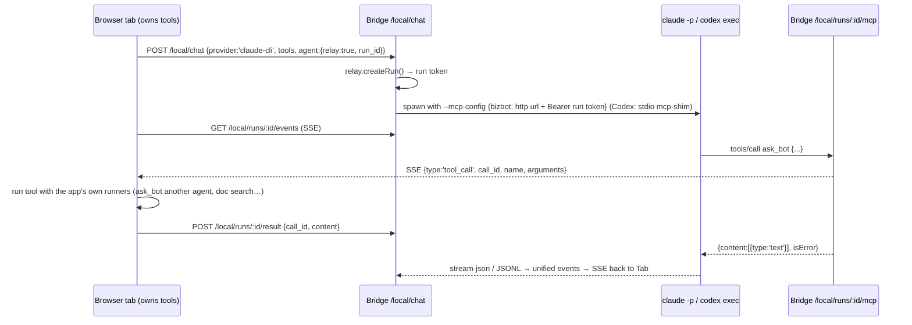

# biz-bot — Backend runtimes: Cloudflare Worker (+Durable Object project runner) and local Bridge

> Slice reviewed: `biz-bot/worker/src/**`, `biz-bot/bridge/src/**`, `biz-bot/wrangler.jsonc`, `biz-bot/package.json`, `biz-bot/.dev.vars.example` (variable names only), `biz-bot/worker/test/**`, `biz-bot/bridge/test/**` (titles and fixture shapes), README sections on worker/bridge/providers/relay/pairing/security, and `docs/project-platform.md` runtime sections. A few shared modules under `public/js/runtime/` (ledger, runtime contract, services, content store, sync) were read because both runtimes import them unchanged. All paths below are relative to `reference/biz-bot/`.

---

## 1. Purpose & architecture

biz-bot ("Bizbot") is a personal operating agent: a static SPA (no framework, no build step) plus two backend runtimes that share one wire protocol and one execution engine.

1. **Cloudflare Worker** (`worker/src/index.js`): a thin, keyed router in front of OpenAI, xAI, Anthropic, Workers AI and a keyless Mock provider. It normalises every provider's stream into one event vocabulary, proxies remote MCP servers, reads public web pages, and serves the SPA from the same origin. It also mounts a **Durable Object** (`RuntimeDO`, `worker/src/runtime/project-runtime.js`) at `/api/runtime/*`. That object runs projects (plans, DAG tasks, automations) in the cloud when no local bridge is online.
2. **Local Bridge** (`bridge/src/*`, Node 22): a loopback server with three jobs. It hosts the Worker module in-process, so `npm run local` gives the app, the API and local capabilities on one origin. It adds what a Worker cannot do: local models (Ollama, any OpenAI-compatible server), CLI coding agents (Claude Code, Codex), a sandboxed shell, workspace files, a real Playwright browser, and stdio MCP servers. It also runs the same headless engine as a background runner that keeps executing after the browser tab closes.

The design rule is "same app, same features, wherever it runs". Both runtimes implement one runtime contract (`public/js/runtime/runtime.js`: `exec`, `fs`, `browser`, `relay`, `runner`, `mcp`, `artifacts`). Both host the same portable engine (`public/js/headless-engine.js`) over the same transactional ledger (`public/js/runtime/ledger.js`). They sync the app's records through the same versioned protocol 2 (`public/js/sync.js`). In the app, `runtime-auto.js` picks the bridge when it is online, otherwise the cloud DO, otherwise the offline bridge. Each plan's runtime is **pinned**, so it is never silently moved.

```
                        ┌──────────────────────────── Browser SPA (public/) ───────────────────────────┐
                        │  chat/room engine · plan DAG executor · tool loop · runtime-auto (bridge|cloud) │
                        └───────┬───────────────────────────────┬──────────────────────────┬────────────┘
             same-origin /api/* │                    /local/* (loopback, or paired origin + bearer)
                                ▼                               ▼                          │ SSE /local/runs/:id/events
┌──────────── Cloudflare Worker (worker/src/index.js) ─────┐  ┌──────── Local Bridge (Node, bridge/src) ────────────┐
│ originPolicy → route()                                    │  │ http.js Node↔Web · auth.js policy · router.js       │
│  /api/chat  → providers/{openai,xai,anthropic,mock}.chat  │  │  /api/*  → worker-host.js (the SAME worker module)  │
│  /api/image|image/edit|speech|transcribe|embeddings|search│  │  /local/chat → ollama | openai-compat | claude-cli  │
│  /api/realtime/token (xAI ephemeral secret)               │  │               | codex-cli (exec | app-server)       │
│  /api/fetch (fetch-page) · /api/mcp/tools|call (mcp.js)   │  │  /local/exec (sandbox chain) · /local/fs/* ·        │
│  /api/runtime/* ──► RuntimeDO (idFromName('default'))     │  │  /local/browser/* (Playwright) · /local/mcp/*       │
│      SQLite kv+events · R2 WORKSPACE · alarm triggers     │  │  /local/runs/* relay + per-run MCP endpoint ◄─ CLI  │
│      portable engine + ledger + protocol-2 sync + SSE bus │  │  /local/runner/* portable engine + ledger + sync    │
│      in-process fetch("/api/..") → route()                │  │     + triggers + memory files + reflection          │
└───────────────┬───────────────────────────────────────────┘  │  in-process fetch("/api|/local") → ctx.handle        │
                ▼                                              └───────────────┬─────────────────────────────────────┘
  api.openai.com/v1 · api.x.ai/v1 · api.anthropic.com/v1 ·                     ▼
  Workers AI (env.AI) · remote MCP servers · public web          Ollama :11434 · LM Studio/vLLM · `claude -p` · `codex exec`
                                                                  docker / sandbox-exec · Playwright Chromium · stdio MCP
```

The CLI-agent tool relay, a key flow for multi-agent work:



---

## 2. Feature inventory

### 2.1 Unified provider router and event protocol (Worker)
- **What:** One API for all providers. `POST /api/chat` takes `{provider, model, system, messages, tools, tool_choice, max_tokens, reasoning_effort, response_format, temperature, stream}` and returns SSE of unified events. With `stream:false` it returns a collected JSON result.
- **How:** `route()` in `worker/src/index.js:97` resolves keys (`resolveKeys`, :204) from secrets `OPENAI_API_KEY`, `XAI_API_KEY`, `ANTHROPIC_API_KEY`, var `ENABLE_MOCK`, and binding `AI`. `getProvider(id, keys, capability)` (:214) checks three things: the provider exists, it is keyed, and it exports the capability function (`chat`, `image`, `imageEdit`, `speech`, `transcribe`, `embeddings`, `search`, `realtimeToken`). `defaultProvider(keys, order)` picks the first keyed provider in a per-route preference order: chat `openai→xai→anthropic→mock`, image `xai→openai→mock`, speech/stt `openai→xai→mock`, embeddings `openai→mock→cloudflare`, search `xai→openai→anthropic→mock`.
- **Event vocabulary** (`README` + `util.js:175 collectEvents`): `{type:'text',delta}`, `{type:'reasoning',delta}`, `{type:'tool_call',id,name,arguments}` (arguments is a JSON string), `{type:'citation',url,title}`, `{type:'image',b64|url,mime}`, `{type:'usage',input,output,cached?,cost?}`, `{type:'done',finish:'stop'|'tool_calls'|'length'|'refusal'|'incomplete'}`, `{type:'error',message,status,details}`, then `data: [DONE]`. The bridge adds `{type:'session',provider,id,resumed,model?}` and `{type:'activity',kind:'status'|'tool_use'|'tool_result'|'command'|'file_change',id,tool,input?,output?,is_error?,parent_id?}`.
- **Unified message shape:** `role: system|user|assistant|tool`. Content is a string or parts `{type:'text'|'image'|'document'|'file', text|url|data|name|detail}`. Assistant messages carry `tool_calls:[{id,name,arguments}]`; tool messages carry `tool_call_id`, `name`, `content`. Each adapter translates this shape to its provider's dialect.
- **Limits:** JSON body ≤20 MB (`readJson`), audio ≤25 MB, embeddings ≤256 inputs.
- **Maturity:** solid (unit tests in `worker/test/providers.test.mjs`).

### 2.2 Worker origin policy and auth model
- **What:** No app-level user auth. `/api/*` accepts only same-origin requests, plus origins listed in `ALLOWED_ORIGIN`. A request without `Origin` is allowed unless `Sec-Fetch-Site: cross-site`, which covers curl and navigations. Access control is delegated to **Cloudflare Access** in front of the Worker (per the `wrangler.jsonc` comment and README step 4).
- **How:** `originPolicy()` (`index.js:70`). There is no wildcard CORS; allowed foreign origins get echo-origin CORS with `Vary: Origin`.
- **Maturity:** solid, but single-tenant by design (see §7).

### 2.3 Reliable SSE producer (`sseResponse`) and parser (`parseSSE`)
- **What:** One streaming primitive, shared by the Worker, the bridge, the DO event bus and the relay.
- **How** (`worker/src/util.js:92`):
  - Uses a `TransformStream` writer.
  - Sends a comment heartbeat `: keepalive` every 15 s, but only when no write is pending, so a stalled reader never queues multiple heartbeats.
  - Wires an upstream `AbortController` into the producer. A client disconnect or parent-signal abort cancels the provider fetch and makes the next `emit` reject, so producers unwind.
  - Emits errors as `{type:'error', message, status, details}` and always closes with `data: [DONE]`.
  - Sets headers `Cache-Control: no-cache, no-transform` and `X-Accel-Buffering: no`.
  - `parseSSE` (:41) handles multi-line `data:`, CRLF and comments, and cancels the reader if the consumer stops early. The MCP client relies on this when it finds its JSON-RPC reply mid-stream.
- **Tests:** `worker/test/stream-reliability.test.mjs` covers silent-reasoning heartbeat, error status retention, cancellation clearing timers, stalled-reader heartbeat bounds, and abort of a silent upstream.
- **Maturity:** solid.

### 2.4 Responses API adapter (OpenAI and xAI share it)
- **What:** Converts unified messages into Responses `input` items and parses Responses SSE into unified events (`worker/src/providers/responses.js`).
- **Conversion** (`toInputItems`): system messages become the `developer` role for OpenAI and the `system` role for xAI. Assistant text becomes `output_text`. `tool_calls` become `function_call` items and tool results become `function_call_output`. Images become `input_image` and documents become `input_file` (with `file_url` or `file_data`).
- **Stream-integrity features** (`parseResponsesStream`, :47):
  - Tracks text per `item_id:content_index`. On `output_text.done`, `content_part.done`, `output_item.done` or `response.completed`, it emits only the missing suffix. Final-only answers are recovered, and duplicated parts are never emitted twice.
  - A mismatched prefix throws `inconsistent streamed output — retry this step` (:82).
  - A stream that ends without `response.completed`/`incomplete` throws `response stream ended before completion — retry this step` (:193). A truncated stream is never reported as success.
  - Inserts paragraph breaks between agentic narration bursts. Grok streams "…next.Got the notes." around server-side searches, so `needsBreak` (:74) and `separator()` add the breaks.
  - Deduplicates citations from `url_citation` annotations, `web_search_call`/`x_search_call` `action.sources`, and `response.citations`.
  - Surfaces `image_generation_call` results as `image` events and refusals as `finish:'refusal'`. MCP call errors become inline text.
  - Usage includes `cached` from `input_tokens_details.cached_tokens`.
- **Maturity:** solid (4 dedicated tests).

### 2.5 OpenAI provider
- `POST https://api.openai.com/v1/responses` with `stream:true` and `store:false`. The system prompt goes into `instructions`.
- Reasoning models (`/^(gpt-5|o\d)/`) get `reasoning:{summary:'auto', effort}`. Only non-reasoning models get `temperature`.
- JSON schema output via `text.format = {type:'json_schema', name, schema, strict}`.
- Tool mapping: `function` (strict:false), `web_search` (`search_context_size`, `filters.allowed_domains`), `code_interpreter` (`container:{type:'auto'}`), `image_generation` (`gpt-image-2`, png), and remote `mcp` with `require_approval:'never'`. When web search is on, it adds `include:['web_search_call.action.sources']`.
- Media: images via `/images/generations` (gpt-image-2, n≤4). Speech via `/audio/speech` (default `gpt-4o-mini-tts`, voice `marin`, input clipped to 4096, `instructions` for non-tts-1 models, `speed`), with the body streamed straight through. Transcription via `/audio/transcriptions` (default `gpt-transcribe`). Embeddings via `/embeddings` (`text-embedding-3-small`), re-sorted by `index`.
- `search()` runs a `web_search`-forced chat on `gpt-5.6-luna` and returns `{answer, citations}`.
- Maturity: solid.

### 2.6 xAI (Grok) provider
- `POST https://api.x.ai/v1/responses`. Reasoning effort is applied only where `supportsEffort` allows it (not for non-reasoning, `4.20-reasoning` or `build` models). JSON schema output is strict by default.
- Tools: `web_search` (≤5 allowed domains), `x_search` (`from_date`, `to_date`, ≤20 `allowed_x_handles`), `code_interpreter`, `image_generation` (`action:'auto'`), and `mcp`. It adds `include:['web_search_call.action.sources','no_inline_citations']` because xAI's inline `[[N]](url)` markup leaks into text.
- Images: `/images/generations` (default `grok-imagine-image-2.0`, `response_format:'url'`, `aspect_ratio`, `resolution`, `quality` only on 2.0). Image **edit** via `/images/edits` with `image:{type:'image_url', url}` (a data URL or https).
- **TTS:** `POST /v1/tts` with `{text (≤15000), voice_id, language (required, default 'en'), output_format:{codec: mp3|wav|pcm, sample_rate:24000, bit_rate:128000}}` and speed clamped to 0.7–1.5.
- **STT:** `POST /v1/stt` multipart with `language`, `format=true` and the file last. Returns `{text, language, duration}`.
- **Realtime voice:** `POST /v1/realtime/client_secrets` with `{expires_after:{seconds:60..3600}}` → `{client_secret, expires_at, url:'wss://api.x.ai/v1/realtime', model:'grok-voice-latest'}`. The browser connects directly with the ephemeral secret, so the key never leaves the Worker.
- `search()` supports modes `web|x|both` on `grok-4.3`.
- Maturity: solid (the realtime *client* is not in this slice).

### 2.7 Anthropic provider
- `POST https://api.anthropic.com/v1/messages` with `anthropic-version: 2023-06-01`. `max_tokens` defaults to 16000.
- Adaptive thinking `thinking:{type:'adaptive', display:'summarized'}` on models matching `opus-5|sonnet-5|fable-5|mythos-5|opus-4-[78]`. `output_config.effort` and `output_config.format` (json_schema) are used instead of prefill hacks.
- Refusal fallback: for `claude-(opus-5|fable-5|mythos-5)` it sends beta header `server-side-fallback-2026-07-01` plus `fallbacks:'default'`.
- Tools: `web_search_20260209`, `web_fetch_20260209`, `code_execution_20260120`, and function tools as `input_schema`.
- `tool_choice` mapping: `required`/`any` → `{type:'any'}`, `none` → `{type:'none'}`, a named tool → `{type:'tool', name}`.
- Message conversion: consecutive tool results merge into one user turn of `tool_result` blocks. A synthetic first user turn is added if needed. Data-URL images and documents become base64 blocks, and plain image URLs become `source:{type:'url'}`.
- Stream parsing: `thinking_delta` → reasoning. `input_json_delta` accumulates per block index and is emitted at `content_block_stop`. `web_search_tool_result` and `citations_delta` → citations.
- A stream without `message_stop` throws (:175). A refusal adds an inline note and `finish:'refusal'`.
- Maturity: solid.

### 2.8 Multimodal endpoints (Worker)
- `/api/image` → `{images:[{url|b64,mime,revised_prompt}], model}`. `/api/image/edit` is xAI-only.
- `/api/speech` returns audio bytes, streamed through with `Cache-Control: no-store`. `/api/transcribe` takes multipart `file`, `provider`, `model`, `language`.
- `/api/embeddings` → `{embeddings, model, dims}`. `/api/search` → `{answer, citations, provider, model}`. `/api/realtime/token` returns an ephemeral xAI secret.
- Video, avatars and visemes are **not** present in this slice. README mentions ffmpeg key-frame extraction, which runs through the bridge's `/local/exec`.
- Maturity: solid for image/TTS/STT/embeddings/search; realtime is token-only.

### 2.9 Static model catalog and defaults
- `GET /api/models` → `buildCatalog()` (`worker/src/catalog.js`). Each adapter exports a static `catalog` (models with `vision`, `reasoning`, `fast`, `default`, `context`, `note`; `reasoning_levels`; `image`; `tts.models/voices`; `stt.models`; `embeddings` with `dims`; `capabilities` flags; xAI `realtime`). The UI can render model pickers without a key.
- `defaults` holds the first enabled provider per capability. Embeddings prefer openai → mock → cloudflare.
- Mock is only listed when `ENABLE_MOCK=true`; Cloudflare only when the `AI` binding exists.
- Maturity: solid, but model lists are hand-maintained.

### 2.10 Workers AI embeddings fallback
- `worker/src/providers/cloudflare.js`: `env.AI.run('@cf/baai/bge-base-en-v1.5', {text: batch})` with batches of 100 and each text clipped to 2000 chars (768 dims). Vector search works with no embeddings-capable key (neither xAI nor Anthropic has an embeddings API). Maturity: solid.

### 2.11 Mock provider (schema-aware, keyless)
- `worker/src/providers/mock.js`. It makes the entire product usable and e2e-testable with no keys:
  - `!tool <name> {json}` emits a tool call and then summarises the result.
  - `!slow N` delays output (for navigation-during-turn tests).
  - JSON-schema requests are answered from the schema itself. A schema with `members` gets a canned team whose provider, model and tools come from the schema's enums. A schema with `tasks` gets a 3-task DAG over member names, with the deliverable kind inferred from the goal. A router schema with `owners` picks the `@mention` or the first listed bot. Any other schema gets a generic type-driven value generator.
  - Review prompts are `APPROVED`. An HTML deliverable request gets a real tiny page.
  - Also: 1×1 PNG image, 0.1 s WAV silence TTS, hashed 64-dim bag-of-words embeddings (similar texts land near each other), and a canned search result.
- Maturity: solid, and a pattern worth copying.

### 2.12 Worker MCP client (Streamable HTTP)
- `worker/src/mcp.js`: `initialize` → `notifications/initialized` → `tools/list` (paginated, ≤500) → `tools/call`.
- Protocol negotiation tries `2025-11-25`, `2025-06-18`, `2025-03-26` and retries only on an explicit 400 that mentions "version".
- Handles `application/json` or `text/event-stream` replies and JSON-RPC batches. Tracks `Mcp-Session-Id` and `MCP-Protocol-Version` headers.
- An in-memory session cache per isolate (10-minute TTL, keyed by URL plus a headers hash) reconnects once on 404/400.
- `contentToText()` flattens text, image, audio, resource and resource_link content.
- Routes: `/api/mcp/tools {server_url, headers}` and `/api/mcp/call {server_url, headers, name, arguments}`. `assertUrl` refuses private and loopback hosts. `sanitizeHeaders` drops `host`, `origin`, `cookie` and similar.
- Maturity: solid (tool calls only; no resources, prompts or sampling).

### 2.13 `fetch_page`: SSRF-safe web reader
- `worker/src/fetch-page.js`. `assertPublicUrl` blocks loopback, RFC1918, link-local, CGNAT `100.64/10`, ULA `fc/fd/fe80`, and `.internal`, `.local`, `.localhost` names. Redirects are followed manually (≤4 hops) with every hop re-checked. There is a 15 s timeout, a 2 MB cap, and a content-type allowlist (text, json, xml, markdown).
- `htmlToText()` strips script, style, nav, footer, aside, form and banner headers. It keeps headings as `#`, list items as `- `, links as `text (url)`, and decodes entities.
- Returns `{url, finalUrl, title, contentType, text (1k–60k chars), truncated}`.
- Portable: the same module runs under wrangler and inside the bridge, and bridge page watchers reuse `htmlToText`.
- Maturity: solid.

### 2.14 Cloud runtime Durable Object (`RuntimeDO`)
- **What:** One SQLite-backed DO per deployment (`idFromName('default')`). It hosts the portable engine so projects run in the cloud with no bridge (`worker/src/runtime/project-runtime.js`).
- **Init** (`init()`, :54):
  - Builds the SQLite storage and assigns `globalThis.localStorage` to a SQLite-backed shim, so `public/js/store.js` runs unchanged.
  - Installs the **in-process fetch** (:29): the engine's relative `fetch('/api/...')` calls are routed to the Worker's own `route()` in the same isolate.
  - Loads the skill and connector catalogs from the `ASSETS` binding.
  - Creates the store, a durable bus over the ledger, the R2 fs, the content store and services.
  - Wires `createRuntime({kind:'cloud', capabilities:{exec:false, fs:true, browser:false, relay:false, runner:true, memory:false, mcp:true, documents:false, audio:false, takeover:false}})`.
  - Creates triggers and the engine, subscribes store deltas to the bus, calls `engine.recover()`, and schedules the alarm.
- **Honest limits:** `/health` returns `kind:'cloud'`, `protocol:2`, capabilities, and a `limits` map with plain-language reasons (no shell unless a Sandbox container binding is added, CLI agents are bridge-only, headless browsing needs Browser Rendering, memory files live on the bridge). `/exec`, `/browser/*`, `/relay/*` and `/runs/*` answer 503 with a reason. `/runner/memory` and `/runner/reflect` also answer 503.
- **Routes** (mounted at `/api/runtime`):
  - `/health`, `/models`, `/services` (RPC), `/fs/{read,write,list,search,stat,mkdir}`, `/mcp/{tools,call}` (http servers only).
  - `/runner/state`, `/runner/sync`, `/runner/sync/replace`, `/runner/events` (SSE with `?since`), `/runner/notices`, `/runner/reflections`.
  - `/runner/plans/:key[/start|stop|release]` (key must match `swarm:<id>`). `start` returns 409 if the plan is already running, if it belongs to another `runtimeId` ("Explicit handoff required"), or if its status is `done`, `awaiting_approval` or `stale`.
  - `/runner/decisions/:id` (resolve and auto-resume), `/runner/runs`, `/runner/runs/:id/log`, `/runner/triggers[/:id[/fire]]`.
- **Alarm:** `alarm()` ticks triggers and re-arms at `triggers.tickMs` (60 s) while any trigger is enabled.
- **Test:** `worker/test/runtime.test.mjs` runs a 2-task plan to `done` with the mock provider in-process, checks deltas sync between two clients, checks SSE mirrors `plan` and `store` events, and checks an alarm fires a schedule trigger and produces a `notify` notice.
- **Maturity:** solid for what it claims. Long-running runs without an attached request are a risk (§7).

### 2.15 DO storage: SQLite kv, localStorage shim, run journal
- `worker/src/runtime/storage.js`. Two tables: `kv(k TEXT PRIMARY KEY, v TEXT)` and `events(run, seq, at, v, PRIMARY KEY(run, seq))`.
- Key prefixes:
  - `ls:*`: localStorage shim.
  - `plan:<key>`: plan records.
  - `kv:*`: artifacts, runs index, pings, runtime budgets, tickets.
  - `notices`: last 200.
  - `triggers`.
  - `runtimeId`: `cloud:<uuid>`.
  - `ledger:*`: see §2.18.
- Values are JSON text, ≤2 MB per row. The event log appends with per-run `seq`, and reads/lists by run.
- Maturity: solid.

### 2.16 R2 workspace (cloud file system)
- `worker/src/runtime/fs.js` implements the **same fs contract as the bridge**: `read` (utf8 with offset/limit slices, or base64; binary detection via NUL bytes), `write` (≤25 MB), `list` (depth), `search` (bounded: ≤200 objects scanned, skips >512 KB and binaries), `stat`, and `mkdir` (writes a `.keep` marker).
- Path normalisation refuses `..` and NUL.
- Content-store records live under the `bizbot-content/` prefix (`runtime/content.js`).
- Maturity: solid, though search is a naive scan.

### 2.17 Cloud automations on DO alarms and result gating
- `worker/src/runtime/triggers.js` mirrors the bridge triggers without Node parts. Kinds are `schedule` (`everyMs` ≥60 s or `dailyAt` HH:MM in **UTC**) and `page` (https only; fetch-page → optional regex capture or SHA-1 of the text → condition `changed|contains|not_contains|below|above`, edge-triggered with `'rise'` versus `'hold'`).
- Actions:
  - `skill`: the skill's workflow template becomes a linear task graph, or one LLM step with the skill's instructions and tools.
  - `plan`: `planGoal()` builds the plan with the project's decisions as context.
- Firing appends `[Automation "name"] context` to the room log, saves the plan with `approvedAt` set ("creating the trigger was the approval"), journals it, and starts the engine. It skips if the room is busy.
- **Gate** (:119): after a run, the proactivity level (`off|quiet|on`, overridable per trigger) decides whether to notify. `quiet` notifies on attention statuses or page changes. Otherwise a small LLM judge call returns `{matters, reason}`. The daily **annoyance budget** (`allowPing`: off 0, quiet 6, on 30 per day) demotes excess notices to `log`.
- Maturity: solid (folder watchers are bridge-only).

### 2.18 Execution ledger: leases, fencing, retries, outbox, budgets (shared by DO and bridge)
- `public/js/runtime/ledger.js`, backed by DO SQLite or bridge `node:sqlite` (`bridge/src/runner/ledger.js`: WAL, `synchronous=FULL`, `BEGIN IMMEDIATE` transactions).
- **Jobs:** `enqueue({id,...})` is idempotent on a stable id. `claim(id, owner)` enforces `runtimeId` ownership, rejects a live lease, checks dependencies are done, and increments `attempts` and `fence` with `expiresAt = now + 90 s`. `heartbeat`, `finish` and `retry` all call `assert(owner, fence)`, so a stale writer is **fenced out** (`LedgerConflict` 409). `retry` backs off exponentially (1 s·2^(n-1), max 5 min) and moves to `dead_letter` after 3 attempts. `resume` re-queues non-live jobs.
- **Events:** `emit()` writes a zero-padded `event:<seq>`; `events(since)` reads them back. `createDurableBus(ledger)` turns this into the SSE bus with replay.
- **Outbox:** `deliver(id, message)` is idempotent, then `outbox()` and `acknowledge(id)`. The engine uses it to deliver run completions to conversations.
- **Effects:** `effect(key, intent)` claims before an external side effect and `receipt(key, result)` records completion. A crash leaves the effect `pending` to reconcile, never to replay blindly. **Defined and unit-tested but not wired into any tool yet** (docs list exactly-once effects as future work).
- **Budgets:** `reserve(id, {scopes:[{id,maxUsd,maxTokens}], usd, tokens})` refuses when the scope would overspend, or when cost is unknown and a USD cap exists. `settle(id, usage)` records `costStatus: 'reported'|'unavailable'`. `usage()` lists everything. The engine reserves before every model call (`headless-engine.js:130`).
- **Engine usage:** each run heartbeats every 30 s and aborts itself if fenced. `recover()` runs every 30 s and at boot, and skips live or dead-lettered jobs.
- **Tests:** `bridge/test/ledger.test.mjs` covers events, ownership, receipts, duplicate claims, expired leases fencing stale writers, concurrent reservations that cannot overspend, and unpriced requests that are not treated as free.
- Maturity: solid core; effects are partial.

### 2.19 Durable event bus and SSE mirror
- `GET /runner/events?since=N`, identical on the DO and the bridge. It sends `{type:'ready', seq, running}`, replays ledger events after `since`, then streams live.
- Event types: `store` (sync deltas with `client`, `storeSeq`, `changes`), `plan` (checkpoints), `log`, `decision`, `memory`, `memory_file`, `trigger`, `notice`, `reflection`, `ticket`, `system`, `artifact`, and `record`.
- The app skips its own `client` changes. Maturity: solid.

### 2.20 Protocol-2 record sync
- `POST /runner/sync {since, changes, client}` applies the peer's changes via `store.applyChanges` and returns `{protocol:2, client, seq, applied, changes (since, excluding that client), bots, projects, skills, memory}`. A v1 full-export body gets `409 {upgrade:true}`. `/sync/replace` is the only full overwrite (restore).
- Merge rules (`public/js/sync.js`): newer `updatedAt` wins, then higher `rev`. Tombstones are records (30-day TTL). A resolved decision beats a pending one regardless of clock. MCP connector `headers` are redacted before sync and restored from the local copy, so secrets never leave the machine.
- Maturity: solid.

### 2.21 Decisions (human-in-the-loop) and auto-resume
- `POST /runner/decisions/:id {answer}`: 404 for an unknown decision, 409 if already resolved.
- Resolving appends `Decision: <question>\n<answer>` to the room log. If the decision is the plan approval (`taskId:'__plan__'`, `approvalDecisionId`), the plan's status becomes `planned`.
- The plan then restarts from `planned|waiting|needs_review|partial|stopped|failed|interrupted`. If the plan is currently running, the resume is queued via `resumeAfterRun`.
- A denied plan approval does not resume. Maturity: solid.

### 2.22 Services RPC: content store, catalog, dispatch tickets, budgets
- `POST /services {method, args}` (DO) or `/local/services` (bridge) → `createServices()` (`public/js/runtime/services.js`). Methods:
  - Files: `file_put`, `file_get`, `file_search`. Content-addressed SHA-256 blobs, chunked, optionally embedded, lexical-plus-cosine scoring.
  - Memory: `memory_write` (typed `semantic|episodic|procedural|profile` with provenance, confidence and history), `memory_search` (relevance × confidence × recency decay), `memory_link` (graph edges `{from, to, relation}`).
  - Workflows: `workflow_dispatch` accepts only *published* catalog workflows or approved plans, respects autonomy and runtime ownership, and creates a `ticket:<runId>`. `run_status`.
  - Catalog: `catalog_list`, `catalog_get`, `catalog_draft`, `catalog_evaluate`, `catalog_publish`, `catalog_rollback`.
  - Other: `index_rebuild`, `outbox`, `acknowledge`, `budget_get`, `budget_set` (`dailyUsd`, `dailyTokens`, `taskTokens`).
- On the bridge, content search is backed by a SQLite **FTS5** table `content_search(id, scope, name, text)` (`bridge/src/runner/content.js`), and the content store refuses symlinks.
- Maturity: partial. Newer convergence work; `docs/convergence.md` checklist items are all unchecked.

### 2.23 Bridge server core and module composition
- `startBridge(config, {modules, providers})` (`bridge/src/index.js:14`) builds `ctx` (config, providers, `routes[]`, `closers`, `onReady`, status, workerHost, staticHandler). Each module (`relay`, `chat`, `exec`, `fs`, `browser`, `mcpClient`, `runner`) pushes a route handler returning `Response | null`.
- `http.js` adapts Node req/res to Web `Request`/`Response`, including streaming with backpressure (`drain`). A client disconnect aborts `request.signal`.
- `serveStatic` serves the SPA with fallback, traversal refusal and security headers.
- The startup banner prints the provider matrix, sandbox mode, the pairing token location, and a LAN QR code.
- `npm run local` serves SPA + worker + `/local/*`. `npm run bridge` (`--no-spa`) serves `/local/*` only, for pairing with the deployed app.
- Maturity: solid.

### 2.24 In-process worker host and in-process fetch
- `worker-host.js` dynamically imports `worker/src/index.js` and calls `worker.fetch(request, env, ctx)` with env built **only** from `.dev.vars` and explicit provider env vars (`config.workerEnv`). Provider keys never enter `process.env` for children.
- `runner/engine.js installInProcessFetch()` patches `globalThis.fetch` so relative `/api/*` and `/local/*` calls from the shared app modules resolve through `ctx.handle` with no network hop. The DO does the same with `route()`.
- Maturity: solid (clever, but global monkey-patching; see §7).

### 2.25 Config precedence and secret isolation
- `bridge/src/config.js`: precedence is `process.env > .dev.vars > ~/.biz-bot/bridge.json > DEFAULTS`.
- Defaults: port `8788`, host `127.0.0.1`, workspaces `~/biz-bot-workspaces`, sandbox `auto`, docker image `node:22`, network off, Ollama `http://127.0.0.1:11434`, max runs 4, max exec 4, exec timeout 10 min, CLI idle 20 min, kill grace 5 s, relay call timeout 30 min, relay grace 60 s, trigger tick 30 s, debounce 1.5 s, takeover max 10 min, data dir `~/.biz-bot`.
- The pairing token is generated once (24 random bytes, base64url) and stored mode 0600.
- A non-loopback bind is refused unless `BRIDGE_LAN=1` (which forces TLS) or `BRIDGE_UNSAFE_BIND`.
- An explicitly empty env var disables a provider even if `.dev.vars` holds a key.
- Maturity: solid (`bridge/test/config.test.mjs`).

### 2.26 Bridge auth: loopback, Host pinning, paired origins, throttling
- `bridge/src/auth.js policy()` returns `mode: 'same-origin'|'paired'|'denied'`:
  1. The Host header must be loopback (or, in LAN mode, one of the machine's own names) on the configured port. This defends against DNS rebinding.
  2. A per-Host throttle blocks the host for a minute after 20 failed bearer checks in a minute.
  3. Any request arriving over the network needs the bearer token even when same-origin.
  4. No `Origin` + `cross-site` is refused.
  5. A foreign origin must be in `allowedOrigins` **and** present the bearer, compared in constant time.
- CORS responses include Chrome Private/Local Network Access headers (`Access-Control-Allow-Private-Network` / `-Local-Network`).
- The per-run MCP endpoint uses its own run token and refuses any request with an `Origin` header ("not for browsers"). The bridge token does not open a run.
- Maturity: solid (`auth.test.mjs`, `relay.test.mjs`).

### 2.27 Device pairing (token, page, claim, QR, rotate)
- `/local/pair` works on loopback only and serves an HTML page: masked token with Show/Copy/**Rotate**, the LAN link, a QR SVG, and setup steps.
- Pair link: `https://<host>:<port>/#/pair?url=<origin>&token=<token>`. The app saves both, probes, then calls `POST /local/pair/claim`. The bearer is the credential, and the calling origin is appended to the persisted `allowedOrigins`.
- `POST /local/pair/rotate` is same-origin only.
- A QR code is also printed as ASCII in the terminal (`public/js/qr.js`).
- Maturity: solid.

### 2.28 LAN mode with automatic TLS
- `bridge/src/tls.js`: `lanHosts()` gives the IPv4 addresses plus the hostname and `hostname.local`. `ensureTls()` creates a cert once under `~/.biz-bot/tls`: with **mkcert** if installed (trusted), otherwise **openssl** self-signed RSA-2048, 825 days, SAN listing every name. It reuses the cert afterwards.
- LAN with TLS off is refused, because an https app cannot call an http bridge (Safari refuses outright). Maturity: solid.

### 2.29 Health, capability probes and local catalog
- `GET /local/health` (cached 60 s, `?force=1`) probes Ollama (`/api/version`, `/api/tags`), `claude` and `codex` binaries plus versions, Docker daemon plus image, seatbelt (a functional probe), Playwright, `rg`, `ffmpeg`, `python3`, and a local OpenAI-compatible server.
- Returns `{protocol:2, bridge_id, paired, allowed_origins, lan, capabilities, runner:{running,triggers}, providers, sandbox:{preferred,effective,modes}, workspaces, tools, worker:{hosted, providers}}`.
- `GET /local/models` has the Worker's catalog shape with `local:true` and `agent:true` flags. CLI agents are never the default chat provider.
- Maturity: solid.

### 2.30 Local chat endpoint
- `/local/chat` has the same contract as `/api/chat` plus `agent:{relay, run_id, session_key, session_id, workspace, add_dirs, permission_mode, allowed_tools, disallowed_tools, sandbox, max_turns, max_budget_usd, ephemeral, transport, max_minutes, project_id, task_id, workflow_run_id}`.
- If `agent.relay` is set and the provider is an agent, the bridge creates a relay run and ties the chat signal to the run signal with `AbortSignal.any`.
- `/local/embeddings` defaults to Ollama. Maturity: solid.

### 2.31 Ollama provider
- `bridge/src/providers/ollama.js`. The catalog is dynamic from `/api/tags` (≤60 models), with per-model `/api/show` capabilities (`completion`, `tools`, `vision`, `thinking`, `embedding`) and `context_length`, cached 10 minutes by name@digest. The default is the first tools-capable model. Embedding models are listed separately, preferring nomic/bge/minilm.
- Chat: `/api/chat` NDJSON with system, tool history (`tool_name`), base64 `images`, function tools, `options.num_predict`, `temperature`, `format` (JSON schema object or `'json'`), and `think` (`true`, or a level for `gpt-oss`, and only if the model has `thinking`).
- A stream without `done` is an error. A 404 gives the hint `ollama pull <model>`.
- Embeddings via `/api/embed`. Maturity: solid (`ollama.test.mjs` with `fake-ollama.mjs`).

### 2.32 OpenAI-compatible local servers (LM Studio, llama.cpp, vLLM)
- `LOCAL_OPENAI_BASE_URL` (+ optional `LOCAL_OPENAI_API_KEY`). The catalog comes from `/v1/models`. Chat uses `/v1/chat/completions` streaming with `stream_options.include_usage`.
- Tool-call fragments are assembled by `index`. `reasoning_content`/`reasoning` → reasoning. `response_format.json_schema` is supported.
- A stream without `finish_reason` or `[DONE]` is an error. Embeddings via `/v1/embeddings` for ids matching `/embed/`.
- Maturity: solid.

### 2.33 CLI-agent adapter framework
- `bridge/src/cli/adapter.js runCli(adapter, {ctx, signal, run}, params)`:
  - Finds the binary. `find-binary.js` searches PATH, the login-shell PATH, `~/.claude/local/bin`, volta, bun, asdf, nix, brew and nvm versions.
  - Resolves the workspace cwd and `add_dirs` inside the roots.
  - Writes data-URL images to per-run temp files so the CLI can read them.
  - Renders the transcript as one text prompt (`renderPrompt`: "Conversation so far:" or, on resume, "Continuing the conversation. New messages since your last reply:").
  - Computes a context **fingerprint** (sha256 of system, model, tools, cwd, addDirs, permission, sandbox).
  - Negotiates a session, spawns with the prompt on **stdin**, and parses JSONL. Non-JSON lines become `activity/status`, except `Warning:` lines.
  - An idle timer (20 min without output) kills with SIGTERM → SIGKILL after the grace period. Abort kills too.
  - The temp dir is always removed.
- **Stale-resume healing:** if attempt 1 was a resume and `adapter.isStaleResume(stderr, state)` matches, it drops the saved session, emits status "The saved session had expired; replaying the conversation into a new one.", and retries fresh with the full transcript.
- **Env scrubbing** (`childEnv`): strips `CLAUDECODE`, `CLAUDE_CODE_*`, `CLAUDE_AGENT_*`, `ANTHROPIC_BASE_URL`, `BRIDGE_*` and all provider API keys. Nested-session markers and the Worker's keys never reach the CLI. The Anthropic key is kept only in `--bare` mode.
- Maturity: solid.

### 2.34 CLI session negotiation (tail resume)
- `bridge/src/cli/session.js`. The app always sends the full transcript. The bridge persists `{provider, sessionId, seenCount, seenHash (sha256 prefix of first N messages), fingerprint}` per `session_key` in `~/.biz-bot/sessions.json` (0600, 30-day TTL).
- If the prefix hash matches and the history grew, it resumes with **only the tail**. An edited history or a changed fingerprint means a fresh session.
- If the bridge forgot (restart) but the app sends `session_id`, it resumes by hint with the messages after the last assistant turn.
- Maturity: solid. This is a key pattern for driving stateful agents from a stateless UI.

### 2.35 Claude Code provider
- `bridge/src/providers/claude-cli.js`. Invocation: `claude -p --output-format stream-json --verbose --include-partial-messages`, plus:
  - `--model`.
  - `--session-id <uuid derived from runId via FNV hashing>` for new sessions, or `--resume <id>`.
  - `--append-system-prompt` (new sessions only) and `--effort`.
  - `--json-schema <schema>`.
  - `--permission-mode`. `bypassPermissions` is downgraded to `acceptEdits` unless `agent.sandbox === 'danger-full-access'`.
  - `--allowedTools`, from per-mode lists: `plan`/`default` get read-only tools plus WebFetch, WebSearch and Task; `acceptEdits`/`bypass` add Edit, Write, MultiEdit, NotebookEdit, Bash and TodoWrite. `mcp__bizbot` is appended when relayed.
  - `--disallowedTools`, `--add-dir`, `--max-turns` (default 30, cap 200), `--max-budget-usd`.
  - `--mcp-config {mcpServers:{bizbot:{type:'http', url, headers:{Authorization}}}}` (or stdio shim) with `--strict-mcp-config`.
  - `--bare` and `--no-session-persistence` (ephemeral).
  - Env `MCP_TOOL_TIMEOUT` (30 min) and `MCP_TIMEOUT` 30 s.
- **Parsing:**
  - `system/init` → `session`. An error status is emitted if the `bizbot` MCP server did not connect.
  - `stream_event` deltas → text and reasoning, with no duplication when the full `assistant` message arrives later.
  - Sub-agent (`parent_tool_use_id`) text → `activity/status tool:'subagent'`.
  - `tool_use` → `activity/tool_use`; `tool_result` → `activity/tool_result` (clipped to 4k).
  - `result` → usage, including cache read/creation tokens and `total_cost_usd` → `cost`.
- **Structured output:** the CLI answers through a synthetic `StructuredOutput` tool whose input is the object. The parser captures it, hides the tool use, and emits it as JSON text. It **accepts `error_max_turns` when structured output exists** (the `claude-schema.jsonl` fixture shows this real behaviour).
- `isStaleResume` matches "no conversation found with session id…".
- **Tests:** `claude-cli.test.mjs` with `fake-claude.mjs`, plus `claude-real-fixtures.test.mjs` over captured real JSONL (plain, resume, tool with Bash, schema, stale resume, not-logged-in).
- Maturity: solid.

### 2.36 Codex CLI provider (exec transport)
- `bridge/src/providers/codex-cli.js`. New sessions run `codex exec --json [-m model] --skip-git-repo-check -c approval_policy="never" [-c model_reasoning_effort=…] [--output-schema schema.json] -o last.txt -C cwd -s <read-only|workspace-write|danger-full-access> [--add-dir] [-i image] [mcp -c overrides] [--ephemeral] -`. Resume runs `codex exec resume <thread> … -c sandbox_mode=… -`.
- The system prompt is folded into stdin as `# Operating instructions … # Task …`.
- MCP is wired via `-c mcp_servers.bizbot.command=<node> args=[mcp-shim.js --run --port] env={BRIDGE_RUN_TOKEN=…} tool_timeout_sec=1800 startup_timeout_sec=30`.
- **Parsing:**
  - `thread.started` → session.
  - `item.*` of type `agent_message` → text; `reasoning` → reasoning.
  - `command_execution` → `activity/command` plus `tool_result` with `exit_code`.
  - `file_change` → `activity/file_change`; `mcp_tool_call` → tool_use/result; `web_search`/`todo_list`/`error` → status.
  - `turn.completed` → usage (and `done` in finalize, after reading `-o last.txt` if no text streamed).
  - `turn.failed` → error, unwrapping nested JSON error messages.
  - The legacy `{msg:{type}}` format is also supported.
- `isStaleResume` matches "no rollout found", "thread/resume failed" and similar. Maturity: solid (`codex-cli.test.mjs`).

### 2.37 Codex app-server transport (native approvals → Inbox decisions)
- `bridge/src/providers/codex-app-server.js` spawns `codex app-server --stdio` (bidirectional JSON-RPC). Sequence: `initialize` → `thread/resume` (falls back to `thread/start` on not-found) → `turn/start {input:[{type:'text'}], effort, outputSchema}`. Overrides: `approvalPolicy:'untrusted'`, `sandbox: workspace-write|read-only`, `network_access:false`, and MCP servers.
- Notifications map to events: `item/agentMessage/delta` → text, `item/reasoning/summaryTextDelta` → reasoning, `thread/tokenUsage/updated` → usage, `item/started|completed` → activity, `turn/completed` → done or error.
- **Native requests** matching `requestApproval`, `requestUserInput` or `elicitation` become a durable **project decision** (`store.saveDecision({kind:'input', from:'Codex', question, nativeRequest})`). The transport polls every 500 ms until the decision resolves, then maps the answer back (`accept`/`decline`, permissions scope `turn`, or answers per question id). Without a project scope, approvals are declined.
- A wall-clock deadline (`agent.max_minutes`) applies, and `turn/interrupt` is sent on early exit.
- Maturity: partial. It is opt-in via `BRIDGE_CODEX_TRANSPORT=app-server`, and no dedicated test was found in scope.

### 2.38 Relay: CLI agents call the app's tools (per-run MCP server and stdio shim)
- `bridge/src/relay.js createRun({id, tools, provider})` creates a run with a random **run token**, the function tools converted to MCP `{name, description (≤1024), inputSchema}`, a 200-event ring, and pending calls.
- Limits: `maxRuns` (default 4), ≤8 pending calls per run, a 10-minute tool timeout (30 minutes for `request_user_input`, `ask_bot` and `add_project_agent`).
- `mcp-server.js handleMcp()` is a stateless Streamable-HTTP JSON-RPC handler: `initialize` echoes the client's protocolVersion (default `2025-03-26`), plus `ping`, `tools/list`, `tools/call`, batches, and notifications (202).
- `tools/call` emits `{type:'tool_call', call_id, name, arguments}` to the tab's SSE subscription (`/local/runs/:id/events?since=` replays the ring) and waits for `POST /local/runs/:id/result {call_id, content, is_error}`. Results are capped at 1 MB.
- **Disconnect grace:** if no tab is subscribed while calls are pending for `relayGraceMs` (60 s), the run is cancelled and the CLI is killed. `DELETE /local/runs/:id` cancels.
- `mcp-shim.js` is a stdio JSON-RPC to HTTP forwarder for Codex (or Claude in `BRIDGE_MCP_TRANSPORT=stdio` mode). The run token travels in env `BRIDGE_RUN_TOKEN`, and nothing but JSON-RPC goes to stdout.
- App side (`public/js/relay.js`): it relays everything except bridge-native and **system** tools, since CLI agents never extend the system. An `InputRequired` tool pauses the run as a project decision. It reconnects up to 6 times with `since`.
- Maturity: solid (the `relay.test.mjs` scenario covers auth, batch, replay, timeout, grace and cancel).

### 2.39 Bridge MCP client (stdio and private HTTP)
- `bridge/src/mcp-client.js` handles stdio servers: spawned **without a shell** with a minimal environment (HOME, TMPDIR, LANG, USER, SHELL, augmented PATH, plus the record's own validated env, never `BRIDGE_*`). They speak newline JSON-RPC. `initialize` (`2025-06-18`) has a 20 s timeout and calls have a 60 s timeout. Idle servers stop after 5 minutes, at most 6 run at once, and a crash (`MCP_EXIT`) triggers one restart.
- The cwd must be inside a workspace root.
- HTTP specs reuse the Worker's `mcp.js`. This matters for private-address servers a deployed Worker cannot reach.
- Routes `POST /local/mcp/tools|call {server:{transport, url|command,args,cwd,env, headers}}`. Maturity: solid.

### 2.40 Shell execution with a sandbox chain
- `POST /local/exec {command (≤20k chars), cwd, timeout_ms (≤1 h), network, env, stdin, sandbox}` returns SSE `start` → `stdout`/`stderr` chunks (64 KB, 2 MB total cap with a truncation notice) → `exit {code, signal, duration_ms, truncated, timed_out, sandbox}` → `done {finish: exit|timeout|aborted}`. Concurrency ≤ `maxExec`.
- **Policy** (`sandbox/confined.js checkCommand`) denies by regex:
  - sudo/doas/su, disk formatting, raw device writes, chmod 777 or chown -R on `/`, fork bombs, power control, launchctl, killing system processes, `curl|sh`, reverse shells, `crontab -r`.
  - macOS system config (csrutil, spctl, tccutil, …), keychain `security` dumps, osascript, opening Terminal, `defaults write /Library`.
  - `rm` of critical paths, and recursive `rm` outside the workspace roots.
- **Mode chain** `auto`: docker → seatbelt → confined.
  - **Docker:** `--network none` unless asked, 2 GB memory, 256 pids, 2 CPUs, `--cap-drop ALL`, `no-new-privileges`, `--read-only`, tmpfs `/tmp` 512 MB, runs as the host uid, workspace bind-mounted at `/workspace`.
  - **Seatbelt** (`sandbox-exec`): an SBPL profile allows reads except secrets (`~/.ssh`, `~/.aws`, `~/.gnupg`, `~/.kube`, `~/.docker`, gcloud, `~/.biz-bot`, `~/.claude`, `~/.codex`, Keychains, Cookies, browser profiles, `.npmrc`, `.netrc`, `.git-credentials`, `.env*`, `.dev.vars`). Writes are allowed only to the workspace and a per-run TMP. Network is behind a switch. A startup probe checks that the workspace is writable and `$HOME` is not.
  - **Confined:** `/bin/sh -c` in a process group with the env scrubbed of PATH/LD_/DYLD_/NODE_OPTIONS/BRIDGE_/provider/cloud tokens.
- Timeout or abort kills the whole process group, with SIGKILL after the grace period.
- Maturity: solid (`exec.test.mjs`, including the macOS seatbelt test).

### 2.41 Workspace file system
- `bridge/src/fs.js resolveInside(roots, p)` resolves through the deepest existing ancestor's **realpath**, so symlink escapes, `..`, NUL and foreign absolute paths are refused (403).
- Ops `stat`, `read` (text ≤2 MB with offset/limit, base64 ≤8 MB, binary detection), `write` (≤8 MB, `create_dirs`, **optimistic concurrency `if_mtime` → 409**), `list` (depth ≤4, ≤5000 entries, skips node_modules/.git etc.), `search` (ripgrep `--json` with context lines, or a JS fallback walk; both engines are tested to agree), and `mkdir`.
- Maturity: solid.

### 2.42 Real browser for agents (Playwright)
- `bridge/src/browser.js`: a persistent Chromium profile (logins survive; `~/.biz-bot/browser-profile`) or an ephemeral one. Headless by default; headed with `BRIDGE_HEADED`. At most 4 tabs, idle tab close after 10 minutes, browser shutdown after 30 minutes idle.
- **URL policy:** `checkUrl` resolves DNS and refuses private, link-local, CGNAT, ULA and `.local` addresses unless listed in `BRIDGE_BROWSER_ALLOW_LOCAL`. A context-wide `route('**/*')` also aborts sub-requests to private hosts.
- **Compact page snapshots for the model:** injected JS tags visible interactive elements with `data-bb-ref="ref_N"` and outputs lines such as `ref_3 button "Sign in"` or `ref_7 link "Docs" href="/docs"`, plus headings and paragraph text, capped by `maxChars`. Actions address elements by `ref` or selector.
- Actions: `open`, `navigate`, `snapshot`, `click` (double, button), `type` (clear/submit), `press`, `scroll`, `back`, `screenshot` (jpeg q70 or png, element or full page → b64 for vision models), `text`, `close`, `sessions`.
- **Take-over / hand-back:** the user drives a headed tab while agent actions wait (bounded by `takeoverMaxMs`). The agent **auto-pauses while a password field has focus** and refuses to type into password fields.
- Maturity: solid (`browser.test.mjs`, skipped without Playwright).

### 2.43 Bridge background runner (handoff, journal, recovery)
- `bridge/src/runner/index.js`:
  - A file-backed `localStorage` (`~/.biz-bot/state/store.json`, debounced atomic writes) lets `store.js` run in Node.
  - Plans persist in `state/plans/<key>.json` and the ledger `state/execution.sqlite`. kv, notices and triggers are JSON files.
  - The append-only **run journal** is `~/.biz-bot/events/<run>.jsonl` (model turns with provider, model, usage and finish; tool calls and results; decisions; state transitions).
- The same routes as the DO under `/local/runner/*`, plus `/memory*` and `/reflect`, and trigger `GET` and `check`.
- **Ownership:** a plan has `executor: 'tab'|'bridge'`. `release` hands the latest plan and transcript back to the tab, and a released plan is not resumed at boot.
- **Crash recovery:** `engine.recover()` on ready resumes `running` or `interrupted` plans without redoing finished tasks (tested by killing the bridge mid-run). Shutdown stops runs with `interrupted:true`.
- `TAB_ONLY` steps (document ingest in the browser, TTS, STT) raise a decision asking the user to open the tab, or answer "skip".
- Maturity: solid (`runner.test.mjs`, 9 scenarios).

### 2.44 Bridge automations (schedule, page, file, docs, reflect)
- `bridge/src/runner/triggers.js`: a superset of the cloud triggers.
  - `file` and `docs` watchers use recursive `fs.watch` on a workspace folder with a debounce. `docs` filters by extension (pdf, md, txt, csv, json, docx, html, rtf). An optional regex filters paths.
  - `reflect` actions run on a schedule.
  - Page watchers use the browser URL policy and allow http.
  - Schedule intervals may be as short as 1 s, and `dailyAt` uses **local** time.
- The gate (:188) adds a `judge()` LLM call with strict JSON schema `{matters, reason}`.
- Maturity: solid.

### 2.45 Memory as editable Markdown files
- `bridge/src/runner/memory.js`: `~/.biz-bot/memory/principal.md` and `project-<id>.md` mirror the store's memory, one bullet per fact with an HTML-comment id.
- Files are written atomically on every memory change. The directory is watched (debounced 300 ms), and the bridge's own writes are ignored by content hash.
- A hand edit **becomes authoritative**: it replaces the store slice and emits `memory_file`. `reconcile()` at start and after sync lets existing files win.
- `/local/runner/memory/forget {phrase, scope}` removes matching facts on both sides.
- Maturity: solid (`memory.test.mjs`).

### 2.46 Reflection (memory compaction and ideas)
- `bridge/src/runner/reflect.js`: one JSON-schema turn of the Principal over the facts, goals and recent transcript. It returns `{retire[], merge[], rewrite[], add[] (≤3), ideas[] (≤3), note}`.
- Unknown fact ids are dropped. Changes become an **approval decision** carrying the diff. Ideas go to the board, deduped, and dismissed ideas are never re-proposed. A notice is gated by proactivity. The result is stored in `kv.reflections` (last 20) and journaled.
- Maturity: solid.

### 2.47 Tests and fixtures as behavioural spec
- `worker/test`: providers (stream to unified events, tool round-trips, MCP JSON and SSE, Workers AI batching), stream reliability, fetch-page, and the DO runtime (with `fake-cloud.mjs`: a fake SQL engine for the exact statements, a fake R2, a fake DO ctx, fake ASSETS).
- `bridge/test`: auth, browser, claude-cli, claude real fixtures, codex, config, exec, fs, http, ledger, mcp-client, memory, ollama, openai-compat, relay, runner, tls, worker-host.
- Fixtures: real captured Claude/Codex JSONL (plain, resume, stale-resume, schema, structured, tool, turn-failed, not-logged-in) and fake binaries (`fake-claude.mjs`, `fake-codex.mjs`, `fake-ollama.mjs`, `fake-mcp-stdio.mjs`).
- `npm run predeploy` stamps the version and runs the tests before `wrangler deploy`.

---

## 3. Providers, models & external APIs

Model ids are shown exactly as they appear in code. The catalog notes are dated Aug 2026.

| Provider (id) | Endpoint(s) | Models / defaults | Capability flags |
|---|---|---|---|
| OpenAI (`openai`) | `https://api.openai.com/v1/responses`, `/images/generations`, `/audio/speech`, `/audio/transcriptions`, `/embeddings` | chat: **gpt-5.6-sol** (default), gpt-5.6-terra, gpt-5.6-luna, gpt-5.5, gpt-5.4, gpt-5.4-mini, gpt-5.4-nano, gpt-5.2, gpt-5.1, gpt-4.1, gpt-4.1-mini (contexts 400k–1.05M). reasoning `low/medium/high/xhigh`. image `gpt-image-2`. TTS `gpt-4o-mini-tts` (default), `tts-1-hd`; voices marin, cedar, alloy, ash, ballad, coral, echo, fable, onyx, nova, sage, shimmer, verse. STT `gpt-transcribe` (default), `gpt-4o-transcribe`, `whisper-1`. embeddings `text-embedding-3-small` (1536, default), `text-embedding-3-large` (3072). search model `gpt-5.6-luna` | web_search, code_execution, image_generation, tts, stt, embeddings, search, mcp_native |
| xAI (`xai`) | `https://api.x.ai/v1/responses`, `/images/generations`, `/images/edits`, `/tts`, `/stt`, `/realtime/client_secrets`; realtime `wss://api.x.ai/v1/realtime` | chat: **grok-4.6** (default), grok-4.5, grok-4.3 (1M), grok-4.20-multi-agent ("4 or 16 internal agents; effort controls the count"), grok-4.20-reasoning, grok-4.20-non-reasoning, grok-build-0.1. images `grok-imagine-image-2.0` (default), `grok-imagine-image-quality`, `grok-imagine-image`. TTS `grok-tts` with 26 voices (eve, ara, leo, rex, sal, carina, zagan, helix, orion, luna, iris, altair, zenith, perseus, helios, lux, kepler, rigel, cosmo, celeste, ursa, sirius, lumen, castor, naksh, atlas). STT `grok-stt`. realtime model `grok-voice-latest`. search model `grok-4.3` | web_search, x_search, code_execution, image_generation, tts, stt, search, mcp_native, realtime; **no embeddings** |
| Anthropic (`anthropic`) | `https://api.anthropic.com/v1/messages`, `anthropic-version: 2023-06-01`, beta `server-side-fallback-2026-07-01` | **claude-opus-5** (default), claude-sonnet-5, claude-haiku-4-5, claude-fable-5, claude-opus-4-8, claude-sonnet-4-6. reasoning `low…max`. Server tools `web_search_20260209`, `web_fetch_20260209`, `code_execution_20260120`. search model `claude-sonnet-5` | web_search, code_execution, search; no image, tts, stt or embeddings |
| Cloudflare Workers AI (`cloudflare`) | `env.AI.run()` binding | embeddings `@cf/baai/bge-base-en-v1.5` (768 dims) | embeddings only |
| Mock (`mock`) | none | `mock-1`, `mock-image`, `mock-tts`/voice `mock`, `mock-stt`, `mock-embed` (64-dim hashed) | image, tts, stt, embeddings, search |
| Ollama (`ollama`, bridge) | `OLLAMA_BASE_URL` (default `http://127.0.0.1:11434`): `/api/version`, `/api/tags`, `/api/show`, `/api/chat`, `/api/embed` | dynamic; default = first tools-capable model; `think` levels low/medium/high (gpt-oss) | json_schema, tools (per model), vision/thinking per model, embeddings |
| Local OpenAI-compatible (`local-openai`) | `LOCAL_OPENAI_BASE_URL` `/v1/models`, `/v1/chat/completions`, `/v1/embeddings` | dynamic from `/v1/models` | json_schema, tools, embeddings when an id matches `/embed/` |
| Claude Code CLI (`claude-cli`) | `claude -p --output-format stream-json …` | aliases `sonnet` (default), `opus`, `haiku`; `claude-opus-5`, `claude-sonnet-5`, `claude-fable-5-1`, `claude-haiku-4-5-20251001`; override with `BRIDGE_CLAUDE_MODELS`. efforts low…max. permission_modes plan, default, acceptEdits, bypassPermissions | agent, tools, json_schema |
| Codex CLI (`codex-cli`) | `codex exec --json …`, `codex exec resume`, `codex app-server --stdio` | `default` (from `~/.codex/config.toml`), gpt-5.5, gpt-5.5-codex, gpt-5.4, gpt-5-codex, gpt-5-mini; override with `BRIDGE_CODEX_MODELS`. efforts minimal…xhigh (max→xhigh). sandboxes read-only, workspace-write, danger-full-access | agent, tools, json_schema |

Other external protocols:
- **MCP:** client versions `2025-11-25` → `2025-06-18` → `2025-03-26` (Worker); `2025-06-18` (bridge stdio); server `2025-03-26` default (bridge relay, echoes the client's version).
- **Chrome PNA/LNA:** preflight headers.
- **mkcert / openssl** for TLS.
- **Docker, sandbox-exec, ripgrep, ffmpeg, python3** probes.
- The User-Agent `biz-bot-fetch/1.0` for fetch-page.

Environment variable **names** from `.dev.vars.example` (values not reproduced):
- Worker: `OPENAI_API_KEY`, `XAI_API_KEY`, `ANTHROPIC_API_KEY`, `ENABLE_MOCK`.
- Bridge: `BRIDGE_PORT`, `BRIDGE_ALLOWED_ORIGINS`, `BRIDGE_TOKEN`, `BRIDGE_WORKSPACES`, `BRIDGE_SANDBOX`, `BRIDGE_DOCKER_IMAGE`, `BRIDGE_NETWORK`, `OLLAMA_BASE_URL`, `LOCAL_OPENAI_BASE_URL`, `LOCAL_OPENAI_API_KEY`, `BRIDGE_CLAUDE_BIN`, `BRIDGE_CLAUDE_MODELS`, `BRIDGE_CLAUDE_BARE`, `BRIDGE_MCP_TRANSPORT`, `BRIDGE_HEADED`, `BRIDGE_BROWSER_PROFILE`, `BRIDGE_BROWSER_ALLOW_LOCAL`, `BRIDGE_MAX_RUNS`, `BRIDGE_TRIGGER_TICK_MS`, `BRIDGE_TRIGGER_DEBOUNCE_MS`, `BRIDGE_TAKEOVER_MAX_MS`, `BRIDGE_EXEC_TIMEOUT_MS`, `BRIDGE_TLS_CERT`, `BRIDGE_DATA_DIR`.
- Also in `config.js`: `BRIDGE_HOST`, `BRIDGE_LAN`, `BRIDGE_TLS`, `BRIDGE_TLS_KEY`, `BRIDGE_UNSAFE_BIND`, `BRIDGE_CODEX_BIN`, `BRIDGE_CODEX_TRANSPORT`, `BRIDGE_CODEX_MODELS`, `BRIDGE_BROWSER_CHANNEL`, `BRIDGE_MAX_EXEC`, `BRIDGE_CLI_IDLE_MS`, `BRIDGE_KILL_GRACE_MS`, `BRIDGE_RELAY_CALL_TIMEOUT_MS`, `BRIDGE_RELAY_GRACE_MS`, `BRIDGE_MCP_MAX_SERVERS`, `BRIDGE_MCP_CALL_TIMEOUT_MS`, `BRIDGE_MCP_IDLE_MS`.

Wrangler bindings (`wrangler.jsonc`): DO `RUNTIME` → class `RuntimeDO` (migration `v1`, `new_sqlite_classes`), R2 `WORKSPACE` → `biz-bot-workspace` (`biz-bot-workspace-e2e` in the `e2e` env), `ai` → `AI`, `assets` → `./public` with SPA fallback and `run_worker_first: ["/api/*"]`, `compatibility_flags: ["nodejs_compat"]`, `compatibility_date: 2026-08-04`, and observability on.

---

## 4. Data model & persistence

**Cloud (DO SQLite, `worker/src/runtime/storage.js`)**
- `kv(k TEXT PRIMARY KEY, v TEXT NOT NULL)` holds prefixes `ls:*` (the app store via the localStorage shim), `plan:<swarm:id>`, `kv:<name>` (`artifacts`, `runs:<projectId>`, `pings`, `runtime:budgets`, `ticket:<runId>`, `reflections`), `notices`, `triggers`, `runtimeId`, and `ledger:*`.
- `events(run TEXT, seq INTEGER, at INTEGER, v TEXT, PRIMARY KEY(run, seq))` is the run journal.
- R2 holds workspace files keyed by path (folders are prefixes with a `.keep` marker) and content records under `bizbot-content/`.

**Bridge (`~/.biz-bot/`, `BRIDGE_DATA_DIR`)**
- `bridge.json` (0600): `{token, createdAt, allowedOrigins[]}`.
- `sessions.json` (0600): `{<session_key>: {provider, sessionId, seenCount, seenHash, fingerprint, at}}`.
- `state/store.json`: the app store via file localStorage.
- `state/plans/<key>.json`, `state/kv.json`, `state/notices.json`, `state/triggers.json`.
- `state/execution.sqlite`: `ledger_kv(k,v)` plus FTS5 `content_search(id, scope, name, text)`.
- `events/<run>.jsonl`: the journal.
- `memory/principal.md`, `memory/project-<id>.md`.
- `content/`: content store blobs and records.
- `tls/{cert.pem, key.pem, tls.json}`, `browser-profile/`, `tmp/<runId>/` (per-run CLI images, schema, last.txt, seatbelt profile).

**Key record shapes**
- **Plan record:** `{key:'swarm:<id>', plan:{title, objective, status, tasks[{id,title,brief,acceptance,owners[],reviewers[],dependsOn[],activity,config,status,output}], final, deliverable:{kind:'document'|'web'|'code',title}, runId, runtimeId, approvedAt, approvalDecisionId, trigger?, skill?, costUsd?}, entries[] (≤500 transcript lines {kind:'user'|'bot'|'note', from, text, at}), executor:'tab'|'bridge', runId, lease:{owner,at}|null, interrupted, updatedAt}`.
- **Ledger job:** `{id, key, priority, readyAt, dependencies[], attempts, fence, runtimeId, status:'queued'|'running'|'retry'|'done'|'blocked'|'dead_letter', owner, expiresAt, createdAt, finishedAt, error}`. Also `event:<seq16>`, `outbox:<id> {…, acknowledged}`, `effect:<key> {intent, status:'pending'|'completed', result}`, `usage:<id> {scopes[{id,maxUsd,maxTokens}], usd, tokens, status:'reserved'|'settled', costStatus}`.
- **Trigger:** `{id, name, kind:'schedule'|'page'|'file'|'docs', enabled, projectId, swarmId, action:{type:'plan'|'skill'|'reflect', goal, skill, bot, deliverable}, schedule:{everyMs, dailyAt}, page:{url, extract (regex), condition, value}, file:{path, pattern}, gate:'inherit'|'off'|'quiet'|'on', lastCheckedAt, lastFiredAt, lastValue, lastMatch, lastResult, lastError, runs}`.
- **Notice:** `{id, at, key, run_id, projectId, title, body, status, level:'notify'|'log', why, gate, trigger:{id,name,kind}|null}`.
- **Relay run (in memory):** `{id, token, tools[], provider, origin, shimPath, active, startedAt, seq, events (ring 200), subscriber, pending: Map<call_id,{resolve,timer,name}>, graceTimer}`.
- **Ticket:** `{runId, key, projectId, conversationId, runtimeId, status, deliverable, createdAt}`.
- **Sync change:** `{coll, id, rev, at, by, deleted, record, meta:{rev, updatedAt}}` over collections `bots` (by name), `swarms`, `projects`, `projectDecisions`, `skills`, `grants`, `ideas`, `mcpServers` (headers redacted), `principal`, `conversations`, `systemChanges`.
- **Decision** (store): `{id, projectId, taskId|'__plan__', runId, kind:'approval'|'input'|'notification', from, question, detail, status:'pending'|'resolved', answer, nativeRequest?, reflection?}`.
- **Content file record:** `{id (sha256 of scope:name:hash), hash, name, mime, scope, source, encoding, text, chunks[{text,index,embedding}], model, at}`. **Memory fact:** `{id, type:'semantic'|'episodic'|'procedural'|'profile', scope, confidence 0..1, validFrom, validTo?, source (provenance), text, history[]}`.

---

## 5. UX details worth keeping

- **Honest capability reporting.** Every runtime publishes `capabilities` plus a `limits` map with human sentences. Anything missing throws `RuntimeUnavailable` with a plain reason instead of half-working. A bot on an offline local provider is refused with a banner, never silently moved to a cloud model.
- **Streaming ergonomics:** heartbeats keep "thinking" connections alive without faking progress. Reasoning streams separately from text. Paragraph breaks are inserted between agentic narration bursts. The "retry this step" errors make truncation visible.
- **Tool chips for CLI agents:** `activity` events (tool_use, tool_result, command with exit code, file_change, sub-agent status, todo list) render as chips but are never executed by the browser. The user can watch a coding agent work.
- **Background-run mirroring:** one SSE stream with `?since` replay means reopening the app catches up. The "Background journal" reads the JSONL. *Take over here* / *release* hands a plan back to the tab.
- **Inbox decisions as the universal pause.** Plan approval, command approvals inside tasks, Codex native approvals, relay `request_user_input`, reflection compaction, budget raises and "open the tab to run this step" all become one decision type, resolved from anywhere, which auto-resumes the owning runtime.
- **Pairing UX:** a QR code in the terminal and on the loopback page, a one-tap link that saves url+token and claims the origin, a masked token with Show/Copy/Rotate, and clear Chrome LNA and Safari HTTPS guidance.
- **Browser take-over:** the user drives, the agent waits. A password-field focus auto-pauses the agent with the note "Never type passwords — ask the user to enter it in the browser window".
- **Proactivity dial and annoyance budget:** `off/quiet/on` with 0/6/30 pings per day. The notice records `why` it was (or was not) pushed. An LLM judge handles quiet mode.
- **Startup banner:** the terminal prints which providers, CLIs, sandbox mode and browser are available, with reasons when missing.
- **Mock-first demo:** `ENABLE_MOCK=true` makes the whole product (teams, plans, reviews, HTML deliverables, speech, images) explorable with no keys.

---

## 6. Patterns worth reusing (and how to lift them)

1. **One unified event stream across every model source** (`worker/src/util.js`, `providers/*`, `bridge/src/providers/*`). Adopt the `text|reasoning|tool_call|citation|image|usage|done|error` plus `session|activity` vocabulary as the Agent Workplace's internal bus event for every agent turn. Extend it for avatars: add `speech_chunk {audio, mime, seq}`, `viseme {t, id, weight}` and `emotion {label, intensity}`, so an avatar renderer subscribes to the same stream the transcript does. The `collectEvents` reducer gives non-streaming callers for free.
2. **Completion enforcement in stream parsers** (`responses.js:82,193`, `anthropic.js:175`, `ollama.js:152`, `openai-compat.js:82`). Every adapter must see its provider's terminal event or throw a retryable error. The orchestrator's retry and ledger logic then treats "incomplete" as a failure, not as output. Lift as a lint rule for all new adapters.
3. **`sseResponse` with bounded heartbeats and cancellation propagation.** Copy it verbatim for all server-sent streams (agent turns, meeting rooms, event bus). It prevents zombie provider calls when a user navigates away, which is important when many agents stream in parallel.
4. **Portable engine plus injected runtime** (`headless-engine.js` `createPortableEngine({store, state, eventLog, emit, runtime, …})`, and the DO and bridge wrappers). Write the orchestrator once, with platform concerns (fs, exec, browser, storage, catalog, health) injected. Run it in the tab, a local daemon and a Durable Object. Pair it with the `runtime.js` contract plus `RuntimeUnavailable`, and with `runtime-auto.js` pinning per plan.
5. **In-process fetch loopback** (`project-runtime.js:29`, `runner/engine.js:14`). Shared client code calls relative `/api/*` and the host answers in-process. The pattern is good, but implement it as an injected `fetch` in the client module rather than by patching `globalThis.fetch`.
6. **Transactional ledger with leases, fencing tokens, backoff, dead-letter, idempotent enqueue, outbox and budget reservations** (`public/js/runtime/ledger.js`). This is the backbone for the Workplace's P4 orchestration: each agent task is a job, heartbeats keep ownership, and a stale worker is fenced. `reserve`/`settle` implements per-project and per-agent spend caps that refuse unpriced spend when a USD cap exists. Wire in `effect`/`receipt`, which biz-bot left unwired, around every external side effect (email, payments, posting).
7. **Durable bus with `?since` replay** (`createDurableBus`, `/runner/events`). This is the "listen-in" feed: any client (office view, mobile, a meeting room) resumes from its last seq. Map it to a Durable Object per project with WebSocket hibernation, which biz-bot lists as future work.
8. **CLI agents as first-class coworkers:** `runCli` with JSONL mapping, tail-resume session negotiation keyed by `session_key` plus a context fingerprint, stale-resume healing, and env scrubbing. Adopt it for "engineer" personas backed by Claude Code or Codex. The `StructuredOutput` capture (including accepting `error_max_turns` with structured output) is a hard-won detail.
9. **Per-run MCP relay** (`relay.js`, `mcp-server.js`, `mcp-shim.js`). This is exactly the P5 intra-agent comms primitive for external agents: a sub-agent process gets a scoped MCP endpoint with a one-time run token, exposing only the whitelisted Workplace tools (`ask_bot`, `request_user_input`, document search). The orchestrator executes them and results flow back. Keep the disconnect grace, pending cap, long-tool timeouts and "system tools never relayed" rule.
10. **Native approval → durable Inbox decision bridging** (`codex-app-server.js:45`). Any agent runtime's permission prompt becomes a Workplace decision card, routed to the owner and resolvable from any device.
11. **Sandbox chain with a functional probe** (`sandbox/index.js`, `seatbelt.js` `probeSeatbelt`, `docker.js`). Choose the strongest available isolation, prove it works at startup, and report the effective mode. Reuse the deny-list and env-scrub lists as a baseline policy.
12. **Browser snapshots with refs plus take-over** (`browser.js`). Give models a compact, ref-addressed accessibility-style snapshot instead of raw HTML. Screenshots feed vision. A human can take the wheel. Reuse the password-field guard as a non-negotiable rule.
13. **Local-daemon security model:** loopback bind, Host pinning (DNS rebinding), bearer plus origin allow-list, constant-time compare, per-host throttling, PNA/LNA headers, token rotation, QR pairing, auto-TLS for LAN. Lift it wholesale for a "Workplace desktop companion".
14. **Schema-aware mock provider.** Generate plausible structured outputs from the request's JSON schema (enums first, recursion bounded) so the whole orchestration graph can be e2e-tested without keys.
15. **Edge-triggered watchers and a proactivity gate with an LLM judge and daily ping budget** (`triggers.js`). This is P4 automations with P12 anti-spam built in.
16. **Memory as human-editable Markdown with hash-guarded two-way sync, plus a reflection diff as an approval.** A good P9 pattern: the business owner can read and edit what agents "know", and compaction is proposed, not imposed.
17. **Realtime voice via ephemeral client secrets** (`xai.js realtimeToken`). Keep provider keys server-side and mint short-lived tokens so browsers can talk directly to realtime voice sockets. This is essential for low-latency avatar conversations.

---

## 7. Gaps, debt & risks

- **Single-tenant cloud runtime.** One DO for the whole deployment (`idFromName('default')`), no user or org identity in the Worker, and auth fully delegated to Cloudflare Access. There is no per-user authorization on `/api/runtime/services`, which exposes file, memory, workflow dispatch and budget writes. The Workplace needs per-tenant DO naming (for example per org/project) and real authn/z.
- **Long-running work inside a DO without a request or alarm.** Runs rely on in-memory promises, `setInterval` heartbeats and recovery timers. An alarm is scheduled only while triggers exist. Nothing keeps the object awake or re-wakes it to resume a plan after eviction, so it resumes only on the next request or alarm (`init()` calls `recover()`). This is plausible stalling risk when no tab is subscribed and was not verified live. Fix: an alarm-based "tick while any job is running" plus hibernatable WebSockets.
- **Global monkey-patching:** `globalThis.fetch` and `globalThis.localStorage` are replaced in the DO and the bridge. This is fragile with multiple DOs per isolate or libraries that capture fetch, and it complicates testing.
- **`effect`/`receipt` exactly-once machinery is unwired.** Docs admit a crash between an external effect and its receipt can repeat it on resume.
- **Divergent trigger semantics between runtimes:**
  - `dailyAt` is **UTC** in the cloud (`setUTCHours`) but **local time** on the bridge (`setHours`).
  - Minimum interval is 60 s in the cloud versus 1 s on the bridge.
  - Page watchers are https-only in the cloud versus http(s) on the bridge.
  - Folder/doc watchers are bridge-only.
- **SSRF-check inconsistency:** the Worker's `assertUrl` for MCP lacks the CGNAT/ULA/`.localhost` checks that `fetch-page.js` has, and neither Worker check resolves DNS. The Worker's egress model mitigates this, but the checks should be unified.
- **OpenAI remote MCP uses `require_approval:'never'`**, so server-side MCP tool calls bypass the app's approval gate when the provider executes them.
- **Coding agents run on the host, unsandboxed by the bridge.** They are governed only by their own permission modes. `bypassPermissions` is available with `danger-full-access`. Codex exec runs with `approval_policy="never"`.
- **Hand-maintained, future-dated model catalogs** (for example `gpt-5.6-*`, `grok-4.6`, `claude-opus-5`) with no live discovery for cloud providers. There is also a naming mismatch: Claude Code lists `claude-fable-5-1`, the API catalog lists `claude-fable-5`.
- **The Worker MCP client is minimal:** tools only (no resources, prompts, sampling or OAuth flows), fixed JSON-RPC ids, and an isolate-local session cache.
- **Cloud R2 search** scans at most 200 objects sequentially with no index.
- **Cloud embeddings are unavailable to the DO engine** (`health.capabilities.embeddings:false`) even though the Worker has Workers AI. Document ingest and TTS/STT are "tab-only" steps in background runs.
- **No rate limiting or quotas on `/api/*`** beyond Access. Credit abuse risk is documented.
- **Codex app-server decisions poll every 500 ms** (no event wake-up), and there are no dedicated tests in scope.
- **In-memory relay runs:** a bridge restart loses active relays (CLI sessions can resume, but in-flight tool calls are lost).
- **Multimodal gaps for the Workplace:** no video generation, no avatar or viseme output, TTS returns whole audio with no timestamps (xAI supports a `pcm` codec that could feed amplitude-based lip sync), and there is no Google/Gemini provider.
- **Maturity note:** the `docs/convergence.md` checklist (durable ownership, shared content stores, provider session contracts, recoverable effects, tickets, evaluations) is entirely unchecked, so services, tickets, catalog publish and content stores are newer and less proven than the core runner.

---

## 8. Relevance to the Agent Workplace (pillar mapping)

| Pillar | biz-bot features in this slice | Recommendation |
|---|---|---|
| **P1 Lead orchestrator** | Portable engine hosted in tab, bridge or DO; `runtime-auto` pinning; services `workflow_dispatch` tickets; decisions auto-resume | **Adopt** the engine and runtime split. The chief-of-staff agent runs in a per-tenant cloud DO, always on, and delegates to a local companion for desktop capabilities |
| **P2 Personas** | Per-agent provider/model/effort, Claude permission modes, Codex sandboxes, CLI agents as coworkers, mock team generator from schema enums | **Adapt:** persona records carry a provider, model, voice, and capability profile |
| **P3 Avatars** | Only indirect: TTS (OpenAI voices, 26 xAI voices, pcm 24 kHz), xAI realtime ephemeral tokens | **Build new:** add `speech_chunk`/`viseme` events to the unified stream; use the realtime token pattern for live avatar voice |
| **P4 Workflow orchestration** | Ledger (leases, fencing, retries, dead-letter, deps), plan start/stop/release, triggers (schedule, page, file, docs, reflect), gating, crash recovery, run journal | **Adopt** the ledger and triggers almost verbatim; **fix** UTC versus local time and DO keep-alive; wire `effect`/`receipt` |
| **P5 Intra-agent comms** | Relay plus per-run MCP (`ask_bot` from inside CLI agents), activity events, SSE bus with replay, decisions | **Adopt** the relay for external agent processes; the bus with `?since` becomes the "listen-in" channel for rooms and meetings |
| **P6 Projects & plans** | Plan records, executor ownership, runs archive, artifacts kv, R2/local workspaces, inbox decisions, notices | **Adopt** the shapes. Move to a per-project DO with an R2 workspace |
| **P7 All LLM providers** | OpenAI/xAI via Responses, Anthropic Messages, Workers AI, Ollama, OpenAI-compatible, Claude Code, Codex (exec and app-server), Mock; static catalog plus dynamic local catalogs | **Adopt** adapters and parsers. **Add** Google Gemini and live model discovery. Keep completion enforcement |
| **P8 Multimodal** | Vision input (all), image gen (gpt-image-2, Grok Imagine) and edit (xAI), TTS/STT (OpenAI, xAI), embeddings (OpenAI, Workers AI, Ollama, local), realtime token, browser screenshots, ffmpeg frames via exec | **Adopt**; **add** video gen, streaming TTS with timings, camera/screen capture |
| **P9 Context & memory** | Content store (hash-addressed files, chunks, embeddings, FTS5), typed memory facts with provenance, confidence, decay and links, Markdown memory files, reflection compaction | **Adapt:** a good base for a business knowledge graph; add vector indexes (Vectorize) server-side |
| **P10 Tools / MCP** | Worker MCP client (HTTP), bridge stdio/private MCP, relay MCP server, fetch-page, fs, exec, browser | **Adopt**; extend the MCP client (resources, prompts, OAuth); honour approvals for provider-side MCP |
| **P11 Navigation & UX** | Mirrored SSE, take-over/hand-back, pairing via QR, LAN mode for phones, honest capability banners | **Adopt** pairing and take-over; the event replay enables joining any agent's session mid-flight |
| **P12 Trust & governance** | Loopback/Host/bearer auth, throttling, sandbox chain with probes, deny-list, env scrubbing, realpath confinement, password guard, budget reservations, annoyance budget, secret redaction in sync, run tokens | **Adopt** all of it; **add** multi-tenant auth and per-route rate limits in the cloud |
| **P13 Business** | Mock provider for demos, Access-based protection, single `npm run deploy` | **Adapt:** billing and tenancy are absent |
| **P14 Infrastructure** | Worker + DO (SQLite) + R2 + Workers AI + Assets in one deploy; Node bridge with an in-process Worker host; node:test suites with fakes for SQL, R2, DO and CLIs; real JSONL fixtures | **Adopt** the topology and testing strategy (fake-cloud doubles, captured CLI fixtures) |

**Avoid:**
- Global `fetch`/`localStorage` patching. Inject dependencies instead.
- A single deployment-wide DO.
- Relying on Cloudflare Access as the only authorization.
- Unapproved provider-side MCP execution.
- Divergent time semantics across runtimes.
- Hand-maintained future model lists without discovery.
