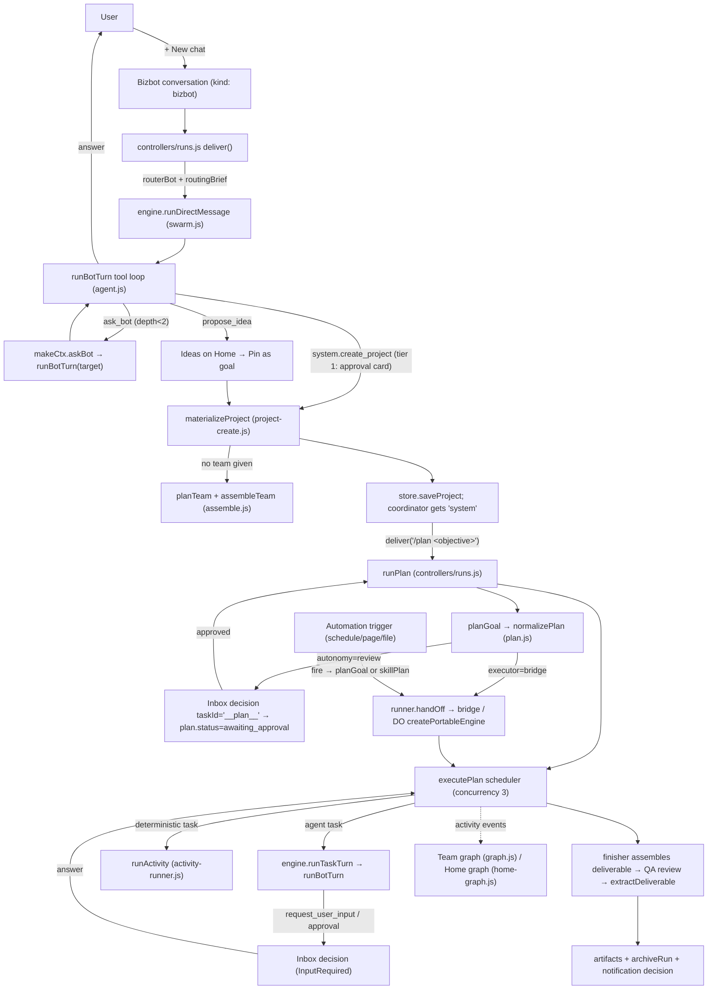

# biz-bot — Orchestration core: Bizbot/Principal, delegation, teams, projects, plans, swarm, runs, workflows, automations, graph

> Slice reviewed: `biz-bot/public/js/{bizbot,agent,assemble,swarm,plan,runner,headless-engine,activity-runner,activities,projects,project-view,project-create,workflow-editor,triggers,runs,budgets,grants,system-tools,tools,local-tools,graph,home-graph,turn-record,refine,scenarios,drafts}.js`, the matching tests in `biz-bot/public/test/`, `biz-bot/public/templates/*.json`, `biz-bot/docs/{project-platform,convergence,studio-roadmap}.md`, and the README sections on projects, teams, self-extension and automations. For context I also skimmed the callers (`public/js/controllers/runs.js`, `controllers/projects.js`, `app.js`), the store normalizers (`public/js/store.js`), the bridge trigger runner (`bridge/src/runner/triggers.js`), the ledger (`public/js/runtime/ledger.js`) and the worker model catalog (`worker/src/providers/*.js`). All paths below are relative to `reference/biz-bot/`.

---

## 1. Purpose & architecture

biz-bot is a single-user "personal operating agent": a static, framework-free SPA (plain ES modules, no build step) served by a Cloudflare Worker that holds the provider keys and streams every model through one unified `/api/chat` event stream. This slice is the **orchestration brain** of that app. It covers:

- **Bizbot**, the lead agent the user talks to. It is a *virtual* bot built on the fly from the **Principal** profile (`bizbot.js`). It answers directly, delegates to specialists with `ask_bot`, and turns larger outcomes into **projects** with `create_project` or `propose_idea`.
- **The Principal / instance model.** Every generated agent is an *instance* of one assistant: the same voice, preferences, standing rules and proactivity dial, with a different specialty and skill set (`agent.js buildSystemPrompt`).
- **Teams ("rooms"/"swarms")**, which are group chats of 2–12 agents. They support `@mentions`, coordinator or router routing, synchronous delegation (`ask_bot`), asynchronous hand-offs (`message_bot`) and structured multi-round discussions (`swarm.js`).
- **Team generation** from a scenario, done with one JSON-schema call (`assemble.js`).
- **Projects** (objective, scope, success criteria, autonomy, budget, workspace, executor), each owning a team, a current plan, a run history, decisions, artifacts, automations and apps (`projects.js`, `project-create.js`, `runs.js`, `project-view.js`).
- **Plans.** A goal becomes a DAG of 2–8 tasks, each owned by a *cluster* (lead + co-owners + reviewers). A scheduler runs them in parallel through work → review → revise loops, then a finisher assembles a deliverable and a QA reviewer checks it (`plan.js`).
- **Typed workflow activities.** Plans can also contain deterministic integration steps (human decision, ingestion, MCP call, STT, TTS, storage, log, shell command) with execution receipts. These steps are editable in a step inspector (`activities.js`, `activity-runner.js`, `workflow-editor.js`).
- **Human in the loop.** The Inbox holds durable decisions. Actions go through `approveAction`, which checks grants first. Scoped grants, budgets and an audit trail sit alongside (`tools.js`, `grants.js`, `budgets.js`).
- **Bounded self-extension.** A `system` tool with tiers, rate limits, an audit trail and undo (`system-tools.js`).
- **Automations** (schedules, page watchers, folder watchers) that start a plan or a skill run in the background (`triggers.js` dialog and `bridge/src/runner/triggers.js`).
- **Portable execution.** The same scheduler and turn loop run in the browser tab, in the local Node bridge, or in a Cloudflare Durable Object (`headless-engine.js`, `runner.js`).
- **Visualization.** A live, force-directed **team graph** with flowing links, an inspector and a replay scrubber, a **Plan view** of the DAG, and a cross-project **home graph** and goals board (`graph.js`, `home-graph.js`).

### Main flow



### Layering (how the pieces fit)

```
 Views (DOM)      project-view.js · graph.js (createRoomGraph) · workflow-editor.js · triggers.js · assemble.js modal · plan.js modals
                        ▲ events (onActivity: route/turn/ask/handoff/tool/decision/team/skill/idle)
 Controllers      controllers/runs.js (deliver, runPlan, /undo /forget /refine) · controllers/projects.js (createProject, resolve decisions)
                        ▼
 Engines          swarm.js createEngine (tab; renders into a message controller)   headless-engine.js createPortableEngine (bridge / DO; journals)
                        ▼  both call the same:
 Pure core        agent.js runBotTurn/buildSystemPrompt · plan.js executePlan/normalizePlan/repairPlan · activities.js · projects.js
                  runs.js · grants.js · budgets.js · refine.js · home-graph.js build/layout · graph.js buildGraph · system-tools.js · tools.js
                        ▼
 Runtime          api.js (/api/chat …) · runtime/{runtime-bridge,runtime-cloud,runtime-auto,ledger}.js · runner.js (SSE mirror + sync)
```

The key architectural decision is that **`executePlan` is pure**. It receives a `runTurn({bot, prompt, directive, tag, phase, taskId, onProgress})` callback plus `getDecision` and `onDecision` callbacks, and all orchestration state lives in one serializable `plan` object. That is why the same scheduler runs in the browser tab (`controllers/runs.js runPlan`), in the Node bridge, and in the Durable Object (`headless-engine.js runPlan`) without modification.

---

## 2. Feature inventory

### 2.1 Bizbot, the lead router agent (virtual Principal bot)
- **What:** The default conversation partner. It "answers directly when you can", delegates specialist work with `ask_bot`, proposes projects with `propose_idea` or creates them with `create_project`, and "extends the system instead of asking the user to configure it".
- **How:** `bizbot.js:9 routerBot(store, catalog)` builds a bot object on every turn. The bot is never stored, so it can't be deleted or renamed. Its fields:
  - identity (`name`, `title`, `icon`, `voice`) from `store.getPrincipal()`
  - `tools` = `BIZBOT_TOOLS` (`ask_bot, memory, document_search, summarize_document, web_search, fetch_page, system`) ∪ `principal.router.tools`
  - `instanceOf:'principal'`, `virtual:true`, `canDelegate:false`
  - provider chosen as `principal.router.provider` if usable, else `catalog.defaults.chat`, else the first enabled non-agent provider. CLI agents are excluded (`!providers[id].agent`).
- `bizbot.js:27 routingBrief(store, {plans})` builds the extra system text injected on each turn:
  - four numbered routing rules: answer small things; `ask_bot` in parallel and integrate the answers; `create_project` or `propose_idea` for multi-step work; use `create_agent`/`create_team`/`install_skill`/`create_automation`/`add_connector` after `list_capabilities`
  - the list of delegable agents (`canDelegate!==false && !projectId`) with their tools
  - standalone teams
  - projects in progress, each with its `projectSummary` label and a 120-char objective
- **Dispatch:** `controllers/runs.js:227-228`. When `conv.kind === 'bizbot'` → `engine.runDirectMessage({ bot: routerBot(store, cat), …, extraSystem: routingBrief(store, { plans }) })`.
- **Maturity:** solid. There's no dedicated test file for bizbot.js, but the flow is covered by the `e2e:admin` suite, per the README.

### 2.2 Principal and instance prompt layering
- **What:** One assistant identity with many specialist "instances".
- **How:** `agent.js:43 buildSystemPrompt(bot, {store, swarm, project, skills})`. For `bot.instanceOf === 'principal'` it layers:
  1. "You are {principal.name} — one assistant that works as several specialist instances. Here you are the instance …"
  2. `Voice and style: {tone}`
  3. `The user's preferences …`
  4. `Standing rules from the user (they override everything below)`
  5. the proactivity line (`PROACTIVITY.off|quiet|on`)
  6. `UNCERTAINTY_RULE` (`budgets.js:35`: say `⚠ Uncertain:` on its own line and show both sources when they disagree)
  7. an ideas instruction plus up to 20 dismissed idea titles ("never propose again")
  8. the specialty (`bot.instructions`)
  9. the date
  10. skills summary (`use_skill` on demand)
  11. memory: the last 40 facts, project-scoped when in a project
  12. room membership and collaboration rules (when in a swarm)
  13. a long **Execution** paragraph: never claim a file, check, watcher or external action succeeded without a confirming tool result; diagnose failures; treat delegation as a bounded assignment
  14. a voice note if `text_to_speech` is enabled ("write for the ear")
  15. `EXTERNAL_RULE`
  16. formatting rules (Markdown, mermaid, no repeating text after tool calls)
- **Principal record:** `store.js normalizePrincipal`: `{name, title, icon, tone, preferences, rules, proactivity: off|quiet|on, voice:{provider,voice}}`. Templates set `principal.{name,title,tone,rules}`.
- **Tests:** `principal.test.mjs` "prompt layering: an instance speaks as the principal with its specialty; a standalone bot is unchanged".
- **Maturity:** solid.

### 2.3 The bot turn tool loop
- **How:** `agent.js:93 runBotTurn({bot, messages, ctx, ui, signal, extraSystem, onProgress})`:
  - Resolves the model (§2.4) and builds the tool set with `buildTools(ctx)` plus provider-native tools (`nativeToolsFor`: `web_search`, `x_search`, `code_execution`).
  - Loops up to `MAX_ITERATIONS = 8`. Each iteration streams `chatStream({provider, model, system, messages, tools, reasoning_effort, max_tokens, ...agentParams})`.
  - Handles stream events: `text`, `reasoning`, `citation`, `image`, `activity` (CLI agents: `tool_use|command|file_change|tool_result|status`), `session`.
  - **Parallel tool execution:** `Promise.allSettled` over `result.tool_calls`. A per-signature failure counter (`name:JSON(args)`) refuses a third identical failing call with "This identical tool call has failed twice…".
  - A tool may return `_image` (a screenshot). It is shown to the user and sent to a vision model as a follow-up user image turn.
  - A **hand-off-only** response (every call is `message_bot`) ends the turn.
  - **Progress checkpointing:** `onProgress({text})` is throttled to once per second. It feeds `turn-record.js` and plan drafts so streamed text survives crashes.
  - **Taint:** a tool result containing `<external source=` sets `ctx.turn.tainted = true`, so system changes will ask first.
  - **Cost:** `priceUsage(result.usage, rates)` accumulates cost. CLI cost is noted in the transcript.
  - On error, `e.partial = {text, citations, images, toolCalls, usage, finish:'incomplete'}` is attached so callers keep partial work.
  - Hooks `ctx.beforeModel` / `ctx.afterModel` are used by the headless engine for ledger reservations and concurrency limiting.
- **CLI agents (Claude Code / Codex):** tools execute inside the CLI. The app exposes its own tools through a relay (`relayToolDefs`, `startRelay`). Agent params are sent as `{run_id, relay, session_key:"<logKey>:<bot>", session_id, workspace, add_dirs, permission_mode, sandbox, allowed_tools, project_id, task_id, workflow_run_id, transport}`. Sessions persist per chat and bot (`cli-sessions:<logKey>`).
- **Tests:** `local-agent.test.mjs`, `project-execution.test.mjs` ("work emitted before a tool round survives an empty final reply…").
- **Maturity:** solid.

### 2.4 Model resolution and fallback
- `agent.js:19 resolveModel(bot, catalog)` returns `{provider, model, fallback, wanted, unavailable?}`. If the bot's provider has no key, it falls back in the order `['openai','xai','anthropic','mock']`, then to any enabled provider. A **local** provider (Ollama/CLI via the bridge) is *never* silently moved to a paid cloud model. Instead `unavailable` is returned and `runBotTurn` throws `BridgeOffline`.
- `assemble.js:21 pickPlanner(catalog)` chooses the "best configured model" for every planning-type call (team design, plan drafting, refine, gate judge): `catalog.defaults.chat`, then `anthropic`, `openai`, `xai`, `mock`, taking the provider's `default:true` model.
- `swarm.js:186 pickRouter` chooses a **fast** model (`models.find(m => m.fast)`) in the order openai → xai → anthropic for room routing.
- **Maturity:** solid.

### 2.5 Synchronous delegation: `ask_bot`
- **How:** `tools.js:323-338` defines `list_bots` and `ask_bot({bot, task})` (with an enum of names outside projects). The run happens in `swarm.js:382 makeCtx.askBot`:
  - Refuses at `depth >= MAX_DELEGATION_DEPTH (2)`.
  - The target must be in `ctx.availableBots`: room members, or all delegable standalone bots in a direct chat, or project members inside a project, scoped by `projectBot`.
  - The delegate runs `runBotTurn` at `depth+1` with its own message bubble tagged "asked by X". Inside a room it sees the shared transcript. In a direct chat it only sees `[Request from bot "X"] task`.
  - A `createTurnRecord(log, {from: target, inReplyTo: asker})` persists the answer as a transcript entry. That entry is what the graph later reads as an `ask` edge.
  - Emits `{type:'ask', from, to, state:'start'|'end'}` and `{type:'turn', …}` activity events.
  - An incomplete delegate result returns "Incomplete response from X (…); do not treat it as finished work. Saved text: …". `InputRequired` and `AbortError` propagate upward, so a delegated specialist can pause the whole task for a decision.
- The coordinator nudge (`swarm.js:235`) tells a room coordinator to "call several ask_bot tools in ONE turn to run them in parallel".
- **Maturity:** solid.

### 2.6 Asynchronous hand-off: `message_bot`
- **How:** `tools.js:339-349` defines `message_bot({bot|'everyone', message})`. It is only offered in rooms, where `makeCtx` gets a `handoffs` array. `swarm.js:422 ctx.messageBot` validates the target, dedupes on `from>to:text`, and queues. After each batch, `runSwarmMessage` (`swarm.js:273-279`):
  - appends `{kind:'handoff', from, to, text}` to the log
  - posts a `🤝 @A → @B` system note
  - queues the targets (`everyone` expands to all other members) as the next round's owners with `reason: "hand-off from A"`
- Up to `MAX_ROUNDS = 6` rounds per user message. Any overflow shows "⏸ stopped after 6 hand-off rounds (pending: …)".
- **Maturity:** solid.

### 2.7 @mentions, coordinator and auto-router
- `swarm.js:74 parseMentions(text, members)`: `@everyone` → all members. Otherwise it does case-insensitive substring matching of `@name` or `@namewithoutspaces`.
- `runSwarmMessage` (`swarm.js:217`):
  - Mentioned members become owners and run **in parallel** (`Promise.all(batch)`).
  - With no mention, the room coordinator owns the message, with the coordinator nudge.
  - With no coordinator, `routeOwners` makes a JSON-schema call (`{owners: string[]}`, `max_tokens: 200`) on a fast model and posts "↪ routed to @X".
- **Maturity:** solid.

### 2.8 Structured discussions (`/discuss`)
- `swarm.js:92 discussionPlan(members, {coordinator, rounds})` produces a speaking order. Round 1 is chair (`framing`) then the others (`opening`). Later rounds are the others then the chair (`debate`). It ends with the chair's `synthesis`. Rounds are clamped to 1–4 (default 2).
- `swarm.js:111 discussionDirective(turn)` gives a phase-specific system directive: framing <200 words names the hinge constraint; opening = your discipline's angle and the failure mode; debate = name one disagreement with evidence; synthesis = recommendation (≤3 sentences), plan with owners, disagreements, needs from the user.
- `runDiscussion` (`swarm.js:289`) runs members **sequentially**. Each sees everything said before, there are no hand-offs, and entries are tagged `phase: "round 1/2 · opening"`.
- **Maturity:** solid. It's a nice pattern for "meetings".

### 2.9 Team generation: "Assemble a team"
- **What:** Describe a scenario and get 2–6 specialists (Principal instances), each with discipline, brief, provider/model, reasoning effort, tools and 0–3 catalog skills, plus a room with a coordinator.
- **How:**
  - `assemble.js:122 planTeam({scenario, size, catalog, store})` makes one `chat()` call with `response_format: {type:'json_schema', name:'team', schema}`. `planSchema` (`assemble.js:51`) enumerates the **real** provider ids, model ids, tool ids and skill names, so the model can only pick valid values.
  - `PLANNER_SYSTEM` design rules:
    - every member owns a different discipline ("no two generalists, no member whose job is to summarise the others")
    - **exactly one designated sceptic** who "speak[s] for whoever is not in the room"
    - spread members across providers and models "so the perspectives really differ"
    - the strongest reasoning model goes to the hardest trade-off
    - the coordinator is never the sceptic
  - `assemble.js:164 normalizePlan` clamps the result:
    - unknown provider → `catalog.defaults.chat`
    - unknown model → the provider default
    - unsupported reasoning → `default`
    - tools filtered to `availableToolIds` (TTS deliberately excluded: "six bots reading themselves aloud in a room is not useful"), and `code_execution` only if the provider supports it
    - `ask_bot` always added
    - names stripped of `@`/`:` and deduped
  - `assemble.js:221 assembleTeam` imports catalog skills (versioned) and saves bots with `instanceOf:'principal', generated:true, icon: emojiAvatar(emoji)` (an emoji rendered into an SVG data URI) and the tools merged from their skills. It then saves the swarm `{name, goal: brief+goal, bots, coordinator, rounds}`. Existing names get numeric suffixes.
  - The modal (`openAssembleModal`) runs describe → "Design the team" → review cards → "Create the room", with "Rethink" and a "magic" autofill button. Editing the scenario invalidates the proposed team.
- **Tests:** `principal.test.mjs` "assemble: members become principal instances with catalog skills imported…".
- **Maturity:** solid.

### 2.10 Project creation (`materializeProject`) and "Turn into project"
- `project-create.js:7 materializeProject({values, store, catalog, fromConversationId, ideaId})`:
  - Uses the existing room if `values.swarmId` is set. Otherwise it calls `planTeam` with the **project context** as the scenario, restricted to the project's shared MCP servers, and `assembleTeam`.
  - Saves the project and converts the originating conversation to `kind:'project'` ("the thread continues with the project's team").
  - Marks an idea as `pinned` with a `goalId`.
  - For generated teams, stamps `projectId` onto each bot and **gives the coordinator the `system` tool**.
- The UI (`controllers/projects.js:307 createProject`) chains: the modal (or Simple-mode question) → `withAutofill('project', …)` (AI fills blank scope/criteria) → `materializeProject` → `ensureProjectWorkspace` (bridge folders `inbox/ artifacts/ apps/ notes/`) → `deliver({who:{kind:'swarm'}, raw: '/plan ' + objective})`. Creating a project therefore **immediately drafts a plan**.
- The same function backs the `create_project` system tool (`app.js:93`), the bridge (`headless-engine.js:116`), template sample projects (`controllers/setup.js:162`) and "Pin as a goal" (`controllers/projects.js:215`).
- **Maturity:** solid.

### 2.11 Project model, scoped capabilities and context
- `projects.js:6 projectBot(bot, project, store)` returns a **runtime clone** for a turn. It unions the project's `sharedSkills` and `sharedMcpServers` (adding `mcp:<name>` tools) and sets `workspace` to the project folder. The agent's own folder moves to `extraDirs` for CLI agents. The reusable profile is never mutated.
- `projects.js:24 projectContext(project, decisions, {artifacts})` is appended to every member turn. It contains objective, scope, success criteria, workspace, autonomy policy, collaboration rules ("Use request_user_input when a user decision is necessary; do not invent an answer or claim approval"), resolved user decisions (up to 20; notifications excluded) and up to 25 prior artifacts ("read them with read_artifact before redoing work").
- `projects.js:42 projectSummary(project, plan, decisions)` is the **single status model** used by the sidebar, home and overview: `ready | running | waiting | complete | paused`. Its labels include "Plan needs approval", "Needs your input", "Scope changed" and "Needs attention". It also returns `progress`, `decisions` and `needsInput`.
- **Tests:** `projects.test.mjs`, e.g. "shared skills and MCP are scoped runtime unions and never leak to other projects or bots", "project prompts exclude global and other-project memories", "deleting a project takes a generated team and its agents, keeps a pre-existing room".
- **Maturity:** solid.

### 2.12 Ad-hoc specialists (`add_project_agent`)
- Offered only inside a project task at depth 0 (`tools.js:106`). `swarm.js:138 addProjectSpecialist` clones the **coordinator's** config minus the `system` tool, with a bounded name, role and instructions, `adhoc:true`, `projectId`. It appends the specialist to the team.
- Caps: `MAX_ADHOC_SPECIALISTS = 4`, `MAX_PROJECT_MEMBERS = 12`.
- The call emits a `team` activity event and returns "Use ask_bot with this exact name and a concrete task."
- **Maturity:** solid. Tests: "ad hoc specialists belong to a single project and team growth is bounded"; "a specialist added during a turn appears in the next team listing".

### 2.13 Plan drafting (`/plan`)
- `plan.js:85 planGoal({goal, swarm, members, catalog, context, deliverable, project, decisions})` makes one JSON-schema call (`max_tokens: 6000`):
  - The schema constrains `owners` and `reviewers` to member-name enums and `deliverable.kind` to `document | web | code`.
  - The user prompt includes the room goal, members with titles and tools, and the last 8 room messages.
  - `PLAN_SYSTEM` rules: tasks must produce real intermediate outputs; no "coordinate" or "summarise" tasks; no final assembly task (the finisher does that); "make it a graph, not a list"; clusters of 1–3 owners plus 0–2 reviewers from another discipline; put the challenger where being wrong is most expensive; verifiable acceptance criteria.
- `plan.js:126 normalizePlan`: max 8 tasks (`MAX_TASKS`), unique ids, members validated, reviewers ≠ owners, raw-id remapping, `breakCycles` (DFS back-edge drop), finisher fallback (raw → coordinator → first member). Each task has the shape `{id,title,brief,acceptance,owners,reviewers,dependsOn,status:'pending',output,by,reviews[],turns[],attempts,error}`.
- `topoLevels` and `describePlan` post the plan to chat, e.g. "Plan: X — 5 tasks in 3 stages, then @Y assembles the 📄 document …".
- Flags: `/plan --web|--code|--document <goal>`, `/plan --resume`.
- Starting a new plan archives the previous run (`archiveProjectRun`) and resolves pending decisions as "Superseded by a new plan". Each plan gets `runId = crypto.randomUUID()`, which prevents old answers from authorizing a new plan.
- **Maturity:** solid.

### 2.14 Plan review and approval gate
- In `controllers/runs.js:~313`, a project with `autonomy === 'review'` and no `plan.approvedAt` gets an Inbox decision `{taskId:'__plan__', kind:'approval', from:'Planner', question:"Approve the plan for X?", detail: objective + numbered tasks with owners and acceptance}`. The plan is saved as `awaiting_approval`. Approval sets `approvedAt` and a later run proceeds; "Decline plan" pauses.
- Background hand-off refuses to run until the plan is approved (`controllers/runs.js:91`).
- Editing unfinished work or changing scope invalidates approval (the plan becomes `stale` → "Build a new plan").
- **Maturity:** solid.

### 2.15 The DAG executor (`executePlan`)
- `plan.js:371 executePlan({plan, members, runTurn, note, onUpdate, signal, concurrency=3, maxRevisions=1, maxAttempts=2, getDecision, onDecision})`.
- **Prelude:**
  - `repairPlan(plan)` (§2.16)
  - consume resolved decisions (`approve|yes|accept` → done for review decisions; free text → `revisionPending` with a fresh revision allowance; `userAnswer` appended to the next prompt)
  - reset mid-flight or failed tasks to `pending`
- **Scheduler loop** (`plan.js:512-529`):
  - Mark `skipped` any pending task whose input failed or was skipped.
  - Start ready tasks (all deps `done`) up to `concurrency`, then `Promise.race` the in-flight tasks.
- **Per-task loop** (`runTask`, `plan.js:430`):
  1. The lead is `owners[attempts % owners.length]`, so a failed attempt **rotates to another cluster member**.
  2. Work turn with `taskPrompt` (brief, acceptance, cluster, dependency outputs) and `workDirective` ("Your reply is the work product… call request_user_input if a necessary decision is missing…"). The output is accepted only if `completeTurn(result)` (non-empty and `finish === 'stop'`).
  3. All reviewers run **in parallel** (`reviewPrompt` requires a first line of exactly `APPROVED` or `CHANGES`). An incomplete review counts as `changes`.
  4. On changes and `revisions < maxRevisions`, the lead revises (`revisePrompt`: "the whole thing, not a diff") and review repeats.
  5. Changes remaining after the revision limit → `needs_review` plus an approval decision "Accept the remaining review issues…, or give revision direction?". Dependents are held.
  6. `InputRequired` → `waiting` (other tasks continue). Failure → attempts++, retry with the next owner, then `failed`.
- **Final assembly:**
  - The finisher gets `finalPrompt` with done outputs and a list of unfinished tasks ("never claim those tasks succeeded"). The format contract per kind: web = ONE self-contained HTML file in a single ```html fence; code = one runnable file; document = a Markdown doc.
  - `pickQaReviewer` picks the most-used task reviewer ≠ finisher. The QA verdict gets one revision.
  - `extractDeliverable` → `{kind, content, filename, mime, language, note?}`.
  - The final status is `needs_review` (open review, plus a decision), `partial` (some tasks not done) or `done`.
  - `inputKey` (FNV/djb2 hash of the objective, deliverable, finisher and task outputs) detects when inputs changed, and archives the stale final into `previousResults`.
- **Statuses:** `STATUS_LABEL` = pending, working, review, revising, done, failed, skipped, stopped, waiting, needs_review, partial. The plan also uses planned, running, awaiting_approval, interrupted and stale.
- **Tests:** `project-execution.test.mjs` (16 tests, e.g. "waiting tasks preserve dependencies while independent tasks finish; resume consumes the answer without rerunning done work", "a truncated APPROVED review is not an approval", "partial work and truncated outputs cannot be reported complete").
- **Maturity:** solid. It's the best-engineered part of the slice.

### 2.16 Checkpoints, drafts, recovery and history
- `outputTurn` (`plan.js:379`) writes `target.draft = {text, by, phase, updatedAt}` on every throttled progress callback, so large generations survive interruption. On resume, `recoveryContext` feeds the draft back as reference material inside `<incomplete_output>`, noting "Check existing tool receipts… do not repeat an action".
- `turn-record.js createTurnRecord(log, fields)` does `progress` → an entry with `incomplete:true`; `finish` → final text/citations/images/tools/usage; `fail` → keeps partial text plus the error. `downloadTurnOutput` offers the draft as a `.md` download.
- `plan.js:229 repairPlan` reopens "false completions": a done task with empty output or unresolved reviews reopens along with its dependents (fixpoint loop). The old attempt is kept in `previousAttempts`, the old final in `previousResults` via `archiveFinal`, and `plan.recovery = {at, taskIds, message}` is set. No model calls happen automatically.
- Browser timeouts (per `docs/project-platform.md`): 10 min without network data, 20 min without provider progress, SSE keepalive every 15 s. `plan.persistFailed` triggers a "Browser storage is full" banner.
- **Tests:** `plan-checkpoints.test.mjs` ("interrupted large output is checkpointed before completion and supplied intact on resume", "a review timeout does not discard or regenerate completed task work"…), `plan-history.test.mjs`.
- **Maturity:** solid.

### 2.17 Typed workflow activities and the step inspector
- `activities.js:2 ACTIVITIES` defines 14 typed steps in 5 groups:
  - `llm`, `research` (web_search), `review`
  - `ingest`\*, `mcp`\*
  - `stt`\*, `tts`\*
  - `storage`\*, `log`\*, `human`\*
  - `command`\*·local, `agent` (Claude Code/Codex)·local, `browser`·local, `files`·local
  - \* = `deterministic` (no model, no review loop, success = the operation succeeded).
- `createActivityTask(activityId, {id, owner, reviewers, dependsOn})`.
- `validateTaskEdit`:
  - completed steps are read-only; the plan must be paused
  - title, brief and acceptance are required; the owner must be a member
  - **cycle detection** via reachability
  - provider/model/reasoning checked against the catalog
  - `maxTokens` 256–32000
  - agent `permissionMode` ∈ {default, acceptEdits, plan, bypassPermissions} and `sandbox` ∈ {read-only, workspace-write, danger-full-access}
  - command timeout 1–600 s
  - MCP server must be enabled for the project or the lead, with a JSON-object argument
- `applyTaskEdit` resets the task and clears receipts, drafts and decisions.
- `workflow-editor.js`: `openActivityLibrary()` (a searchable `<dialog>` grouped by category, card shows "output · Integration/Agent work · local bridge") and `mountStepEditor(host, {task, plan, …})`. The per-activity form covers provider/model/reasoning/maxTokens/extra system prompt/extra tools, file sources (8 MB audio, 2 MB docs), MCP "Discover tools" with schema display, and "magic" AI fill for brief, acceptance, system prompt and MCP arguments (from the tool's JSON schema).
- Plans may grow to `MAX_MANUAL_TASKS = 24`.
- **Tests:** `activities.test.mjs` (11 tests).
- **Maturity:** solid.

### 2.18 Deterministic activity runner with execution receipts
- `activity-runner.js:7 runActivity({task, plan, project, …})`: if `task.execution.result` exists it returns immediately. That receipt is the idempotency guard ("retries do not repeat a known successful call"). Inputs are the concatenated outputs of `dependsOn` tasks.
  - `human`: `requestProjectInput` with `matchDetail:false` (the question is the identity).
  - `ingest`: `vectorStore.storeDocument(name, content, 'swarm:<id>')`.
  - `tts`: `services.speech`, ≤12k chars, ≤10 MB, `task.media` as a data URL.
  - `stt`: `services.transcribe(blob)`.
  - `mcp`: approval if `server.requireApproval`, then `services.mcpCall(url, headers, tool, args)`.
  - `storage`: chatlog state `project-data:<pid>:<name>`, with a write verified by reading it back.
  - `log`.
  - `command`: approval unless policy is `auto`, then `rt.exec({command, cwd, timeout_ms, network, sandbox})`.
- `appendDiffStat` appends `git diff --stat` and untracked files after a coding-agent step.
- **Maturity:** solid.

### 2.19 Inbox decisions and human-in-the-loop
- `tools.js:35 requestProjectInput(ctx, {question, detail, kind, matchDetail, grant, budget})`. It requires a project task. It looks up decisions for the same `taskId` and `runId`: an already-resolved identical question returns `{answer}`, otherwise it reuses the task's pending decision or creates one. Then it **throws `InputRequired`**, which is control flow, not a failure. The scheduler marks the task `waiting` and keeps other tasks running.
- The tool `request_user_input({question, detail})` is offered to every project task turn.
- Decision record (`store.js normalizeDecision`): `{id, projectId, taskId, runId, kind: input|approval|notification, status: pending|resolved, question, detail, answer, from, createdAt, resolvedAt, grant?: {capability, scope, subject}, reflection?: {id, scope, diff}, budget?: {raise, spent, budget}}`.
- UI (`project-view.js:40 decisionCard`):
  - approvals: "Approve & continue", "Allow for this task", "Allow for 24 hours", "Always allow", "Decline" / "Decline plan", plus "Give revision direction" (a textarea)
  - inputs: a free-text response
  - notifications: "Mark as read"
- `renderInbox` groups Needs your input / Project updates / Recently resolved.
- `controllers/projects.js resolveProjectDecision`: an answer `approved:<kind>` creates a grant; a budget approval raises `project.budgetUsd`; bridge-owned plans are resolved on the bridge (`runner.resolve`).
- **Maturity:** solid.

### 2.20 Approvals and scoped grants
- `tools.js:55 approveAction(ctx, {title, detail, policy, capability, target})` is the single gate for commands, file writes, browser actions, MCP calls, system changes and apps. The order:
  1. `policy:'auto'` → ok.
  2. `findGrant` in force → ok, plus a muted note "allowed by a grant…".
  3. In a project task → Inbox approval decision carrying a grant proposal.
  4. In chat → `ctx.approve` card returning `{ok, kind}`, where a non-`once` kind creates a grant.
- `grants.js`:
  - `GRANT_KINDS = once|task|session|hours|standing`
  - `CAPABILITIES = command|write|browser|mcp|network|system|app`
  - `REFUSED_CAPABILITIES = money, payment, send, email, message, identity, login, credentials` (they throw)
  - `NO_STANDING = system, app` (no `standing` or `task` kinds)
- `scopeMatches`: command glob (`npm test *` also matches `npm test`); write = path prefix; browser = origin equality; mcp = `server/tool` glob; system and app must match exactly.
- `suggestScope` derives a sensible scope from one action: `npm test *` (two words for npm/git/docker/etc.), the parent folder, the origin, `server/*`, or the exact target.
- Subject is `principal` (every instance) or `bot:<name>`.
- **Tests:** `grants.test.mjs`, `approval.test.mjs`.
- **Maturity:** solid.

### 2.21 Untrusted-content framing and turn taint
- `grants.js:86 wrapExternal(source, text)` produces `<external source="…">…</external>` after `sanitizeExternal`, which strips OTP codes and token-bearing links (`TOKEN_LINK_RE`, `OTP_RE`).
- It is applied to `fetch_page`, browser snapshots and text, `read_file`, `search_files` matches, document search and read, `read_artifact`, and attachments in `transcriptToMessages`.
- `EXTERNAL_RULE` is added to every system prompt.
- `agent.js:226` taints the turn; tainted turns make even tier-0 system drafts ask for approval.
- **Maturity:** partial. See §7 for gaps: MCP results, search results and delegated summaries are not wrapped.

### 2.22 Audit trail
- `grants.js:94 buildAudit({plan, decisions, grants, entries, journal, projectId})` produces one chronological list of `{at, kind: done|failed|denied|asked|answered|granted|planned, actor, text, cost?, runId?}` from transcript bot entries and tool records, decisions, grants, bridge journal turn-ends and tool errors, and pending plan tasks. It also returns `cost = {total, byRun}`.
- Rendered as the project overview "Audit trail" panel.
- **Maturity:** solid.

### 2.23 Budgets: cost per goal, ledger reservations, annoyance budget
- `budgets.js`:
  - `PINGS_PER_DAY = {off:0, quiet:6, on:30}`. `allowPing(state, level)` counts proactive interruptions per day and records suppressions.
  - `runCost({journal, entries})`.
  - `budgetCheck(project, spent)`.
- Before every model turn of a project task, both engines check `project.budgetUsd`. Over budget → an approval decision "Budget of $X reached… Raise it by $X and continue?" with `budget:{raise, spent, budget}`. Approval doubles the budget and resumes.
- The headless engine also reserves an **estimated** cost and tokens in the ledger before each call (`headless-engine.js:122 beforeModel`) against three scopes: `run:<runId>` (maxUsd = project budget), `task:<runId>:<taskId>` (maxTokens) and `day:<YYYY-MM-DD>` (dailyUsd, dailyTokens). It settles the actual priced usage after the call ("Unknown cost is never counted as free"). A shared limiter (`createLimiter(3)`) caps concurrent model calls.
- **Tests:** `budgets.test.mjs`.
- **Maturity:** solid in the tab (spend from transcript `usage.cost`). The ledger path is partial and new, part of the convergence work.

### 2.24 Bounded self-extension: the `system` tool
- `system-tools.js:63 buildSystemTools(ctx)` is registered only if the bot has `system`, `ctx.depth === 0` and a `ctx.system` adapter exists (`tools.js:357`). Delegates and CLI relays never see it.
- Tools, with the tier from `TIERS`:
  - `list_capabilities` (0): agents, teams, projects, installed and catalog skills, configured and catalog connectors (needsKey), bridge online, toolIds, budget state.
  - `create_agent` (0): a draft (`canDelegate:false, draft:true, instanceOf:'principal'`) the user accepts in Admin → Agents.
  - `update_agent` (1): only `AGENT_PATCH_FIELDS` (`title, description, welcome, instructions, tools, skills, canDelegate, provider, model, reasoning`). Other keys are reported as `ignored`. The `system` tool can never be granted (`known()` filters it).
  - `create_team` (0).
  - `create_project` (1): via `ctx.system.createProject`, which designs a team, creates the project and starts `/plan`.
  - `install_skill` (1): from the catalog or authored; `trial:{since}`.
  - `create_automation` (1): needs a project and the bridge; `schedule` (≥ 15 min, or `dailyAt`) or `page` (public https only); action `plan` or `skill`; `gate:'inherit'`.
  - `add_connector` (1): catalog id or public https URL; `requireApproval:true`; keyed connectors are saved `authPending` and the user is prompted to add the key in Admin.
  - `create_app` (0): a draft single-HTML app.
- **Guard pipeline** `guarded()`: budget (`BUDGETS = {turn:3, hour:12, day:40}` counted from the audit trail, undone changes excluded) → tier (tier>0 or a tainted turn → `approveAction(capability:'system', target:'<kind>:<name>')`) → do → `record()` into `store.addSystemChange({kind, action, name, by, chatKey, projectId, tier, before, after})` (≤300 kept) → `ctx.onSystemChange` (the UI adds Undo on the message).
- **Secret refusal:** `looksLikeSecret` (regex for `sk-…`, `ghp_…`, `github_pat_…`, `xox?-…`, `AKIA…`, PEM headers, bearer tokens, JWT-like, 40+ hex, `?token=` etc.) runs *before* any approval. `isPublicHttpsUrl` blocks private hosts.
- **Undo:** `undoSystemChange` removes creations and restores updates (agent only). Automations are removed via the bridge and apps via the app store. A team that now belongs to a project can't be undone ("delete the project instead"). Undo is available via `/undo` (last change in this conversation), the message's Undo action, and Admin → Activity.
- **Tier 2 is unreachable by construction:** there is no code path to the principal, grants, trust, bridge config, secrets, deletion, money, sending or identity.
- On the bridge, changes are mirrored as `system` events and applied once by id (`store.applySystemChange`).
- **Tests:** `system-tools.test.mjs` (8 tests covering tiers, taint, budgets, undo, bridge mirroring, "tier 2 is unreachable").
- **Maturity:** solid. This is a strong pattern.

### 2.25 Automations and triggers
- **Dialog:** `triggers.js:14 openTriggerDialog({project, swarm, store, roots, trigger})`. Kinds: `schedule` (every 15 min / hour / 6 h / day / week, or `dailyAt` HH:MM), `page` (URL, optional regex with one capture group, condition `changed | contains | not_contains | below | above`, value), `file` or `docs` (folder inside a bridge root, optional filename regex). Action: `skill` (one skill run) or `plan` (a full plan from a goal), with owner bot, goal/brief, deliverable kind and gate (`inherit | quiet | on | off`). It returns a spec. `describeTrigger` gives a human line such as "daily at 08:00 → run skill weekly-review".
- **Evaluation** (`bridge/src/runner/triggers.js`):
  - Tick-based due checks. Page watchers fetch with the browser URL policy, then extract, then `evaluateCondition`. Comparison conditions are **edge-triggered**; `changed` fires on every change.
  - `fire()` builds a plan either from the goal via `planGoal`, or via `skillPlan`. `skillPlan` turns a skill's `workflow` template into typed tasks, or a single `llm` step with the skill's instructions and tools. It then sets `plan.approvedAt` ("creating the trigger was the approval"), stamps `plan.trigger`, journals, and `engine.start`s.
  - If the room is busy, the fire is skipped with the reason recorded.
- **Gating after a run** (`gate()`): `on` → notify; `quiet` → notify on attention states, on watched-source changes, or when a small `judge()` JSON call says `{matters, reason}`; `off` → log only. The daily ping budget is applied.
- **Template automations** ship disabled with `requires:'bridge'`, e.g. "Daily ops review (08:00)" → skill `weekly-review`.
- **Maturity:** solid on the bridge. The cloud Durable Object supports schedule and page watchers per the docs; folder watchers are bridge-only.

### 2.26 Runs and run history
- `runs.js`:
  - `runKeyOf(pid, runId) = run:<pid>:<runId>`, `runsIndexKey(pid) = runs:<pid>`
  - `TERMINAL = done | failed | stopped | partial | interrupted | stale`
  - `runRecordFrom(plan, …)` → `{runId, projectId, teamId, title, objective, status, startedAt, finishedAt, costUsd, deliverable:{kind,title,filename}, tasks:{total,done,failed}, artifactIds, trigger, by, executor, archivedAt}`
  - `archiveRun({get,set}, project, plan, …)` writes the snapshot `{record, plan}` and an index (newest first, deduped by runId, ≤200)
- Storage is injected, so the same code writes to chatlog state in the tab and to kv on the bridge (mirrored as `record` events).
- The project overview shows a "Runs" panel with a Result button per run.
- **Maturity:** solid.

### 2.27 Artifacts as orchestration output
- Engines register artifacts from:
  - reply lines `Artifact: <path>` (`artifactsFromText`)
  - generated images and screenshots
  - `write_file` results
  - the plan's final deliverable (`result:<runId>`)
  - task media (TTS audio)
- Project turns get `list_artifacts({kind, query})` and `read_artifact({id|title, part})` (12k-char parts, wrapped as external). `projectContext` lists recent artifacts so months-later conversations can reuse them.
- The result modal (`plan.js:708 openResultModal`): a document is rendered as Markdown; a web page runs in a sandboxed `srcdoc` iframe (`allow-scripts allow-forms allow-modals allow-popups`) with "View source"; code is shown. It offers Copy, Download and **Install as app**.
- **Maturity:** solid.

### 2.28 Headless portable engine
- `headless-engine.js:41 createPortableEngine({store, state, eventLog, emit, onFinished, runtime, getLocalCatalog, triggers, content})` is the same contract as the tab engine, without a DOM:
  - `headlessUi(trace)` journals tool chips and notes.
  - `logFor(key)` gives the transcript per plan (≤500 entries); each append is mirrored as a `log` event.
  - `runTaskTurn` mirrors `swarm.js runTaskTurn`.
  - `runDeterministic` handles tab-only steps: `TAB_ONLY = {ingest, tts, stt}`. These raise a decision "needs the browser tab… answer 'skip'".
  - `runPlan` handles the budget decision, deterministic steps and coding-agent diff stat, registers artifacts, and posts completion or partial-result **notification decisions**.
  - `start(key)` enqueues and claims a lease in the **ledger** (`fence`, 30 s heartbeat that aborts on lease loss), sets `executor:'bridge'`, traces `run start`, archives the run on terminal status, **delivers** a completion message to the originating conversation through the ledger outbox (`delivery` event), and calls `onFinished` (gating).
  - `stop(key)`, and `recover()` every 30 s plus at startup, which resumes `running` or `interrupted` bridge-owned plans whose lease expired and skips `dead_letter`.
  - `emitPlan` is throttled to 250 ms.
- **Maturity:** solid, and tested on the bridge side (not in this slice's test list).

### 2.29 Runner client: tab ↔ background hand-off and mirroring
- `runner.js:17 applyRunnerEvent(ev, {store, chatlog, plans, notify, artifacts})` applies SSE events of type `delivery | plan | log (append or patch by at) | decision | team | memory | record | system | store (protocol-2 deltas) | notice | artifact | memory_file | reflection | run | trigger | activity` to the app's stores.
- `runner.js:59 createRunnerClient` provides:
  - a reconnect loop with `since` and exponential backoff to 30 s
  - on `ready`: `sync()` (bidirectional deltas with per-bridge cursors), then `catchUp()` (fetch every background project's plan and transcript)
  - `handOff(key, plan, entries)` (sync first, then start), `takeOver(key)` (release lease, merge transcript by `at`), `resolve(decision, answer)` (sync, then resolve on the bridge), and `triggers.{list, save, remove, fire}`
- `runnerAvailable` requires the bridge online, a `runner` capability and sync protocol 2.
- **Maturity:** solid.

### 2.30 Durable execution ledger (convergence work)
- `public/js/runtime/ledger.js createLedger({get, set, keys, transaction, now, runtimeId})` is synchronous transactional state for Node SQLite and Durable Object SQLite:
  - jobs: `enqueue`, `claim` with lease, `fence` and `attempts`; `dead_letter` after `maxAttempts=3`; `heartbeat`, `finish`, `retry`, `resume`
  - an event sequence (`emit` / `events(since)`)
  - an outbox (`deliver` / `acknowledge`)
  - effects (`effect(key, intent)` → pending, `receipt(key, result)`: "Claim before executing. A crash leaves 'pending', which must be reconciled, never replayed blindly.")
  - usage reservations (`reserve` / `settle`) with scope budgets
  - `createDurableBus(ledger)`
- `docs/convergence.md` lists these as **unchecked** checklist items ("Durable execution ownership, replay, queue, accounting and budgets", "Recoverable effects…"), so the implementation is in progress.
- **Maturity:** partial.

### 2.31 Team graph (room graph with flowing links, inspector, replay)
- **Pure part:** `graph.js:37 extractExchanges(entries, members)` produces `[{i, at, from, to, kind: ask|handoff|mention|user, text, broadcast?, answer?}]` from the persisted chat log. Rules:
  - `ask` from `inReplyTo` entries, with the task text recovered from the asker's later `ask_bot` tool args
  - `handoff` from handoff entries (`everyone` expanded)
  - `mention` from @names in replies
  - `user` from user @mentions and replies answering the user
  - former members still appear
- `buildGraph` produces nodes `{spoke, asked, answered, handedOff, received, mentioned, mentionedBy, exchanges, coordinator}` and weighted edges `{id: kind|from|to, count, items, last, undirected}`. `replaySteps` gives entry indices.
- **Renderer** `createRoomGraph(root, {onJump, onSend, onPlan, onPlanAction, onConfigureStep, canBackground})`:
  - SVG force simulation (repulsion, spring rest length shrinking with count, centering, alpha cooling, 70 pre-settle ticks, reduced-motion aware)
  - node radius ∝ √(messages); provider-coloured ring (`openai #10A37F`, `xai #E2E8F0`, `anthropic #D97757`, `mock #B794F4`); avatar image clipped to the circle; ★ for the coordinator
  - curved quadratic edges with parallel-edge offsets and arrow markers per kind (Delegation `#3987e5`, Hand-off `#d95926`, Mention `#199e70`, You `#8A95A8`)
  - animated "flow" dashes whose speed scales with count; **pulses** travel along an edge when a new exchange lands
  - **speaking halos** plus a "thinking… / answering… / picking up the hand-off…" label
  - **tool bursts** (🔎 web search, 🤝 ask bot, 🧠 memory…) float off the node for 2.2 s
  - **in-flight** links drawn dashed until the answer lands
  - hover tooltips; click to pin the inspector (room overview with busiest link, node stats and links, edge items with "Show in chat ↗" jumping to the message via `data-at`); drag to pin nodes; ⟲ Re-layout; legend chips toggle kinds (persisted in localStorage `graph:hidden`)
  - **replay scrubber** (range over steps, ▶ play at 380–1100 ms per step, ● Live) and a composer under the graph ("Message the room and watch it happen")
- **Live input:** `controller.activity(key, ev)` with `turn | route | ask | handoff | tool | idle` events from the engine's `onActivity`.
- **Plan view** (same component, `mode:'plan'`): the DAG laid out by topological levels (horizontal or vertical, whichever fits), task cards with status, cluster chips (lead/co-owner/reviewer) and speaking highlights, and edges coloured done/failed/flow into a final deliverable card. The planbar offers + Add activity, Pause, ▶ Resume, 🛰 Run in background, ⤵ Take over here, 🏁 Result, and 🗺 New plan. The side panel shows the task brief, "Done when", "Needs", cluster roles, output, reviews, saved draft with download, "Previous work" history, and the embedded step editor.
- See `docs/graph.png`.
- **Maturity:** solid. There is no unit test for the renderer; the graph is covered by e2e per the README.

### 2.32 Home: goals board, active-agents graph, ideas
- `home-graph.js:9 buildHomeGraph({bots, projects, swarms, triggers, activity, running, plans})`: nodes are `goal` (project, with status, progress and executor), `instance` / `bot` (skills, provider, live `working` label from turn events or active plan tasks) and `watcher` (trigger). Edges are `works` (membership, coordinator flagged), `ask`, `handoff` and `trigger` ("starts").
- `layoutGraph` is a deterministic force layout with goals on a horizontal spine. `renderHomeGraph` draws SVG (rounded-rect goals, circle instances with initials and a ✦ skill-count badge, diamond watchers) and is keyboard accessible.
- `home-graph.js:80 goalBoard({project, plan, decisions, triggers, cost, running})` gives a **next action with a verb**: "Answer: …" → inbox, "Approve the plan", "Working: <task> (<bot>)", "Open the result", "Build a new plan (scope changed)", "Resume work", "Start the plan". It also returns owner, watcher count, last and next check-in (computed from schedule specs), cost and executor.
- `project-view.js renderHome`: metrics (Projects / In progress / Needs your input / Completed), up to 3 decision cards, project cards with progress, goal block and quick actions (Pause, 🛰 Run in background, Add watcher), the active-agents graph with a detail aside and "New instance from the catalog", recent artifacts, and **Ideas** (Pin as a goal / Dismiss).
- Ideas: `propose_idea({title, detail, why})` is offered to Principal instances unless proactivity is `off` (`tools.js:253`). `store.addIdea` dedupes by title; dismissed ideas are fed back into prompts.
- **Tests:** `home-graph.test.mjs`.
- **Maturity:** solid.

### 2.33 Project workspace UI
- `project-view.js:119 createProjectView(container, callbacks)` → `renderHome`, `renderProject({…, tab})`, `renderInbox`. Panels:
  - hero with status pill, autonomy badge and main action (context-dependent: Build a plan / Review & start / Resume work / Pause work / Take over here / Open result)
  - storage-full banner and error banner
  - "Your team needs you" decisions
  - Execution (task list with expandable cards: brief, "Done when", owners and reviewers, error, latest output, audio player, saved draft download; "Add a task")
  - Deliverable, Project team (presence dots, "Working · <task>" / "Reviewing"), Recent activity (humanized events), Runs, Artifacts and workspace files, Apps, Automations (Run now / pause / delete), Background journal, Audit trail, Project boundaries
- Tab layouts: overview, artifacts, automations, psettings. The README lists Overview, Chat, Team, Artifacts, Workflow, Automations and Settings; Chat, Team and Workflow reuse the chat view and graph.
- `paint()` preserves focused textarea drafts, caret position and open `<details>` across re-renders. That's a notable technique for live-updating HTML string views.
- `openProjectModal` fields: name, objective, scope, success criteria, team (generate or existing), autonomy radio cards, cost budget, run-in-background checkbox (bridge or cloud), shared skills and MCP, workspace folder. It has magic fill.
- **Maturity:** solid.

### 2.34 Bounded self-improvement (`/refine`)
- `refine.js`:
  - `ALLOWED_TARGETS = skill | memory | trigger | task_prompt`
  - `skillsUsed(entries)` (from `use_skill` records and `/skill` expansions)
  - `proposeRefinement`: one JSON-schema call whose target enum lists only *existing* allowed targets plus "none". It returns `{target, before, after, summary, evidence[1–3], confidence}` or null when nothing really changes.
  - `applyRefinement`: throws for other targets. A skill change saves a new version and a `trial`; memory is rewritten; a trigger goal goes through the bridge; a task prompt updates `task.config.systemPrompt`.
  - `recordRejection` keeps the last 10 rejections with reasons.
  - `diffLines` is an LCS line diff for the review card.
- **Discrepancy:** `noteSkillOutcome` (`refine.js:110`) now only records the use and a `failStreak`, with the comment "Outcomes inform a human review. They never publish, retire or roll back instructions". The automatic promote, rollback and retire logic moved to `legacyTrialOutcome`, which is "never used". But the README, `docs/project-platform.md` and `refine.test.mjs:37` still describe or assert automatic promotion after 3 successes and rollback after 2 failures. That test would fail against the current code. This matches `docs/convergence.md`'s "manual refinement/publication" direction.
- **Maturity:** partial, with docs and test drift.

### 2.35 Starter templates
- `public/templates/*.json`: `personal-assistant` (Assistant, Researcher, Analyst, Artist + Research team), `research` (Researcher, Fact-checker, Analyst, Writer + Research desk + a "Watch the Cloudflare changelog" watcher + sample project "Market brief"), `software` (Builder with `prefer:"cli"`, Reviewer, Tester, Docs writer + Dev team + GitHub and DeepWiki connectors + "Ship a small feature"), `business-ops` (Ops assistant, Analyst, Planner, Writer + Ops team + 7 skills + a disabled "Daily ops review (08:00)" + "Quarterly review deck").
- Shape: `{id, version, name, icon, tagline, description, principal:{name,title,tone,rules}, bots[{key,name,title,description,welcome,instructions,instanceOf,tools,skills,prefer?}], teams[{key,name,goal,bots,coordinator,rounds}], skills[names], connectors, automations[{key,name,kind,enabled,schedule|page,action:{type,skill|goal},team,gate,requires}], apps, sampleProjects[{key,name,objective,scope,successCriteria,team,autonomy}], starters[{title,prompt}]}`.
- `templates.js`: `validateTemplate`, `planApply`, `applyTemplate` (idempotent merge; `prefer:'cli'` picks Claude Code or Codex when the bridge offers them), `exportSetup` / `importSetup` (never secrets), and pending-trigger queue.
- **Tests:** `templates.test.mjs`.
- **Maturity:** solid.

### 2.36 Scenario library
- `scenarios.js SCENARIOS` holds 12 guided workflows. Each has `{id, title, category, mode: chat|plan|discuss, needs, prompt, checks[]}`, e.g. `/plan --document` launch plan, `/discuss` onboarding debate, `/plan --web` capacity planner, repair-and-verify, teach-by-showing, page watcher, `/refine`.
- `openScenarios({onUse})` is a searchable modal with "Use prompt" and "Copy". It doubles as manual acceptance tests (`docs/test-scenarios.md`).
- **Maturity:** solid, but small.

### 2.37 Per-conversation composer drafts
- `drafts.js createDraftStore(sessionStorage)`: draft text, images and files keyed by conversation ("Composer state belongs to a conversation, never to whichever conversation is visible after an await").
- **Maturity:** solid, but small.

### 2.38 Conversations as orchestration surfaces
- `store.js CONVERSATION_KINDS = bizbot | agent | project | channel`. There is one `channel` per team, where plans, discussions, hand-offs and automations post. A `project` conversation carries the project's context and artifacts, and redirects `/plan` and `/discuss` to the team channel (`controllers/runs.js:201`).
- "Turn into project" (⋯ menu) → `createProject({fromConversationId})`, pre-filling the objective from the last user message.
- Slash commands: `/plan [--web|--code|--document|--resume]`, `/discuss`, `/refine`, `/undo`, `/forget <words>`, `/skill-name` (expands the skill).
- **Maturity:** solid.

### 2.39 Voice output inside orchestration
- `tools.js:411 autoSpeak` reads a TTS-enabled bot's reply aloud after each turn (room, discussion, task and direct). `speakable()` strips Markdown, code, links and tables and caps at about 3000 chars at a sentence boundary. `ttsFor(bot, catalog)` resolves voice → the bot's provider → the default TTS. The `speak` tool is for extra text.
- This is the closest hook to "listen while avatars speak". There is **no avatar animation or lip sync** here.
- **Maturity:** solid for audio; avatars are not present.

---

## 3. Providers, models & external APIs

**Model selection in this slice** (no model ids are hard-coded in the orchestration files; everything flows from the worker catalog):

| Purpose | Function | Selection rule |
|---|---|---|
| Team design, plan drafting, `/refine`, background "does this matter?" judge | `assemble.js:21 pickPlanner` | `catalog.defaults.chat`, then `anthropic`, `openai`, `xai`, `mock`; that provider's `default:true` model |
| Room auto-router | `swarm.js:186 pickRouter` | first `fast:true` model of openai, then xai, then anthropic |
| Bot turn fallback | `agent.js:19 resolveModel` | wanted provider; else `openai`, `xai`, `anthropic`, `mock`; local providers never fall back |
| Bizbot router | `bizbot.js:9 routerBot` | `principal.router.provider` if usable, else `defaults.chat`, else first enabled non-agent provider |

**Catalog model ids seen** (`worker/src/providers/*.js`), with flags:
- Anthropic: `claude-opus-5` (default, vision, reasoning, 1M ctx), `claude-sonnet-5` (fast), `claude-haiku-4-5` (fast), plus `claude-fable-5`, `claude-opus-4-8`, `claude-sonnet-4-6`.
- OpenAI: `gpt-5.6-sol` (default), `gpt-5.6-terra`, `gpt-5.6-luna` (fast), `gpt-5.5`, `gpt-5.4`, `gpt-5.4-mini` (fast), `gpt-5.4-nano` (fast), `gpt-5.2`, `gpt-5.1`, `gpt-4.1`, `gpt-4.1-mini` (fast).
  - image: `gpt-image-2`
  - TTS: `gpt-4o-mini-tts` (default), `tts-1-hd`
  - STT: `gpt-transcribe` (default), `gpt-4o-transcribe`, `whisper-1`
  - embeddings: `text-embedding-3-small` (default), `text-embedding-3-large`
- xAI: `grok-4.6` (default), `grok-4.5`, `grok-4.3` (fast), `grok-4.20-reasoning`, `grok-4.20-non-reasoning` (fast), `grok-4.20-multi-agent`, `grok-build-0.1`.
  - image: `grok-imagine-image-2.0` (default), `grok-imagine-image`, `grok-imagine-image-quality`
  - TTS: `grok-tts`; STT: `grok-stt`
- Cloudflare Workers AI embeddings: `@cf/baai/bge-base-en-v1.5`.
- Mock: `mock-1`, `mock-image`, `mock-tts`, `mock-stt`, `mock-embed` (keyless; `ENABLE_MOCK=true` returns a canned team and a canned 3-task plan).
- Local through the bridge: Ollama models, OpenAI-compatible servers, and CLI agents `claude` (Claude Code) and `codex` (`provider.agent:true`, `provider.local:true`).

**Capability flags consumed:**
- per model: `enabled`, `models[].{id, default, fast, vision, reasoning, rates, context}`
- per provider: `reasoning_levels[]`, `capabilities.{web_search, x_search, code_execution}`, `tts`, `stt`, `image[]`, `agent`, `local`, `reason`
- catalog `defaults.{chat, search, image, embeddings, tts, stt}`

**Worker API calls from this slice** (via `api.js`):
- `POST /api/chat`, streaming unified events `text | reasoning | tool_call | citation | image | usage | done | error`, plus `activity` and `session` from the bridge. Structured output is requested with `response_format: {type:'json_schema', name, schema}`, used for team, plan, route, refinement and judge calls.
- `api.search({provider, query, mode:'web'|'x'})` → `/api/search`
- `api.generateImage` → `/api/image`
- `api.speech` → `/api/speech`
- `api.transcribe` → `/api/transcribe`
- `api.mcpCall` / `mcpCallFor` / `mcpTools` → `/api/mcp/call|tools` (or the bridge for stdio and private servers)
- `api.fetchPage` → the worker's fetch-page

**Bridge runner routes used** (via `runtime-bridge`):
- `GET /local/runner/events?since=` (SSE)
- `POST /local/runner/sync {since, changes, client}`
- `…/start`, `…/release`, `…/stop`
- `POST /local/runner/decisions/:id`
- `GET /local/runner/runs/:id/log`
- triggers list, save, remove and fire
- `PUT /local/runner/memory/:name`
- `/local/exec`, `/local/fs/*`, `/local/browser`

The cloud equivalent is mounted at `/api/runtime/*`.

---

## 4. Data model & persistence

**Where things live (tab):**
- `localStorage` via `store.js`: principal, bots, swarms/teams, projects, decisions, skills, MCP servers, grants, ideas, conversations, systemChanges (≤300), pings, local config. Every write is versioned for protocol-2 sync (rev/updatedAt, tombstones kept 30 days, changelog ≤2000).
- **IndexedDB** via `chatlog.js` (conversation logs `conv:<id>` plus a key-value "state" store):
  - `plan:<swarmId>` (the current plan)
  - `run:<pid>:<runId>` and `runs:<pid>`
  - `project-data:<pid>:<name>` (storage activity)
  - `cli-sessions:<logKey>`
  - `artifacts:index` and `artifact:<id>`
  - app storage
- `sessionStorage`: composer drafts `draft:<key>`.

**Where things live (bridge / cloud):**
- `~/.biz-bot/state/` (a file-backed localStorage shim for `store.js`, plans with `{plan, entries, executor, runId, lease, interrupted, costUsd}`)
- `~/.biz-bot/events/<run>.jsonl` (the journal)
- ledger keys `ledger:job:*`, `ledger:event:*`, `ledger:outbox:*`, `ledger:effect:*`, `ledger:usage:*`
- the Durable Object uses SQLite with the same shims, plus R2 `projects/…` for workspace files

**Key record shapes:**

```js
// Principal (store.js normalizePrincipal)
{ name, title, icon, tone, preferences, rules, proactivity: 'off'|'quiet'|'on', voice:{provider, voice}, updatedAt }
// Bot (subset used by orchestration)
{ name, title, description, welcome, instructions, icon, provider, model, reasoning, maxTokens?, tools:[], skills:[], mcpServers:[],
  voice:{provider,voice}, instanceOf:'principal'|undefined, canDelegate, draft?, generated?, adhoc?, projectId?, workspace?, extraDirs?,
  agent:{permissionMode, sandbox, allowedTools, transport}, trust:{commands, browser, filesWrite}, source? }
// Swarm / team / room
{ id, name, goal, bots:[names], coordinator, rounds: 1..4, source }
// Project (normalizeProject)
{ id, name, objective, scope, successCriteria, status:'ready'|'running'|'waiting'|'paused'|'complete', autonomy:'review'|'autonomous',
  sharedSkills:[], sharedMcpServers:[], workspace, executor:'tab'|'bridge', budgetUsd, swarmId, source, createdAt, updatedAt }
// Plan (plan.js normalizePlan + executor fields)
{ title, objective, goal, deliverable:{kind:'document'|'web'|'code', title, description, language}, finisher,
  tasks:[Task], final:{status, by, text, reviews[], turns[], artifact:{kind, content, filename, mime, language, note?}, error, draft?, inputKey?, decisionId?},
  status:'planned'|'awaiting_approval'|'running'|'waiting'|'needs_review'|'partial'|'done'|'failed'|'stopped'|'interrupted'|'stale',
  runId, roomId, approvedAt?, approvalDecisionId?, executor?, bridgeRunning?, runtimeId?, trigger?:{id,name,kind,firedAt,context}, skill?, costUsd?,
  previousResults:[], recovery?:{at, taskIds, message}, error, persistFailed?, createdAt, updatedAt }
// Task
{ id, title, brief, acceptance, owners:[lead,...], reviewers:[], dependsOn:[ids], activity?:'llm'|'research'|..., config?:{provider, model, reasoning,
  maxTokens, systemPrompt, tools[], workspace, permissionMode, sandbox, command, cwd, timeout, network, server, tool, arguments, source, key, text, voice, language},
  status, output, by, reviews:[{by, verdict:'approved'|'changes', text, round}], turns:[{at, by, phase}], attempts, error,
  draft?:{text, by, phase, updatedAt}, workReady?, revisionPending?, revisionCount?, reviewApproved?, decisionId?, reviewDecision?, userAnswer?,
  execution?:{at, result, sandbox?, duration_ms?}, media?:{kind:'audio', url, filename}, savedRecord?, previousAttempts?, startedAt?, finishedAt? }
// Decision (§2.19), Grant
{ id, subject:'principal'|'bot:<name>'|'*', capability, scope, kind, taskId, sessionKey, projectId, expiresAt, createdAt, usedAt, uses, note }
// SystemChange
{ id, seq, at, kind:'agent'|'team'|'project'|'skill'|'automation'|'connector'|'app', action:'create'|'update'|'install', name, by, chatKey, projectId, tier, before, after, undoneAt?, mirrored? }
// Idea
{ id, title, detail, why, from, projectId, source:'run'|'reflection', status:''|'pinned'|'dismissed', goalId?, createdAt }
// Conversation
{ id, kind:'bizbot'|'agent'|'project'|'channel', title, titleSource, botName, teamId, projectId, summary, pinned, archived, lastMessageAt, messageCount }
// Transcript entry (chatlog) kinds: user | bot | handoff | note | attachment
{ at, kind, text, from?, to?, via?, inReplyTo?, phase?, taskId?, runId?, incomplete?, error?, citations?, images?, tools:[{name,args,result,error,agent?}],
  usage?:{cost}, decisionId?, deliveryId?, activity? }
// Trigger spec (bridge)
{ id, name, kind:'schedule'|'page'|'file'|'docs', enabled, projectId, swarmId, schedule:{everyMs, dailyAt}, page:{url, extract, condition, value},
  file:{path, pattern}, action:{type:'plan'|'skill'|'reflect', skill, bot, goal, deliverable}, gate:'inherit'|'off'|'quiet'|'on',
  lastFiredAt, lastValue, lastMatch, lastResult, lastError, runs }
// Run record: see §2.26. Activity events (engine → graph/overview):
{ type:'route', swarmId, owners } | { type:'turn', swarmId, bot, state:'start'|'end', reason } | { type:'ask'|'handoff', swarmId, from, to, state? }
| { type:'tool', swarmId, bot, name } | { type:'decision', swarmId, bot, taskId, decisionId } | { type:'team', ... } | { type:'skill', name, event } | { type:'idle' }
// Journal lines (bridge): run | turn (provider, model, usage, finish) | tool_call | tool_result | note | state | decision | usage | system | trigger | skill
```

---

## 5. UX details worth keeping

- **One lead agent with a routing brief.** The user never picks a specialist. Bizbot sees who exists, which teams exist and what is in flight, and delegates, proposes or creates.
- **Delegation is visible.** Each `ask_bot` spawns the delegate's own message bubble tagged "asked by X". Hand-offs appear as yellow `🤝 @A → @B` notes. Routing appears as "↪ routed to @X". Plan progress is posted as system notes: ▶ start, ↻ changes requested, ✅ done with n/m approvals, ⚠ failed and taken over, ⏭ skipped, ⏸ needs input, 🏁 assembling.
- **Every task turn is tagged in the transcript** (`task 2: Size the market · work|review|revision 1`, `deliverable · review`), so a team channel reads like a work log.
- **The team graph as a living "office".** Speaking halos, "thinking…" / "answering the request…" labels, tool bursts, dashed in-flight delegations, pulses along links, a replay scrubber, and "Show in chat" deep links. A composer under the graph lets the user talk to the room while watching it. This is the best existing analogue to "watch agents work and join in".
- **Plan view in the same canvas:** a DAG of task cards with cluster chips, a status-coloured flow into a deliverable card, and a side inspector with brief, acceptance, needs, cluster roles, output, reviews, saved draft and previous work. The step editor is embedded, with a "Pause to edit" affordance.
- **Goals board "never shows a status without a verb":** next action buttons such as "Answer: …", "Approve the plan", "Working: <task> (<bot>)" and "Open the result".
- **Decision cards with graded consent:** Approve & continue, Allow for this task, Allow for 24 hours, Always allow, and Decline. A card explains what grant would be created ("A grant would cover `command: npm test *` for every instance"). There's also "Give revision direction" for review disputes.
- **Honest partial states:** "Saved draft · incomplete (N characters received)" with download; "Saved output · completion or review is still pending"; "Partial result"; "Scope changed"; storage-full banner; recovery message explaining what reopened and why.
- **Assemble review step:** member cards show emoji avatar, "chairs" tag, provider badge, model, effort, skills (✦) and tools. Editing the scenario invalidates the proposal. "Rethink" regenerates.
- **Undo everywhere for agent-made changes:** Undo on the message, `/undo`, and Admin → Activity.
- **Proactivity dial and annoyance budget** gate ideas, toasts and desktop notifications. Ideas can be pinned (becoming a project with auto-filled fields) or dismissed (never proposed again).
- **Result modal:** a web deliverable runs live in a sandbox iframe, with View source, Copy, Download and "Install as app".
- **Background execution affordances:** 🛰 Run in background, ⤵ Take over here, a "running in the background" tag, and a Background journal panel.
- **Magic (AI) fill buttons** on project objective, scope and criteria, step brief, acceptance, system prompt and MCP arguments (from the tool's schema).
- **Live re-render hygiene:** `project-view.js paint()` preserves focus, caret, typed drafts and open `<details>` while agents stream updates. The graph inspector refuses to re-render while the user edits a step form.

---

## 6. Patterns worth reusing (and how to lift them)

1. **Pure scheduler with an injected `runTurn`** (`plan.js:371 executePlan`). Lift the executor as a framework-agnostic package: `executePlan({plan, runTurn, getDecision, onDecision, onUpdate, signal, concurrency})`. In the Agent Workplace, `runTurn` becomes "run agent X with avatar Y". The UI hook can drive the avatar's speaking state from `onProgress`. The same code can run in a Durable Object per project.
2. **Clusters: lead + co-owners + cross-discipline reviewers, with lead rotation on failure** and a strict `APPROVED`/`CHANGES` verdict protocol. Adopt it as the default task-ownership model. Replace first-line text parsing with a JSON-schema review verdict (`{verdict, issues[]}`) for robustness.
3. **"Completion needs evidence" invariants.** `completeTurn()` requires `finish === 'stop'`; `repairPlan()` reopens false completions; "partial output is never presented as completion". Encode these as engine invariants and tests (the test names in `project-execution.test.mjs` are a ready-made spec list).
4. **Control-flow exception for HITL** (`InputRequired` from `requestProjectInput`). Any tool, delegate or step can pause *its* task durably while siblings continue. The decision is keyed by `(projectId, taskId, runId, question)`, so retries reuse the answer. Use this for "the agent raises its hand" moments, which can be rendered as an avatar gesture plus an Inbox card.
5. **Draft checkpointing plus a recovery prompt.** Persist streamed text about once a second into `task.draft`, and resume with `<incomplete_output>` reference material and "check receipts before repeating external actions". Essential for long agent runs on mobile.
6. **Execution receipts for deterministic steps** (`task.execution.result`), which editing clears. Combine this with the ledger's `effect(key,intent)`/`receipt(key,result)` for exactly-once external effects.
7. **JSON-schema generation with enum-constrained choices plus a normalizer that clamps** (`assemble.js planSchema` + `normalizePlan`, `plan.js planSchema` + `normalizePlan`, `refine.js schemaFor`). The model can only choose real providers, models, tools, members and targets; the normalizer then repairs anything left. Use it for team generation, plan drafting, routing and self-edits.
8. **Principal + instances prompt layering** (`buildSystemPrompt`). One company "voice" and rule set with per-agent specialties. The Agent Workplace can extend this to persona and avatar: principal-level brand voice and rules, instance-level role, face and voice ID.
9. **Team-design heuristics** in `PLANNER_SYSTEM`: distinct disciplines, one designated sceptic who speaks for absent stakeholders, spread across providers for real diversity, the strongest reasoning model on the hardest trade-off, and a coordinator who is never the sceptic.
10. **Discussion protocol** (`discussionPlan` + `discussionDirective`): chair frames, members open, debate rounds, chair synthesizes (recommendation, plan with owners, disagreements, asks). Reuse it verbatim as the "meeting" mode where avatars take turns and the user can listen in.
11. **Graded consent with scoped grants** (`approveAction` → `findGrant` → card/decision → grant). Kinds once/task/session/hours/standing, capability-specific scope matchers, `suggestScope`, refused capability classes, and no standing grants for self-modification.
12. **Bounded self-extension** (`system-tools.js`): tiers (inert drafts free; anything that runs or reaches out asks; dangerous targets unreachable in code), per-turn/hour/day budgets, taint escalation, secret-shaped input refusal before approval, full before/after audit and undo. Adopt this as the lead agent's "admin powers".
13. **Taint tracking at the tool boundary** (`wrapExternal` + `ctx.turn.tainted`). Cheap and effective. Extend it to MCP, search and delegate outputs (see §7).
14. **Activity event bus → visual graph.** Engines emit tiny `{type:'turn'|'ask'|'handoff'|'tool'|'route'|'decision'|'idle'}` events. The graph and presence UIs subscribe. In the Agent Workplace the same bus can drive avatars (speaking, thinking, using a tool, waiting on the user).
15. **Graph derived from the persisted transcript** (`extractExchanges`), not from a separate store. Replay and shared views come for free. Keep this "log is the source of truth" approach.
16. **Goals board next-action derivation** (`goalBoard`). A pure function from (project, plan, decisions, triggers) to a verb-first CTA.
17. **Proactivity gating plus annoyance budget** (`gate()` + `judge()` + `allowPing`). A small model decides "does this matter" before interrupting; daily caps per dial level.
18. **Portable engine plus runtime interface plus leases** (`createPortableEngine`, `runtime-auto`, ledger fence/heartbeat, `recover()`). One engine and three hosts. Map it to "Durable Object per project" in the Agent Workplace, with the browser as viewer and controller.
19. **Run archive and deliverable extraction** (`archiveRun`, `extractDeliverable`, run records with cost, deliverable and artifact ids). A long-lived project keeps a history of immutable run snapshots.
20. **Templates as plain JSON** (principal, bots, teams, skills, connectors, automations, sample projects, starters), with idempotent apply and export without secrets. This is directly reusable for "business-in-a-box" onboarding (P13).

---

## 7. Gaps, debt & risks

- **Docs and tests drift on `/refine`:** `refine.js:110 noteSkillOutcome` no longer promotes, rolls back or retires, while `refine.test.mjs:37-52`, the README and `docs/project-platform.md` claim it does (the logic now sits in the unused `legacyTrialOutcome`). Expect this test to fail. The convergence work is mid-flight: `docs/convergence.md` has every checklist item unchecked.
- **Duplicated engine code:** `swarm.js makeCtx/runTaskTurn` and `headless-engine.js makeCtx/runTaskTurn` are near-copies. They already differ: the headless `askBot` omits artifacts from `projectContext`, the headless `approve` returns a boolean and refuses outside tasks, and the tab version passes `produced` artifacts. Drift risk; factor out one turn-context builder.
- **Taint laundering and unwrapped sources:**
  - MCP tool results (`tools.js:304-312`), function-based `web_search`/`x_search` answers, and native provider search are **not** wrapped in `<external>`, so they don't taint the turn.
  - Delegation starts a fresh ctx, so a delegate that read hostile content returns a plain-text answer to the depth-0 agent, which holds the `system` tool, without tainting it.
- **Text-protocol fragility:**
  - review verdicts parse `^APPROVED` on the first line
  - decision answers are matched with regexes like `/^(approve[d]?|yes|accept[ed]?)/`
  - grant kinds are encoded as strings like `approved:hours`
  - `parseMentions` uses substring matching, so `@Ann` also matches `@Anna`
  - Prefer structured outputs and structured decision payloads.
- **Grant UX inconsistency:** the decision card always offers "Allow for this task" and "Always allow". For `system`/`app` capabilities `normalizeGrant` refuses `task` and `standing` (the proposal's `kinds` field is ignored by `decisionCard`), so those buttons error with a toast.
- **One pending decision per task:** `requestProjectInput` reuses *any* pending decision on the task when a new question arrives (`tools.js:43`), so a second, different question from a parallel tool or delegate is silently folded into the first.
- **Default execution in the browser tab.** Without the bridge or the cloud Durable Object, work stops when the tab closes (the home page says so). Project and decision records live in `localStorage` (size-limited) and plans in IndexedDB (quota failures are handled with a banner). It's a single-user, local-first design: no multi-user identity, sharing is URL-based, and there's no server-side auth beyond Cloudflare Access.
- **Hard caps** (by design, but limiting for a "company of agents"):
  - `MAX_TASKS = 8` (24 manual)
  - teams of 2–6 generated, 12 max in a project, 4 ad hoc
  - delegation depth 2
  - 6 hand-off rounds
  - 8 tool iterations per turn
  - concurrency 3
  - 1 revision pass
  - 2 attempts
- **Exactly-once external effects** are not guaranteed yet. The docs admit that a crash between an effect and its receipt can repeat it. The ledger `effect/receipt` API exists but only activity receipts are wired into plans.
- **Cost accounting depends on catalog `rates`.** Tab-side budgets use `runCost(entries)`, which only counts entries carrying `usage.cost`. Without rates, cloud-model spend may be invisible to the tab budget (the headless ledger instead refuses unknown cost when a USD budget is set, which is safer).
- **Router choice ignores user defaults:** `pickRouter` hard-codes openai → xai → anthropic fast models and never considers local models. `routeOwners` falls back to the first member on any error.
- **The `create_automation` system tool is bridge-gated** ("runs on the local bridge") even though the cloud Durable Object supports schedule and page triggers. It is unclear whether `runner.available()` counts the cloud runtime; that depends on `runtime-auto` (unverified).
- **Monolithic string-template UIs:** `graph.js` (≈1000 lines) and `project-view.js` (multi-kilobyte single-line template literals) are hard to maintain and test. There are no unit tests for the renderers.
- **No avatars or embodiment:** personas are emoji-in-SVG icons, and voice is post-hoc TTS of the full reply (after the turn, ≤3000 chars). There's no streaming TTS, visemes, barge-in or listening state.
- **Security posture is single-user local:** keys live on the worker, and connector tokens are entered in Admin and never shown to models (good). There's no RBAC, no per-user budgets, and no multi-tenant isolation.
- **Ideas dedupe by exact title** (case-insensitive only), so near-duplicates slip through.

---

## 8. Relevance to the Agent Workplace (pillar mapping)

| Pillar | biz-bot feature(s) in this slice | Verdict |
|---|---|---|
| **P1 Lead orchestrator** | Bizbot `routerBot` + `routingBrief`; answer/delegate/propose/create; `create_project` → auto-team → auto-plan; delivery of background results back to the originating conversation (ledger outbox) | **Adopt** the routing brief pattern (live roster + in-flight projects injected per turn) and the "answer / delegate in parallel / create project" policy. **Adapt:** make the lead a persistent persona with an avatar and give it a structured "handoff card" UI. |
| **P2 Personas** | Principal + instances; `PLANNER_SYSTEM` team design (sceptic, provider spread); templates' bots; `emojiAvatar` | **Adopt** the layering; **extend** instance records with face, voice ID, personality sliders and expression set. |
| **P3 Avatars** | Only speaking and thinking indicators in the graph and `autoSpeak` TTS | **Missing.** Reuse the activity event bus (`turn start/end`, `tool`, `ask`) as avatar state drivers; add streaming TTS + visemes separately. |
| **P4 Workflow orchestration** | `executePlan` DAG, clusters, review/revise, retries with lead rotation, checkpoints, `repairPlan`, typed activities with receipts, plan approval, triggers (schedule/page/file) + skill workflow templates, leases/recovery | **Adopt wholesale** (the strongest part). **Adapt:** raise caps, JSON verdicts, wire ledger effects. |
| **P5 Intra-agent comms** | `ask_bot` (sync, depth 2), `message_bot` (async hand-off rounds), @mentions/@everyone, coordinator/router, `/discuss` meeting protocol, team channel transcript, graph with replay; user can post into the room | **Adopt.** The discussion protocol maps directly to "meetings you can listen in on"; the channel-per-team model maps to "rooms". |
| **P6 Projects with plans** | Project record (objective/scope/criteria/autonomy/budget/workspace/executor), plan approval, Inbox decisions, runs archive, artifacts, apps, automations, goals board | **Adopt** the data model and the `projectSummary`/`goalBoard` derivations. |
| **P7 LLM providers** | `resolveModel` (no silent local→cloud), `pickPlanner`, per-step provider/model/reasoning overrides, CLI agents as providers with sessions and relay | **Adopt** the fallback rules and per-step overrides; the catalog itself lives in another slice. |
| **P8 Multimodal** | Activities `stt`/`tts`/`ingest`; screenshots → vision turn; image artifacts; web/code/document deliverables | **Partial**; realtime voice, video and embeddings live in other slices. |
| **P9 Context & memory** | `projectContext` (decisions + artifacts), project-scoped memory keys, `transcriptToMessages` with a bounded attachment budget, `list_artifacts`/`read_artifact` | **Adopt** the "context bundle per turn" builder. |
| **P10 Tools/MCP/self-extension** | `system` tool (tiers, budgets, audit, undo), MCP activity step with schema discovery, `add_project_agent` | **Adopt** the self-extension guard pipeline as-is. |
| **P11 Navigation & UX** | Team graph (room + plan modes), home active-agents graph, inspector with "Show in chat", replay scrubber, Inbox, goals board, scenario library | **Adapt** into a spatial office: nodes become avatars at desks, edges become visible conversations, and the replay scrubber becomes "rewind the meeting". |
| **P12 Trust & governance** | `approveAction`, scoped grants, refused capabilities, taint + `EXTERNAL_RULE`, audit trail, cost budgets + ledger reservations, annoyance budget, `looksLikeSecret` | **Adopt**, fixing the taint gaps (MCP, search, delegation) and the grant-kind UI mismatch. |
| **P13 Business** | Templates (business-ops, research, software, personal), sample projects, starters, scenarios | **Adopt** the JSON template format as "business packs". |
| **P14 Infrastructure** | Headless portable engine; runtime interface (tab / bridge / Durable Object); SSE mirror + protocol-2 sync; ledger with leases, fences, outbox and usage | **Adopt** the architecture (a Durable Object per project running the same engine). **Avoid** the browser-tab-as-default-executor and localStorage as the system of record. |

**Adopt:** the pure executor and its invariants, clusters and review protocol, the InputRequired HITL pattern, JSON-schema-plus-normalizer generation, Principal layering, the discussion protocol, graded grants, bounded self-extension, the activity-event bus driving live visuals, run archives, and JSON templates.

**Adapt:** structured verdicts and decision payloads, larger or configurable caps, server-side durable execution by default, avatar-state mapping from engine events, a spatial rendering of the team graph, and unified tab/headless context builders.

**Avoid:** duplicated tab and headless context code, text-regex protocols for approvals and verdicts, giant string-template views, unwrapped tool outputs that bypass taint, and docs claiming behaviour the code no longer has (e.g. auto-promotion in `/refine`).
