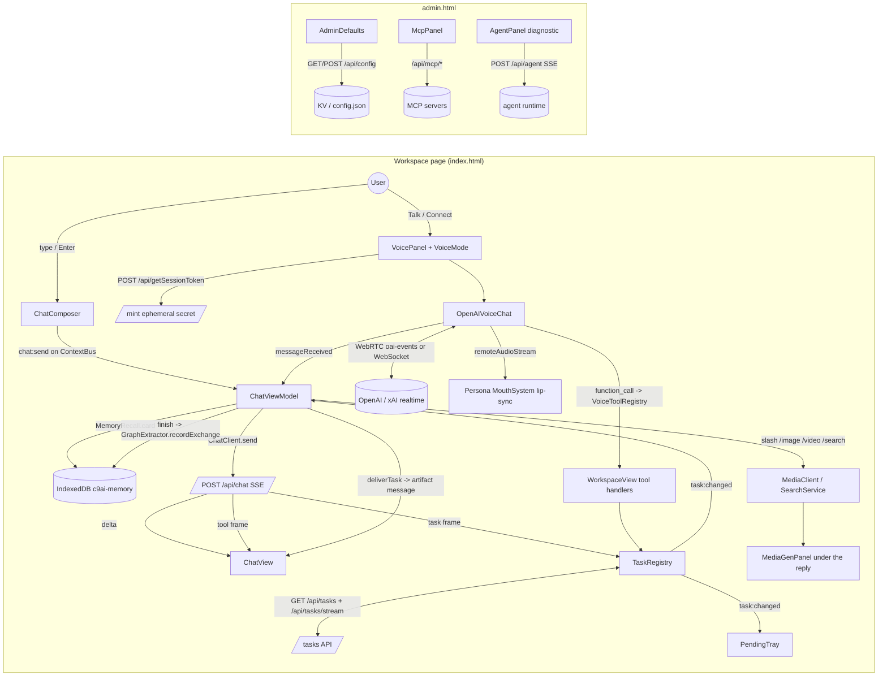

# oncloudnine — Client app: workspace view, chat, agent panel, voice chat & voice mode, media gen, memory panel, files hub, pending tray, task registry, admin

> Slice reviewed: `oncloudnine/app/**`, `oncloudnine/public/{index,admin}.html`, `docs/architecture/{workspace-persona-voice,memory}.md`, `docs/img/workspace.png`, and the unit/e2e tests that cover these files. Paths below are relative to `reference/oncloudnine/` unless stated. Server files are cited only where the client depends on their contract (model ids, headers, event shapes). No secret-bearing files were opened.

---

## 1. Purpose & architecture

"Cloud Nine AI" is a **single-user, mobile-first assistant workspace** with one animated avatar (the "persona") that speaks. The `app/` folder holds the user-facing shell and the operator (admin) page. It is written in TypeScript/TSX on a **custom JSX runtime** (`$reference`, `$event`, `EventManager`, `ObservableList`, not React) and compiled into **one IIFE bundle** (`build/public/js/app.js`, about 600 KB). Two HTML documents load that bundle:

- `public/index.html`: the workspace. It loads jszip, docx-preview, docx, d3 v7, lazy pdf.js, and `images.js`, then calls `start(document.body)`, which is `renderWorkspaceView`.
- `public/admin.html`: the operator page. It imports the same bundle for its side effects and calls `window.renderAdminView`, which `app/Views/AdminView.tsx` publishes on `globalThis`.

Several design decisions shape the rest of the slice:

1. **The client is thin.** `POST /api/chat` sends only the conversation. It carries no provider, model or system prompt. The server orchestrator decides whether to answer directly, call built-in or MCP tools, or start a long-running background task. It reports what it did on an SSE stream with five frame types: `delta`, `tool`, `task`, `done` and `error`.
2. **Operator controls live elsewhere.** Provider, model, global system prompt, MCP servers, diagnostics and folder-upload policy are on `/admin.html`. Tests assert that the workspace DOM contains no provider/model/system-prompt control and never names the model (`test/unit/chat-orchestration.test.js`, `test/e2e/admin.spec.js`).
3. **Background work is always visible.** Every long-running job is a `TaskJob` in `TaskRegistry` and is shown in the **Pending tray**, whether it is an image, video, generated app, document or agent run, and whether it runs locally or on the server. A finished job's artifact is **delivered once** into the conversation that asked for it.
4. **Voice is one of several ways to reach the same conversation.** A realtime voice session (OpenAI over WebRTC or xAI over WebSocket) runs in parallel with text chat. Its transcript is appended to the same conversation. Its tool calls run client-side and appear as tray jobs.
5. **Integration goes through a page-level event bus.** `ContextBus` (`shared/Modules/ContextBus.ts`) carries `context:add/remove`, `chat:send`, `transcript:interim/final`, `tts:speak/stop`, `toast` and `task:changed`. Some components mount themselves by watching the DOM with `MutationObserver` rather than being composed: PendingTray, FilesHub, MediaGenPanel and SearchToggle.

### Main flow



### Screen layout (from `docs/img/workspace.png` and the CSS)

```
+-------------------------------------------------------------+
| [menu]            Cloud Nine AI     [theme][admin][Connect] |  header (44px targets)
+-------------------------------------------------------------+
| chat-header: <title>          [Search the web] [+ New chat] |  sticky
| chat-stream (role=log, aria-live=polite)                     |
|   user bubble / assistant bubble                             |
|     tool-steps (Searched the web ✓, Details ▸)               |
|     message-content (sanitized markdown)                     |
|     message-artifact (img | video | sandboxed app | doc)     |
|     media-panel (image/video cards, citation cards)          |
|     footer "2,293 in / 52 out tokens · stopped"              |
|                                  [persona avatar lane 200px] |  desktop: avatar bottom-center
+-------------------------------------------------------------+
| context-row: [chip: notes.pdf ~1.2k tokens ×] [Memory ×]     |
| transcript-row (interim dictation preview)                   |
| [attach][camera][Talk][screen][Tasks•]  [ Message...  ][➤/■]|  dock (--dock-height)
+-------------------------------------------------------------+
 Drawer (overlay <768px): Chats | Files | Memories | Settings
 Voice panel: right card (desktop) / bottom sheet (mobile)
 Pending tray: slide-up panel beside the dock
 Phone: persona collapses to a 76px corner bubble
```

The screenshot shows the older, voice-centric first impression: a large illustrated female avatar, a "Connect" pill at the top right, a welcome bubble, and a dock with **Show** (camera), **Talk**, **Share** (screen), a message box and a magic-wand overflow. The current code keeps that dock and turns the avatar into a lane on desktop and a 76px bubble on phones.

---

## 2. Feature inventory

### 2.1 Workspace shell (`app/Views/WorkspaceView.tsx`)
- **What it does:** Composes the header, drawer, persona overlay, voice panel, chat view, legacy `.conversation` container, pending tray and composer dock, and mounts one `ToastHost`.
- **How it works:**
  - `renderWorkspaceView(element)` (line 31) calls `ThemeManager.init()` so the theme is set before first paint.
  - It reads `localStorage['assistant-settings']` defensively. A corrupt value falls back to `{avatar: 2}`. It then calls `applyDefaultSettings`.
  - The header buttons are built imperatively with `workspaceIconButton` (line 1127) because the JSX runtime wraps `<svg>` children in a span.
  - The drawer uses the shared `Tabs` with tabs "Chats", "Files", "Memories" and "Settings". `enhanceTabStrip` (line 444) adds `tablist`/`tab`/`tabpanel` roles, a roving tabindex and Arrow/Home/End navigation, and a `MutationObserver` keeps `aria-selected` in sync.
  - `pinAssistantToToolbar` (line 510) publishes `--dock-height` and keeps it current with a `ResizeObserver`, so the avatar and chat padding follow the dock as it grows.
  - `openAdminPage` (line 584) opens a named tab `cloudnine-admin` without `noopener`, then sets `opened.opener = null`. That way a blocked pop-up can still be detected and turned into a toast.
- **Settings drawer:** Three disclosure groups: Appearance (theme), Voice (opens the voice panel) and Administration (opens admin). Persona appearance is **not** user-editable here. Only the model can change it, through `update_persona`.
- **Maturity:** solid (e2e: `workspace-shell.spec.js`, `responsive.spec.js`).

### 2.2 Chat view model / turn orchestration (`app/ViewModels/ChatViewModel.ts`)
- **What it does:** Owns conversations, the active conversation, context cards, the streaming turn, slash commands, search mode, generated-media "extras", background-task delivery, memory recall and extraction, and error humanization. It never touches the DOM.
- **Events:** `conversationsChanged`, `conversationLoaded`, `messageAdded/Updated/Removed`, `streamingChanged`, `contextChanged`, `providersChanged`, `selectionChanged` (the *server's* resolved default, never a user choice), `transcriptChanged/Committed`, `extrasChanged` and `searchChanged`. It publishes itself as `ChatViewModel.active` so self-mounting components can find it.
- **`init()`** (line 182): subscribes the bus once, loads conversations (most recent first, or creates "New chat"), calls `loadProviders()` (`GET /api/models`) and `TaskRegistry.instance.connect()`.
- **`subscribe()`** (line 208) wires the bus events:
  - `context:add` → `addContextCard`
  - `context:remove` → `dropContextCard`
  - `chat:send` → `send`
  - `task:changed` → `onTaskChanged`
  - `transcript:interim` → preview
  - `transcript:final` → `commitTranscript`. This drops the text into the composer and does **not** auto-send, because a capture loop cuts segments of silence too.
  - It also calls `GraphExtractor.instance.listen()`.
- **`send(text)`** (line 388) runs these steps in order:
  1. Parse a slash command. `/image`, `/video` or `/search` with no prompt toasts the usage line.
  2. Run memory recall (`MemoryRecall.instance.card(content)`), except for commands, so recalled memories never leak into an image prompt.
  3. Snapshot the context cards into `attachments`.
  4. Push the user message and auto-title the conversation from the first message (`titleFrom`: 48 characters, or 45 plus "...").
  5. **Consume** the cards: retire their ids and emit `context:remove` so producers drop their persisted copies.
  6. Persist.
  7. Route to `runCommand`, to `runSearch` (when the search toggle is on and search is available) or to `run()`.
- **`run()`** (line 505) creates an empty assistant message, calls `setStreaming(true)` **before** `messageAdded` (so the typing dots render), then calls `ChatClient.send({conversationId, messages: buildRequestMessages(...), stream:true, maxTokens:4096})` with these handlers:
  - `onDelta` appends text.
  - `onTool` → `recordToolStep` upserts by step id. The merge keeps the prior summary when the closing frame omits one.
  - `onTask` → `adoptTask` → `TaskRegistry.applyServerTask(task, conversationId)`.
  - `onDone`: if no text arrived but tasks were started, the content becomes "Started “X”. It is in the Pending tray, and the result will appear here when it finishes."
  - `onError` sets `error:true`, the `code`, a readable message and a toast.
- **`buildRequestMessages`** (line 1344):
  - Skips system messages and failed turns.
  - For user messages with attachments, emits blocks `[{type:'text', text:"[kind: title]\ncontent"}, {type:'image', dataUrl}?, {type:'text', text}]`.
  - An image block is sent only when `modelSupportsVision()` says the resolved model advertises `vision`. The description always travels, so a camera frame degrades to its caption.
- **Other operations:** `regenerate(messageId)` splices from that message and re-runs. `deleteMessage`. `stop()` aborts, keeps the partial reply and marks it `stopped: true`. `speak(messageId)` emits `tts:speak` and falls back to `SpeechOutput.instance.speak`.
- **`finish()`** persists, then calls `remember()` → `GraphExtractor.instance.recordExchange(userText, assistantText, conversationId)`. This is fire-and-forget; memory failures never surface as chat failures.
- **Maturity:** solid (unit: `chat-orchestration.test.js`, `chat-artifacts.test.js`; e2e: `chat.spec.js`, `conversations.spec.js`).

### 2.3 Chat transport and the orchestration wire contract (`app/Modules/ChatClient.ts`)
- **Contract:**
  - `POST /api/chat {messages, conversationId?, stream?, maxTokens?}` returns SSE, or JSON when not streamed.
  - `GET /api/models` returns `{providers:[{name, configured, devOnly?, defaultModel, models:[{id,label,capabilities}]}]}`. It is **unauthenticated by design**, because it only reports configuration.
- **The five frame types** (each is `data:{json}\n\n`):
  - `{"type":"delta","text":"..."}`
  - `{"type":"tool","id","name","status":"running|ok|error","summary","detail"?}`
  - `{"type":"task","task":{ServerTask}}`
  - `{"type":"done","message":{...},"usage":{inputTokens,outputTokens},"model","provider"}`
  - `{"type":"error","message","code"}`
- **Behaviours:**
  - Unparseable frames become text deltas.
  - `[DONE]` is treated as done.
  - A `done` that carries the whole answer, as reasoning models do, is rendered when no deltas arrived.
  - A stream that ends with no text and no tool/task activity becomes an `empty_response` error. This prevents typing dots that never go away.
  - HTML error bodies from proxies are never shown.
  - `readableToolName` turns `web_search` into "Web search" and `mcp.searchIssues` into "Search issues".
  - Requests go through `apiFetch` (`shared/Connectors/ApiSession.ts`), which attaches `X-Session-Token` and retries once on 401. The fallback reads `globalThis.APP_SESSION_TOKEN` or a `<meta name="app-session-token">`.
- **Maturity:** solid.

### 2.4 Conversation transcript rendering (`app/Components/ChatView.tsx`)
- **Structure:** A title, an always-visible **New chat** button (`chat-new`), a notice line ("No AI provider is configured yet…"), and a stream with `role="log" aria-live="polite" aria-relevant="additions text"`.
- **Rendering:**
  - Message nodes are kept in a `Map` and **patched in place**.
  - Repaints are coalesced on a **60 ms timer**, not `requestAnimationFrame`, so a reply that finishes in a background tab is still painted.
  - Each message node has five slots: `tool-steps`, `message-content`, `message-artifact`, `message-attachments` and `message-footer`, plus `MessageActions`.
- **Tool steps:** One compact row per step, with a spinner, check or alert icon and one sentence. Detail sits behind a closed `Disclosure` and is written with `textContent`. A step that finishes without a summary keeps the sentence it started with.
- **Artifacts (`paintArtifact`):**
  - `image` renders as `<figure>`.
  - `video` renders as `<video controls playsinline>`.
  - `application` renders in an iframe with `sandbox="allow-scripts"` and **without `allow-same-origin`**, filled via `srcdoc`.
  - `document` renders as sanitized markdown.
  - `setMediaSource` fetches `/api/...` URLs through `apiFetch` as a blob, because media elements cannot send `X-Session-Token`. It revokes the object URLs it replaces.
  - `artifactMediaUrl` accepts http(s), `data:image|video`, a same-origin path, or raw base64 with an image or video mime type.
- **Other states:**
  - Typing indicator: three `.typing-dot` spans with `role="status"` and an aria-label.
  - Error message: `role="alert"` text plus a **Retry** button (`vm.regenerate`).
  - Footer: token counts and "stopped". The model and provider are **intentionally not shown**.
- **Maturity:** solid.

### 2.5 Composer dock (`app/Components/ChatComposer.tsx`)
- **What it does:** Shows context chips (thumbnail when `vision`, title, `~N tokens`, remove ×), a live transcript preview row (`aria-live`), dock actions passed as children, and an autosizing textarea (maximum 180px).
- **Keys:** Enter sends. Shift+Enter inserts a newline. Enter is ignored during IME composition (`isComposing` or `keyCode 229`).
- **Send path:** The button swaps to a stop glyph while streaming. Sending emits `chat:send` on the bus and falls back to `vm.send` when nothing is subscribed.
- **Transcript commit:** Committed transcripts are **appended into the box** for review. Focus is not stolen, so a phone keyboard does not pop up.
- **Maturity:** solid.

### 2.6 Conversations (`app/Components/ConversationList.tsx`, `ConversationStore`)
- **What it does:** Create, switch, **inline rename** (Enter or blur commits, Escape cancels; no `prompt()`), and delete. Deleting the open conversation opens the next most recent one, or creates an empty one if none remain.
- **Storage:** IndexedDB `cloudnine`, stores `conversations` and `settings`. `ConversationStore.id(prefix)` generates ids.
- **Mobile:** Picking a conversation closes the drawer under 768px.
- **Maturity:** solid (e2e `conversations.spec.js`).

### 2.7 Message actions (`app/Components/MessageActions.tsx`)
- **Controls:** Copy (with a toast), Speak (assistant only), Regenerate (assistant only) and Delete. All are icon-only buttons with a 44px hit area and an aria-label.
- **Speak feedback:** Speak shows a **spinner with `aria-busy`** until `SpeechOutput` reports `loading:false`. One pending speak button is tracked module-wide.
- **Maturity:** solid.

### 2.8 Slash commands and web search mode (`ChatViewModel.parseCommand`, `app/Components/SearchToggle.tsx`)
- **Commands:** `^\/(image|video|search)(?:\s+(.*))?$`. A command is an ordinary turn whose reply comes from a different backend.
- **Search toggle:**
  - It is persisted as `localStorage['cloudnine-search']`.
  - It is **hidden unless a configured provider advertises a model with the `search` capability**, so there is no dead switch.
  - `runSearch` calls `new SearchService().run({query, provider, messages: last 10 turns, signal})`. Citations `{title,url,snippet?,source?}` are stored as a `CitationGroup` beside the conversation.
- **Not configured:** A missing capability produces an error bubble naming the key to add (`notConfiguredMessage`):
  - search: `ANTHROPIC_API_KEY or XAI_API_KEY`
  - video: `XAI_API_KEY`
  - image: `OPENAI_API_KEY or XAI_API_KEY`
- **Maturity:** solid (e2e `mediagen.spec.js`).

### 2.9 Media generation (`ChatViewModel.generateMedia`, `MediaClient`, `app/Components/MediaGenPanel.tsx`)
- **Image flow:**
  1. `MediaClient.image({prompt, provider})` → `POST /api/generateImage`.
  2. `storeGeneratedImage` accepts only `https?:` or `data:image/` sources.
  3. It fetches the bytes and saves them to the files hub (`FileStore('assistant-files')`).
  4. The record keeps a **data URL**, so the card renders instantly and the image can later be attached as a vision block.
- **Video flow:**
  1. `POST /api/generateVideo` returns `202 {job}`.
  2. The composer is released immediately.
  3. `pollVideo` runs `GET /api/generateVideo?id=` every **2500 ms**.
  4. On `completed`, `GET ...&download=1` returns the blob, which is saved to the files hub. The record keeps `fileName`; the object URL is recreated on demand.
  5. Pending videos **resume polling after reload** (`loadExtras`).
- **Tray mirroring:** Each media job is mirrored to a tray job with the stable id `media-<mediaId>`. Progress is a percent on the media record and a fraction on the job. `retry` re-runs `generateMedia`.
- **Panel:** `MediaGenPanel` decorates message bubbles via `startMediaGen`, a `MutationObserver` on `chat-stream`. It shows:
  - a progress bar or "Generating the image…" while pending
  - `` or `<video>` when ready
  - an error with `role=alert` on failure
  - a footer with the prompt and model/provider, **Attach to chat** (turns the image into a `context:add` vision card) and **Download**
  - citation cards: numbered links with `target=_blank rel="noopener noreferrer nofollow"`

  A signature string prevents rebuilds that would restart video playback.
- **Maturity:** solid (unit `mediagen.test.js`, e2e `mediagen.spec.js`).

### 2.10 Background task registry (`app/Modules/TaskRegistry.ts`)
- **What it does:** A singleton, published on `globalThis`, that holds every background job, local or server-owned.
- **Types:**
  - `TaskKind = 'agent'|'image'|'video'|'application'|'document'`
  - `TaskStatus = 'queued'|'running'|'succeeded'|'failed'|'cancelled'`
  - `TaskProgress = number (0..1) | 'indeterminate'`
- **State machine (`allows`, line 180):** `queued → running|terminal`, `running → terminal`, and terminal is final. Late resolutions, double succeeds and aborts after cancel are no-ops.
- **Local API:**
  - `add` is idempotent by id.
  - Other calls: `start`, `progress`, `rename`, `succeed(id, TaskResult)`, `fail`, `cancel` (runs the job's own `cancel()` exactly once; a throwing handler still leaves the job terminal), `remove`, and `track(input, run, describe)`.
- **Server half:**
  - `connect()` is idempotent. It runs `reconcile()` (`GET /api/tasks`), `listen()` (`GET /api/tasks/stream`, frames `data:{"type":"task_update","task":{...}}`) and the sweep timer.
  - Reconnects back off exponentially, 1s up to 15s. A **429, 401 or 5xx goes straight to the slow attempt**. A stream only resets the backoff after it has stayed open **5s** (`streamStableMs`).
  - `applyServerTask` upserts without the state machine, because the server is the authority. It normalizes status spellings (`completed/done → succeeded`, `processing/in_progress → running`, `pending/waiting → queued`, `canceled → cancelled`), normalizes progress (a value above 1 is read as a percent), and suppresses no-op replays by comparing a JSON signature.
- **Delivery tracking:**
  - `deliveredTo(id, conversationId, messageId)` marks the job and `POST /api/tasks/{id}/delivered`, so a reload never delivers the same answer twice.
  - `hydrate` fetches `GET /api/tasks/{id}/result` once for results marked `detached: true` (large base64 images).
  - `requestCancel` sends `POST /api/tasks/{id}/cancel`.
  - `clearFinished` sends `POST /api/tasks/clear`.
- **Retention:** `sweepFinished` removes succeeded or cancelled rows **120s** after they finish (checked every 30s). It never removes failures, running jobs, or server jobs that have not been delivered.
- **Events:** `ContextBus.emit('task:changed', {task, reason:'added'|'updated'|'removed'})`.
- **Maturity:** solid (unit `taskregistry.test.js` and `task-store*.test.js`, which test the server store, not this slice).

### 2.11 Pending tray (`app/Components/PendingTray.tsx`)
- **What it does:** A slide-up panel titled "Pending", with a count ("2 working" or "3 finished"), a Clear button and one row per job.
- **Each row:**
  - a kind icon: agent=sparkle, image, video, application=globe, document
  - the title, as a button that is enabled only when the job succeeded and can be opened
  - a status label (Queued, Working, Done, Failed or Cancelled)
  - a spinner, or a percentage when progress is measured
  - a live elapsed clock ("m:ss", 1s ticker only while something runs)
  - a determinate or indeterminate bar with `role=progressbar` and `aria-valuenow`
  - an error line
  - Retry (failed or cancelled jobs with a `retry` handler)
  - Stop/Dismiss (icon only)
- **Ordering:** Rows are patched in place, and the list is reordered only when a job's status changes (active first, then finished jobs by most recent).
- **Reveal:** It **opens itself** on a newly added *non-terminal* job. Finished jobs reconciled on page load do not pop it open. The dock's Tasks button shows the count and a pulsing dot.
- **`openTaskResult` (line 510), in order:**
  1. the producer's `open()`
  2. if the answer landed in **another conversation**: `selectConversation`, then scroll to the message and highlight it for 2s
  3. scroll to `messageId`
  4. open `content` in a `DocumentPanel`, with HTML inside a sandboxed iframe
  5. open a safe URL in a new tab
- **Mounting:** `mountPendingTray` is idempotent and also self-bootstraps through a `MutationObserver` that gives up after 30s.
- **Maturity:** solid (unit `pendingtray.test.js`, e2e `pending-tray.spec.js`).

### 2.12 Delivering finished tasks into conversations (`ChatViewModel.onTaskChanged` / `deliverTask` / `writeTaskMessage`)
- **Scope:** Only **server** jobs are delivered this way. Local jobs write their own reply.
- **Order of operations:** `job.delivered` is set **before** the first await. `ChatViewModel.artifactOf` maps the job result to a `ChatArtifact`, and `taskCaption` writes one sentence ("Here is the image for “X”.").
- **Idempotency:** The conversation transcript is the dedupe record. `taskMessageIn(conversation, taskId)` checks whether a message already carries `taskId`, so reloads never duplicate.
- **Where it lands:**
  - The open conversation updates live.
  - Another conversation is written directly to the store and announced with a toast: "A background task finished in “Title”."
- **Failures:** A failed task becomes an assistant error message (`code:'task_failed'`) with Retry.
- **Maturity:** solid.

### 2.13 Realtime voice sessions: WebRTC vs WebSocket (`app/Modules/VoiceChat.ts`, `OpenAIVoiceChat`)
- **Minting (`requestRealtimeSession`, line 1313):**
  - The client sends `POST /api/getSessionToken` through `apiFetch`, with the **PersonaSettings object as the body**.
  - The response body is the ephemeral secret as plain text. The session metadata comes from these headers:
    - `X-Realtime-Model`
    - `X-Realtime-Voice`
    - `X-Realtime-Provider` (`openai` or `xai`)
    - `X-Realtime-Transport` (`webrtc` or `websocket`)
    - `X-Realtime-Base` (WebRTC)
    - `X-Realtime-Websocket` (WebSocket)
  - The call fails if the token or model is missing, and the client never guesses a model. The account API key never reaches the browser.
- **OpenAI over WebRTC (`connectWebRtc`, line 573):**
  1. Create an `RTCPeerConnection` and a data channel named `"oai-events"`.
  2. `getUserMedia({audio:true})`, then add the mic track.
  3. Create an SDP offer and `POST` it to `realtimeSdpUrl(model, baseUrl)` = `https://api.openai.com/v1/realtime?model=<model>` with `Authorization: Bearer <ephemeral>` and `Content-Type: application/sdp`.
  4. `setRemoteDescription(answer)`.

  Remote audio arrives via `ontrack`. It is bound to a hidden `<audio autoplay>` and exposed as `remoteStream`. Session configuration (voice, VAD, tools and transcription) was fixed server-side at mint time; see Section 3.
- **xAI over WebSocket (`connectWebSocket`, line 637):**
  1. Open `new WebSocket(wss://api.x.ai/v1/realtime?model=<model>, ['xai-client-secret.<token>'])`. The subprotocol carries the token because browsers cannot set WebSocket headers. Opening times out after 20s.
  2. Build a playback `AudioContext({sampleRate:24000})` plus a `MediaStreamDestination`. The destination is a **silent tap for lip-sync only**; it is never bound to `<audio>`, which would echo.
  3. Capture the mic through `ScriptProcessorNode(4096)` (about 170 ms). Each buffer is converted by `float32ToBase64Pcm16` and sent as `input_audio_buffer.append`. Muting stops sending rather than sending silence.
  4. Send `session.update` with:
     - `voice` (default `eve`)
     - `instructions`
     - `turn_detection:{type:'server_vad', threshold:0.5, prefix_padding_ms:300, silence_duration_ms:500}`
     - `audio.input/output.format {type:'audio/pcm', rate:24000}`
     - `tools: clientRealtimeToolSchemas()`

  Assistant audio arrives as `response.output_audio.delta` or `response.audio.delta` (base64 PCM16). Chunks are scheduled back to back with `AudioBufferSourceNode.start(max(currentTime, playbackTime))` and tracked for barge-in.
- **Shared protocol surface (`handleRealtimeEvent`, line 794):**
  - `session.created/updated`: records `session.tools`, announces "connected" **once**, then calls `attachMcpTools()`.
  - `input_audio_buffer.speech_started`: sets `userSpeaking` and **barges in** (`interrupt()`) if the agent is speaking.
  - Transcript deltas and done events, for both the beta (`response.audio_transcript.*`, `response.text.*`) and GA (`response.output_audio_transcript.*`, `response.output_text.*`) names, feed `VoiceTranscript`, set `agentSpeaking`, and emit `agentStateChanged({speaking, lastMessage: <delta only>})`.
  - User transcription: `conversation.item.input_audio_transcription.delta|completed|failed`.
  - `response.function_call_arguments.done` → `onFunctionCallArguments`.
  - `response.done|response.cancelled` and `output_audio_buffer.stopped` set speaking to false.
  - `error` → `errorOccurred`.
- **Barge-in (`interrupt`, line 1031):**
  - Send `response.cancel`.
  - On WebRTC, send `output_audio_buffer.clear`. On WebSocket, `stopPcmPlayback()` stops the scheduled sources.
  - Detach `audioElement.srcObject`; it is re-bound on the next spoken turn, WebRTC only.
  - Mark the transcript entry interrupted.
  - The **microphone is kept alive**.
- **Text and context into a live session:**
  - `sendMessage` sends `conversation.item.create {type:'message', role:'user', content:[{type:'input_text'}]}` followed by `response.create`.
  - `sendContext` sends a `role:'system'` item with **no** `response.create`. It is used on connect to share the file list and settings-backed memories.
- **Robustness:**
  - Messages sent before the channel or socket opens are queued and flushed on open.
  - Voice changes: `canUpdateVoice()` is false once audio has started, because the API rejects the change. The panel then says "applies to the next voice session".
  - `disconnect()` closes every resource, including sessions that failed while connecting, and is the only place the mic tracks are stopped.
- **Maturity:** partial. The code is thorough and both transports are unit-tested against scripted channels and sockets, but the project's own docs say *"Neither realtime transport has ever been exercised against a live session"* (`docs/architecture/workspace-persona-voice.md:235`). `ScriptProcessorNode` is deprecated.

### 2.14 Voice transcript state machine (`VoiceTranscript`, `VoiceChat.ts:56`)
- **Design:** A pure state machine over realtime events that produces `VoiceTranscriptEntry {id, role, text, final, interrupted?, ts}`.
- **Keys:** Assistant entries are keyed `assistant:<response_id|item_id|current>`; user entries `user:<item_id|current>`.
- **Updates:** Deltas append. The done event **replaces** the text, which prevents double rendering.
- **Empty and interrupted turns:** An empty user transcription is dropped rather than left as an empty bubble. Interrupted keys are remembered (bounded to 20) so late frames from a cancelled response do not open a second bubble.
- **Bounds:** 200 entries.
- **Rendering:** `VoicePanel.renderEntry` upserts nodes using `textContent`, with interim, final and interrupted classes.
- **Maturity:** solid (unit-tested).

### 2.15 Tool calls during voice (`VoiceToolRegistry`, `WorkspaceView.registerVoiceTools` / `onFunctionCalled`)
- **Built-in tools:** Five tools, declared server-side for OpenAI at mint and client-side for xAI via `clientRealtimeToolSchemas()`. The two lists are asserted equal in tests.

  | Tool | Parameters |
  |---|---|
  | `create_application` | `{name, specs}` |
  | `generate_image` | `{description, size: 1024x1024 \| 1792x1024 \| 1024x1792}` |
  | `create_document` | `{title, markdown}` |
  | `add_memory` | `{description}` |
  | `update_persona` | `{name, description, message, avatar: masculine \| feminine, voice, appearance}` |

- **Dispatch (`onFunctionCallArguments`, line 898):**
  1. Parse the arguments (bad JSON becomes `{}`).
  2. Emit `functionCalled` for observers.
  3. `await tools.dispatch(name, args)`. This **always resolves**: an unknown tool returns `{error}`, and a handler that throws becomes a `{error}` result.
  4. Send `conversation.item.create {type:'function_call_output', call_id, output: summarizeToolResult(result)}`, bounded to **2000 chars** (`TOOL_OUTPUT_LIMIT`).
  5. Send `response.create` so the assistant speaks again.
- **Handlers:**
  - `create_application`: a tray job (`kind:'application'`, indeterminate, cancellable via `AbortController`). It calls `POST /api/createApplication {name, specs, html: currentHtml}` so the app is **iterative**; the current HTML travels along. It is deliberately not `/api/agent`. The result is shown in a sandboxed iframe with Download and Close, saved to `assistant-files`, and returns `{application_created, bytes}`. A re-entrancy guard answers "Application is being generated, please wait...".
  - `generate_image`: a tray job. It calls `POST /api/generateImage {prompt,size,count:1}` and shows the image in the sandboxed preview.
  - `create_document`: an instant tray job that is created already succeeded. It shows a `DocumentPanel` in markdown mode.
  - `add_memory`: `resolveMemoryModule()` feature-detects `MemoryStore/KnowledgeGraph/MemoryGraph/Memory` with a method named `addMemory/remember/upsertMemory/add`. It also writes to the legacy `settings.memories` list.
  - `update_persona`: merges `args.appearance` into the settings, applies the name, description and voice, persists `assistant-settings`, and calls `settings.setReference`, which re-renders the avatar.
- **Endpoint probing:** `postFirstAvailable(paths, body)` remembers any path that returned 404 for the life of the page.
- **Maturity:** solid for dispatch; partial for handlers (see the bugs in Section 7).

### 2.16 MCP tools inside the voice session (`attachMcpTools`, `loadMcpVoiceTools`, `callMcpVoiceTool`)
- **Loading:** After the session reports its tools, the client runs `GET /api/mcp/tools` and takes at most **24** tools (`MAX_VOICE_MCP_TOOLS`, because every schema costs context on every turn).
- **Name encoding:** Tool names are wire-encoded **bijectively**, `server.tool` → `server__tool`, with underscores inside each part escaped as `_-` (`voiceToolWireName`/`voiceToolNameFromWire`, the same encoding as the agent runtime). Names must match `^[A-Za-z0-9_-]{1,64}$`.
- **Registration:** Names already declared by the session are filtered out *before* registration, so an MCP tool cannot hijack `create_document`. Because `session.update` **replaces** the tool list, the client resends the declared tools plus the MCP additions. A session that never reports its tools never gets MCP tools.
- **Calls:** `POST /api/mcp/call {name, arguments}`. `isError` becomes `{error}`; success becomes `{text}`.
- **Maturity:** solid (unit `agent-voice-tools.test.js`).

### 2.17 Voice mode resolution (`app/Modules/VoiceMode.ts`)
- **Inputs:** The preference `auto|realtime|stt`, persisted as `localStorage['cloudnine-voice-mode']`. Availability comes from `/api/models`.
- **Realtime availability:** An explicit `provider.realtime` boolean wins. Otherwise a model with the `realtime` capability counts, and otherwise the name list `['openai','xai']`. An empty provider list is `unknown`, **not** `no`, so the Connect button does not flicker on load.
- **STT source:** `server` if any configured provider advertises `transcription`; otherwise `browser` if `SpeechRecognition` or `webkitSpeechRecognition` exists; otherwise `none`.
- **`resolveVoiceMode` table (line 175):**

  | Preference | Realtime available | Mode | Connect button |
  |---|---|---|---|
  | auto | yes or unknown | realtime | shown |
  | auto | no | stt | hidden |
  | realtime | no | stt | hidden, `degraded: true`, with a reason sentence |
  | stt | any | stt | hidden, forced |

  It also returns `micUsable` and `reason`.
- **Controller:** `VoiceModeController` notifies only on an actual change and fires immediately on subscribe.
- **Maturity:** solid (unit `voice-mode.test.js`).

### 2.18 Single-session voice coordinator (`VoiceSessionCoordinator`, `VoiceMode.ts:403`)
- **States:** `idle | connecting | connected | listening | speaking | error | unavailable`.
- **Session gate:** `requestSession()` returns true **once per session**. Connect-then-Mic or Mic-then-Connect, even in the same tick, never mints a second ephemeral secret. `adoptSession()` joins a session the shell started.
- **Floor rules:** While the agent is speaking the state is `speaking` (agent floor wins). The user speaking gives `listening`. Idle-with-session is `connected`. STT dictation reuses `listening` without a session. The rest state is `unavailable` when nothing can use the mic.
- **Maturity:** solid.

### 2.19 Voice panel UX (`app/Components/VoicePanel.tsx`)
- **Layout:** A card fixed at the right on desktop and a bottom sheet under 768px.
- **Contents:**
  - a status pill (`data-state`, colour plus text, pulsing for listening and speaking)
  - a notice line with the reason, warn or error
  - Connect/End, Mic (label changes with mode: "Talk", "Mute", "Unmute", "Dictate", "Stop dictation"), Mute and Interrupt buttons
  - a Mode select (Auto, Realtime, Speech to text)
  - a Voice select, a Preview voice button and a speaking badge ("Speaking (server voice)" or "(browser voice)")
  - a live transcript list (`role=log`)
- **Publishing:** It exposes `VoicePanelApi` through an event and as `globalThis.VoicePanelControl` for e2e. Methods include `connectPressed()`, `micPressed()`, `attach(session)`, `setStatus`, `modeState`, `onModeChanged`, `hasSession` and `state`.
- **Unavailable Connect:** When realtime is not possible, the Connect control is **hidden, not disabled**, because a disabled button would still be an offer the deployment cannot keep.
- **Voice picker:** In realtime mode it follows the session provider (OpenAI 8 voices or xAI 5). In STT mode it follows the `/api/speech` provider's catalogue (`SpeechOutput.voicesFor`). An unknown stored voice resolves to the provider default.
- **Error messages:** `voiceFailure` routes every failure through `ChatViewModel.readableVoiceError` and logs the raw text.
- **Maturity:** solid (e2e `voice.spec.js`).

### 2.20 Non-realtime speech: TTS fallback and STT dictation (VoicePanel + `shared/Modules/SpeechOutput.ts` + input app)
- **TTS:** `SpeechOutput.instance.attach()` makes it the subscriber for `tts:speak` and `tts:stop`.
  - It prefers `POST /api/speech`: OpenAI's 8 voices or xAI's 26 (per the docs).
  - It falls back to browser `speechSynthesis`.
  - Clips are cached under a sha256 of voice plus text in a bounded cache.
  - It is **suspended while a realtime session is live** and resumed afterwards.
  - It publishes `state.stream` for lip-sync.
- **STT dictation, two paths:**
  - Browser `SpeechRecognition`: `inputViewModel.speechInput.startListening(true)` (continuous).
  - Server: `AudioInputManager({publish:true})` → `CaptureContextPublisher` → `/api/transcribe`.

  Both emit `transcript:interim` and `transcript:final` on the bus, and the composer renders them. A configured transcription provider is preferred over the browser recognizer.
- **Maturity:** solid on the client wiring (`SpeechOutput` itself is outside this slice).

### 2.21 Driving the persona while it speaks (WorkspaceView + `persona/`)
- **Avatar:** `PersonaView` is layered DOM plus CSS custom properties from `PersonaSettings`: eye, brow, mouth, nose, lip and skin parameters plus `avatar`, `voice`, `name` and `description`. `FaceAnimation` is an ECS with Blink, EyeMovement, EyeBrow and Mouth systems (from the docs; the code is in `persona/`).
- **Realtime lip-sync:**
  - On `agentStateChanged({speaking:true})` the shell calls `startSpeakingAudioEvent.notify(voiceChat.remoteAudioStream)`. The MouthSystem reads the analyser's mid-band mean and maps it to the viseme classes `closed/bmp/default/aei/o/u`.
  - With no stream, it falls back to `startSpeakingEvent.notify(lastMessage)`, a text-timed letter walk.
  - `speaking:false` calls `stopSpeakingEvent`, which closes the mouth.
- **Non-realtime lip-sync:** `attachSpeechToPersona` drives the mouth from the clip's own stream, or from the text for the browser synthesizer. It is ignored while realtime is connected, so two sources never drive the mouth at once.
- **Persona in instructions:** The server embeds the persona's current name, description, avatar, voice and appearance into the realtime `instructions` (`server/api/getSessionToken.ts:167 realtimeInstructions`). The model is told how `update_persona` values map to the CSS avatar. **The model can restyle and re-voice the avatar mid-conversation.**
- **Tap to interrupt:** Tapping the avatar stops speaking, calls `voiceChat.interrupt()` and emits `tts:stop`.
- **Presence states:**
  - `.assistant` has `--scale-factor` values of .8, .5 (screen-position) and .25 (pinned, scrolled or tapped).
  - It is `pinned` while a generated document or app is on screen.
  - On phones it becomes a 76px circular bubble at top-right (`chat.css` `@media (max-width:768px)`), with the scale factor set to .105.
- **Maturity:** solid for single-avatar wiring. There is no multi-avatar support.

### 2.22 Context cards and visible memory recall (ChatViewModel + composer + memory panel)
- **Card shape:** `ContextCard {id, kind:'file'|'capture'|'memory', title, content, mime?, tokens?, preview?, dataUrl?, vision?}`. Cards come from the file pipeline, captures, media "Attach to chat", agent artifacts and memory recall.
- **Upsert and retirement:** `context:add` is an upsert, because capture cards are republished when their description lands. A **retired-id list** (bounded to 500) stops a late description from re-attaching a card that was already sent.
- **Recall card:** Recall produces a `memory` card with a **unique id per turn**. It is a removable chip before sending, and the memory panel lists exactly what was injected, with the retriever that found each item ("memory used").
- **Maturity:** solid.

### 2.23 Knowledge-graph memory panel (`app/Components/MemoryPanel.tsx`)
- **Controls:**
  - search, debounced 150ms, using hybrid `store.search` over entities and chunks
  - stats: "N entities · N relations · N notes"
  - a "Use memory in new messages" toggle (`cloudnine-memory-enabled`)
- **Sections:**
  - **Memory used**: items plus retriever
  - **Graph**: Show/Hide
  - **Entities**: name, type, edit (rename, retype, add a note), delete, and delete per observation
  - conversation notes (chunks), with source and delete
  - **Relations**: "A → type → B", delete
  - **Clear all memory**, behind an inline confirm (not `window.confirm`)
- **Graph view:** Rendered lazily, only when opened, because d3's force layout reads container dimensions and fails inside hidden tabs. It uses the shared `Graph` component. Nodes are keyed by entity `key` (`name|type`), and dangling edges are dropped. If d3 is missing, a message says so.
- **Maturity:** solid (e2e `memory.spec.js`: a fact told in conversation A is recalled in B). The graph re-renders fully on every edit.

### 2.24 Files hub (`app/Components/FilesHub.tsx`)
- **What it does:** One panel over every stored file: uploads, folder context, captures, generated media, and agent deliverables across all conversations. It is backed by `FileLibrary` (`shared/Modules/FileStore.ts`) on CacheStorage.
- **Archiving:** Every `context:add` card is **archived on arrival**, so files survive after a message consumes them. The conversation association comes from `ChatMessage.attachments[].id` matching `record.cardId` (`indexConversations`).
- **Features:**
  - a scope select ("All conversations" or one conversation)
  - select all with an indeterminate state
  - **Export .zip** (JSZip, real DEFLATE; exports what is on screen when nothing is selected)
  - batch delete, which also emits `context:remove` so the composer drops the card
  - per-row Preview, Download and Delete, with metadata `kind · mime · size · conversation · updated`
- **Previews:** Image, audio and video play inline. HTML uses `HtmlPreview` (sandboxed `srcdoc` with a source toggle). JSON arrays render as a `Table`. Markdown and plain text open in a `DocumentPanel`.
- **Mounting:** It mounts itself into `.sidebar [data-tab="Files"]` with up to 40 retries, then floats as a fallback. It hides the legacy `.list`. It refreshes when it becomes visible (`IntersectionObserver`).
- **Maturity:** solid (e2e `fileshub.spec.js`).

### 2.25 Agent task panel, now an admin diagnostic (`app/Components/AgentPanel.tsx`, `app/ViewModels/AgentViewModel.ts`)
- **History:** It was a workspace drawer and is now only mounted from `/admin.html` as "Advanced: run a task manually". The code comment records why: goal boxes, tool checklists and step ceilings ask end users to plan runs themselves ("seems complicated and users will not understand").
- **Controls:**
  - a goal textarea
  - a provider/model row, hidden when there is no chat view model
  - a step-limit select: default, 4, 8, 12, 16, 20 or **24** (`AGENT_MAX_STEPS_CEILING`, asserted equal to the server's `AGENT_MAX_STEPS_LIMIT`)
  - a tool allowlist: 7 built-ins (`current_time`, `fetch_url`, `create_document`, `create_application`, `generate_image`, `web_search`, `query_memory`) plus every enabled MCP server's tools, all on by default. **No list is sent when every tool is on**, and turning all tools off is refused.
  - "Send the N attached context cards"
  - Run and Stop
- **Run request:** `POST /api/agent {goal, provider?, model?, maxSteps?, tools?, context?, memory?, stream:true}`. `memory` holds up to 8 items pre-recalled with `MemoryRecall.recall`.
- **Stream frames:**
  - `step` with `phase: start|message|thinking|wrap-up`
  - `tool {id,name,step,status,args,result,durationMs}`
  - `result {artifact}`
  - `error`
  - `done {text, steps, stopReason, usage, model, provider, toolCalls, artifacts}`
- **Timeline:** Patched in place so open `<details>` stay open. Tool arguments and results are shown as `<pre>` via `textContent`; the final answer is sanitized markdown. The footer reads "N steps · N tool calls · model · stopped at the step limit".
- **Artifacts:** `addArtifact` runs `safeMediaUrl`, then emits `context:add`, so the deliverable reaches the files hub and the composer. Every run is a tray job with cancel and retry.
- **Maturity:** solid as a diagnostic (unit `agent.test.js`, e2e `agent.spec.js`, including a real filesystem MCP server).

### 2.26 MCP server management (`app/Components/admin/McpPanel.tsx`, `AgentViewModel` MCP half)
- **Endpoints:** `GET/POST/DELETE /api/mcp/servers`, `POST /api/mcp/connect|disconnect {id}`, `GET /api/mcp/tools`.
- **Server rows:** namespace name, status badge, transport (`http | sse | stdio`), URL or command line, `lastError`, and a tool list inside `<details>`. Actions are Reconnect, Disconnect and Remove.
- **Adding a server:** The form takes a namespace (tools are called `namespace.tool`), a transport, a URL or a command with arguments (quote-aware split). The `stdio` option is **disabled with the server's reason** unless `stdio.available`, because the server gates it on `isLocalRequest`.
- **Maturity:** solid.

### 2.27 Admin view (`app/Views/AdminView.tsx`, `app/Components/admin/*`)
- **Framing:** A separate document with a warning banner: *no accounts; this is not an authentication boundary*. Anchor navigation covers Defaults, Providers, MCP, Diagnostics, Memory, Folder defaults and Advanced. A hidden "parking host" `.sidebar` keeps self-mounting workspace panels from floating over the admin page.
- **AdminDefaults:**
  - Global provider ("Automatic (server decides)" or a configured provider; unconfigured ones are listed but disabled).
  - Model: chat-capable models only, disabled until a provider is pinned.
  - **Global system prompt** of up to 8000 characters (`ADMIN_SYSTEM_PROMPT_MAX`), with a counter.
  - Stored server-side via `GET/POST /api/config` under KV keys `DEFAULT_PROVIDER`, `DEFAULT_MODEL` and `SYSTEM_PROMPT`.
  - Shows the **write protection in the server's own words** (`protection.summary`; `admitted: local|secret`). Save is disabled with a reason when the page is not writable. After saving it re-renders from what the server read back.
- **AdminProviders:** One card per provider: configured badge, "local only", default model, **config key names only** (`ADMIN_PROVIDER_CONFIG_KEYS`), capabilities and a model list.
- **AdminDiagnostics:**
  - `/api/health`: whether the server is healthy, the config source ("config.json …" vs "Cloudflare KV namespace (env.KV)", chosen by hostname), and which providers are configured.
  - `/api/session`: token state, header, TTL and expiry. **The token value is never rendered.**
  - Rate-limit classes: `read` (health, models, tasks), `session`, and `spend` (agent, chat, config, createApplication, describeImage, embeddings, extractMemory, generateImage, generateVideo, getSessionToken, mcp, search, speech, transcribe).
  - A log of this page's last 12 requests with status, duration and `Retry-After`.
- **AdminMemory:** Counts of entities, relations, observations, chunks and embedded chunks, plus `navigator.storage.estimate()`. Clearing the store is behind a confirm.
- **AdminFolderRules:** Skipped folders and extensions, skip dotfiles, and maximum file size in KB. Stored in `localStorage['cloudnine-folder-rules']`, which the workspace folder picker reads.
- **AdminApi:** The single transport, through `apiFetch`. It adds an `X-Admin-Secret` header from `sessionStorage['cn9.admin.secret']` (set via `AdminApi.useSecret(...)` in the console) and keeps the request log.
- **AdminConfig:** A **pure presentation model** that rebuilds payloads field by field with a whitelist, so key material can never leak into the DOM.
- **Maturity:** solid (unit `admin-config.test.js`, `admin-endpoint.test.js`; e2e `admin.spec.js`).

### 2.28 Theme manager (`app/Modules/Theme.ts`)
- **Behaviour:** Preferences are `light|dark|system`, stored as `cloudnine-theme`. It sets `data-theme` and `data-theme-preference` on `<html>` and mirrors the legacy `body.dark` class. While the preference is `system` it follows `prefers-color-scheme` live. `toggle()` resolves `system` to the opposite of what is currently shown.
- **Maturity:** solid.

### 2.29 Error humanization (`ChatViewModel.readableError`, `readableVoiceError`)
- **Chat errors:**
  - `humanizeError` splits "prefix: {json}" and unwraps `error → message → (a JSON string)` up to 12 levels.
  - Truncated JSON is handled with a `"message":"…"` regex.
  - `cleanErrorText` refuses anything that still has braces, and caps the text at 300 characters.
  - Fallback codes: `upstream_error`, `not_configured`, `rate_limited`, `unauthorized`, `payload_too_large` and `internal_error`.
- **Voice errors:** Cause-first regex signals map failures to actionable sentences: mic permission, no mic, mic in use, not configured, 401/403, quota, 429, 5xx, timeout and network. Plumbing words ("offer", "SDP", "ICE", "peer connection", "data channel") are never shown. Output is capped at 160 characters.
- **Maturity:** solid.

### 2.30 Client-side security hygiene (cross-cutting)
- **Media URLs:** `AgentViewModel.safeMediaUrl` accepts only `http(s)://` or `data:image/`. Control characters are stripped before the scheme is read. `ChatView.safeMediaUrl` also accepts `data:video/` and a single-slash same-origin path (`//host` is rejected).
- **Generated HTML:** Always rendered via `srcdoc` inside a sandbox. ChatView and PendingTray use `allow-scripts`; WorkspaceView and AgentPanel use `allow-scripts allow-forms`. **`allow-same-origin` is never set.** This replaced an earlier same-origin `document.write` preview with an unvalidated `postMessage` listener.
- **Untrusted text:** Tool output, MCP descriptions, transcripts and provider errors are written with `textContent`. Assistant markdown goes through the shared sanitizing renderer.
- **Links:** Citation links use `noopener noreferrer nofollow`.
- **Admin tab:** Opened with `opener = null`.
- **Maturity:** solid.

### 2.31 Mobile-first layout and accessibility (all of `app/Styles/*.css`)
- **Layout:**
  - `--max-width: min(1000px,100%)`.
  - Safe-area insets are read into `--safe-*` variables.
  - **Every control is at least 44×44px.**
  - The drawer is an overlay at 768px and below and a persistent column above.
  - Header captions appear from 600px (the Connect button gets its " Connect" / " Connected" label there).
  - Message actions show on hover for pointer devices and always on touch.
  - The composer autosizes, and `--dock-height` is published for the layout.
  - The voice panel becomes a bottom sheet on mobile, and the tray is sized `min(300px, 100vw-20px)`.
- **Accessibility:**
  - `prefers-reduced-motion` blocks in chat, agent, voice, pending-tray, tray and main CSS.
  - Live regions: the chat log, the voice transcript and the tray list are polite; the status pill uses `aria-live`.
  - **SVG icons only.** Tests assert that no emoji appears in the chrome.
- **Maturity:** solid (e2e `responsive.spec.js`, `workspace-shell.spec.js` checks "nothing scrolls sideways at <size>").

### 2.32 Camera and screen capture in the dock (integration only; the implementation is in `input/`)
- **Wiring:** `MediaInput type="camera|screen"` with a capture cadence (`captureInterval` from `assistant-settings`, clamped by `normalizeInterval`). Frames are described by `ImageDescriptionService` and published as `capture` context cards by `CaptureContextPublisher`. Captures no longer auto-stop after 10 seconds.
- **Maturity:** partial in this slice (wiring only).

---

## 3. Providers, models & external APIs

### 3.1 Endpoints the client calls
| Endpoint | Caller | Auth | Notes |
|---|---|---|---|
| `GET /api/models` | `ChatClient.models`, AdminDefaults/Providers | **none** | Capability discovery. It is the only unauthenticated call |
| `POST /api/chat` (SSE) | `ChatClient.send` | `X-Session-Token` via `apiFetch` | Five frame types |
| `GET /api/tasks`, `GET /api/tasks/stream` (SSE), `POST /api/tasks/{id}/cancel`, `POST /api/tasks/{id}/delivered`, `GET /api/tasks/{id}/result`, `POST /api/tasks/clear` | `TaskRegistry` | session | `task_update` frames. Results can be detached |
| `POST /api/getSessionToken` | `requestRealtimeSession` | session | Plain-text ephemeral secret plus `X-Realtime-*` headers |
| `POST /api/generateImage` | `MediaClient.image`, `generateVoiceImage` | session | `{prompt, provider?, size?, count?}` returns `{url?, b64?, alt, provider, model, images}` |
| `POST/GET /api/generateVideo` (`?id=`, `&download=1`) | `MediaClient` | session | 202 job, then poll, then MP4 bytes |
| `POST /api/createApplication` | `generateApplicationHtml` | session | `{name, specs, html}` returns `text/html` |
| `GET /api/mcp/tools`, `POST /api/mcp/call`, `GET/POST/DELETE /api/mcp/servers`, `POST /api/mcp/connect\|disconnect` | Voice, AgentViewModel | session | `server.tool` naming |
| `POST /api/agent` (SSE) | AgentViewModel | session | step, tool, result, error and done frames |
| `/api/search` (via `SearchService`), `/api/speech` (via `SpeechOutput`), `/api/transcribe` (via `AudioInputManager`), `/api/embeddings` + `/api/extractMemory` (via memory modules) | shared modules | session | Outside this slice |
| `GET/POST /api/config`, `GET /api/health`, `POST /api/session` | AdminApi | session plus locality or `X-Admin-Secret` for writes | Admin only |

### 3.2 External realtime endpoints (called directly from the browser)
- **OpenAI WebRTC:** `https://api.openai.com/v1/realtime?model=<model>` (`REALTIME_BASE_URL`, overridable via `X-Realtime-Base`). The SDP offer is sent with `Authorization: Bearer <ephemeral>`. The server mints the secret at `POST {base}/realtime/client_secrets` (GA route; the beta `/realtime/sessions` now returns 404).
- **xAI WebSocket:** `wss://api.x.ai/v1/realtime?model=<model>` (`XAI_REALTIME_WS_URL`), subprotocol `xai-client-secret.<token>`. The server mints at `POST {base}/realtime/client_secrets {expires_after:{seconds}}`.

### 3.3 Model ids (from `server/providers/registry.ts`; the client never hard-codes a chat model)
- **Realtime:**
  - OpenAI `gpt-realtime-2` (override with `OPENAI_MODEL_RT`)
  - xAI `grok-voice-latest` (override with `XAI_MODEL_RT`)
  - Realtime input transcription uses `gpt-4o-mini-transcribe`
- **Realtime voices:**
  - OpenAI: `alloy, ash, ballad, coral, echo, sage, shimmer, verse` (default `echo`)
  - xAI: `eve, ara, rex, sal, leo` (default `eve`)

  Drift between the client and server lists is caught by `voice-realtime.test.js` and `realtime-providers.test.js`.
- **Turn detection:**
  - OpenAI (mint body): `server_vad`, threshold 0.5, prefix 300ms, silence 500ms, `create_response:true`, `interrupt_response:true`, `output_modalities:['audio']`.
  - xAI (client `session.update`): the same VAD values; audio `pcm` at 24 kHz both ways.
- **Other models:**

  | Provider | Chat | Other |
  |---|---|---|
  | OpenAI | `gpt-5.2` | TTS `gpt-4o-mini-tts`, STT `gpt-4o-mini-transcribe`, embeddings `text-embedding-3-large`, image `gpt-image-1` (legacy `dall-e-3`, `dall-e-2`) |
  | xAI | `grok-4.5`, `grok-4.3` | image `grok-imagine-image` / `grok-imagine-image-quality`, video `grok-imagine-video-1.5` / `grok-imagine-video`, `grok-tts`, `grok-stt` |
  | Anthropic | `claude-opus-5` (chat, streaming, vision, tools, search) | |
  | Ollama | `qwen3:32b` | embeddings `nomic-embed-text` |

- **Capability flags the client reads:** `chat`, `streaming`, `vision`, `tools`, `search`, `embeddings`, `transcription`, `speech`, `image`, `video` and `realtime`. The UI shows or hides features based on them:
  - vision: whether an image block is sent
  - search: the search toggle
  - image and video: slash commands
  - realtime: the Connect button
  - transcription: the STT source
  - speech: the voice catalogue
- **Config key names shown in admin:**
  - `ANTHROPIC_API_KEY`
  - `OPENAI_API_KEY`, `OPENAI_ORGANIZATION_ID`, `OPENAI_MODEL`, `OPENAI_MODEL_RT`
  - `XAI_API_KEY`
  - `OLLAMA_BASE_URL`, `OLLAMA_MODEL`
  - `DEFAULT_PROVIDER`, `DEFAULT_MODEL`, `SYSTEM_PROMPT`
  - `ADMIN_SECRET`

---

## 4. Data model & persistence

### 4.1 Stores
| Store | Where | Contents |
|---|---|---|
| IndexedDB `cloudnine` v1 | `ConversationStore` (shared) | `conversations` (`Conversation`), and `settings` (key/value, including `extras:<conversationId>`) |
| IndexedDB `c9ai-memory` v1 | `MemoryStore` (shared) | `entities`, `relations`, `chunks` |
| CacheStorage `assistant-files` and others | `FileStore`/`FileLibrary` | Uploaded, captured and generated file bytes, with metadata in Response headers |
| localStorage | various | `assistant-settings` (PersonaSettings, legacy `memories[]`, `captureInterval`), `cloudnine-theme`, `cloudnine-voice-mode`, `cloudnine-search`, `cloudnine-memory-enabled`, `cloudnine-folder-rules` |
| sessionStorage | AdminApi | `cn9.admin.secret` |
| Server (KV / config.json) | `/api/config`, `/api/tasks` | Global defaults, task records with a retention window and a `delivered` flag |
| In-memory singletons | `TaskRegistry.instance`, `ChatViewModel.active`, `SpeechOutput.instance`, `MemoryStore.instance`, `ContextBus.instance` | Live state, published on `globalThis` |

### 4.2 Key record shapes (from `app/types.d.ts` and module interfaces)
```ts
Conversation { id, title, created, updated, system?, provider?, model?, messages: ChatMessage[] }
ChatMessage  { id, role:'user'|'assistant'|'system', content, ts, provider?, model?, usage?{inputTokens,outputTokens},
               error?, code?, stopped?, attachments?: ChatAttachment[], tools?: ChatToolStep[],
               artifact?: ChatArtifact, taskId? }
ChatToolStep { id, name, status:'running'|'ok'|'error', summary, detail? }
ChatArtifact { kind:'image'|'video'|'application'|'document', title?, content?, url?, mime? }
ChatAttachment / ContextCard { id, kind:'file'|'capture'|'memory', title, content, mime?, tokens?, preview?, dataUrl?, vision? }
ChatExtras (settings 'extras:<cid>') { media: GeneratedMedia[], citations: CitationGroup[] }
GeneratedMedia { id, conversationId, messageId, kind:'image'|'video', prompt, status:'pending'|'ready'|'failed',
                 provider?, model?, url? (data: or https, never blob:), alt?, jobId?, progress? (0-100), fileName?, mime?, error?, ts }
CitationGroup { messageId, query?, citations: {title,url,snippet?,source?}[] }
TaskJob { id, kind, title, status, progress?, startedAt, finishedAt?, result?: TaskResult, error?,
          cancel?(), retry?(), conversationId?, server?, delivered? }
TaskResult { kind?:'document'|'application'|'image'|'video'|'text', title?, content?, url?, mime?, messageId?, open?() }
ServerTask (wire) { id, kind?, title?, status?, progress?, startedAt?, finishedAt?, result?, error?, conversationId?, delivered? }
VoiceTranscriptEntry { id, role:'user'|'assistant', text, final, interrupted?, ts }
RealtimeSession { token, model, voice, provider:'openai'|'xai', transport:'webrtc'|'websocket', baseUrl?, websocketUrl? }
VoiceModeResolution { mode, preference, forced, degraded, showConnect, sttSource:'browser'|'server'|'none', micUsable, reason }
AgentStep { id, step, kind:'phase'|'message'|'tool', label, detail, status:'running'|'ok'|'error'|'done', args?, durationMs? }
AgentArtifact { kind:'document'|'application'|'image', title, content?, url?, mime }
McpServerInfo { id, name, transport:'http'|'sse'|'stdio', url?, command?, args?, enabled, status, lastError, toolCount, tools[], serverInfo? }
MemoryEntity { id, name, type, key(name|type normalized), observations[], source, createdAt, updatedAt }
MemoryRelation { id, from(key), to(key), type, key, createdAt, updatedAt }
MemoryChunk { id, text, embedding:number[], source, conversationId, ts }
MemoryRecallItem { id, kind:'entity'|'chunk', title, text, score, from }
StoredFileRecord { id, store, name, title, kind, format, mime, size, updated, conversationId?, conversationTitle?, source?, preview?, dataUrl?, tokens?, cardId? }
PersonaSettings { name, description, welcome?, knowledge, image?, avatar:number, voice, eye*/mouth*/nose*/lip*/skin* params,
                  speechEnabled, speechDetectionEnabled, speechDetectionThreshold, memories?: string[] }
```

### 4.3 Persistence rules worth noting
- Media **bytes** go to the files hub. Conversation records hold data URLs for images or file names for video, never `blob:` URLs, which are stripped by `saveExtras`.
- The **transcript is the delivery ledger**: a message carrying `taskId` means the task is delivered. The server `delivered` flag backs it up.
- Context cards are **consumed** by the message that carries them. The composer strip empties, producers are told to drop their copies, and the files hub keeps an archived copy.
- Provider, model and system prompt are **not** stored per conversation (`Conversation.provider/model/system` fields exist but are legacy).

---

## 5. UX details worth keeping

1. **A single chat surface that shows the agent's work in plain language.**
   - Tool steps are one sentence each ("Searched the web"), with a spinner that becomes a check.
   - Machinery is hidden behind a closed "Details" disclosure.
   - A turn that only started background work says so: "Started “X”. It is in the Pending tray, and the result will appear here when it finishes."
2. **The Pending tray as the single place for everything in flight.**
   - An elapsed clock, spinner or real progress bar, and a working Stop that actually aborts.
   - Retry on failures. Auto-open on new work, but not for reconciled old work.
   - A pulsing dot on the dock's Tasks button when closed.
   - Rows are receipts that sweep after 2 minutes; failures persist until dismissed.
3. **Results come to you.**
   - A finished task writes an artifact message into the *originating* conversation.
   - If you have moved to another conversation, you get a toast, and clicking the tray row switches back and highlights the message.
4. **Controls that cannot work are removed.**
   - The Connect button is hidden with no realtime provider.
   - The search toggle is hidden with no search-capable model.
   - Commands answer with the exact key to add.
5. **Two entry points, one voice session.** The header Connect and the dock Talk both reach one session. Pressing the mic during a live call toggles mute; it never starts a second session or double-transcribes.
6. **Barge-in by talking or by tapping the avatar.** The interrupted assistant bubble is marked `interrupted`, and the mic stays live.
7. **A voice picker that tells the truth.** It shows the catalogue of whichever provider will actually speak. "applies to the next voice session" appears once audio has started. Preview voice plays a sample.
8. **Dictation goes into the composer, not straight to the model.** The user reviews and edits first. The live interim preview sits above the input.
9. **Visible memory.** Recalled memories arrive as a removable chip and are listed in "Memory used" with the retriever. A single toggle turns injection off, and the panel says so.
10. **The new-chat affordance is always visible**, in the chat header, not buried in the drawer.
11. **Typing indicator discipline.** Three animated dots with an accessible sentence. An empty stream becomes an error bubble with Retry, never endless dots.
12. **Errors read as sentences.** Provider JSON never reaches a bubble or toast. Voice errors give the action to take ("Allow it in your browser, then start voice again").
13. **The footer shows token cost, not the model.** "2,293 in / 52 out tokens · stopped" signals conversation cost. The model id is deliberately omitted.
14. **Avatar presence states.** The avatar is large when idle, shrinks when content is pinned or the page is scrolled, and becomes a corner bubble on phones. The mouth follows the real audio envelope.
15. **Admin shows what the server says.** Write-protection text in the server's own words, key *names* with a configured badge, and a per-request log with `Retry-After`.
16. **Mobile ergonomics.** 44px targets, safe-area insets, a drawer overlay that closes after a pick, bottom-sheet panels, no horizontal scroll at 375px (e2e-tested), and reduced-motion handling everywhere.

---

## 6. Patterns worth reusing (and how to lift them into the Agent Workplace)

1. **A thin client with server-owned orchestration** (`ChatClient.ts`, `ChatViewModel.run`).
   - **Lift:** The Lead agent (P1) lives server-side. The client sends only `{projectId, threadId, messages}`, and the stream reports `delta | tool | task | done | error`.
   - **Extend:** Add `agent` (which coworker is speaking), `handoff` (delegation event), `plan` (DAG snapshot) and `approval_request`. Keep "unknown frames are ignored" for forward compatibility.
2. **The TaskRegistry state machine plus server reconciliation** (`TaskRegistry.ts`).
   - **Lift as-is:** idempotent `add` by id, terminal-is-final `allows()`, `reconcile()` + SSE `task_update` + exponential backoff with a "stable for 5s" reset, the `delivered` marker on both client and server, and detached-result hydration.
   - **Add fields:** `agentId` (assignee), `parentTaskId`/`planStepId` (DAG), `projectId`, `requiresApproval` and `cost`. This becomes the Project Run / Inbox backbone (P4/P6).
3. **Delivery of results into the originating thread, deduped by `taskId` in the transcript** (`writeTaskMessage`, `taskMessageIn`).
   - **Lift:** Every coworker deliverable lands as a message in the project channel that requested it, with the tray and inbox row linking back.
4. **The Pending tray UI contract** (`PendingTray.tsx`).
   - **Lift:** Use it as the "Activity" rail for the whole office. Group by project or agent, keep patch-in-place rows, the elapsed clock, the determinate vs indeterminate bar, retry and stop.
5. **The realtime voice abstraction over two transports** (`OpenAIVoiceChat.handleRealtimeEvent`, `requestRealtimeSession`).
   - **Lift:** One `RealtimeVoiceSession` class per agent. The server mints an ephemeral secret and returns the transport metadata in headers; the client picks WebRTC or WebSocket.
   - **Keep:** GA and beta event aliases, the send queue before open, the silent MediaStream tap for lip-sync, barge-in that keeps the mic, `canUpdateVoice` gating, and a full resource teardown.
   - **Replace** `ScriptProcessorNode` with `AudioWorklet`.
6. **An always-resolving tool registry with bounded outputs and a follow-up `response.create`** (`VoiceToolRegistry`, `summarizeToolResult`, `onFunctionCallArguments`).
   - **Lift:** This is the right shape for any agent's realtime tool bridge. Route voice tool calls to the **server orchestrator** (see gap 7.2) instead of client-side handlers.
7. **Bijective MCP tool-name wire encoding and additive `session.update`** (`voiceToolWireName`, `attachMcpTools`).
   - **Lift:** Use it verbatim for any provider that restricts function-name characters. Keep "session-declared names win" to stop tool hijacking, and cap tools per session (24).
8. **Voice mode resolution plus a single-session coordinator** (`VoiceMode.ts`).
   - **Lift:** A pure, unit-testable matrix (preference × availability → mode, showConnect, sttSource, reason) and a state machine with a `requestSession()` gate.
   - **Extend:** Make the coordinator per-agent, plus an office-level "floor" arbiter so only one avatar speaks at a time, or several play in a "meeting" mix.
9. **Persona-in-the-prompt plus a self-restyling tool** (`update_persona`, server `realtimeInstructions`).
   - **Lift:** Each coworker's persona record (appearance and voice) is injected into its realtime instructions. The lead agent can call `update_persona(agentId, …)` to adjust a coworker. Persist server-side per agent, not in localStorage.
10. **Lip-sync from the real audio stream** (`remoteAudioStream` → `startSpeakingAudio`, `SpeechOutput.state.stream`).
    - **Lift:** Every audio source exposes a `MediaStream` (WebRTC remote track, WebSocket playback tap, or TTS clip tap). The avatar component consumes the stream and falls back to text timing. This lets the user "listen in" on any agent with the correct mouth animation.
11. **Capability-driven UI from a provider registry** (`/api/models` capabilities; `capableProvider`, `SearchToggle`, `VoiceMode.providerRealtime`).
    - **Lift:** The model registry (P7) advertises capability flags, and every multimodal affordance (P8) keys off them. Hide what is not available.
12. **Visible, removable memory injection** (`MemoryRecall.card` → composer chip → "Memory used" disclosure; retired card ids).
    - **Lift:** Every context injection into any agent (business context, project docs, memories) becomes an inspectable, removable card with provenance. This is an important trust pattern (P9/P12).
13. **Context cards consumed by the message, archived by the files hub** (`ChatViewModel.send`, `FilesHub` archive on `context:add`).
    - **Lift:** One pipeline for "things attached to work". Scope to a project, and derive the association from message attachments.
14. **Media jobs that survive reloads** (`extras` in the settings store, resumed polling, stable job ids `media-<id>`).
    - **Lift:** Long media jobs (video) are server tasks. Keep "bytes in file storage, references in messages".
15. **Error humanization** (`readableError`, `readableVoiceError`).
    - **Lift verbatim:** A cause-first signal table, recursive unwrapping, a plumbing-word filter, and the raw error kept in the console.
16. **Security primitives** (`safeMediaUrl`, sandboxed `srcdoc` without `allow-same-origin`, `textContent` for untrusted text, the admin whitelist presentation model `AdminConfig.ts`).
    - **Lift:** Use them as shared utilities in the new app. Use the whitelisting presentation-model pattern for any config or secret-adjacent payload.
17. **Drift tests between duplicated constants** (voice lists, the step ceiling, rate-limit classes, config keys).
    - **Lift:** Any value duplicated across client and server gets a test that reads both files.
18. **A separate operator surface.** End users never see provider or model pickers.
    - **Adapt:** In the Agent Workplace the business owner *is* the operator. Keep a "Workspace settings" area separate from the "Office", and let the lead agent pick per-coworker models from policy.

---

## 7. Gaps, debt & risks

1. **Single persona, single session, single user.** One `assistant-settings` persona in localStorage, one `OpenAIVoiceChat`, and one global `VoiceSessionCoordinator`. Multi-agent avatars, per-agent voices and concurrent sessions do not exist.
2. **Voice and chat are two separate systems.**
   - The realtime session does not go through `/api/chat`. It has its own five client-side tools plus MCP, and no access to the server orchestrator's tools, background tasks or global system prompt (only `OPENAI_INSTRUCTIONS`).
   - Voice transcripts are appended to the conversation (`chat.appendMessage`), but the chat model does not see voice-only tool results, and the voice model sees only the connect-time context (the file-name list plus legacy `settings.memories`, **not** knowledge-graph recall).
   - This is the most important gap for P1: the lead agent should be the same agent whether you type or talk.
3. **Two rendering paths for artifacts.**
   - Voice tool outputs (`showHTML`/`showDocument`) render into a legacy `.conversation` div below the chat view.
   - Server-task artifacts render inside ChatView messages.
   - The voice-generated `files` `ObservableList` and cache are a second, legacy file list, which the files hub hides with `supersedeLegacyFileList`.
4. **Two memory stores.** `add_memory` writes to both the knowledge graph and the legacy `settings.memories` array, and the realtime connect sends only the legacy list.
5. **Bugs and risks in the voice tool handlers** (`WorkspaceView.onFunctionCalled`):
   - `update_persona` returns "Missing required parameters" unless **both `name` and `appearance`** are present, although the schema marks neither as required. A voice-only change ("use the sage voice") fails.
   - The avatar gender mapping only ever sets `avatar = 2` for `feminine` and never maps `masculine` back.
   - `generate_image` saves `new File([image.url], "<name>.jpg", {type:'image/jpeg'})`. The file content is the URL *string*, not the image bytes, so the files hub entry is not a real JPEG.
   - `applyVoice` returns early unless the voice is realtime-capable (`isRealtimeVoice`). Picking one of xAI's non-realtime TTS voices in STT mode updates `SpeechOutput` but is not persisted to settings. This is plausible from reading the code and was not tested.
6. **Realtime transports are unverified live** (per the docs). WebSocket mic capture uses the deprecated `ScriptProcessorNode`, and there is no `AudioWorklet` build output.
7. **Fragile integration mechanics.**
   - The one-scope IIFE bundle causes helper-name collisions (the code comments warn about them).
   - There is heavy reliance on `globalThis` publishing, `typeof X !== 'undefined'` feature detection, and `MutationObserver` self-mounting with timeouts (PendingTray 30s, FilesHub 40 retries).
   - The custom JSX runtime has quirks (`disabled={false}` becomes disabled; SVG children are wrapped).
   - Duplicate `connected` state lives in WorkspaceView and VoicePanel.
   - A new stack should use a mainstream framework and explicit composition.
8. **No authentication or tenancy.** The admin page is "not an authentication boundary". Writes are protected by locality or `ADMIN_SECRET`, which is held in sessionStorage and set through the console. The session token is issued to every visitor.
9. **Memory is browser-only.** IndexedDB, no sync, no per-project or per-conversation scoping, no decay, no re-embedding after a model change (mixed-dimension vectors are skipped), and hard deletes with no undo. The graph view re-renders fully on every edit.
10. **No plans or DAGs in the UI.** The agent step timeline exists only as an admin diagnostic. End users see tool steps and tray rows, but no plan, dependencies, checkpoints or approvals.
11. **Full history is resent every turn** with fixed `maxTokens: 4096`. There is no client-side summarization or windowing (search uses the last 10 turns).
12. **The task model lacks multi-agent attribution.** `TaskJob` has no `agentId`, `parent` or `projectId`. The five kinds are fixed (`agent|image|video|application|document`), and unknown kinds collapse to `agent`.
13. **Video is xAI-only.** OpenAI's Videos API is noted as shut down in September 2026. The poll interval is a fixed 2.5s with no backoff.
14. **Persona appearance is not user-editable.** Only the model can change it, via `update_persona`. There is no persona editor in the Settings drawer.
15. **Persona leak (docs):** `Persona.tsx` re-renders construct a new `FaceAnimation` without cancelling the old ECS loop. `applyDefaultSettings` uses `||`, which swallows legitimate zeros.
16. **Accessibility is strong, but** the legacy `main.css` shell predates the safe-area conventions, and the global `button{outline:none}` is only overridden by the newer sheets.

---

## 8. Relevance to the Agent Workplace (P1–P14)

| Pillar | What this slice offers | Adopt / Adapt / Avoid |
|---|---|---|
| **P1 Lead orchestrator** | Thin client + server orchestrator; `tool`/`task` frames; "a turn that only started work says so"; the agent runtime is reachable only via the diagnostic | **Adopt** the thin-client contract and plain-language step rendering. **Adapt:** make the lead agent the single brain for *both* text and realtime voice by routing realtime function calls to the server orchestrator. **Avoid** the split voice/chat brains (gap 7.2) |
| **P2 Personas** | `PersonaSettings` (appearance and voice), persona embedded in realtime instructions, the `update_persona` tool, per-provider voice catalogues with drift tests | **Adapt** into server-stored per-agent persona records (role, personality, skills, voice per provider, face params). Keep the "model can restyle via tool" idea, gated by approval. **Avoid** localStorage persona storage and the parameter bugs |
| **P3 Interactive avatars** | Envelope-driven lip-sync from any `MediaStream`, text-timed fallback, tap-to-barge-in, presence states (large, pinned, corner bubble), reduced-motion gating | **Adopt** the stream-driven lip-sync contract and presence states. **Adapt** for N avatars (office grid, meeting view) with a per-agent audio stream and a floor arbiter. The DOM/CSS avatar is lightweight but stylistically limited, so consider a richer renderer behind the same stream API |
| **P4 Workflow orchestration** | `TaskRegistry` state machine, server reconciliation and SSE, cancel/retry, delivered markers, detached results, receipt sweeping; the agent step timeline (step, tool, wrap-up at the step limit) | **Adopt** the registry as the run backbone. **Extend** with DAG fields (parent, step, depends-on), approvals/checkpoints, assignee agent, triggers and cost. Promote the step timeline from admin to a per-run "Run view" |
| **P5 Intra-agent comms** | Mostly absent. `ContextBus` is a typed page event bus. The voice transcript joins the chat transcript. There are no agent-to-agent channels | **Adapt** the typed-event pattern into server-side channel events (`message`, `handoff`, `@mention`, `meeting.start`). Reuse `VoiceTranscript` to render *agent* speech in channels so the user can observe or join |
| **P6 Projects with plans** | Conversations with extras, deliver-to-origin-conversation, files hub scoped by conversation, tray click-through across conversations | **Adapt** conversation → project thread. Keep delivery-to-origin and files-scoped-by-thread. Add plans, inbox and decisions, which are missing |
| **P7 LLM providers** | Capability-driven UI from `/api/models`; admin global defaults (provider, model, system prompt); key names only in UI | **Adopt** the capability flags (`chat, streaming, vision, tools, search, embeddings, transcription, speech, image, video, realtime`) and the no-model-chrome discipline. **Adapt:** per-agent model policy chosen by the lead agent or owner, rather than one global default |
| **P8 Multimodal** | Realtime voice over two providers and transports; TTS with provider fallback and browser fallback; STT (server or browser) into the composer; vision attachments with a caption fallback; image generation (`gpt-image-1`, `grok-imagine-image`); video generation with polling (`grok-imagine-video-1.5`); search with citations; camera and screen capture cadence | **Adopt** nearly all of this as the multimodal toolkit. **Fix** the file-bytes bug in voice image generation and the deprecated audio capture node. Make media jobs server tasks throughout |
| **P9 Context & memory** | Visible, removable recall cards with retriever provenance; the knowledge-graph panel (d3), editable entities, observations and relations; the "memory used" disclosure; the recall toggle | **Adopt** the visibility and editability UX. **Adapt** the storage to server-side and project/agent-scoped memory with sync. **Avoid** browser-only IndexedDB as the system of record |
| **P10 Tools / MCP** | Admin MCP panel (http, sse, stdio with gating reason), MCP tools bridged into realtime voice, bijective wire names, capped tool counts, agent tool allowlists | **Adopt** the wire encoding, additive session updates, hijack protection and per-run allowlists. **Adapt** allowlists into per-persona skill/tool grants |
| **P11 Navigation & UX** | Mobile-first shell, drawer tabs with full ARIA, a composer with chips, the Pending tray, the voice panel as a bottom sheet, always-visible New chat, the admin page split | **Adopt** the tray, the composer and the accessibility discipline. **Extend** with an office/spatial navigator (agents as rooms or tiles), "join" and "listen in" on any agent, and a per-agent voice panel |
| **P12 Trust & governance** | Sandboxed `srcdoc` without same-origin, `safeMediaUrl`, textContent for untrusted text, whitelist presentation of config, ephemeral realtime secrets (no key in the browser), write protection stated in the server's words, rate-limit classes and request log, humanized errors, memory disclosure | **Adopt** all of it. **Add** real auth and roles, approvals before costly or irreversible tool calls, budgets per agent or project, and audit/undo (memory deletes are currently hard deletes) |
| **P13 Business features** | Very little: a token-usage footer, a global system prompt, "not configured → which key to add" guidance | **Adapt** the usage footer into per-project cost tracking. Templates, sharing, billing and onboarding must come from other slices |
| **P14 Infrastructure** | One bundle with two HTML entry points; `apiFetch` session-token pattern; drift tests between client and server constants; e2e at 375px; KV-backed config | **Adopt** the drift-test habit and the session-token gate for spendable endpoints. **Avoid** the one-scope IIFE with globalThis publishing and MutationObserver self-mounting; use a standard framework and bundler |

**Bottom line.** Several pieces are close to reusable as-is: the **Pending tray + TaskRegistry**, **deliver-to-origin with transcript dedupe**, the **realtime voice client (two transports, one protocol, barge-in, MCP bridging)**, **voice mode resolution with the single-session gate**, **stream-driven lip-sync** and **visible memory recall**. The main change needed for the Agent Workplace is to generalize everything that assumes one assistant into per-agent instances: persona, voice session, coordinator, tray attribution, memory scope and avatar. The realtime voice path also needs to be unified with the server-side lead orchestrator, so the agent the owner talks to is the same one that spawns and coordinates coworkers.
