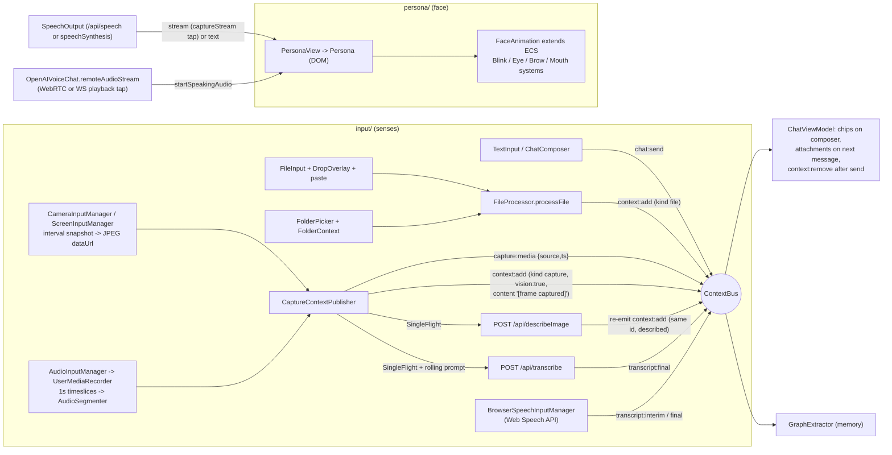

# oncloudnine — Input & persona: multimodal capture (camera, screen, mic, dictation, folder, file parsing) and the animated persona face

Scope reviewed (all paths relative to `reference/oncloudnine/`): `input/**` (Modules, Components, ViewModels, Views, interfaces), `persona/**` (FaceAnimation, PersonaSettings, Persona.tsx, PersonaView.tsx, Persona.css, interfaces), `docs/architecture/input-and-media.md`, `docs/architecture/workspace-persona-voice.md`, and the in-scope tests (`test/unit/{capture-logic,face-animation,facing-mode,fileprocessor,folder-context,input-viewmodel,voice-speech}.test.js`, `test/e2e/{capture,capture-cadence,folder,ingest,voice}.spec.js`). Where behaviour depends on code just outside the slice (the `ContextBus`, `ECS`, `SpeechOutput`, the `/api/transcribe` and `/api/describeImage` endpoints, `WorkspaceView` wiring, `GraphExtractor`), I read that code too and cite it, because the slice cannot be understood without it.

---

## 1. Purpose & architecture

This slice is the "senses and face" of Cloud Nine AI:

- **`input/`** is a micro-frontend that turns everything the user can hand the assistant into one shape: a `ContextCard` published on the shared `ContextBus`. Sources: the text box, file attach/drag-drop/paste, a local folder picker with ignore rules, interval snapshots from camera and screen (described by a vision model), microphone segments transcribed server-side, and Web Speech API dictation as the zero-cost fallback.
- **`persona/`** is a micro-frontend that renders a single animated assistant face — layered PNG bust plus CSS-drawn eyes, brows and mouth — and animates it with a tiny ECS (entity-component-system) loop: blinking, gaze tracking with an idle look-around, random eyebrow gestures, and a mouth driven either by the live audio envelope of whatever the assistant is saying or by a per-character "viseme" walk over the text.

The two apps never import each other or `app/` (they are separate TypeScript projects: `input/tsconfig.json`, `persona/tsconfig.json`, each `outDir ../build/<app>`, JSX factory `$element`). Integration happens through three channels only:

1. **`ContextBus`** (`shared/Modules/ContextBus.ts`) — typed pub/sub singleton, also published on `globalThis.ContextBus`.
2. **DOM self-mounting** — `DropOverlay` and `FolderPicker` mount themselves into `document.body` / the Files drawer; `MediaInput` appends its floating strip to `document.body`; `window.CaptureControls` is exposed for late mounting and e2e probes.
3. **Props/events passed by the workspace** — `WorkspaceView` renders `<MediaInput>` and `<PersonaView>` and hands the persona three events: `startSpeaking(text)`, `startSpeakingAudio(MediaStream)`, `stopSpeaking()`.

### Main flow



ASCII view of the persona render stack (from `persona/Components/Persona.tsx:119-150` and `persona/Styles/Persona.css`):

```
div.persona  (--person-width/height = 700px * --scale-factor; ~25 CSS custom props from settings)
 ├─ div.skin  (filter: hue-rotate(--skin-hue) brightness(--skin-brightness) grayscale(--skin-grayScale))
 │   ├─ div.photo   background-image: img/avatarN.png  (faceless bust)  OR user photo masked by it
 │   ├─ div.nose    background-image: img/noseN.png
 │   └─ img.outline (optional, img/photo1|2.png)
 └─ div.face  (scale: --scale-factor)
     ├─ div.eye.left   ├─ div.eyeBrow   └─ div.eyeBall(rotated 45°, lid = ::after) └─ div.iris (+ ::before pupil)
     ├─ div.eye.right  (same)
     └─ div.mouth.<shape>  ├─ .gums.upper ├─ .teeth.upper ├─ .gums.lower └─ .teeth.lower  (lips = ::before border)
```

---

## 2. Feature inventory

### 2.1 Persona avatar rendering (layered PNG + CSS features)

**What:** A stylised bust (four hand-drawn "faceless" PNGs: `public/img/avatar1..4.png`, with `nose1/2.png` and outline images `photo1/2.png`) over which eyes, irises, pupils, eyelids, eyebrows and a mouth with lips, gums and teeth are drawn entirely in CSS. No canvas, SVG or WebGL.

**How:**
- `Persona(props)` (`persona/Components/Persona.tsx:18-151`) builds the DOM tree above, collects `$reference`s for every part, and on load calls `loadPersona()` (`:65-101`) which writes every entry of `getPersonaProperties(settings, small)` (`:153-254`) as a CSS custom property on the root (`--skin-hue`, `--skin-brightness`, `--skin-grayScale`, `--iris-color`, `--eye-spacing`, `--eye-width`, `--eyeBrow-color`, `--eyeBrow-scale`, `--eyeLid-color`, `--eye-outline-color`, `--mouth-size`, `--mouth-width`, `--mouth-height`, `--nose-size`, `--nose-width`, `--nose-height`, `--lip-color`, `--lip-size`). A `small` mode halves/divides pixel sizes, but it is hard-wired off (`const smaller = false//...` at `:68`).
- Geometry is all `calc()` off `--person-width/height` and `--eye-width` (`persona/Styles/Persona.css:31-60`); eye positions use `--eye-spacing` (`:143-149`); the eyeball is a 45°-rotated square with `border-radius: 100% 0` giving an almond shape, and the eyelid is an oversized `::after` disc in `--eyeLid-color` (`:220-260`). The iris moves via `transform: translateY(var(--iris-offset-y)) translateX(var(--iris-offset-x))` (`:160`).
- **Custom photo mode:** when `settings.image` is set, the photo is the div's background and the chosen avatar PNG becomes a CSS `mask-image` (`Persona.tsx:76-81`), so a user's picture is cut to the bust silhouette; with `showOutline` an `` (`img/photo1.png` for avatars 0/1, `photo2.png` for 2/3) is overlaid (`:87-99`).
- Skin tone is a filter chain on `.skin` (hue-rotate/brightness/grayscale) — one PNG, many complexions.
- A persona fades in: `PersonaView` adds `.open` 100 ms after load (`persona/Views/PersonaView.tsx:44-46`); `.face`/`.nose` go from `opacity:0` to 1 under `.open` (`Persona.css:79-98`).

**Maturity:** solid for a single 2D cartoon face. `.persona .preview` CSS (`Persona.css:115-127`) for a video/image behind the face exists but nothing renders it (vestigial).

### 2.2 FaceAnimation — an ECS loop for the face

**What:** `FaceAnimation extends ECS` (`persona/Modules/FaceAnimation.ts:23-61`) creates one entity `face` with seven `FaceComponent`s (two eyes, two brows, two irises, mouth; type tags `'eye'|'eyeBrow'|'iris'|'mouth'`) and four systems.

**How:**
- `ECS` (`shared/Modules/ECS.ts`) is a ~190-line generic ECS: entities with a component array, systems as `{id, update(entity)}`, `update()` runs every system over every entity. `runDelayed()` (`:112-117`) is the loop: `setTimeout(1000/30)` → `update()` → `requestAnimationFrame(runDelayed)`, i.e. roughly 20–30 Hz, with **no cancellation handle**.
- `prefersReducedMotion()` (`FaceAnimation.ts:15-21`) is read once at construction. Under reduced motion only `MouthSystem` is installed (`:53-59`); the other systems are still constructed so callers keep references. Rationale in code: blink/gaze/brows are decoration, lip-sync is functional feedback.
- `Persona` constructs `FaceAnimation` in `person.onLoad` and calls `face.runDelayed()` (`Persona.tsx:105-115`), stamping `data-reduced-motion` on the root.

**Maturity:** solid core; see leak notes in §7.

### 2.3 Blinking

`BlinkSystem` (`FaceAnimation.ts:63-86`): every 5 000 ms adds `.blinking` to both `.eye` elements for 150 ms via `setTimeout`. CSS collapses the eyelid `::after` to cover the eyeball (`Persona.css:262-267`). Fixed interval, no jitter, no double-blinks. **Maturity:** solid, simplistic.

### 2.4 Gaze: pointer tracking + idle look-around

`EyeMovementSystem` (`FaceAnimation.ts:88-204`):
- Document-level `mousemove` and single-finger `touchmove` listeners (`:108-128`, skipped under reduced motion) record the pointer and the time.
- **Tracking:** each tick computes the angle/distance from the iris centre to the pointer, clamps to a radius of 6 px (3 px when `isSmall`) and vertical offset of ±3 px (±1.5), then eases `current += (target - current) * 0.3` and writes `--iris-offset-x/y` on both irises (`:163-203`).
- **Idle state machine:** after 2 000 ms without pointer movement, `updateRandomLook()` (`:130-161`) cycles `paused` (90 frames) → `looking` at a random point within the radius (60 frames) → `returning` to centre → `paused`. The doc diagram in `docs/architecture/workspace-persona-voice.md:189-200` shows this.
- A constant `this.currentY += 1.2` "to account for eyelid" is applied every frame (`:196`) — see §7 for the resulting bug.

**Maturity:** partial (works for tracking; idle cycle has a defect).

### 2.5 Eyebrow gestures

`EyeBrowSystem` (`FaceAnimation.ts:206-254`): every 3 000 ms picks a random gesture 0–6 different from the current one — neutral, raised, furrowed, surprised, thinking, happy, confused — each a `[leftRot, rightRot, leftTransY, rightTransY]` tuple applied as an inline `transform: rotate(..) translateY(..)` with a 0.5 s ease. Gestures are random, not tied to conversation state. **Maturity:** partial (random only; left/right detection bug in §7).

### 2.6 Lip-sync from the live audio envelope (primary path, "F-12")

**What:** `MouthSystem.startSpeakingFromAudio(stream, sharedContext?)` (`FaceAnimation.ts:355-385`) animates the mouth from whatever audio the assistant is actually playing.

**How:**
- Creates (or reuses a passed-in) `AudioContext`, resumes it if suspended, builds an `AnalyserNode` with `fftSize = 1024`, `smoothingTimeConstant = 0.55`, connects `createMediaStreamSource(stream)` to it (not to the destination — it is a silent tap).
- `pumpAudio()` (`:430-440`) runs on `requestAnimationFrame`: `getByteFrequencyData` → `readEnvelope()` = mean of bins from index 20 to 40 % of the bin count, normalised 0..1 (`:443-453`; at 48 kHz that is roughly 0.94–9.6 kHz, i.e. formant/consonant energy, skipping the fundamental) → `shapeFromEnvelope()` thresholds (`:459-466`):

| envelope | class |
|---|---|
| < 0.04 | `closed` |
| < 0.10 | `bmp` |
| < 0.22 | `default` |
| < 0.38 | `aei` |
| < 0.55 | `o` |
| ≥ 0.55 | `u` |

- It only writes when the shape changes (`if (shape === this.lastShape) return`), by adding a `MouthShapeComponent` to the entity; the ECS `MouthSystem.update()` (`:280-303`) consumes it on the next tick and sets `mouth.className = "mouth <shape>"`, then removes the component. So effective mouth rate is capped by the ~20–30 Hz ECS loop.
- `audioMode = true` blocks the text path from starting on top of a live stream (`:316`). `stopSpeaking()` (`:387-395`) tears down the analyser, closes the context only if owned, and rests the mouth `closed`.
- Tests pin the mapping: `test/unit/face-animation.test.js:137-204` ("maps envelope amplitude onto the same shape classes", "the envelope is the mid-band mean", "text-driven startSpeaking is a no-op while audio mode is active", "an audio frame only writes a shape when the shape actually changed"). The test compiles the real `shared/Modules/ECS.ts` + `FaceAnimation.ts` with `tsc` and injects stubbed `matchMedia`/`requestAnimationFrame`.

**Where streams come from** (outside the slice but essential):
- Realtime voice: `WorkspaceView` on `state.speaking === true` notifies `startSpeakingAudioEvent` with `voiceChat.remoteAudioStream` (the WebRTC remote track, or on the xAI WebSocket transport a `MediaStreamDestination` silent tap of the playback graph) (`app/Views/WorkspaceView.tsx:796-803`).
- Non-realtime TTS: `attachSpeechToPersona()` (`app/Views/WorkspaceView.tsx:848-863`) subscribes to `SpeechOutput.instance.onStateChanged`; when `/api/speech` plays a clip, `SpeechOutput.captureTap()` (`shared/Modules/SpeechOutput.ts:432-455`) returns `audio.captureStream()` / `mozCaptureStream()` first, and only falls back to `createMediaElementSource → MediaStreamDestination` if the context is already `running` (to avoid silencing the reply). A live realtime session "owns the avatar": the TTS path is ignored while `connected`.

**Maturity:** solid, but amplitude-only (not phonetic) — see §7.

### 2.7 Text-driven visemes (fallback path)

`MouthSystem.startSpeaking(text)` (`FaceAnimation.ts:313-345`) walks the text one character at a time with `setTimeout`: 50 ms per letter, 100 ms for space/comma, 200 ms for `. ! ?`. Each character (and the digraph `ch`) maps through `mouthMap` (`:473-508`) to one of 11 CSS classes: `aei`, `o`, `u`, `bmp`, `fv`, `cdgtnskxyz`, `jch`, `l`, `r`, `qw`, `closed` (else `default`). Each class is a `transform: scale(x,y)` plus show/hide of gums/teeth and thicker lip borders (`Persona.css:370-519`). Used when there is no stream: browser `speechSynthesis` (exposes no audio), transcript-only turns. **Maturity:** solid, legacy; drifts from audio on long replies (which is why the envelope path exists).

### 2.8 Reduced-motion handling

JS gate (`prefersReducedMotion`) plus a CSS block (`Persona.css:532-555`) that disables transitions/animations on every face part, freezes iris offsets to 0 and neutralises the blink. Mouth classes still switch (instantly) so the face remains an "is speaking" indicator. **Maturity:** solid. Worth copying verbatim as a principle.

### 2.9 PersonaSettings — appearance, identity and voice config

`persona/interfaces.ts` declares `PersonaSettings` (33 fields). `applyDefaultSettings()` (`persona/Modules/PersonaSettings.ts:1-40`) normalises a partial object with defaults:

- Identity: `name` ('Assistant'), `description` ('I am a helpful assistant.'), `welcome`, `knowledge` (''), `memories` ([]).
- Look: `avatar` (index 0–3, default 0; the workspace seeds `{avatar: 2}` — `WorkspaceView.tsx:31-53`), `image` (custom photo URL), `showHair`, `showNose`, `showOutline`, `eyeColor '#0077b6'`, `eyeSpacing 1`, `eyeWidth 58.3`, `eyeBrowColor`, `eyeBrowSize 1`, `eyeLidColor '#EAA583'`, `eyeOutlineColor`, `mouthSize 1`, `mouthWidth 80`, `mouthHeight 58`, `noseSize 1`, `noseWidth 64`, `noseHeight 82`, `lipColor '#d35b53e0'`, `lipSize 8`, `skinHue 0`, `skinBrightness 100`, `skinGrayScale 0`.
- Voice: `voice` ('shimmer'), `speechEnabled` (true), `speechDetectionEnabled` (true except on mobile UAs), `speechDetectionThreshold` (100).

Persisted as JSON in `localStorage['assistant-settings']`; the same object also carries `captureInterval` (read by `WorkspaceView.captureIntervalSetting`, `:533-542`) and the chosen voice (written by the voice picker, `:697-712`). **Maturity:** solid storage; several fields are dead (see §7). There is no end-user UI to edit appearance — only the model can, via `update_persona`.

### 2.10 `update_persona` — the model restyles its own avatar

A realtime tool (server schema `server/api/getSessionToken.ts:312-360`; client-side schema for the WebSocket transport `app/Modules/VoiceChat.ts:1270-1284`) with `name`, `description`, `message`, `avatar: 'masculine'|'feminine'`, `voice` (enum of the provider's realtime voices), and a strict `appearance` object requiring all 18 numeric/colour fields. The session instructions (`getSessionToken.ts:167-190`) tell the model the values are "relative to a CSS-controlled avatar" and inline the current appearance JSON. The handler (`WorkspaceView.tsx:1051-1074`) merges `args.appearance` over current settings via `applyDefaultSettings`, sets `avatar = 2` for 'feminine', updates the voice live (`updateVoice`), persists to localStorage and calls `settings.setReference()`, which re-renders the persona. **Maturity:** partial (works; mapping masculine→index is missing; see §7). This "appearance as a JSON-schema'd tool argument" is the most transferable idea in the persona slice.

### 2.11 Persona presence states (size by context)

The face scales through one variable, `--scale-factor`:
- `app/Styles/main.css:190-204`: `.assistant` 0.8; `.assistant.screen-position` 0.5; `.pinned/.scrolled/.tapped` 0.25.
- `app/Styles/chat.css:875-894` (chat-first workspace): docked at the trailing edge at 0.28, shrinking to 0.18 when tapped/pinned/scrolled.
- `chat.css:949-976` (≤768 px): a **76 px circular "bubble"** in the top-right corner at 0.105 with border and shadow, `z-index:199` (below the drawer).
- Tapping the avatar toggles `.tapped` (and un-pins) (`WorkspaceView.tsx:326-343`); in voice mode the avatar tap is also the barge-in gesture (per `workspace-persona-voice.md:157-158`).

`docs/img/workspace.png` shows the older avatar-first layout (large bust centred above the composer with Show/Talk/Share buttons). **Maturity:** solid.

### 2.12 ContextBus + ContextCard (the input contract)

`shared/Modules/ContextBus.ts`:

```ts
interface ContextCard { id; kind: 'file'|'capture'|'memory'; title; content; mime?; tokens?; preview?; dataUrl?; vision? }
interface ContextBusEvents {
  'context:add': {card}; 'context:remove': {id}; 'chat:send': {text};
  'capture:media': {source:'camera'|'screen'|'mic', dataUrl?, blob?, ts};   // now metadata only: {source, ts}
  'transcript:interim': {text}; 'transcript:final': {text};
  'tts:speak': {text}; 'tts:stop': {}; 'toast': {message, level:'info'|'success'|'warn'|'error'} }
```

`emit()` iterates a copy of the handler list, isolates handler exceptions, and **returns the handler count** — used by `InputViewModel.onSendButton` to keep text in the composer if nobody is listening (`input/ViewModels/InputViewModel.ts:170-182`). Semantics established by convention: `context:add` is an **upsert by id** (capture cards are re-emitted when described); the **producer owns persistence** and deletes its stored copy on `context:remove`; the chat retires cards once sent and ignores late upserts for retired ids (`app/ViewModels/ChatViewModel.ts:336-349, 436-446`). **Maturity:** solid.

### 2.13 Camera snapshot capture (interval cadence)

`VideoInputManager` (`input/Modules/CameraInputManager.ts:31-272`), subclassed by `CameraInputManager` (`:274-293`):
- Detached `<video>` with `muted/autoplay/playsInline` set as both properties and attributes incl. `webkit-playsinline` (Safari) (`:60-68`).
- `startRecording()` (`:124-163`): capability check → `UserMediaManager.startMedia()` → `play()` (rejection tolerated) → `waitForFrame()` (`:241-266`: resolves when `readyState >= 2 && videoWidth > 0`, listening to `loadeddata/canplay/playing` **and** polling every 100 ms, 8 s timeout) → immediate first capture → `setInterval` at `normalizeInterval(options.interval)`. A stop that lands during the permission prompt wins, and the late stream is torn down.
- `capture()` (`:174-186`): canvas sized by `computeCaptureSize(videoWidth, videoHeight, 1280, 1280)` (aspect-preserving, never upscales), `drawImage`, `toDataURL('image/jpeg', 0.8)`.
- `captureNow()` for an on-demand extra frame; `setCaptureInterval()` restarts the timer live.
- Constraints (`UserMediaManager.constraints()`, `input/Modules/UserMediaManager.ts:98-118`): video `{deviceId exact?, facingMode ideal?, width ideal 1280, height ideal 720}`, no audio.

**Maturity:** solid. e2e: `test/e2e/capture.spec.js` ("starting the camera publishes a capture card and folds the description into it", "camera frames keep the source aspect ratio", "the snapshot interval can be changed while a capture is running"), `capture-cadence.spec.js` ("keeps capturing at the configured cadence instead of stopping itself").

### 2.14 Screen-share snapshot capture

`ScreenInputManager extends VideoInputManager` (`input/Modules/ScreenInputManager.ts`) — identical pipeline over `getDisplayMedia({video:true, audio:false})` (`UserMediaManager.ts:83-85`). Browser "Stop sharing" is detected by the standard track `ended` event (`:88-96`), which stops recording and reverts the toggle. `ScreenInput.tsx` is a thin named entry that answers `screenCaptureSupported()` (iOS Safari has no `getDisplayMedia`). **Maturity:** solid.

### 2.15 Camera flip (front/back)

`CameraInputManager.toggleFacingMode()` (`CameraInputManager.ts:284-288`) → `setFacingMode()` (`:98-122`) → `UserMediaManager.switchFacingMode()` (`UserMediaManager.ts:129-137`) which **clears any pinned `deviceId`** (an exact device id beats `facingMode`), stops the old stream and reopens. Before start, it only changes the next constraint. The strip mirrors only the preview for the user-facing lens (`input/Styles/MediaInput.css` `.capture-strip[data-facing="user"] .capture-live>video { transform: scaleX(-1) }`), never the frame sent to the model. The button label names where the next press goes (`MediaInput.tsx:325-341`). Tests: `test/unit/facing-mode.test.js` (4 tests), `capture.spec.js:351`. **Maturity:** solid.

### 2.16 Capability detection and human-readable media errors

`supportsUserMedia / supportsDisplayMedia / supportsMediaRecorder` (`UserMediaManager.ts:5-19`), `supportsCapture(type)` (`MediaInput.tsx:29-33`), `supportsSpeechRecognition()` (`BrowserSpeechInputManager.ts:7-10`). Controls render with `.unsupported` and an explanatory `title`, and toast instead of failing on click. `describeMediaError(error, type)` (`UserMediaManager.ts:28-45`) maps `NotAllowedError/SecurityError`, `NotFoundError/OverconstrainedError`, `NotReadableError`, `AbortError` to sentences ("Camera access was blocked. Allow it in the browser permission prompt and try again."). `MediaInputHandler` (`UserMediaInputHandler.ts:77-111`) reverts the toggle on any `onError`/`onStopRecording`, so a denied prompt never leaves a lit button. **Maturity:** solid.

### 2.17 Vision description pipeline for frames

`CaptureContextPublisher` (`input/Modules/CaptureContextPublisher.ts:56-198`):
- `publishFrame(dataUrl, ts)` (`:106-127`) immediately emits `capture:media {source, ts}` (metadata only) and `context:add` with a card `{id: capture-<source>-<ts>-<seq>, kind:'capture', title:'Camera 14:03:22', content:'[frame captured]', mime:'image/jpeg', tokens, preview:dataUrl, dataUrl, vision:true}`.
- `describe(card)` (`:152-171`) runs through a per-source `SingleFlight` — **at most one request in flight; frames arriving meanwhile are dropped, not queued** (`CaptureSupport.ts:123-153`, counted in `droppedCount`). It calls `ImageDescriptionService.getImageDescription(dataUrl, 'Describe what is visible in one or two concise sentences.', [], [], 300)`.
- `ImageDescriptionService` (`shared/Connectors/ImageDescriptionService.ts`) → `apiFetch('/api/describeImage', {provider?, image_url, text, max_tokens ≤ 4096})`, response read as text.
- The answer is sanitised by `extractDescriptionText()` (`CaptureSupport.ts:253-286`): rejects HTML error pages, unwraps JSON envelopes (`{text}`, `{description}`, `{message:{content}}`, Anthropic-style content-block arrays), refuses `{error:...}`; then `summarizeDescription()` collapses whitespace and caps at 400 chars. The same card id is re-emitted with the description (upsert) and `onDescribed` fires locally. Failure leaves the placeholder; the frame is still usable as a vision block.
- Server (`server/api/describeImage.ts`): validates `image_url` is `data:image/*` or http(s) (`isSupportedImageUrl`), resolves a provider with `VISION_PROVIDER_ORDER = ['anthropic','openai','xai']` (Ollama deliberately excluded: default `qwen3:32b` has no vision), system prompt `IMAGE_DESCRIPTION_PROMPT` (detailed-description instructions), returns `text/plain` with `X-Provider` / `X-Model` headers.

Tests: `capture-logic.test.js` ("SingleFlight keeps at most one description in flight per source and drops the rest", "only prose from the vision connector becomes card content", "descriptions are collapsed and bounded"). **Maturity:** solid.

### 2.18 Capture strip UI

`MediaInput(props)` (`input/Components/MediaInput.tsx:64-342`) renders a toolbar toggle (`label.media` with icon and verb: **Show** / **Talk** / **Share**) plus a floating `.capture-strip` appended to `document.body` (`:110-117`) at a `ScreenPosition` (`top-right` camera, `top-left` screen in the workspace). Strip contents (`buildStrip`, `:147-191`): header with **privacy indicator** (a dot that pulses only when `data-state="live"`, i.e. after the stream actually delivered, not when the toggle flipped), status text, stop button (SVG icon, not an emoji glyph); the live preview (`video` for camera/screen, the visualizer `canvas` for mic); settings: interval `<select>` (5 s/10 s/30 s/1 m from `CAPTURE_INTERVAL_CHOICES`), **Now** button, **Flip** (camera only); thumbnails (last 4, `CAPTURE_THUMBNAIL_LIMIT`), which gain the description as their `title` and a `.described` class when the vision answer arrives; mic segments appear as chips that change from `pending` to the transcript text. States flow `idle → starting → live → idle` on both label and panel via `data-state`. `window.CaptureControls.mount(type, target, options)` (`:359-370`) mounts extra controls (used by e2e). **Maturity:** solid. Only camera and screen are mounted in the workspace toolbar (`WorkspaceView.tsx:375-388`); the mic strip exists but the dock's Talk button goes through the voice panel instead.

### 2.19 Microphone recording and segmentation

`AudioInputManager` (`input/Modules/AudioInputManager.ts:25-115`) composes `UserMediaManager('microphone')` (constraints: `echoCancellation`, `noiseSuppression`, optional exact `deviceId`), `UserMediaRecorder`, `AudioAnalyzer`, an optional `AudioVisualizer` canvas (200×200), and a `CaptureContextPublisher('mic')`.

`UserMediaRecorder` (`input/Modules/UserMediaRecorder.ts:25-207`):
- Picks the container with `pickRecorderMimeType(AUDIO_MIME_PREFERENCES, MediaRecorder.isTypeSupported)` — `audio/webm;codecs=opus`, `audio/webm`, `audio/mp4;codecs=mp4a.40.2`, `audio/mp4`, `audio/ogg;codecs=opus`, `audio/ogg` (`CaptureSupport.ts:27-34`) — then trusts `recorder.mimeType` if the browser picked something else.
- Starts **once** with a 1 000 ms timeslice and never stops at segment boundaries. `AudioSegmenter<Blob>` (`CaptureSupport.ts:158-216`) accumulates slices until `segmentMs` (default 10 s) and returns a segment — **prefixing every segment after the first with the header slice** so each is a standalone decodable file. `setSegmentMs()` re-cadences the live segmenter instead of replacing it (replacing lost the header and made the rest of the session undecodable).
- `stop()` waits for the final `dataavailable` (resolved in `onstop`, 2 s safety timeout) before flushing the tail. `requestSegment()` forces a cut via `recorder.requestData()` (the strip's **Now**).
- Emits `AudioSegment {blob, dataUrl (object URL), mimeType, extension, ts}`; keeps at most 3 object URLs alive, revoking older ones, and revokes all on stop.

Tests: `capture-logic.test.js` ("the recorder mime type is the first supported preference, never a guess", "AudioSegmenter groups whole slices and prefixes the container header", "flushes the tail on stop and ignores empty slices", "changing the cadence mid-recording keeps the container header", "can cut a segment on demand"). e2e `capture.spec.js:215` uses a **WebAudio oscillator as a synthetic microphone** (Chromium's fake audio device never delivers headless) and asserts non-empty multipart uploads. **Maturity:** solid.

### 2.20 Server transcription with rolling context

`CaptureTranscriptionService` (`CaptureContextPublisher.ts:31-54`) posts `FormData{audio: blob as capture.<ext>, prompt: previousTranscript, temperature?}` to `/api/transcribe` via `apiFetch` (session-token aware). The **previous segment's transcript is sent as the STT prompt** so names/jargon carry across 10 s boundaries. Also single-flight per publisher. Success emits `transcript:final` and `onTranscribed`. Dropped audio files go through `transcribeAudioBlob()` (`input/Modules/FileProcessor.ts:565-583`) to the same endpoint.

Server (`server/api/transcribe.ts`): accepts part `audio` or `file`, optional `language`, `prompt`, `provider`; resolves via `TRANSCRIBE_PROVIDER_ORDER = ['openai','xai']`; returns `{text, model, provider}`; empty text → 502 `upstream_error`. OpenAI: `POST {base}/audio/transcriptions` multipart with `model=gpt-4o-mini-transcribe`, `language`, `prompt` (`server/providers/openai.ts:135-150`). xAI: `POST {base}/stt`, file part last, no model id, **prompt dropped** (no biasing field) (`server/providers/xai.ts:46-62`). **Maturity:** solid.

### 2.21 Browser speech recognition (zero-cost dictation)

`BrowserSpeechInputManager` (`input/Modules/BrowserSpeechInputManager.ts:24-195`): feature-detected (`SpeechRecognition || webkitSpeechRecognition`), `interimResults: true`, `maxAlternatives: 1`, `lang = navigator.language`. It separates **`wanted`** (user intent) from `isListening` (recognizer reality). `onend` while still wanted restarts with `RestartPolicy` — exponential backoff 500 ms → 8 s, max 6 attempts (`CaptureSupport.ts:91-119`), reset on every successful `onstart`. Fatal errors (`not-allowed`, `service-not-allowed`, `audio-capture`, `bad-grammar`, `language-not-supported`) stop for good with a toast; `aborted` is ignored; `no-speech`/`network` are left to the `onend` restart. Interim results → `onInputPreview` + `transcript:interim`; finals → `onInputReceived` + `transcript:final` (and stop, unless continuous). **Maturity:** solid.

### 2.22 Dictation lands in the composer, not auto-sent

Both STT paths end as `transcript:final`; `ChatViewModel.commitTranscript()` (`app/ViewModels/ChatViewModel.ts:230-235`) clears the interim preview and hands the text to the composer to be edited and sent with Enter. Explicit rationale: the capture loop cuts a segment every interval whether anyone spoke, so auto-send would fire a model request per segment of silence. `InputViewModel.onSpeechInput` likewise publishes rather than sends (`InputViewModel.ts:189-193`). The voice panel chooses the source: server transcription when a provider is configured, else browser recognition, else none (`app/Modules/VoiceMode.ts:193-195`), building `new AudioInputManager({publish:true, visualize:false})` lazily (`app/Components/VoicePanel.tsx:538-555`). `SpeechInput` (`input/Components/SpeechInput.tsx`) is the Web-Speech toggle with `data-state` `idle|listening|speaking` and an inline interim transcript span. **Maturity:** solid.

### 2.23 Voice-activity detection (AudioAnalyzer)

`AudioAnalyzer` (`input/Modules/AudioAnalyzer.ts:12-132`): `fftSize 2048`, `smoothingTimeConstant 0.6`, zeroes bins 0–49 each frame ("room rumble" — at 48 kHz that is 0–~1.17 kHz), speech = peak bin > `threshold` (100/255); end-of-speech hangover 1 800 ms; emits `onSpeechDetected` / `onSpeechNotDetected`. Attached automatically when the recorder starts, detached on stop, uses the context from `UserMediaManager.getAudioContext()` (lazily created, resumed, and closed on stop because browsers cap ~6 contexts). **Maturity:** stub-in-effect — **nothing subscribes to the VAD events** (grep finds no consumer), and `PersonaSettings.speechDetectionEnabled/Threshold` are never read.

### 2.24 Audio visualizer

`AudioVisualizer` (`input/Modules/AudioVisualizer.ts`): self-driven rAF loop drawing up to 256 mirrored frequency bars on a translucent black canvas, bars above the analyser threshold drawn green, others red-scaled, with a centre line. Used as the mic strip preview. **Maturity:** solid (cosmetic).

### 2.25 FileProcessor — client-side multi-format extraction

`FileProcessor.processFile(file, max_count = 100)` (`input/Modules/FileProcessor.ts:628-691`) returns `ProcessedFile {name, mime, content: string, rows?, dataUrl?, vision?, note?}` or throws a user-facing message.
- Limits: 20 MB (`maxFileSize`), empty files refused before reading.
- MIME: `guessMimeType()` (`:229-240`) uses `file.type` with an **extension fallback** table (`:12-40`); `.tsv/.tab` override a generic `text/*` type.
- Branches: images (not SVG) → `readAsDataURL`, `content = "Image: name (mime, size)"`, `vision: true`; SVG → text; audio (`mpeg/ogg/wav/webm`) → server transcription with note "Transcribed from audio."; DOCX → `docx-preview` `DOCX.renderAsync` into an off-screen **laid-out** container (so `innerText` keeps line breaks), with a copy of `defaultOptions` (not mutating the global) (`:486-507`); XLSX → JSZip reader (below); PDF → `window.loadPDF()` (pdf.js 4.x ES module, worker `./js/pdf.worker.js`, set up in `public/index.html:18-37`), page text joined from positioned runs with smart spacing and `hasEOL`, error if no text ("may be a scan") (`:456-484`); CSV/TSV → tokenizer, `content = JSON.stringify(rows)`; JSON → guarded parse with the file name in the error, arrays capped; everything else → text.
- Supported list (`:594-621`): DOCX, XLSX, PDF, JSON, XML, JPEG, PNG, GIF, WebP, SVG, text/plain, HTML, Markdown, CSV, TSV, audio mpeg/ogg/wav/webm (PPTX, ZIP, BMP, CSS/JS, MP4 commented out).
- Legacy `readFile()` returns `string | rows | {image}` for the old `IFileProcessor` contract.

Tests: `test/unit/fileprocessor.test.js` (33 tests), `test/e2e/ingest.spec.js` with fixtures `test/fixtures/sample.{pdf,docx,xlsx,csv,json,txt}`, `pixel.png`, `tone.wav`. **Maturity:** solid.

### 2.26 RFC 4180 CSV/TSV tokenizer

`parseCsvText(text, delimiter)` (`FileProcessor.ts:89-145`) — a character state machine: quoted fields, `""` escapes, embedded separators/newlines, CRLF, BOM strip, **empty fields preserved** (the regex it replaced shifted columns). `csvTextToTable()` (`:166-184`) aligns to a header, names blank headers `columnN`, de-duplicates headers (`name_2`), keeps cells past the header, caps rows with a `truncated` flag and `total`. `formatCsvText()` round-trips. `tabularDelimiter()` decides `,` vs `\t` by extension first. **Maturity:** solid.

### 2.27 OOXML spreadsheet reader without SheetJS

`extractXlsxText()` (`FileProcessor.ts:509-537`) unzips with JSZip and regex-parses `xl/sharedStrings.xml`, `xl/workbook.xml` (`<sheet name r:id>` in declaration order), `xl/_rels/workbook.xml.rels` (rId → target, normalised by `resolveWorkbookPath`), and each `xl/worksheets/sheetN.xml` (`parseSheetXml`, `:363-391`: shared strings, inline strings, numbers, **cell references used to keep skipped cells as empty columns**). `orderWorksheets()` (`:326-342`) maps sheets to parts **by relationship id**, falling back to a numeric-aware sort (fixes `sheet10` sorting before `sheet2`). Output: `## <SheetName>\n<JSON rows>` per sheet; note mentions truncation or "formatting and formulas are not included". Formulas contribute cached values; dates/styles/merges are not interpreted. **Maturity:** solid for text extraction.

### 2.28 Window-level drop overlay, paste and per-file progress

`mountDropOverlay()` (`input/Components/DropOverlay.tsx:35-45`) is a page singleton mounted by `InputViewModel`. It listens on `window` for `dragenter/dragover/dragleave/drop/paste`; uses a **drag-depth counter** to know when a drag really left the window (`:55`, `:112-131`), only reacts to transfers whose `types` include `Files`, validates each file (supported/empty/size) and renders **one progress row per file** (`reading` → `done`/`error`) that lingers 2.5 s (6 s for errors) (`:188-215`). Paste inside the message box is handled by `TextInput.onPaste` which `preventDefault()`s so the window handler skips it (`TextInput.tsx:52-84`, `DropOverlay.tsx:141-153`) — "ingested exactly once" is an e2e assertion (`ingest.spec.js:169-212`). `FileInput` defers to the overlay on drop to avoid double-ingest (`FileInput.tsx:66-71`) and sets `accept` from the whitelist. **Maturity:** solid.

### 2.29 Context-card persistence and retirement

`InputViewModel.addFiles()` (`InputViewModel.ts:84-107`) processes files concurrently (`Promise.all`), builds a card with `createFileContextCard()` (`:18-31`: `id = file-<base36 time>-<seq>-<slug>`, `tokens = ceil(len/4)`, 200-char preview, note appended as `[note]`), emits `context:add`, stores it in `FileStore('context-files')` (CacheStorage) under `context-files/<id>.json`, and on `context:remove` deletes it (checking `has()` first so capture cards, which are never stored, do not log failures). On construction it **restores unconsumed cards** after a reload (`:135-155`). e2e: "context cards are persisted so they survive a reload", "a card consumed by a message is removed from the store instead of accumulating". **Maturity:** solid.

### 2.30 Folder context: ignore rules and classification ("F-3")

`input/Modules/FolderContext.ts` (pure logic above a "Browser" banner, `:1-470`):
- `FolderIgnoreRules {folders[], extensions[], skipDotfiles, maxFileSize}`; defaults: 23 folder names (`node_modules, .git, .svn, .hg, dist, build, out, coverage, .next, .nuxt, .cache, .turbo, vendor, target, __pycache__, .venv, venv, bin, obj, .idea, .vscode, .gradle, pods`), ~40 binary/media extensions, dotfiles skipped, 1 MB per file (`:59-92`).
- `classifyFolderFile()` (`:198-218`) returns one reason: `folder` ("inside node_modules"), `dotfile`, `extension`, `empty`, `size`, `unsupported` ("no reader for this format", checked against `FileProcessor.supportedFileTypes`). Source code is admitted as text by extension (`FOLDER_TEXT_EXTENSIONS`, ~60 entries; `.ts` would otherwise arrive as `video/mp2t`) and by well-known names (`Makefile`, `Dockerfile`, `.gitignore`, …) (`:162-183`).
- Ignored entries **stay in the list with their reason** so rules are visible and reversible; `describeIgnoreRules()` renders a one-line prose summary ("Skipping 23 folder names, 42 extensions, dotfiles, files over 1024 KB").
- Rule fields parse as users type them (`parseNameList`, `parseExtensionList`); persisted in `localStorage['cloudnine-folder-rules']`.
- `reclassifyEntries()` (`:261-274`) re-applies edited rules **without re-reading the folder**, preserving user choices for still-includable files.

**Maturity:** solid. Tests: `folder-context.test.js` (29 tests), `folder.spec.js` (6 e2e).

### 2.31 Folder tree with per-file/per-folder selection and token budget

`buildFolderTree()` (`FolderContext.ts:340-369`) nests entries by path (dirs first, alphabetical; collapses a single root). `FolderPicker` renders it imperatively (`input/Components/FolderPicker.tsx:592-720`): chevron toggle with `aria-expanded`, tri-state directory checkbox (checked/indeterminate/disabled), per-file checkbox, meta text `~N tokens` or `skipped — <reason>`, and a footer total "`X of Y files · ~T tokens · Z skipped by rules`" (`:722-734`). Token estimate: `size/4`, flat **750 tokens per image** (`FOLDER_IMAGE_TOKENS`) because a vision block costs far more than its placeholder text (`FolderContext.ts:220-234`). **Maturity:** solid.

### 2.32 Incremental re-scan, persisted handles and permission re-request

- Two entry points, one result shape: `showDirectoryPicker({id:'cloudnine-folder-context', mode:'read'})` (`FolderContext.ts:511-521`) and `<input webkitdirectory directory>` (`scanFileList`, `:619-643`). One visible button ("Add folder") chooses automatically; the file-window fallback appears only when the native chooser is refused, with explanatory copy (`FolderPicker.tsx:147-160, 342-366`).
- `scanDirectoryHandle()` (`:565-613`) walks recursively, **never descends into ignored folders**, stops at `FOLDER_SCAN_LIMIT = 5000` (`truncated`), honours a cancel signal, and returns **lazy readers** (`Map<path, () => Promise<File>>`) so bytes are only pulled at conversion.
- `diffFolderEntries(previous, next)` (`:296-312`) → `{added, changed, removed, unchanged}` keyed by path with signature `size:lastModified`; `summarizeDiff()` → "3 added, 1 changed". On re-scan the stored selection is re-applied and **new files follow the rules** (selected if not ignored) (`FolderPicker.tsx:404-435`).
- `FolderHandleStore` (`FolderContext.ts:680-811`): IndexedDB DB `cloudnine-folders` v1, store `folders` (keyPath `id`), holding `StoredFolder {id, name, added, lastScan, rules, entries[], selected[], handle?, handleStored?}`; degrades to an in-memory `Map` when IndexedDB is unavailable; if the handle is not structured-cloneable, saves without it. Matching a re-picked folder uses `handle.isSameEntry()` then falls back to name (`FolderPicker.tsx:437-450`).
- Saved-folder rows show "N files · access granted" / "access needs to be granted again" with **Reconnect** (`requestPermission({mode:'read'})`), **Re-sync**, and **Forget** (`FolderPicker.tsx:503-586`).

**Maturity:** solid (hard-`denied` recovery gap noted in §7).

### 2.33 Bounded-concurrency ingestion with cancellation

`runWithConcurrency(items, limit, worker, {signal, onProgress})` (`FolderContext.ts:406-436`) — N pumps pulling from a shared cursor, results in order, stops pulling when `signal.aborted`. `ingestFolderEntries()` (`:844-885`) runs the selected entries through `FileProcessor` at `FOLDER_INGEST_CONCURRENCY = 4`, emitting a `FolderIngestProgress {completed,total,path,status,message}` and one card per success; failures are collected, never abort the batch. Folder cards: `folderCardId(path)` = `folder-<djb2-xor hash base36>-<slug>` — **stable per path, so re-ingesting upserts instead of duplicating** (`:443-450`); title is the relative path (so `src/index.ts` ≠ `test/index.ts`) (`:456-470`). Cards stored in `FileStore('folder-files')` with info `{title, kind:'folder', source, updated}` (feeds the Files hub) and restored after reload. **Maturity:** solid.

### 2.34 Composer text input and sanitisation

`TextInput` (`input/Components/TextInput.tsx`): textarea or input; Enter sends, Shift+Enter newlines; auto-grows (25 px/line, `fullscreen` class beyond 20 lines); paste of files with a 1 MB floor on the paste size limit. `InputViewModel.onTextInput()` (`InputViewModel.ts:195-206`) strips `<script|code|style>…</…>` with a regex, rejects >1 000 chars, and `onSendButton` emits `chat:send`, keeping the text if no handler. `InputView`/`InputControl` (`input/Views/InputView.tsx`) compose FileInput + SpeechInput + TextInput + send. In the current workspace the primary composer is `app/Components/ChatComposer.tsx`, which also emits `chat:send` (falling back to `vm.send` if unheard); the workspace constructs `InputViewModel(true,false,false)` mainly for the file pipeline. **Maturity:** solid but partially superseded.

### 2.35 Memory hook on ingested context (integration)

`GraphExtractor.listen()` (`shared/Modules/Memory/GraphExtractor.ts:102-110`) subscribes to `context:add` and queues `title + content` of every file or capture card (not memory cards) for knowledge-graph extraction, deduped by a 200-char fingerprint over the last 50 items and ignoring texts under 12 chars (`:126-138`). So dropped files and described camera frames become long-term memory without `input/` knowing. **Maturity:** solid wiring; noisy for captures (see §7).

### 2.36 Test harness for media (fake devices + bus probes)

`test/e2e/capture.spec.js` runs Chromium with `--use-fake-device-for-media-stream --use-fake-ui-for-media-stream --autoplay-policy=no-user-gesture-required`, replaces `getUserMedia({audio})` with an oscillator-backed `MediaStreamDestination`, mocks `/api/describeImage` and `/api/transcribe`, and records every bus event on `window.__capture` — including the **key set of `capture:media` payloads** so a data URL re-appearing on that event fails the test. Other e2e cover "a browser without getDisplayMedia reports the screen share instead of failing silently" and "a browser without the Web Speech API still renders the workspace". **Maturity:** solid; directly reusable.

---

## 3. Providers, models & external APIs

| Capability | Where | Exact ids / endpoints |
|---|---|---|
| Frame / image description | `server/api/describeImage.ts`, `shared/Connectors/ImageDescriptionService.ts` | Client `POST /api/describeImage` JSON `{provider?, image_url, text, max_tokens}` → `text/plain` + `X-Provider`, `X-Model`. Provider order `VISION_PROVIDER_ORDER = ['anthropic','openai','xai']` (`server/providers/registry.ts:207`). Vision-capable catalogue models: `claude-opus-5` (Anthropic), `gpt-5.2` (OpenAI), `grok-4.5`, `grok-4.3` (xAI). Ollama (`qwen3:32b`) excluded — no vision head. Client prompt: "Describe what is visible in one or two concise sentences.", `max_tokens 300`. |
| Speech-to-text (segments, audio files) | `server/api/transcribe.ts`, `server/providers/{openai,xai}.ts` | `POST /api/transcribe` multipart `audio`\|`file`, `prompt`, `language`, `provider` → `{text, model, provider}`. Order `TRANSCRIBE_PROVIDER_ORDER = ['openai','xai']`. OpenAI `POST {OPENAI_API_URL}/audio/transcriptions`, `model=gpt-4o-mini-transcribe`. xAI `POST {XAI_API_URL}/stt` (no model id; advertised as `grok-stt`; response `{text, language, duration, words[]}` per comment in `xai.ts:12`; prompt not supported). |
| Browser STT | `input/Modules/BrowserSpeechInputManager.ts` | Web Speech API `SpeechRecognition` / `webkitSpeechRecognition`, `lang = navigator.language`. |
| TTS driving the mouth | `shared/Modules/SpeechOutput.ts` | `POST /api/speech {text, voice}` → `audio/mpeg`; OpenAI `gpt-4o-mini-tts` (8 voices), xAI `grok-tts` (26 voices per docs); browser `speechSynthesis` fallback (text-timed mouth). Persona default voice `shimmer`. |
| Realtime voice driving the mouth | `app/Modules/VoiceChat.ts`, `server/api/getSessionToken.ts` | OpenAI `gpt-realtime-2` over WebRTC (`oai-events` data channel); xAI `grok-voice-latest` over WebSocket (`xai-client-secret.<token>` subprotocol). Voices: OpenAI `alloy, ash, ballad, coral, echo, sage, shimmer, verse`; xAI realtime `eve, ara, rex, sal, leo`. Tool `update_persona` edits the avatar. |
| Auth for all of the above | `shared/Connectors/ApiSession.ts` (`apiFetch`), fallback `apiRequestHeaders()` in `FileProcessor.ts:552-562` | `X-Session-Token` (from `APP_SESSION_TOKEN` global or `<meta name="session-token">`), one retry on 401. Keys never reach the browser. |
| Client parsing libraries | `public/index.html:13-37` | `./js/jszip.min.js` (global `JSZip`), `./js/docx-preview.js` (`window.DOCX = docx`, `renderAsync`), `./js/docx.min.js`, pdf.js 4.x ES module via `window.loadPDF()` with `GlobalWorkerOptions.workerSrc = ./js/pdf.worker.js`. |
| Browser media APIs | `input/Modules/*` | `getUserMedia` (video ideal 1280×720, audio with echoCancellation/noiseSuppression), `getDisplayMedia({video:true,audio:false})`, `MediaRecorder` (timeslice 1000), `AudioContext`/`AnalyserNode` (fft 2048 for VAD, 1024 for lip-sync), `canvas.toDataURL('image/jpeg', 0.8)`, `HTMLMediaElement.captureStream/mozCaptureStream`, `createMediaElementSource`, File System Access API (`showDirectoryPicker`, `queryPermission`, `requestPermission`, `isSameEntry`), `webkitdirectory`, IndexedDB, CacheStorage. |

Capability flags seen in the registry: `chat`, `streaming`, `vision`, `tools`, `search`, `embeddings`, `transcription`, `speech`, `image`, `video`, `realtime`. The workspace reads `GET /api/models` for capabilities only (whether an image block may be sent, etc.), never for user model choice.

---

## 4. Data model & persistence

| Record | Shape | Store |
|---|---|---|
| `PersonaSettings` | see §2.9 (identity, 18 appearance fields, `avatar` 0–3, `image`, `show*`, `voice`, speech flags, `memories[]`, `knowledge`, `welcome`) + ad-hoc `captureInterval` | `localStorage['assistant-settings']` (JSON). Corrupt JSON → defaults `{avatar:2}` (`WorkspaceView.tsx:35-47`). |
| `ContextCard` | `{id, kind:'file'\|'capture'\|'memory', title, content, mime?, tokens?, preview?, dataUrl?, vision?}` | In memory on the bus/chat; file cards in CacheStorage `FileStore('context-files')` key `context-files/<id>.json`; folder cards in `FileStore('folder-files')` key `folder-files/<id>.json` with info `{title, kind:'folder', source, updated}`. Capture cards are **not** persisted. |
| Card ids | file: `file-<Date.now base36>-<seq>-<slug≤40>`; folder: `folder-<djb2 hash base36>-<slug>`; capture: `capture-<source>-<ts>-<seq>` | — |
| `ProcessedFile` | `{name, mime, content, rows?, dataUrl?, vision?, note?}` | transient |
| `CsvTable` | `{columns[], rows[], total, truncated}` | transient |
| `IMediaInput` | `{type:'camera'\|'microphone'\|'screen', dataUrl, blob?}` | transient |
| `AudioSegment` | `{blob, dataUrl (object URL), mimeType, extension, ts}` | transient; ≤3 object URLs retained |
| `ISpeechInput` | `{text, confidence}` | transient |
| `FileIngestProgress` / `FolderIngestProgress` | `{id,name,status:'reading'\|'done'\|'error',message?}` / `{completed,total,path,status,message?}` | UI only |
| `FolderIgnoreRules` | `{folders[], extensions[], skipDotfiles, maxFileSize}` | `localStorage['cloudnine-folder-rules']` |
| `FolderEntry` | `{path, name, size, lastModified, mime, tokens, ignored?:reason, reason?, selected}` | inside `StoredFolder.entries` |
| `StoredFolder` | `{id:'folder-<uuid>', name, added, lastScan, rules, entries[], selected[], handle?:FileSystemDirectoryHandle, handleStored?}` | IndexedDB `cloudnine-folders` v1, store `folders`, keyPath `id`; in-memory fallback |
| ECS state | `saveState()/loadState()` serialise entities to `<name>-ecs-state.json` via an `IFileStore` (`ECS.ts:137-165`) | Not used by the persona. |
| Bus events | `context:add`, `context:remove`, `chat:send`, `capture:media {source, ts}`, `transcript:interim`, `transcript:final`, `tts:speak`, `tts:stop`, `toast` | — |

---

## 5. UX details worth keeping

1. **Everything is a chip before it is a message.** Files, folder files, frames and transcripts all land as editable context on the composer; the user decides when to send. Dictation fills the box rather than sending.
2. **Show / Talk / Share** verbs on the capture toggles (camera/mic/screen) — plain-language affordances rather than device names.
3. **Privacy indicator that tells the truth:** the dot pulses only when the device is actually delivering (`data-state="live"`), shows a distinct `starting` state during the permission prompt, and the toggle reverts on denial or on the browser's own "Stop sharing".
4. **Cadence control in context:** 5 s/10 s/30 s/1 m selectable live in the strip, plus **Now** for an on-demand frame; thumbnails gain their description as a hover title when the vision call lands; mic chips flip from "pending" to transcript text.
5. **Mirror only the self-view,** never the frame sent to the model; the flip button's label names the next lens.
6. **Drop anywhere** with a full-window veil ("Drop files to add context — PDF, Word, Excel, CSV, JSON, text, images and audio") and a per-file progress list that lingers long enough to read (errors longer).
7. **Folder panel copy explains consequences, not APIs** ("Folders stay on this device, only the files you tick are attached, and this one is remembered…"). One primary button; the fallback appears only when needed.
8. **Ignored files remain visible with the reason** ("skipped — inside node_modules") and a live token budget footer; rules are editable in prose-parsed text fields and re-apply instantly without re-reading.
9. **Re-sync reports a diff** ("3 added, 1 changed since the last scan") and preserves the user's ticks.
10. **Avatar presence scales with attention:** large when idle, shrinks when the user scrolls or taps, collapses to a 76 px corner bubble on phones so the conversation owns the screen; tap = barge-in in voice mode.
11. **Face behaviours:** eyes follow the pointer/finger, look around when idle, blink, brows move; mouth follows real audio; reduced-motion users get a still face with a still-functional speaking mouth.
12. **The persona can restyle itself on request** ("make your eyes green and speak with a deeper voice") via `update_persona`, re-rendering instantly and switching the live voice.
13. **Errors are sentences** in toasts and on the control's title, never DOMException names or provider JSON.

---

## 6. Patterns worth reusing (and how to lift them)

1. **Pure core / browser shell split.** `CaptureSupport.ts` and the top half of `FolderContext.ts` contain all policy (cadence bounds, geometry, MIME negotiation, backoff, single-flight, diffing, ignore matching, concurrency) with no DOM, so they run under `node:test`. *Lift:* in the Agent Workplace, put capture/ingest policy in a shared package (`packages/media-core`) testable in Node/Workers; keep device code thin.
2. **Universal `ContextCard` + upsert bus + producer-owned persistence.** One envelope for every modality; `context:add` upserts by id; the consumer emits `context:remove` when it consumes; the producer deletes its stored copy; late upserts for retired ids are ignored. *Lift:* make `ContextCard` the unit of "things attached to a turn" for every agent. Add `agentId`, `projectId`, `visibility` (private to one agent / shared with project), `source` and `costEstimate`. The lead orchestrator can route cards to the relevant coworkers.
3. **`SingleFlight` (drop, don't queue) for per-frame expensive calls** (`CaptureSupport.ts:123-153`). *Lift:* wrap every "ambient" model call (vision of a screen share, meeting summarisation ticks, VAD-triggered STT) per source per agent, and surface `droppedCount` in a cost/telemetry panel.
4. **`AudioSegmenter` header-prefix trick** for continuous `MediaRecorder` segmentation without restart gaps (`CaptureSupport.ts:158-216`) plus `pickRecorderMimeType` preference list. *Lift:* use as-is for "always-on listening" to a meeting room or the owner's mic.
5. **Rolling STT prompt** (previous segment text as the `prompt`) for cross-segment continuity. *Lift:* seed with the project glossary (people, product names) from the business-context store, not just the last segment.
6. **`RestartPolicy`** bounded exponential backoff for self-terminating recognizers; separate *wanted* from *is running*. *Lift:* same pattern for realtime sessions, MCP connections, and agent run retries.
7. **`extractDescriptionText` envelope unwrapping** — tolerate text, JSON envelopes, Anthropic content arrays, HTML error pages. *Lift:* a shared `proseFromProviderResponse()` used by any "just give me text" call across providers.
8. **Aspect-preserving bounded snapshots + readiness gate** (`computeCaptureSize`, `waitForFrame`). *Lift:* identical for camera/screen/whiteboard capture and for agent "look at my screen" tools.
9. **Capability detection before offering a control + `describeMediaError`** sentences + toggle auto-revert via a handler base class. *Lift:* a `useCapability()` hook in the new UI that hides/disables controls with the reason string.
10. **Stream tap for lip-sync** (`SpeechOutput.captureTap`: `captureStream()` first, `MediaElementSource` only if the context is running). *Lift:* every agent's TTS clip yields a `MediaStream` for its own face; the "listen in" feature is simply subscribing an audio element + that agent's face to the same stream.
11. **Envelope → shape classes, write only on change; audio wins over text** (`MouthSystem`). *Lift:* keep as the universal fallback lip-sync for any provider; layer true visemes on top when a TTS provider returns timings (not present in this code — see §8).
12. **Decorative vs functional motion** under `prefers-reduced-motion`. *Lift:* adopt as a design rule for all avatar states.
13. **Avatar-as-CSS-variables + tool schema.** Appearance is a flat, validated JSON object that maps 1:1 to CSS custom properties (`getPersonaProperties`), and the model can edit it through a strict JSON-schema tool (`update_persona`). *Lift:* define `PersonaAppearance` as a versioned schema per rendering backend (CSS face, SVG, Live2D, 3D/Ready-Player-Me style) so the lead agent can *design* new coworkers' faces and voices when spawning them.
14. **Faceless bust PNG + procedural features + filter-based skin tone.** Four images yield an unbounded set of faces cheaply, with user-photo masking. *Lift:* good for a lightweight "many coworkers on screen" grid where WebGL per face would be too heavy.
15. **Presence scale states via one variable** (`--scale-factor`). *Lift:* avatar tiles in an office/meeting view can scale by speaking/attention state.
16. **Folder context engine:** visible/reversible ignore rules, reclassify without re-read, `size:mtime` diff, path-hash stable card ids, lazy readers, 4-way concurrency with cancel, IndexedDB with in-memory fallback, `isSameEntry` matching, permission re-request flow. *Lift:* this is almost exactly the "attach a project folder to a project" feature; add a server/bridge implementation for the local desktop agent.
17. **Token budgeting at selection time** (4 chars/token, flat 750 for images) shown live. *Lift:* show per-agent context budgets when the owner assigns documents to a project or a coworker.
18. **Transcripts commit to the composer, not auto-send.** *Lift:* for the lead agent, dictation should be editable; for ambient meeting capture, feed a separate "observation" channel rather than user turns.
19. **Fake-media e2e harness** (Chromium flags, oscillator mic, endpoint mocks, bus-payload key assertions). *Lift:* copy for CI of any voice/avatar feature.

---

## 7. Gaps, debt & risks

Verified in code (beyond what the docs already list):

1. **Idle gaze gets stuck after the first look-around.** `EyeMovementSystem.update()` eases `currentY += (targetY - currentY)*0.3` and then adds `+1.2` every frame (`FaceAnimation.ts:193-196`). The fixed point is `currentY = targetY + 4`, so in the `returning` state (target 0) `Math.abs(currentY) < 0.1` (`:153`) is never true and the state machine never returns to `paused`; `randomLookState` is not reset on pointer movement. After the first idle look in a page's lifetime the eyes stay parked 4 px low whenever the pointer is idle.
2. **Eyebrow asymmetry lost.** `EyeBrowSystem` decides left/right with `component.element.classList.contains('left')` (`FaceAnimation.ts:233`), but the brow elements have class `eyeBrow` only — `left` is on the parent `.eye` (`Persona.tsx:128-136`). Both brows always get the right-hand values, so "thinking" and "confused" render symmetric. The inline `transform` also overwrites the CSS `rotate3d(1,0,0,45deg)` tilt after the first gesture.
3. **No conversational face states.** There is no listening/thinking/speaking/idle state machine on the face: `setExpression()` and `MouthExpressionComponent` are a no-op switch (`FaceAnimation.ts:295-302, 397-404`) with no callers; the `.thinking .eyeBrow` CSS rule (`Persona.css:215-218`) is never applied; brows are random every 3 s regardless of context; the face does not react to the user speaking (VAD events have no subscribers).
4. **Amplitude-only lip-sync.** Loudness bands are mapped to phonetic class names (`loud → 'u'`, a rounded vowel), so shapes are not phonetically meaningful; `default` has no CSS rule (renders as the base near-closed mouth with teeth). The mouth updates at the ECS rate (~20–30 Hz) even though the analyser runs per rAF. No true viseme stream from any provider is used.
5. **Dead or misleading config:** `speechDetectionEnabled`, `speechDetectionThreshold`, `speechEnabled`, `knowledge`, `welcome` in `PersonaSettings` are not read anywhere in app/persona/input; `applyDefaultSettings` uses `||` so legitimate `0` values (e.g. `mouthSize`, `skinBrightness`, `eyeBrowSize`) are replaced by defaults (doc-acknowledged); the `small` rendering mode is commented out (`Persona.tsx:68`).
6. **`update_persona` mapping gaps:** only `'feminine' → avatar 2` is mapped (`WorkspaceView.tsx:1062`); 'masculine' leaves the index unchanged, and avatars 1 and 3 are unreachable by the model; the server instruction labels anything other than 2 as masculine (`getSessionToken.ts:181`). Client schema for the WebSocket transport leaves `appearance` untyped while the OpenAI schema requires all 18 fields.
7. **Lifecycle leaks (doc-acknowledged, confirmed):** each persona re-render constructs a new `FaceAnimation` whose `runDelayed()` loop has no cancel; document `mousemove/touchmove` and window `resize` listeners are never removed; `MouthSystem` creates a new `AudioContext` per `startSpeakingFromAudio` unless one is passed — the workspace never passes one. Scaling to many avatars would multiply all of these.
8. **Single global persona.** One `assistant-settings` object, one face, one `SpeechOutput` singleton; `PersonaView`'s standalone entry is broken (plain object passed where `when` needs an `IReference`, doc-acknowledged).
9. **Capture cost and noise.** Every frame (default every 10 s) becomes a new vision-true card on the composer; cards are not trimmed until a message is sent, and each carries a full JPEG data URL — an idle camera left on for 10 minutes attaches ~60 images to the next message. There is no frame-differencing to skip unchanged screens. `GraphExtractor` records every capture card including the placeholder "`Camera 14:03:22 [frame captured]`" (timestamps defeat its dedupe), queuing memory-extraction calls per frame.
10. **VAD tuning:** `AudioAnalyzer` zeroes bins 0–49 at fft 2048 (≈0–1.17 kHz at 48 kHz), discarding much of the speech fundamental/first formant, and gates on a single peak bin; the visualizer draws the first 256 bins of which ~20 % are always zero.
11. **STT parameters partially ignored:** `temperature` is sent by `CaptureTranscriptionService` but `/api/transcribe` never reads it; `language` is supported server-side but never sent by the client; xAI drops the continuity `prompt`.
12. **Main-thread parsing** of PDF/XLSX/DOCX (no worker; doc-acknowledged); no OCR for scanned PDFs (explicit error), no PPTX, no video files, XLSX dates/styles ignored, the 100-row cap is not user-adjustable; `InputViewModel.addFiles` uses unbounded `Promise.all` for dropped batches (only folders use the concurrency pool).
13. **UI debt:** `InputView` passes `5000` to `ShowTooltip` which expects seconds (`input/Views/InputView.tsx:46`, doc-acknowledged); `TextInput` receives `max_size={10000}` but silently floors it to 1 MB; naive regex "sanitisation" (`<script|code|style>`) in `onTextInput`; the mic capture strip is not mounted in the workspace toolbar; `MediaInput` strip positions are fixed screen corners.
14. **Folder permission dead-end:** a persisted handle in hard `denied` state can only be forgotten and re-picked (doc-acknowledged).
15. **Doc/code drift:** docs say audio object URLs are revoked "on a timer"; code keeps a rolling window of 3 and revokes on stop. `FaceAnimation.readEnvelope` comments reference `AudioAnalyzer.getEnvelope`, which does not exist (only `getAmplitude`, a peak).
16. **Privacy/governance:** frames from camera/screen go to a third-party vision provider on a cadence with only the toggle as consent; there is no redaction, no per-source provider policy, no retention control for capture thumbnails, and no audit record of what was sent where. Folder rules default to skipping dotfiles (good — `.env` excluded), but a user can relax them and ship secrets into context with no warning.

---

## 8. Relevance to the Agent Workplace

| Pillar | What this slice offers | Verdict |
|---|---|---|
| **P1 Lead orchestrator** | Dictation-to-composer, `chat:send` with handler count, context chips; the single-assistant face. | **Adapt.** The lead agent's input bar should reuse the chip model and editable dictation; add routing of each card to one or more coworkers. |
| **P2 Personas** | `PersonaSettings` (identity + appearance + voice), `applyDefaultSettings`, `update_persona` JSON-schema tool, cross-provider voice lists. | **Adopt the idea, rebuild the schema.** Create a versioned `PersonaProfile {role, personality, skills, voice {provider, voiceId, fallback}, face {renderer, appearance}}` stored server-side per coworker; let the lead agent generate faces/voices for new coworkers via a strict tool schema like `update_persona`. Fix the `||`-defaults and avatar-index mapping patterns. |
| **P3 Interactive avatars** | CSS/DOM face, ECS systems (blink, gaze, brows, mouth), audio-envelope lip-sync with text fallback, reduced-motion, presence scaling, faceless-bust + CSS features, photo masking. | **Adopt the engine shape, extend heavily.** Keep: stream-tap lip-sync, audio-wins-over-text, reduced-motion rule, cheap procedural faces for grids. Add: an explicit face state machine (idle / listening via VAD on the user mic / thinking while the agent's run is pending / speaking / handing-off), expression API wired to agent events (tool running, approval needed, error), per-agent instances with one shared `AudioContext` and one shared rAF scheduler with teardown, and real visemes where a TTS provider returns phoneme/word timings (the xAI STT response advertises `words[]`; TTS timing providers are not in this code). Fix the gaze and brow bugs before reuse. |
| **P4 Workflow orchestration** | `runWithConcurrency` + cancel signal, `RestartPolicy`, `SingleFlight`, per-item progress events. | **Adopt** as small primitives inside the run engine (fan-out ingestion, retries, drop-not-queue ambient tasks). |
| **P5 Intra-agent comms** | `ContextBus` typed pub/sub, upsert semantics, metadata-only notification events (`capture:media`) vs payload-bearing cards. | **Adapt.** The same discipline (don't broadcast bytes; broadcast references) applies to agent channels. "Listen in" = subscribe to an agent's TTS stream + its face; meetings = N faces, only the current speaker's mouth driven by its own stream. |
| **P6 Projects with plans** | Folder context with persisted handles, stored selection, diff re-sync, stable per-path card ids, Files hub stores. | **Adopt** for "attach folders/documents to a project"; persist server-side (R2/D1) rather than only IndexedDB, and re-sync on a schedule or on bridge file-watch events. |
| **P7 LLM providers** | Provider-ordered vision (`anthropic→openai→xai`), STT (`openai→xai`), exact model ids, `extractDescriptionText` normaliser. | **Adopt** capability-ordered routing per modality; add Google/Gemini vision and local Whisper/vision models to the orders; send `language` and a glossary prompt. |
| **P8 Multimodal** | Camera/screen interval snapshots with vision descriptions, camera flip, continuous mic segmentation → STT, Web Speech fallback, audio-file transcription, PDF/DOCX/XLSX/CSV/TSV/JSON/text/image parsing. | **Adopt most of it.** Add frame-differencing and card coalescing (keep only the latest frame per source on the composer), per-source provider policy, workers for parsing, OCR fallback, PPTX and video. |
| **P9 Context & memory** | `ContextCard` envelope, token estimates (4 chars/token, 750/image), memory extraction on `context:add`. | **Adopt the envelope; gate memory extraction** (skip placeholders, sample captures, require a described/changed frame). |
| **P10 Tools / MCP** | `update_persona` tool; `CaptureControls` global mount surface. | **Adapt** — expose "look at screen", "capture now", "attach folder", "restyle persona" as tools the lead agent can call (with P12 approvals). |
| **P11 Navigation & UX** | Show/Talk/Share verbs, truthful privacy indicator, capture strip, drop-anywhere overlay with per-file progress, folder tree with budget, corner avatar bubble on mobile, 44 px targets. | **Adopt** these interaction patterns; replace fixed-corner strips with dockable panels in an office/meeting layout. |
| **P12 Trust & governance** | Capability checks, toggle auto-revert, session-token `apiFetch`, dotfile skipping, SVG-as-text, image-URL validation server-side. | **Adopt and extend:** consent per source per agent, visible "who is seeing my screen" list, retention/redaction for frames, audit log of every frame/segment sent to which provider, warnings when rules would include secrets. |
| **P13 Business** | Plain-language copy in the folder panel; no templates/billing in this slice. | Low relevance beyond copy tone. |
| **P14 Infrastructure** | Separate TS projects per micro-frontend joined by a bus; pure modules under `node:test`; Playwright fake-media harness; vendored pdf.js/docx-preview/JSZip. | **Adopt the testing approach** (pure-core tests + fake-device e2e). **Avoid** the global-script/IIFE ambient-symbol style (`declare var DOCX`, bundle-scope `apiFetch`, `window.CaptureControls`) in favour of real module imports in the new codebase. |

**What to avoid:** a single global persona object in `localStorage`; letting every capture frame become an attachment and a memory; amplitude bands dressed up as visemes without a phonetic source; animation loops without disposal; random emotional gestures unrelated to what the agent is doing.

**Net:** this slice is the strongest reference so far for (a) the *input contract* — every modality normalised into context cards with upsert/retire semantics — and (b) a *lightweight, tool-editable avatar* with correct audio-driven lip-sync plumbing. For the Agent Workplace the work is to multiply it (N coworkers, each with a face, voice and stream), give the face real conversational states driven by agent run events, and put governance around ambient capture.
