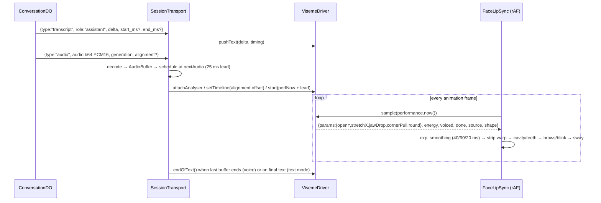

# personagram-ai — Web client: avatar rendering & lip sync (visemes, face landmarks, audio worklets), realtime voice transports, studio, groups, canvas, guest, onboarding, marketing

Scope reviewed (all paths relative to `reference/personagram-ai/`): `src/web/**` (every file read in full), `public/index.html`, `public/styles.css` (selectively), `public/readability.css` (head), the three marketing PNGs, `scripts/{build,seed-demo,demo-content}.mjs`, `scripts/demo-landmarks.json` (shape only), unit tests `tests/{lipsync,worklet,avatars,renderer,turns,qr}.test.ts`, and the Playwright specs in `tests/e2e/`. To explain the wire protocol the browser speaks, I also read the relevant parts of `src/worker/conversation.ts`, `src/worker/providers.ts`, `src/worker/content.ts` and `src/shared/{captions,landmarks,turns}.ts`. Those files belong to other slices; I cite them only where the client depends on them. I did not open `scripts/demo-token.txt` or any `.dev.vars`.

---

## 1. Purpose & architecture

Personagram AI is a Cloudflare Worker app for creators. It turns a still portrait into a talking "AI Avatar" and shares it through unlisted links. The web client is a framework-free TypeScript/ES-module SPA of custom elements, bundled by esbuild (`scripts/build.mjs`: entry `src/web/app.ts`, ESM, `es2022`, code splitting, minified, output `dist/`). Every page is a custom element. `PersonagramApp` (`src/web/app.ts:9`) intercepts same-origin `<a>` clicks, calls `history.pushState`, and swaps in the element for the path (`route()` at `app.ts:52`):

| Path | Element | File |
|---|---|---|
| `/`, `/pricing`, `/privacy` | `marketing-page` | `marketing.ts` |
| `/onboarding`, `/studio`, `/studio/avatar`, `/studio/personagrams`, `/studio/inbox`, `/settings/billing` | `studio-page` | `studio.ts` |
| `/studio/private` | `avatars-page` | `avatars.ts` |
| `/studio/private/new` | `avatar-create-page` | `avatars.ts` |
| `/studio/private/:id` (owner), `/a/:token` (guest) | `doppelganger-page` | `doppelganger.ts` (+ `canvas.ts`) |
| `/studio/groups`, `/studio/groups/:id` | `group-page` | `groups.ts` |
| `/g/:token` | `group-replay-page` | `groups.ts` |
| `/p/:token` | `guest-page` | `guest.ts` |

The avatar subsystem sits underneath all of these. It has three layers:

1. **Geometry**: `face-landmarks.js` runs MediaPipe FaceLandmarker in the browser, once per portrait, and produces normalized landmark JSON. The JSON is validated by `src/shared/landmarks.ts` and stored in `avatar_assets.landmarks`.
2. **Timing / shape fusion**: `viseme-driver.js` combines provider character timestamps, transcript deltas (timed or untimed), live `AnalyserNode` spectra and offline FFT pre-analysis (`audio-features.js`). The result is one `{params, energy, voiced, done}` sample per frame.
3. **Rendering**: `face-lipsync.js` (`FaceLipSync`) is a Canvas2D mouth-warp renderer. It redraws horizontal strips of the cached photo with displacement, then paints a vector mouth cavity, teeth, tongue, blink lids, brow lift and head sway on top. `avatar-view.ts` wraps it as `<avatar-view>`.

Realtime voice is handled by `voice/transports.ts` (`SessionTransport`) and `voice/webrtc.ts` (`PeerSession`). Every conversation goes through a same-origin WebSocket to a `ConversationDO` Durable Object. OpenAI Live adds a WebRTC media leg whose SDP is exchanged through the server. xAI sends microphone audio up as PCM16 over the WebSocket and receives PCM16 back.

```
                    ┌──────────── studio / image-picker ─────────────┐
 upload / camera /  │ POST /api/assets → R2 → <avatar-view>.load(url) │
 xAI generate/edit  │   → detectFaceLandmarks(img) (MediaPipe, local) │
                    │   → normalizeLandmarks → PATCH /api/assets/:id  │
                    └────────────────────────┬────────────────────────┘
                                             │ landmarks JSON (face, eyes, 4 lip contours, lids, brows, chin)
                                             ▼
  guest.ts / doppelganger.ts / groups.ts ──► <avatar-view>  ── FaceLipSync (canvas, rAF loop)
                                             ▲ drive(driver)            ▲ sample(now) every frame
                                             │                          │
                                    createVisemeDriver()  ◄─────────────┘
                                     ▲ pushText(delta,{startMs,endMs})   ▲ attachAnalyser(AnalyserNode)
                                     │ setTimeline(alignment seq)        │
             ┌───────────────────────┴───────────────┐                   │
             │ SessionTransport (voice/transports.ts) │───────────────────┘
             │  WS /api/sessions/:id/ws (JSON + PCM)  │
             │  OpenAI: PeerSession WebRTC (oai-events DC, remote <audio>, silent analyser tap)
             │  xAI: AudioWorklet PCM16@24k up; base64 PCM16@24k down → AudioBufferSource → analyser
             └───────────────────────┬───────────────┘
                                     ▼
                   ConversationDO (worker) ── xAI /stt (WS), /realtime (WS), /tts (WS)
                                           └─ OpenAI /live/sessions (+ /attach sideband, /hangup)
```

Mermaid version of the per-frame lip-sync loop:



---

## 2. Feature inventory

### 2.1 Face landmark capture (MediaPipe, in-browser)
- **What:** converts any portrait into normalized facial geometry, with no server round-trip for the pixels.
- **How:** `detectFaceLandmarks(imageEl)` (`src/web/avatar/face-landmarks.js:71`) lazily imports `@mediapipe/tasks-vision@0.10.35` from jsDelivr `+esm`. The version is pinned on purpose ("`@latest` can break landmark capture silently"). It builds a singleton `FaceLandmarker` (`delegate: "GPU"`, `runningMode: "IMAGE"`, `numFaces: 1`), deduplicates concurrent init through a shared promise, and clears the promise on failure so a later call can retry (`ensureLandmarker`, `:36`).
- **Output shape** (all values normalized 0–1): `face{x,y,width,height,centerX,centerY}`, `leftEye`, `rightEye`, `nose`, `noseBridge`, `mouth`, `eyeSpan`, `left/rightEyeWidth`, `mouthWidth`, `mouthHeight`, and 11-point contours `lipUpperOuter` [61,185,40,39,37,0,267,269,270,409,291], `lipUpperInner` [78,…,308], `lipLowerOuter`, `lipLowerInner`. Also a 21-point `jawContour`, eyelid polylines, and the optional 2026-07 additions `browLeft/browRight` (5 pts), `mouthCornerLeft/Right` and `chin` (`:115-159`).
- **Validation:** `normalizeLandmarks` (`src/shared/landmarks.ts`) whitelists keys and requires numbers in [0,1] and contours of 3–30 points. If `lipUpperOuter` is present, all four lip contours plus the jaw are required. The server caps the stored JSON at 100 KB (`index.ts` PATCH `/api/assets/:id`).
- **Extras:** `computeFaceOverlayStyle()` (`:188`) positions an SVG face overlay over detected landmarks. It is legacy and unused in this app. So are `preloadFaceLandmarker`/`isLandmarkerReady`.
- **Where it runs:** `AvatarView.load()` runs detection only when stored landmarks are missing. `ImagePicker.save()` persists the detected landmarks (`image-picker.ts:132-140`). Group cast portraits painted server-side have **no** stored landmarks, so every viewer re-detects them.
- **Maturity:** solid.

### 2.2 Canvas mouth-warp renderer (`FaceLipSync`)
- **What:** makes the photo's lips part, jaw drop, corners lift and lips round, and adds blinks, brow micro-raises and head sway. There is no mesh or WebGL. Everything is Canvas2D `drawImage` with transforms.
- **Tiers** (`face-lipsync.js:388`): tier 1 has full lip contours and gets strip warp, cavity, teeth, tongue, blink and brows. Tier 2 has only the mouth centre and gets strip warp with assumed lip thickness (`_computeWarpRegion`, `:553`). Tier 3 has no landmarks and shows a static image. Reduced motion (`prefers-reduced-motion`) forces static behaviour.
- **Setup:** the working resolution is capped at `DEFAULT_MAX_SIDE = 1024` (overridable via `options.maxSide`). The source is drawn **once** into an offscreen canvas (`:436-441`), so no frame calls `getImageData`/`putImageData`. Lid colour is sampled once from skin above each eye (`_sampleSkin`, `:575`). The warp region is the lip bounding box with 40%/150% padding, clipped at the chin (`_computePolygonGeometry`, `:483`).
- **Viseme parameter space** (`VISEMES`, `:80`): `REST, CLOSED, OPEN_SMALL, OPEN_MED, OPEN_WIDE, ROUND, WIDE, TEETH, TONGUE`. Each carries `{openY, stretchX, jawDrop, cornerPull, round}` in image-height units, deliberately small ("realism > cartoon open").
- **Warp** (`_drawWarp`, `:779`): the region is cut into 2 px horizontal strips (`STRIP`). Each strip is drawn as column segments with a **shear** transform, so displacement tapers linearly to zero at the corners (`TAPER_BREAKS` [0.45→1, 0.65→.75, 0.85→.25, 1.05→0], `:342`). Clipping happens at the **destination** rectangle; the header comments record that clipping at the source row kept the mouth shut. Lips move rigidly over their vermilion thickness while the surrounding skin stretches linearly to the region edge (`_rowDisplacement`, `:697`). The jaw does most of the opening (`_lipTravel`, `:676`: upper gain 0.3, lower jaw 0.55, lower open 0.25; each lip's travel is capped at `MAX_LIP_TRAVEL = 0.06` × face height). Left/right gains differ per instance by ±6% (`_asym`) to break mirror symmetry. Rows displaced by less than 0.5 px are skipped, so a closed mouth stays the untouched photo.
- **Cavity and teeth** (`_drawMouthCavity`, `:872`): the displaced inner-lip contours are traced with `traceSmooth` quadratic curves and filled with a near-opaque dark gradient plus an occlusion shade under the upper lip. When the gap exceeds 4 px, an upper-teeth band is drawn. It follows the smoothed lip with an arched depth of `sin^0.6`, stops at 14% from the corners, takes at most 28% of the gap, gets an ivory gradient with corner fade and a "seat" shadow, and is split by six incisor separators. On big jaw drops a lower-teeth band appears, and a tongue ellipse is drawn when the driver shape is `TONGUE`. A guard rejects "exploded" contours (`:917-922`).
- **Idle life:** blinks every 3–8 s (250 ms triangle), a faint sway floor (`IDLE_SWAY = 0.12`) and brow decay. The idle loop is throttled to about 30 fps (`IDLE_FRAME_MS = 33`). Breathing jaw motion was removed on purpose because it drew a seam on closed lips (`_updateIdleFrame`, `:1247`).
- **Speaking** (`_updateSpeakingFrame`, `:1279`): polls `driver.sample(now)` and applies per-parameter exponential smoothing: attack 40 ms, release 90 ms, bilabial snap 20 ms (`:316-318`). Speech energy drives sway amplitude. A brow raise fires on energy onsets above 0.18, at most every 1.5 s. One shared per-frame transform, with 2% overscale to hide edges, keeps sway from streaking the warp (`_drawFrame`, `:725`).
- **Lifecycle:** it has a hidden-tab pause via `visibilitychange`, and `setPaused()` exists but is never called. `destroy()` cancels rAF. The static counters `FaceLipSync.activeLoops()` and `created()` support leak diagnostics, and `stats()` exposes geometry and the last sample for harnesses. The rAF ring buffer `frameTimes` (4096 entries) supports fps measurement.
- **Back-compat helpers:** `startSpeaking(sequence, audioEl|ctx, sourceNode)`, `playWithLipSync(url, opts)` (`:1470`), which decodes once, warps text to voiced segments and taps a live analyser, and `getElementAnalyser()`/`getSharedAudioContext()`. **None are used by this app**; they are ported legacy API.
- **Tests:** `tests/renderer.test.ts` uses a fake 2D context that records ops. It asserts destination clipping and asymmetric strip geometry, the dark cavity with a subtle arch of teeth, that on a tilted face "the biting edge follows the lip instead of cutting a wedge", that the rest pose has no jaw seam, the 1024 cap, and single-loop ownership and teardown.
- **Maturity:** solid (well-engineered and tested, with visual realism still heuristic).

### 2.3 Viseme driver (source-priority fusion)
- **What:** one object between "whatever timing we have" and the renderer (`viseme-driver.js:80`, `createVisemeDriver()`).
- **API:** `setTimeline(seq)`, `setPreanalysis(frames)`, `attachAnalyser(node)`, `pushText(delta, {startMs,endMs}?, at?)`, `endOfText()`, `setHeard(bool)`, `start(t0)`, `endUtterance(at)`, `stop()`, `flush()`, `active()`, `pendingChars()`, `sample(now) → {params, energy, voiced, done, source, shape, heard}`.
- **Priority order:** (1) fixed `timeline` (provider character timestamps, or text spread over a known duration). (2) `timed-deltas`: transcript deltas with start/end ms. Their measured chars/sec, clamped to 8–26 and EMA-smoothed (α 0.3), paces a character queue. (3) Untimed `deltas` at an adaptive default of 14 cps. (4) `spectrum` only. (5) `energy` fallback on `OPEN_SMALL` (`:163-181`, `:292-387`).
- **Spectral corrections** apply at every tier when features exist (`classifyFrame`): unvoiced → REST, sibilance → TEETH, low-band energy → jaw `openScale` (0.3–1.6), centroid <1200 Hz with a strong low band → ROUND, ≥1800 Hz with a strong mid band → WIDE.
- **Level normalization:** automatic gain toward a decaying peak (`AGC_TARGET 0.45`, max gain 12, decay 0.9994 per sample), voiced hysteresis (on 0.06 / off 0.035), noise floor 0.016, and a peak fraction of 0.12. The comments explain that a WebRTC tap measured only 0.06–0.09 and flickered at the old fixed threshold (`:18-22`, `:113-126`).
- **Dead-analyser detection:** after 40 unvoiced frames with text waiting and no voiced frame ever seen, the analyser is dropped. This targets iOS, where `createMediaStreamSource` on a remote WebRTC stream is silent forever (`:104-110`, `:308-318`).
- **Queue semantics:** the cursor only advances while voiced, so pauses hold the mouth closed and keep its place. `endUtterance()` keeps text that arrived in the last 1.2 s, because the model's transcript leads its audio. `setHeard(false)` parks the mouth at REST while pacing continues; it is intended for barge-in ducking but is **not called** by current transports.
- **Tests:** `tests/lipsync.test.ts` and `renderer.test.ts` cover start/sample/flush/done, keeping the mouth moving until `endOfText` (a regression test), a late-attached analyser still driving the mouth, exact alignment timestamps, a timed queue draining completely, and silent/muted gating to REST.
- **Maturity:** solid.

### 2.4 Audio features DSP (live and offline)
- `featuresFromFloatFreq(freqDb, sampleRate)` (`audio-features.js:45`) turns `AnalyserNode.getFloatFrequencyData` output into energy, band ratios (low 80–400 Hz, mid 400–2000, high 4000–10000) and spectral centroid. `-Infinity` is clamped to −70 dB.
- `analyzeBuffer(audioBuffer, hopMs=20)` runs an in-house radix-2 FFT with a 256-point Hann window and returns per-frame features (`:97`, `fftRadix2` `:151`).
- `segmentSpeech(frames, {gapMs:180, minMs:60})` finds voiced segments. `warpTimelineToSegments(seq, segments)` re-times a naive text viseme timeline onto actual speech so nothing is articulated during silence, inserting explicit REST entries for gaps over 40 ms (`:201`, `:232`).
- All of it is DOM-free and unit-tested under Node. The offline path is only reachable through `playWithLipSync`, which is unused.
- **Maturity:** solid, though the offline path is dormant.

### 2.5 Text/alignment → viseme sequencing
- `CHAR_TO_VISEME` is a letter-class table: m/b/p → CLOSED, f/v/s/z → TEETH, w/o/u → ROUND, l/n/d/t → TONGUE, a → OPEN_WIDE, e/i/y → WIDE, and so on. `pairViseme()` handles the digraphs th/sh/oo/ee (`face-lipsync.js:140-187`). This is grapheme-based, not phoneme-based.
- `textToVisemeSequence(text, durationMs)` spreads characters evenly. `alignmentToVisemeSequence({characters, character_start_times_seconds, character_end_times_seconds})` converts xAI `with_timestamps` output, which the worker normalizes from `audio_timestamps.graph_chars/graph_times` in `timestampAlignment()`.
- **Maturity:** solid, but simplistic linguistically.

### 2.6 PCM16 capture AudioWorklet
- `createPcmCapture({stream, sampleRate=24000, onChunk, onLevel, audioContext})` (`audio-worklet.js:130`). The processor source is inlined and loaded from a Blob URL (`pg-pcm-downsampler`). It does phase-continuous linear-interpolation resampling from the device rate to 24 kHz, carrying a fractional cursor and the previous sample across blocks. It converts float to Int16, transfers chunks to the main thread without copying, and posts an RMS `level` for every render quantum.
- The module is added **once per AudioContext** (`WeakSet` plus in-flight `WeakMap`), and "already registered" errors are tolerated (`ensureWorklet`, `:104`). This fixed a real bug where the second mic start threw `NotSupportedError` (`tests/worklet.test.ts`).
- **Maturity:** solid.

### 2.7 Media teardown hygiene
- `releaseAudio(el)` calls pause, then `removeAttribute("src")`, then `load()` to clear Android media-session notifications. `clearMediaSession()` nulls `navigator.mediaSession` metadata and state (`audio-cleanup.js`). Transports, previews and the voice picker call both.
- **Maturity:** solid.

### 2.8 `<avatar-view>` custom element
- `avatar-view.ts` renders `<canvas role="img" aria-label="Animated AI Avatar portrait">`. `load(src, landmarks?)` decodes the image, draws a still frame immediately, detects landmarks if none were given, then constructs `FaceLipSync`. A `revision` counter cancels stale loads. `drive(driver)` stores the driver, so a driver attached before the image loads is applied afterwards. `reset()` and `disconnectedCallback()` destroy the renderer and stop the driver.
- It is the reusable unit for every avatar surface (guest, owner stage, group seats, marketing demo, image picker preview).
- **Maturity:** solid, but minimal: no size, tier or pause options are exposed.

### 2.9 Realtime voice session transport (`SessionTransport`)
- **Interface** (`voice/transports.ts:8`): `start(voice?)`, `mute(bool)`, `sendText(text)`, `interrupt()`, `close()`, plus `textOnly()`. `OpenAiLiveTransport` and `XaiVoiceTransport` are empty subclasses; the behaviour branches on `session.provider`.
- **Control socket:** `ws(s)://host/api/sessions/:id/ws` has a 12 s connect timeout and at most 3 reconnect retries with exponential backoff `500·2^n` ms (`connect`, `:67`). Authorization is a scoped `pg_voice` HttpOnly cookie (path `/api/sessions/:id`) that the Worker copies into an `X-Session-Capability` header for the DO (`worker/index.ts:473`).
- **Client → server JSON:** `{type:"start"}` (xAI begins STT), `{type:"text", text}`, `{type:"interrupt"}`, `{type:"mute", muted}`, `{type:"stop_voice"}`, `{type:"end"}`. Binary frames carry PCM16 at 24 kHz, batched to 2400 samples (100 ms, 4800 bytes) (`:190-207`). The DO enforces frames of at most 24,000 bytes, a token-bucket audio budget (48 bytes/ms, cap 96 KB), 1500 JSON messages per session, and the session expiry (`conversation.ts:255-340`).
- **Server → client events:** `ready{provider,expires}`, `mic_ready`, `mic_lost`, `transcript{role, delta?|text?, final?, start_ms?, end_ms?, stream_mode?:"tokens"}`, `thinking`, `audio{audio:<b64 PCM16 24k>, generation, alignment?}`, `audio_done`, `response_done`, `interrupted{generation}`, `speech_started`, `mute{muted}`, `ended{message}`, `error{message}`. Owner avatars also get the tool side-effect events `persona{profile,learned}`, `memory{added}`, `instructions{instructions,added,removed}` and `experience{experience}`. The transport also emits its own client-side events: `connecting`, `reconnecting`, `speaking`, `playback_idle`, and `level{level}` (throttled to 40 ms).
- **OpenAI Live path** (`startVoice`, `:119`): a `PeerSession` builds a non-trickle SDP offer, the client POSTs `/api/sessions/:id/sdp {sdp}`, and applies the returned answer. The server creates the Live session and opens a **trusted sideband** WS (`/live/sessions/{id}/attach`). The browser's data channel is created but its handler is a no-op, and the session is configured with `allowed_client_events: []`. Remote audio plays through a hidden `<audio autoplay playsinline>`. For lip sync, the remote stream is tapped by an `AnalyserNode` routed into a **zero-gain** node to the destination (`attachRemote`, `:239`). A local AudioWorklet capture runs only for level metering and barge-in (`captureMic(false)`). In preview mode it is recvonly with no mic.
- **xAI path:** `{type:"start"}` makes the DO open streaming STT. On `mic_ready`, the client starts worklet capture and streams PCM. Response audio arrives as base64 PCM16 chunks, which are decoded to `AudioBuffer`s and scheduled gaplessly at `max(currentTime+0.025, nextAudio)` through a shared analyser to the destination (`playPcm`, `:308`). The driver clock is aligned to the audio clock with `driver.start(performance.now() + (start − ctx.currentTime)·1000)`. Alignment chunks, when present, are offset by the chunk's start and appended to the timeline.
- **Turn / interruption model:** an output `generation` counter drops stale audio. `interrupted`/`speech_started` flush every scheduled node, clear the timeline and driver, and mute the `<audio>` element until the next assistant transcript. **Client-side barge-in** triggers when mic RMS exceeds 0.055 for more than 45 consecutive worklet blocks (about 120 ms at 48 kHz) while output is playing, with a 900 ms debounce (`:215-229`). In voice mode, `endOfText()` is deferred until the last buffer finishes playing (`onended`), because the model finishes writing seconds before the audio finishes (`:297-301`, `:363-371`).
- **Teardown:** `stopMedia()` bumps a `lifecycle` revision so late async steps abort. It stops tracks, closes the peer, disconnects nodes and stops capture. `close()` sends `end`, closes the socket and AudioContext, releases the `<audio>`, clears the media session, and POSTs `/api/sessions/:id/end`.
- **Maturity:** solid for one conversation per page. See §7 for edge cases.

### 2.10 WebRTC peer (`PeerSession`)
- `voice/webrtc.ts` creates the `oai-events` data channel **before** the offer so it appears in the SDP. It captures an echo-cancelled, noise-suppressed, AGC mic (or adds a recvonly transceiver), waits for ICE gathering with a 10 s limit (`ICE_GATHER_TIMEOUT_MS`), attaches the remote track to an `<audio>` element (falling back to visible controls if autoplay is blocked), reports `connectionState === "failed"`, and tears down idempotently. It is ported from "Meridian public/live.js" (comment `:1-4`).
- **Maturity:** solid.

### 2.11 Captions & transcript
- `CaptionBuffer` (`src/shared/captions.ts`) exposes `applyDelta` (inserts a space between words), `applyTokenDelta` (LLM tokens keep their own spacing), `applyFinal` (authoritative; skips duplicates) and `closeLine`, and caps lines at 80 in the UI.
- Guest and owner pages show the **last line** in an `aria-live="polite"` caption, with a role label ("YOU" / "NAME · AI AVATAR"). A "CC" button opens a `role="log"` transcript drawer.
- **Server-side turn assembly** lives in `src/shared/turns.ts` (`TurnAssembler`: timeline gap 1500 ms, arrival gap 1200 ms, pending tolerance 300 ms, dispatch/pending/confirmed/revised signals; `tests/turns.test.ts`). It stops OpenAI Live transcripts from being answered twice or cut into half-sentences.
- **Maturity:** solid.

### 2.12 Guest immersive conversation page (`/p/:token`)
- `guest.ts` fetches `GET /api/public/personagrams/:token` → `{name, title, headline, purpose, greeting, avatar_url, landmarks, provider, ask_consent}`. It renders a full-bleed stage: a blurred ambient copy of the portrait, a centred `<avatar-view>`, a vignette, an "AI AVATAR" disclosure pill, and an identity block.
- An entry card offers "Start with voice" and "Use text". An optional consent checkbox reveals optional name and email fields. `POST /api/public/personagrams/:token {consent,name,email}` returns `{id, provider, expires, consent, preview}` and sets the cookie.
- The live section has a session badge with a status line ("Connecting your voice…", "Listening to you", "Thinking about that…", "Speaking", "Reconnecting…") and a mm:ss countdown to `expires` that auto-ends at zero. It also has mute/unmute (which becomes "Enable microphone" in text mode), interrupt, CC and End controls, a text form, a recovery panel ("Retry microphone" / "Continue in text"), and a retention notice. The ended card carries consent-aware copy, "Start a new conversation" and a "Create your own AI Avatar" CTA.
- The mobile spec requires the page to fit one screen with no vertical scroll, keep the name below the face, and keep the controls clear of the face (`tests/e2e/guest-mobile.spec.ts`).
- **Maturity:** solid.

### 2.13 Private AI Avatar stage (owner `/studio/private/:id`, guest `/a/:token`)
- `doppelganger.ts` gives one avatar a "talk-first" stage (**Start talking** / "or type instead") that shares the guest controls. Its intro line adapts to memory count ("Welcome back, Greg. I remember 3 things…").
- **Live training visibility:** the server's tool calls surface as events. `memory` adds items, `instructions` updates the textarea unless it is focused, and `experience` pushes an item to the canvas. A transient "Learned: … / Remembered: … / Building: …" strip appears under the portrait for 6 s (`learned()`, `:503`). After the call ends, the page polls at 2.5/6/12/20/32 s for the conversation summary memory (`watchForMemories`, `:456`).
- The **Customize drawer** holds the name, free-form instructions (⌘/Ctrl+Enter saves; "applies from the next reply — even mid-conversation"), a memory toggle, add and forget memories, forget all, files (processing-status polling), canvas sharing, look (`<image-picker>`), voice (`<voice-picker>`) and delete. It closes on Escape or a click on the stage.
- **Share:** `POST /api/doppelgangers/:id/link {rotate}` opens `shareDialog`, which offers "Make a new link" to rotate and "Turn off link".
- The guest mode shows the same stage with nothing to configure and an optional read-only canvas.
- **Maturity:** solid.

### 2.14 Canvas panel (AI-built interactive experiences)
- `<canvas-panel>` (`canvas.ts:50`) shows single-file HTML/JS/WebGL "experiences" that the avatar builds through a tool call or a typed brief (`POST /api/doppelgangers/:id/experiences {brief, webgl?}`).
- **Build follow-up:** `POST /api/experiences/:id/build`, then a 1 s poll of `GET /api/experiences/:id` returning `{status, lines, preview_lines, progress:{lines, tail, phase}, error, based_on}`. A progress bar fills toward 1200 expected lines, the tail of the code being written is shown, and 20 missed polls are tolerated. Builds survive navigation and reload.
- **First-version stand-in:** a quick first version (`?preview=1`) plays while the full one is written. A revision keeps the base version playing. If the user is interacting (iframe focus detected through window `blur`), the full version is offered with a "Play the full version" chip instead of being swapped in under their fingers (`standIn`, `:229`; `build`, `:347`).
- **Sandbox:** the iframe uses `sandbox="allow-scripts allow-pointer-lock"` (opaque origin) and `referrerpolicy="no-referrer"`. The panel stops the page when closed so no hidden WebGL loop keeps running.
- **Self-repair:** the server injects a `REPORTER` script (`worker/experiences.ts:546`) that posts `{type:"pg-experience", errors[]}` to the parent. The panel accepts it only when `e.source === frame.contentWindow`. It calls `POST /api/experiences/:id/repair {errors}` at most twice per root experience. Broken first versions are taken down rather than repaired (`onReport`, `:518`).
- **Files to build with:** up to 8 files. Images are resized client-side to at most 1600 px and 1.4 MB (WebP, falling back to JPEG, stepping quality down) by `fitImage` (`:564`).
- Other controls: a history `<select>`, restart, fullscreen, open in a new tab, download the HTML, and view the code (inline data URIs are shortened for readability).
- **Maturity:** solid (Playwright `canvas.spec.ts` covers sandbox, repair, first version and guest mode).

### 2.15 Group conversations ("conversation studio")
- **Setup** (`groups.ts:807`): a topic textarea (a short first line is the topic; longer text becomes grounding notes), an optional document attachment (`POST /api/groups/document`, at most 4 MB, returning `{name, text, truncated}`), and eight styles: podcast, debate, interview, educational, roast, casual, panel, brainstorm. It also has length (short/medium/long), energy (calm/engaging/viral), and "Cast it for me" (2–6 invented speakers, each of whom becomes a real private AI Avatar with a generated portrait and voice) versus "My AI Avatars" (pick up to 6). "Include me" lets the user take turns. Settings are remembered in `localStorage` (`pg-studio-settings`) and ⌘/Ctrl+Enter submits. `armAudio()` creates the AudioContext inside the click so autoplay works on the next page.
- **Engine** (`class Engine`, `:182`) runs three concurrent loops. The **writer** calls `POST /api/groups/:id/continue {message?, more?}` and gets `{lines:[{id,seq,speaker,text,audio}], next:"continue"|"user"|"end", title?}`, looping while `next==="continue"`. The **voicer** keeps up to 3 lines voicing ahead of the cursor via `POST /lines/:lid/voice`, then fetches and decodes `GET /audio/:lid` (`pump`, `:295`). The **player** plays lines sequentially with 0.35 s gaps, waits and says so when it catches up with voicing or writing, and substitutes a reading-time hold for unvoiced lines. Playback starts within seconds, long before the script is finished.
- **Lip sync in groups:** one `GainNode → AnalyserNode → destination` chain is shared by all lines. For each line a fresh driver gets `pushText(readable(text))`, `endOfText()` and the analyser. Only the current speaker's `<avatar-view>` is driven; the other seats idle (blink and sway). A speaking seat is highlighted with a cyan ring and lift while the others dim to 0.55 opacity (CSS `.group-cast.has-speaker`).
- **Player UI:** play/pause, next line, stop, a seek slider (`role="slider"`, arrow keys ±5 s, `aria-valuetext`), a "ready" band showing how far voicing has got, a "Line n of m+" counter, a clickable transcript that jumps to any line, and keyboard shortcuts (Space, →, Esc). Downloads include a `.txt` transcript with timestamps and a `.wav` that the client stitches together (`toWav`, `:114`, 16-bit mono with inter-speaker gaps). A voicing progress bar shows an ETA.
- **Director speech tags:** the director writes `[pause] [long-pause] [laugh] [sigh] [breath]` and `<whisper>/<soft>/<loud>/<slow>/<fast>` tags for xAI TTS. `readable()` strips them for captions and transcripts.
- **Customize cast drawer:** per-speaker voice and speed (0.85–1.15). No two speakers may share a voice; choosing a taken voice swaps with its holder. Speakers can be edited (name, role, persona, voice leaning) or added and removed (2–6). "New cast" recasts. Stale-state bars offer "Rewrite script" after a cast change and "Rebuild audio" after a voice change, and a "Retry" bar appears for failed lines.
- **Your turn:** a text input or a tap-to-record mic (`MediaRecorder` webm → `POST /api/transcribe` → xAI batch STT) that auto-submits. "Keep going" extends the conversation.
- **Share/replay:** `POST /api/groups/:id/link` produces `/g/:token`. `GroupReplayPage` uses the same Engine with `audioUrl` from the public DTO (`/api/public/groups/:token/audio/:lid`) and replays the conversation exactly, read-only, with an "AI AVATARS" disclosure.
- **Maturity:** solid (Playwright covers setup → playing → customize → replay → WAV download).

### 2.16 Studio (creator workspace and onboarding)
- `studio.ts` provides a sidebar with Overview / Public AI Avatar / AI Avatars / Personagrams / Conversations / Billing (with short labels on phones), a plan meter for active links, and the account.
- **Five-step onboarding** (`:28`): (1) Your look (`<image-picker>`). (2) Your world: one screen with three ways in. You can paste a bio (`POST /api/interview/bulk {text}` returns `{profile, learned}`), add files (`POST /api/sources`, which also become knowledge cards), talk it through (a realtime **voice interview** on the same session machinery via `POST /api/interview/session`, where `persona` events fill the "What I've learned so far" list live), or answer typed Q&A (`POST /api/interview {message}` returns `{question, profile}`). (3) Your knowledge: document upload, draft cards and per-card approval. (4) Your review: nine persona fields, the voice provider tabs and voice grid with previews, and a single approval checkbox that combines likeness consent and AI disclosure. (5) Your first link: the Personagram composer.
- **Personagram composer** (`composeMarkup`, `:731`): title, audience, purpose, outcome, opening line, extra direction (overlay), a knowledge-card selection limited to approved cards, an optional per-link custom portrait (with its own consent), and "Invite guests to share their conversation". The published view offers copy, QR, OS share sheet, and "Meet your AI Avatar".
- **Links:** open chat, copy, QR, share, and revoke (confirm; frees a slot). **Inbox:** consented guest conversations with summary, name and email, transcript modal and permanent delete. **Billing:** Stripe-driven price display (the interval toggle hides intervals that have no price) and a portal link.
- **Media hygiene:** `clearStepMedia()` stops previews, recorders and the interview call whenever the step changes, so no microphone is left hot.
- **Maturity:** solid.

### 2.17 Avatar creation and selection (private AI Avatars)
- `avatars.ts` provides a grid of avatars with memory count, "talked yesterday", a SHARED badge, a per-card share button with QR dialog, and a limit-aware "New AI Avatar" card. Creation is two steps: pick an existing portrait or add a new one via `<image-picker>` (or skip), then name and voice (`<voice-picker>`). `POST /api/doppelgangers {name, asset_id?, provider?, voice?}` creates the avatar and the page navigates straight into conversation. The default voice is `ara`.
- **Maturity:** solid.

### 2.18 Image picker (upload / camera / generate / polish)
- `image-picker.ts` has an upload tab (at most 5 MB, JPEG/PNG/WebP; resized client-side to 1400 px and re-encoded as JPEG q0.9). The camera tab uses `getUserMedia` with `facingMode:"user"` at an ideal 1200×1600, with capture to canvas and revision-guarded stream teardown. The **Imagine** tab calls `POST /api/assets {mode:"generate", prompt}`. **Polish** calls `{mode:"edit", source_id, prompt}`, and the server prefixes the prompt with an identity-preservation instruction (`worker/content.ts:45-90`).
- After saving, it loads the asset into an `<avatar-view>`, detects and normalizes landmarks, PATCHes `{landmarks, approved:false}`, reports "Face mapped. Ready for expressive lip sync." or a still-portrait fallback, and dispatches `image-selected {id, landmarks}`.
- **Maturity:** solid.

### 2.19 Voice picker and previews
- `voice-picker.ts` shows provider tabs (xAI Voice "Expressive, learns mid-call" and OpenAI Live "Fluid, full-duplex") and a radio grid from `GET /api/voices?provider=`, where each voice has a ▶ preview. It fires `voice-change {provider, voice}`.
- Previews differ by provider. An xAI preview is REST TTS whose base64 audio is played by an `Audio` element; the server requests `with_timestamps`, but the client ignores them. An OpenAI preview is a real Live session in recvonly mode, capped by the client at 18 s and by the server at 20 s.
- The studio review step has its own duplicate implementation (`studio.ts:645`).
- **Maturity:** solid.

### 2.20 Share dialog and local QR encoder
- `shareDialog(host, {title, url, note, actions[]})` (`share.ts:17`) is a modal `<dialog>` with a QR code, the URL, Copy, the OS share sheet (`navigator.share`/`canShare`, where a dismissal is a choice rather than an error) and optional extra actions (danger styling, auto-close).
- `qr.ts` is a **self-contained QR encoder**: byte mode, versions 1–10, ECC M, Reed-Solomon over GF(256), mask-penalty selection, format and version bits, SVG output with quiet zone and no external references (`qrMatrix`, `:222`; `qrSvg`, `:371`). The rationale is that unlisted links must never go to third-party QR services. `tests/qr.test.ts` decodes every payload back and checks parity, pattern placement and version selection.
- **Maturity:** solid.

### 2.21 Marketing site, guided demo and showcase avatar
- `marketing.ts` builds the landing page: a hero with a portal-framed `hero.png`, a waveform, and floating notes; how-it-works steps; an ARIA tablist of purposes (Business introductions, Recruiting, Community welcome, Personal FAQs, Creative profiles) that swaps an illustrative chat; an identity triptych (`portraits.png`, "one core AI Avatar"); trust cards; pricing; and a final CTA. It also has `/pricing` and a plain-language `/privacy` page.
- **Guided preview dialog:** a modal `<avatar-view>` of `hero.png` answers three canned questions with **text-only lip sync**. `textToVisemeSequence(answer, words×360 ms)` goes into a driver timeline with no audio, microphone or AI call, and the dialog is labelled "Visual demonstration" (`bindDemo`, `:164`).
- **Showcase link:** the Worker injects `<meta name="personagram-demo">` with the demo token, which reveals the "Talk to our AI Avatar" links (`bindDemoLink`, `:154`).
- `scripts/seed-demo.mjs` idempotently seeds the showcase avatar "Ari" (persona and seven approved knowledge cards from `scripts/demo-content.mjs`), uploads `hero.png` to R2 together with the **pre-computed landmarks** from `scripts/demo-landmarks.json` (it refuses to seed without lip contours), and creates the public link. The token is stable across runs so printed QR codes keep working.
- `public/index.html` carries a `<!--%META%-->` marker that the Worker replaces with per-URL OG, Twitter and JSON-LD tags, so link unfurls show the portrait.
- The images (per `PROVENANCE.md`) are three generated fictional-adult rasters. `hero.png` is a front-facing portrait with cyan/violet rim light. `portraits.png` shows the same woman in professional, everyday and creative looks. `conversation.png` shows two people on either side of a luminous prism divider.
- **Maturity:** solid.

### 2.22 Accessibility and readability layer
- Accessibility features: a skip link; one `#main` and one `h1` per page; `aria-live` captions; a `role="log"` transcript; `aria-pressed`/`aria-expanded` on toggles; radio groups built from buttons with `aria-checked`; dialogs with focus handling and Escape; a keyboard tablist (arrows, Home, End); a keyboardable seek slider; and nav links whose accessible name is always the full label.
- Motion and scaling: `prefers-reduced-motion` stops the renderer loop and CSS animations. `readability.css` (751 lines) is a "readability floor" layer for compact and enlarged text.
- Copy rules are enforced by tests. `avatars.spec.ts` asserts the word "doppelganger" never appears in visible text, labels, placeholders or titles. `guest-mobile.spec.ts` asserts provider names never appear on the guest stage.
- Playwright `accessibility.spec.ts` checks 200% text scaling with no horizontal overflow, keyboard-only operation, visible focus, alt text, and reduced motion. Projects run in Chromium desktop and on iPhone 13.
- **Maturity:** solid.

### 2.23 Tiny client framework utilities
- `api.ts` provides `api()` (a fetch wrapper with JSON/FormData handling that throws `Error` with `.status`), `post()`, `esc()` (HTML escaping; all templates are string-built `innerHTML`), `icon()` (an inline 24×24 SVG path set), `toast()` (`role="status"`), and `busy(button, fn)` (disables the button, sets `aria-busy` and routes errors to a toast).
- **Maturity:** solid, but primitive.

---

## 3. Providers, models & external APIs

Model registry: `src/worker/providers.ts:3` (`MODELS`). The browser never holds provider keys.

| Capability | Provider / model / endpoint | Where used |
|---|---|---|
| Full-duplex voice (WebRTC) | OpenAI `gpt-live-1`: `POST {OPENAI_BASE_URL or https://api.openai.com/v1}/live/sessions` with `{session:{model, instructions, delegation:{type:"client"}, store:false, audio:{output:{voice}}, client:{data_channel:{allowed_client_events:[], allowed_server_events:[]}}, input:[last 12 turns]}, transport:{type:"webrtc", sdp}}` → `{session:{id}, transport:{sdp}}`; sideband WS `/live/sessions/{id}/attach`; `POST /live/sessions/{id}/hangup` | guest/owner voice, OpenAI previews |
| OpenAI Live events consumed | `session.input_transcript.delta` / `session.output_transcript.delta` (`delta,start_ms,end_ms`), `session.input_audio.muted/unmuted`, `session.delegation.created` (target client → server answers via `session.commentary.append`), `session.closed`; sent: `session.instructions.append`, `session.input_audio.mute/unmute`, `session.commentary.append` | `conversation.ts:939-1080` |
| OpenAI voices | fixed list: alloy, ash, ballad, beacon, bossa, cedar, cinder, coral, delta, echo, gleam, marin, meridian, quartz, ripple, sage, shimmer, stone, tempo, verse, vesper, willow | voice picker |
| Streaming STT | xAI WS `/stt?sample_rate=24000&encoding=pcm&interim_results=true&endpointing=450&smart_turn=0.7&smart_turn_timeout=1800`; events `transcript.created`, `transcript.partial{text, speech_final}` | xAI voice |
| Batch STT | xAI `POST /stt` multipart (`language=en`, `file`) | group "your turn" mic (`/api/transcribe`) |
| Speech-to-speech | xAI WS `/realtime?model=grok-voice-think-fast-2.0`; `session.update{voice, instructions, turn_detection:null, tools, audio in/out audio/pcm 24000}`, `conversation.item.create`, `response.create{modalities:["text","audio"]}`; receives `response.output_audio.delta` / `response.audio.delta`, `response.output_audio_transcript.delta`, `response.function_call_arguments.done`, `response.done` | **every** spoken xAI turn (a fresh realtime socket per turn) |
| Streaming TTS with timestamps | xAI WS `/tts?language=en&voice=…&codec=pcm&sample_rate=24000&with_timestamps=true`; upstream `text.delta/text.done/text.clear/response.cancel`; downstream `audio.delta{delta, audio_timestamps{graph_chars, graph_times}}`, `audio.done` | implemented in `conversation.ts:749` but **unreachable** in voice mode (see §7) |
| REST TTS | xAI `POST /tts {text, voice_id, language:"en", speed?(0.85–1.15), with_timestamps?}` (raw audio bytes, or JSON `{audio}`) | group lines, xAI voice previews |
| Voice catalog | xAI `GET /tts/voices` (cached 1 h; gender mapped to description) | voice picker, cast voice assignment |
| Chat / text | xAI `grok-4.20-0309-non-reasoning` (chat and canvas builder: "~0.5 s to first token"), `grok-4.6` (text) | owner/guest text turns, group director |
| Image gen / edit | xAI `grok-imagine-image-2.0`: `POST /images/generations {prompt, n:1, response_format:"b64_json", aspect_ratio:"3:4"}` and `POST /images/edits {image:{url:data URI}}`; the prompt is prefixed with "A single adult, front-facing portrait, unobstructed face, relaxed closed lips…" (important for lip sync) | image picker, cast portraits |
| Face landmarks | MediaPipe Tasks Vision `@0.10.35` (jsDelivr `+esm`, `/wasm`), model `storage.googleapis.com/mediapipe-models/face_landmarker/face_landmarker/float16/1/face_landmarker.task`, GPU delegate | `face-landmarks.js` |
| Auth / billing | Google OAuth (`/api/auth/google`), Stripe (`/api/pricing`, `/api/billing/checkout`, `/api/billing/portal`) | studio, marketing |

Environment variable **names** (README): `APP_ORIGIN`, `GOOGLE_CLIENT_ID`, `GOOGLE_CLIENT_SECRET`, `XAI_API_KEY`, `OPENAI_API_KEY`, `STRIPE_SECRET_KEY`, `STRIPE_WEBHOOK_SECRET`, `STRIPE_PRICE_MONTHLY`, `STRIPE_PRICE_ANNUAL`, `SESSION_CAP_SECONDS` (60–900, default 600), plus the test overrides `XAI_BASE_URL`, `OPENAI_BASE_URL`, `STRIPE_BASE_URL` and the var `DEMO_PERSONAGRAM_TOKEN`.

Capability flags visible to the client: `session.provider` (`"xai"|"openai"`), `session.preview`, `experience.webgl` (`true|false|null` = builder's choice), `stream_mode:"tokens"` on transcripts, and the landmark tier, which is inferred from which keys exist.

---

## 4. Data model & persistence

Client-relevant records (D1 migrations `0001`–`0007`; R2 for binaries):

- **`avatar_assets`**: `id, owner_id, r2_key (avatars/{owner}/{id}), mime, source_type (upload|generate|edit), landmarks (JSON, ≤100 KB), approved, generation_metadata {model, operation, source_asset_id, created_at}`. This is the anchor of the avatar pipeline: portrait plus geometry. It is served privately from `GET /api/assets/:id` (`Cache-Control: private, no-store`) and publicly through token-scoped portrait routes.
- **Landmark JSON**: see §2.1. Example: `scripts/demo-landmarks.json` for `hero.png` has face ≈ `{x:.298, y:.208, w:.386, h:.349}`, mouthWidth `.154`, and mouthHeight `.00047` (a closed mouth, which is why the cavity sizing floors on face height).
- **`avatars`** (one public avatar per creator): `persona`/`draft_persona` (nine fields: name, headline, identity, personality, expertise, stories, preferences, boundaries, handoff), `asset_id`/`draft_asset_id`, `provider`, `voice` (default `ara`), `status`, `step`.
- **`doppelgangers`** (private AI Avatars, many per user): `name, instructions, asset_id, provider, voice, memory_enabled, share_token_hash, canvas_shared, last_talked_at`. **`memories`**: `kind fact|conversation, content, session_id`.
- **`personagrams`**: `title, purpose, audience, outcome, greeting, overlay, knowledge_ids (JSON), asset_id (per-link look), ask_consent, token_hash, status`.
- **`group_conversations`**: `topic, format (style), include_user, participants (JSON snapshot {id,name,role,persona,gender,voice,speed,asset_id,landmarks?}), next_turn, title, duration, energy, context, share_token_hash`. **`group_lines`**: `seq, speaker (participant id | "user"), text (with speech tags), audio_key, audio_mime`. Every line's synthesized audio is stored, which is what makes replay exact.
- **`experiences`**: `title, brief, based_on, status queued|building|ready|failed, r2_key, lines, bytes, preview_lines, webgl`. **`canvas_files`**: `kind text|image, content | r2_key, width, height, bytes`.
- **Sessions:** a `ConversationDO` per session holds history and provider sockets. The browser gets `{id, provider, expires, consent, preview}` and the path-scoped `pg_voice` cookie. Non-consented guest conversations are memory-only; consented ones persist `guest_sessions`/`guest_turns` for up to 90 days.
- **Client-local state:** `localStorage["pg-studio-settings"]` (group setup preferences) and `sessionStorage["pg-studio-draft"]` ("Start over" hand-off). Nothing else is persisted in the browser.

Client in-memory shapes worth reusing:
- Viseme sequence entries are `{viseme, time(ms), duration(ms)}`.
- Driver samples are `{params:{openY,stretchX,jawDrop,cornerPull,round}, energy, voiced, done, source:"timeline"|"timed-deltas"|"deltas"|"spectrum"|"energy"|"idle", shape, heard}`.
- `Line` is `{id, seq, speaker, text, audio?, audio_url?}` and `CastMember` is `{id, name, role, persona, gender, voice, speed, asset_id, avatar_url, landmarks}`.
- `Experience` is `{id, title, brief, status, based_on, lines, preview_lines, webgl, error, created_at}`.

---

## 5. UX details worth keeping

1. **The face is the interface.** The guest and owner stages put a full-height animated portrait behind a blurred ambient copy of itself, with a vignette. Controls float at the bottom, clear of the face, and at phone width the page fits one screen with no scroll.
2. **A presence status line** ("Connecting your voice…" → "Listening to you" → "Thinking about that…" → "Speaking" → "Reconnecting…") plus a live dot and a session countdown. This is a compact, honest state machine for a voice agent.
3. **Voice ↔ text parity with graceful degradation.** Every voice failure leads to a recovery panel ("Retry microphone" / "Continue in text"). The text box is always present, and a reconnect never loses the typed message ("Your message is still here").
4. **Interrupt as a first-class control** (a button, plus automatic barge-in on sustained speech). Mute is a toggle that becomes "Enable microphone" in text mode.
5. **Captions as one live line plus an on-demand transcript drawer (CC)**, with speaker role labels. Deltas append and finals replace.
6. **Visible learning.** When an agent saves a memory, changes its instructions or starts a build, a quiet line under the portrait says "Learned: …", "Remembered: …" or "Building: …", and the settings panel updates live without clobbering an input the user has focused.
7. **Talk-first, configure-later.** Settings live in a "Customize" drawer. Creation takes two steps (face, then name and voice), then drops straight into conversation, and "it sets itself up as you go."
8. **Group stage choreography.** The speaking seat lifts and glows while the others dim. A caption shows the speaker's name, and the transcript highlights and auto-scrolls to the current line without scrolling the page. The "ready" band on the seek bar shows voicing progress. Status reads "Writing what comes next…", "Voicing the next line…" or "Your turn." Stale-state bars appear after edits ("The cast changed. Rewrite the script to hear it.").
9. **Instant start.** Generate & Play arms audio in the click, then plays within seconds while writing and voicing continue in the background (the writer/voicer/player pipeline).
10. **Canvas etiquette.** A first version plays in seconds. The full version is offered, not forced, while you play. Self-repair is bounded and visible ("Fixing a problem it found in …"), and nothing runs while the panel is hidden.
11. **Honesty and consent everywhere.** Pages carry an "AI AVATAR" disclosure pill and label demos "Visual demonstration · no live microphone, audio, or AI call". Consent is asked once, at approval. Guest transcript sharing is opt-in with optional identity fields. Share dialogs explain exactly what a link recipient sees ("never its memories of you").
12. **Share as a first-class object**: QR, copy, OS share sheet, rotate link and turn off link, all in one dialog, with a local QR encoder.
13. **Downloadable outputs**: timestamped `.txt` transcripts and a client-stitched `.wav` of the whole conversation.
14. **Accessibility baked in**: keyboard shortcuts, sliders with `aria-valuetext`, reduced-motion static avatars, 200% text scaling, and tests guarding copy.

---

## 6. Patterns worth reusing (and how to lift them into the Agent Workplace)

1. **Three-layer avatar stack: geometry, driver, renderer** (`face-landmarks.js` → `viseme-driver.js` → `face-lipsync.js`). The driver's `sample(now)` contract fully decouples timing sources from rendering.
   - *Lift:* make `AvatarDriver` a provider-agnostic interface in the workplace. Each agent persona owns `{portraitAssetId, landmarks, voice}`. Any audio source (TTS clip, realtime stream, meeting mix) produces a driver. Keep `sample()` as the only coupling, so the Canvas2D renderer can later be swapped for WebGL/three.js or a Live2D/Rive rig.
2. **Landmarks computed once, client-side, and stored with the asset.** This avoids server GPU, keeps pixels local, and uses tiered degradation (full / mouth-only / static).
   - *Lift:* persona creation runs `detectFaceLandmarks` once and PATCHes `normalizeLandmarks` output. Fix the gap: the lead orchestrator's server-side portrait generation (`paintPortraits`) should trigger a client or worker detection job, so faces that agents spawn get landmarks too.
3. **Generate portraits that are warpable by construction.** The image prompt prefix requires a single adult, front-facing, an unobstructed face and relaxed closed lips (`content.ts:52-58`); the edit prefix preserves identity.
   - *Lift:* reuse these prompt prefixes for every AI-coworker face the orchestrator invents.
4. **Fusion driver with spectral safety net.** Alignment beats timed text, which beats text, which beats spectrum, which beats energy. It adds AGC, hysteresis, a dead-analyser fallback, and a queue that advances only while voiced.
   - *Lift:* use it unchanged. It works for any provider, including ones with no timestamps (Gemini Live, local TTS), because the spectrum alone still drives the mouth.
5. **Audio-clock ↔ perf-clock alignment and generation-gated playback** (`playPcm`: `start = max(ctx.currentTime+0.025, nextAudio)`, `driver.start(perfNow + lead)`, drop `generation < outputGeneration`).
   - *Lift:* this is the core of a per-agent speech queue in meetings. Each agent's utterance gets a generation, and barge-in (from the user or a moderator agent) bumps it.
6. **Server-mediated realtime with a locked-down client.** Provider keys stay server-side, the OpenAI data channel accepts no client events, and all control flows through an authenticated same-origin WebSocket to a Durable Object that holds a sideband.
   - *Lift:* this is the right trust model for P12. The DO per conversation becomes the "room" DO in which several agents and the user are participants.
7. **One transport interface for every provider** (`start/mute/sendText/interrupt/close/textOnly`) with a unified server event vocabulary (`transcript`, `audio`, `thinking`, `speaking`, `interrupted`, `mic_ready`, `ended`, plus domain events).
   - *Lift:* standardize on this event vocabulary for agent↔UI streaming. Add `agent_id`/`room_id` fields and events such as `handoff`, `delegation`, `task_update` and `artifact`.
8. **AudioWorklet PCM capture that is off-main-thread, resampled, level-metered and loaded once per context**, plus 100 ms batching.
   - *Lift:* use as-is for STT uplink and for voice activity detection and barge-in.
9. **Writer / voicer / player pipeline with look-ahead of 3** (`groups.ts` `Engine`). Playback starts before the script exists, users can seek, voicing runs in order with retries, and `revoice()`/`clear()` handle edits.
   - *Lift:* this is directly the "meeting of agents" or "stand-up" renderer. The lead agent (director) writes turns, each coworker's TTS voices its lines, and the stage lip-syncs the current speaker. Replace the canned director with real multi-agent turn-taking, where each line is produced by the agent itself. Keep `next:"continue"|"user"|"end"` as the floor-control signal: the user can "take the floor" and join.
10. **Exact replays from stored per-line audio plus participant snapshots.** A shared `/g/:token` link replays the conversation faithfully even if avatars later change.
    - *Lift:* use this for meeting records and audit (P12) and for "listen later" on project runs (P6).
11. **Tool side-effects streamed as UI events** (`memory`, `instructions`, `persona`, `experience`) and rendered as ephemeral "Learned: …" chips.
    - *Lift:* generalize to "agent did X" chips under each avatar (created task, delegated to @Designer, wrote file). The inbox and decision log keep the durable copy.
12. **Sandboxed artifact canvas with a first-version-then-full build, bounded self-repair from real browser errors, and non-disruptive swap.**
    - *Lift:* this is an "apps / artifacts" surface for P10. Agents produce runnable HTML artifacts; errors come back through `postMessage` with a source check, with at most two fix attempts, and the panel pauses when hidden.
13. **Cast editing invariants**: no two speakers share a voice (automatic swap), speed bounds, 2–6 speakers, and stale-script versus stale-audio distinctions.
    - *Lift:* voice uniqueness across a project's coworkers lets the user tell agents apart by ear when listening in.
14. **Local-only QR and a share dialog with rotate and revoke**: reuse for guest links to projects or agents (P13).
15. **Lifecycle discipline**: revision counters on every async media start, `lifecycle` bumps in `stopMedia`, `releaseAudio` plus `clearMediaSession`, `clearStepMedia` on navigation, and one AudioContext created in a gesture.
    - *Lift:* adopt as coding rules. Multi-agent pages multiply the leak risk.
16. **Pinned-version CDN dependency with a retry-able singleton init promise** (MediaPipe): a good pattern for any heavy WASM model (VAD, local embeddings, Whisper-tiny).

---

## 7. Gaps, debt & risks

**Lip-sync fidelity (verified by reading code)**
- **Timestamped-TTS alignment is effectively dead in live sessions.** `ConversationDO.answer()` sends every spoken xAI turn to `realtimeTurn()` and returns (`conversation.ts:652-655`). The `this.tts(generation)` branch just below (`:660-663`) sits behind the same condition and can never run. Realtime audio arrives without `alignment`, so tier-1 "exact normalized character timestamps first" never happens for xAI. The README's claim that "substantive turns use Grok text streamed through timestamped TTS" is out of date. In practice, xAI lip sync is untimed token deltas plus the spectrum, and OpenAI is timed deltas plus the spectrum.
- **The first transcript deltas of each turn are dropped from the viseme queue.** A delta that arrives before the first audio chunk creates a driver and pushes text into it. On the first `audio` event, `playPcm` calls `newDriver()` because `startedAt` is 0. That stops the old driver and replaces it with an empty one (`transports.ts:285-296` vs `:347-351`). The spectrum correction masks this, but the text queue starts late. The likely fix is to keep the existing driver and only re-`start()` it.
- **Group lines may drain the viseme queue before the audio ends.** `Engine.sound()` calls `pushText(text)` and `endOfText()` before `start()`. With `queueDone` true, the pacing target becomes `max(8, remaining/1.2)` clamped to 26 cps, which is faster than typical speech at 13–16 cps. On long lines the driver can report `done` early, and the renderer then parks the mouth at REST while the audio plays on. The unused `playWithLipSync` path (text warped to voiced segments over the decoded duration) was built for exactly this case. This is plausible and needs visual confirmation.
- **Buffer underrun ends the turn.** In xAI voice mode, `endOfText()` fires when `nodes` empties. A network gap mid-turn therefore finishes the driver, and later chunks play with a frozen mouth until the next flush.
- The grapheme-based viseme table is English-only, with no phoneme model and no coarticulation beyond smoothing. The eyes do not move (no gaze or saccades), there are no emotional expressions, and the head sway is procedural only.

**Scalability to many simultaneous avatars (the Agent Workplace question)**
- Each `<avatar-view>` owns an independent rAF loop and a full-size offscreen canvas (up to 1024 px, about 4 MB RGBA each). Idle cost is about one full-frame `drawImage` at 30 fps. A speaking avatar costs, per frame, roughly (warp rows ÷ 2 px) × about 8 segments `drawImage` calls, each with save/clip/transform/restore; that is hundreds of calls for one mouth. This is fine for 1–6 faces. A wall of 20–50 agent tiles would need:
  - a shared scheduler;
  - `IntersectionObserver` pausing (`setPaused` exists but is unused);
  - `maxSide` exposed through `AvatarView`, for example 256 px for thumbnails;
  - rendering in a worker with `OffscreenCanvas`;
  - or a WebGL mesh-warp port.
- Audio contexts are not shared. `SessionTransport` makes one per session, the group `Engine` makes its own, and `face-lipsync.js` has an unused `sharedCtx`. iOS caps concurrent contexts. "Listening in" on several agents at once needs one app-wide AudioContext with a mixer bus and a per-agent analyser tap. The groups analyser is shared across all speakers, which works only because lines are strictly sequential.
- `SessionTransport` assumes **one** conversation per page (a hidden `<audio>` appended to `document.body`, one mic capture). Multi-room observation would need a transport manager that multiplexes one mic and many remote streams.
- Group cast portraits have no stored landmarks, so every viewer re-runs MediaPipe for every face.

**Architecture and debt**
- There is no framework, and pages are big string-template `innerHTML` renders with manual re-binding (`groups.ts` is 1520 lines and `studio.ts` 1024). Escaping is disciplined (`esc`), but this approach does not scale to a complex multi-pane workplace.
- Code is duplicated: the voice grid lives in both `studio.ts:645` and `voice-picker.ts`; sign-in and unavailable screens repeat across pages; `learned`/`intro` logic is page-local.
- Dead exports: `playWithLipSync`, `startSpeaking`, `getElementAnalyser`, `getSharedAudioContext` (as used by the transports), `setHeard`, `setPaused`, `computeFaceOverlayStyle`, `preloadFaceLandmarker`, `isLandmarkerReady`, and `endUtterance` (the transports use `flush()`/`newDriver()` instead).
- Polling is used everywhere: the canvas build polls every 1 s, sources every 2.5–3.5 s, memories on a backoff, and faces every 3.5 s up to 20 times. There is no push channel outside a live session.
- OpenAI previews open a real Live session (capped at 20 s) just to speak one line, which is costly compared with a TTS clip.
- Providers are hard-wired to xAI and OpenAI. There is no provider registry abstraction in the client; voice lists branch on `provider === "openai"`.
- Unlisted bearer links (`/p/`, `/a/`, `/g/`) are "private by obscurity". They are documented honestly and are revocable and rotatable, but they carry no expiry or allow-list.

**Risks**
- MediaPipe loads from jsDelivr and Google Storage at runtime. If those are offline or blocked by CSP, the avatar degrades to a still image; this is handled gracefully, but it is an external dependency.
- Canvas experiences are model-written code. The sandbox (`allow-scripts` only, opaque origin) is correct, but the "Open in new tab" link serves the HTML from the app origin via `/api/experiences/:id/html`. Whether that response carries a restrictive CSP/sandbox header lives in worker code outside this slice and should be verified.

---

## 8. Relevance to the Agent Workplace (pillar mapping)

| Pillar | What this slice offers | Adopt / adapt / avoid |
|---|---|---|
| **P1 Lead orchestrator** | The group "director" (writer loop with `next: continue/user/end`) and the owner stage where one avatar trains itself through tools | **Adapt**: the lead agent becomes the director, but real agents produce their own lines; keep `next` as floor control and handoff to the user |
| **P2 Personas** | Persona fields (nine-field schema, instructions, role, persona, gender leaning, voice, speed), a cast editor with voice-uniqueness swap, "Cast it for me" auto-generating personas with faces and voices | **Adopt** the cast editor and auto-casting; extend personas with skills and tools |
| **P3 Interactive avatars** | The complete still-portrait → talking-face pipeline: MediaPipe landmarks, tiered strip-warp renderer, cavity/teeth, blink/brow/sway, fusion viseme driver, reduced motion | **Adopt** the driver and landmark capture as-is; **adapt** the renderer for scale (shared scheduler, thumbnails, pause off-screen, OffscreenCanvas/WebGL); add gaze and emotion |
| **P4 Workflow orchestration** | Engine pipelining (write, voice at 3 ahead, play, retry failed, stale-state rebuilds), canvas build queue with preview-then-full and bounded self-repair | **Adapt** the patterns (look-ahead, bounded repair, non-disruptive swap) into run/step UIs |
| **P5 Intra-agent comms** | The group conversation stage: multiple avatars in one room, sequential speaking with a highlight, transcript, user joins by text or mic, replay links | **Adopt** as the "meeting room" view where the user listens in and speaks up; add parallel side channels and @mentions |
| **P6 Projects & plans** | Personagrams as purpose-scoped "doors" (purpose, audience, outcome, greeting, overlay, selected knowledge), an inbox of consented conversations with summaries, exact replays | **Adapt**: a project is a purpose-scoped container with selected context; the inbox maps to decisions and results |
| **P7 LLM providers** | xAI (grok-4.6, grok-4.20-0309-non-reasoning, grok-voice-think-fast-2.0, grok-imagine-image-2.0, STT/TTS) and OpenAI `gpt-live-1` | **Avoid** the hard-wiring; put these behind a model registry. The driver is already provider-agnostic |
| **P8 Multimodal** | Streaming STT, batch STT, realtime speech-to-speech, timestamped TTS (dormant), REST TTS with speed and expressive tags, image generation and identity-preserving edit, camera capture, document ingestion to text, WAV export, AudioWorklet PCM uplink | **Adopt** the worklet, playback scheduler and expressive tags; revive the timestamped-TTS path for the best lip sync |
| **P9 Context & memory** | Memories (fact/conversation), approved knowledge cards selected per link, files per avatar, a "conversation so far" window per realtime turn | **Adapt**; this slice only shows the UI side |
| **P10 Tools / apps** | Tool side-effect events streamed to the UI, and the canvas: sandboxed, agent-built interactive apps with a repair loop | **Adopt** the canvas as the in-app "apps" surface for agent-built artifacts |
| **P11 Navigation & UX** | Immersive single-agent stage, Customize drawer, talk-first creation, status line, CC transcript, voice↔text parity, recovery panel, mobile one-screen layout, keyboard player | **Adopt** the stage and status patterns for "join any agent"; **add** a spatial overview (office or grid of live tiles), which this slice lacks |
| **P12 Trust & governance** | Server-held keys, locked Live data channel, scoped session cookies, audio budgets and message caps, AI disclosure, consent-at-approval, opt-in transcript sharing, sandboxed iframes, local QR, rotate and revoke links | **Adopt** wholesale |
| **P13 Business** | Onboarding (five steps, three intake paths), Stripe pricing and portal, guided no-cost demo, seeded showcase agent with stable QR, OG meta injection, share dialog | **Adopt** the onboarding intake ("paste / files / talk") and the showcase-agent seeding pattern |
| **P14 Infrastructure** | esbuild ESM bundling, node:test DOM-free unit tests with fake canvas and WebAudio, Playwright on desktop and iPhone 13 with API mocking | **Adopt** the fake-canvas renderer tests and mocked-API e2e approach |

**Bottom line.** For the Agent Workplace's "interactive avatars that the user can listen to while they speak", this slice is the strongest reusable asset seen in the reference. Take `face-landmarks.js`, `viseme-driver.js`, `audio-features.js`, `audio-worklet.js`, `audio-cleanup.js`, the `SessionTransport` event vocabulary, and the groups `Engine` more or less intact. Before deploying dozens of simultaneous faces, re-engineer three things:
1. a single app-wide audio graph with per-agent analyser taps;
2. a render scheduler with visibility pausing and small-tile resolution;
3. a multi-stream transport manager.

Also fix the dropped-delta, early-drain and dead-alignment issues so each coworker's mouth tracks its voice.
